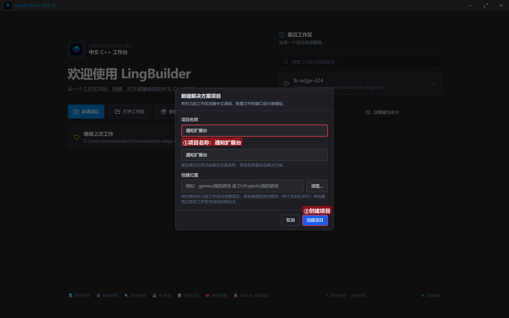
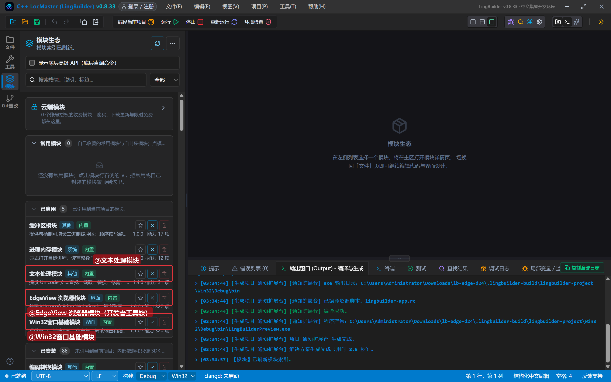
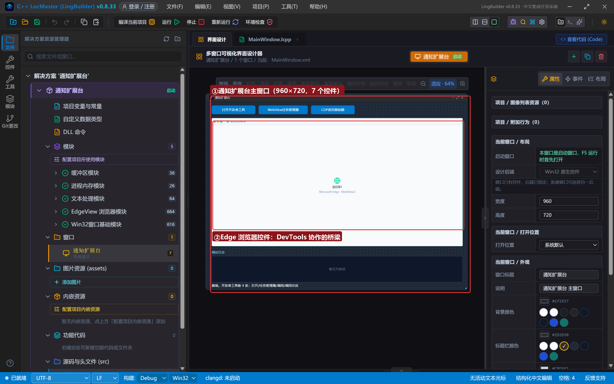
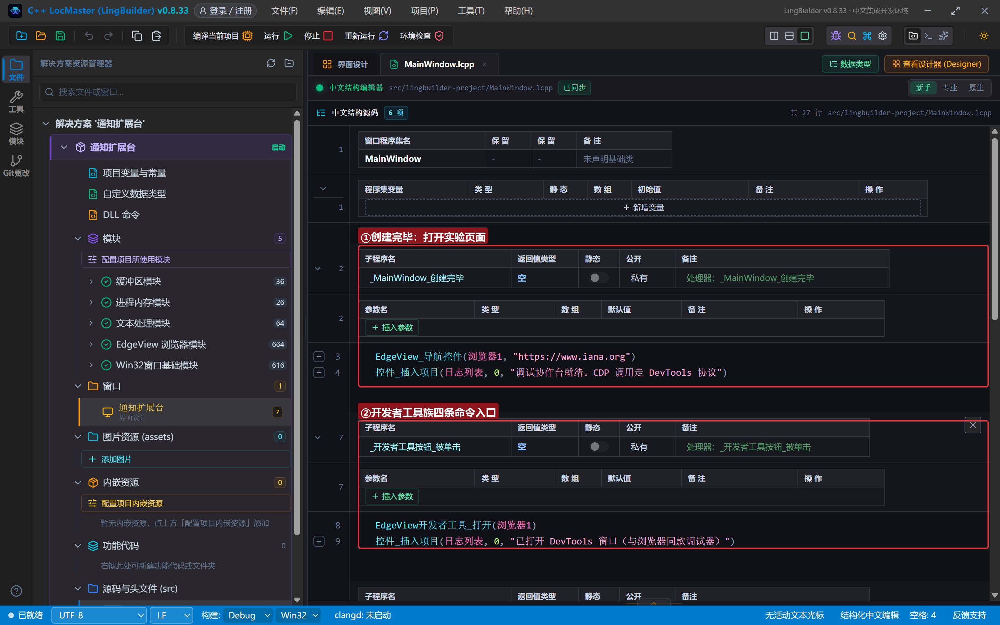
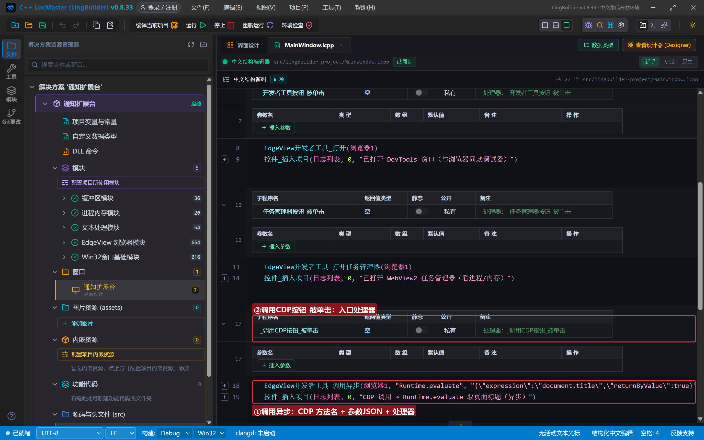
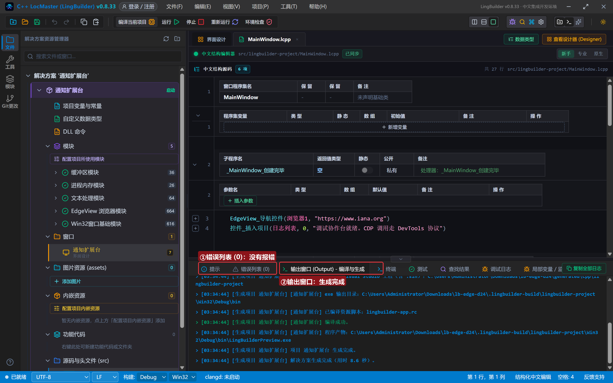
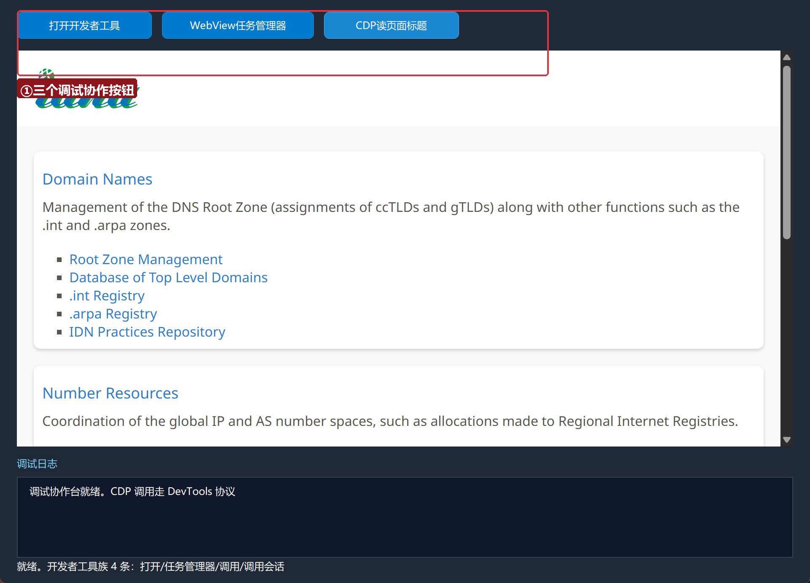
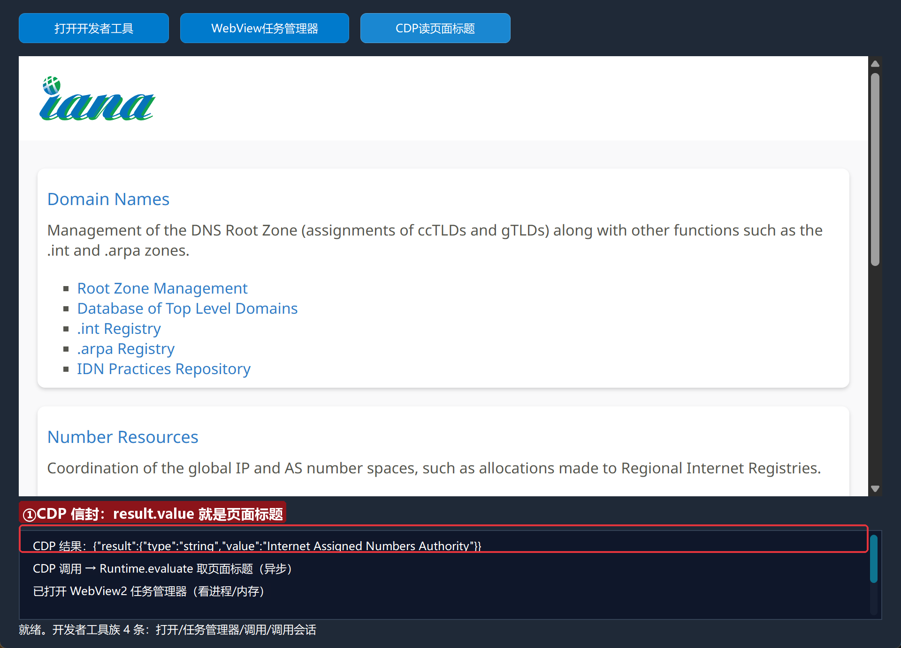

# Edge 合集 24 · 通知与扩展：开发者工具协作

> 《LingBuilder Edge 浏览器合集》第 24 集（高级篇）。大纲中的通知族/扩展族/对象族都是「进阶挂件」：通知族接管网页弹的通知、扩展族加载浏览器扩展、对象族管理受管对象生命周期——它们的共同前提是**先有对应事件/场景**。本集聚焦马上能用的**开发者工具族 4 条**：打开 DevTools、开 WebView 任务管理器、以及最强大的 `调用异步`——从中文代码里直接说 DevTools 协议（CDP）。全程约 25 分钟。
>
> 前置要求：学过[第 5 集](/guide/tutorials/edge-05)（异步任务）。本集源码包见文末。

## 这一集你将学会

- `EdgeView开发者工具_打开(控件)`：打开与浏览器同款的 DevTools 窗口
- `EdgeView开发者工具_打开任务管理器(控件)`：看 WebView2 进程/内存
- `EdgeView开发者工具_调用异步(控件, 方法, 参数JSON, &处理器)`：直说 CDP
- 通知/扩展/对象三族的能力边界与前置条件

## 1. 开发者工具族地图 + 三族边界

| 族 | 命令 | 前置条件 |
| --- | --- | --- |
| 开发者工具 | 打开 / 打开任务管理器 / 调用异步 / 调用会话异步 | 无（随时可用） |
| 通知 | 取信息JSON / 报告已显示 / 报告单击 / 报告关闭 | 需绑「网页通知收到」事件 |
| 扩展 | 安装异步 / 枚举异步 / 置启用异步 / 删除异步 | 扩展目录含 manifest.json；需创建期开「浏览器扩展」 |
| 对象 | 取状态JSON / 释放 / 取文件路径 / 创建文件系统句柄 | 句柄来自事件或创建命令 |

CDP 调用是「万能后门」：DevTools 协议里的任何方法都能调（`Runtime.evaluate` 执行脚本、`Page.captureScreenshot` 截图、`Network.*` 看网络……），参数与返回都是 JSON。

## 2. 新建项目与启用模块

欢迎页「新建项目」，项目名称 **通知扩展台**，「Windows 界面设计」：



模块确认三个已启用：**EdgeView 浏览器模块**、**文本处理模块**、**Win32窗口基础模块**：



## 3. 设计界面

| 控件 | 名称 | 显示内容 | 左距 | 顶距 | 宽度 | 高度 |
| --- | --- | --- | --- | --- | --- | --- |
| 按钮 | 开发者工具按钮 | 打开开发者工具 | 20 | 14 | 160 | 32 |
| 按钮 | 任务管理器按钮 | WebView任务管理器 | 192 | 14 | 180 | 32 |
| 按钮 | 调用CDP按钮 | CDP读页面标题 | 384 | 14 | 160 | 32 |
| **Edge浏览器** | **浏览器1** | （拖入） | 20 | 60 | 920 | 470 |
| 标签 | 日志标题 | 调试日志 | 20 | 542 | 120 | 20 |
| 列表框 | 日志列表 | （清空） | 20 | 566 | 920 | 96 |
| 标签 | 状态标签 | 就绪。开发者工具族 4 条：打开/任务管理器/调用/调用会话 | 20 | 664 | 920 | 20 |



## 4. 写代码

### 4.1 打开页面

```lcpp
事件 _MainWindow_创建完毕()
    EdgeView_导航控件(浏览器1, "https://www.iana.org")
    控件_插入项目(日志列表, 0, "调试协作台就绪。CDP 调用走 DevTools 协议")
结束
```



### 4.2 CDP 调用：中文代码直说协议

```lcpp
事件 _调用CDP按钮_被单击()
    EdgeView开发者工具_调用异步(浏览器1, "Runtime.evaluate", "{\"expression\":\"document.title\",\"returnByValue\":true}", &CDP完成)
    控件_插入项目(日志列表, 0, "CDP 调用 → Runtime.evaluate 取页面标题（异步）")
结束

事件 CDP完成()
    控件_插入项目(日志列表, 0, "CDP 结果：" + EdgeView任务_取结果(EdgeView任务_取当前任务ID()))
结束
```

三个要点：方法名是 CDP 原名（`Runtime.evaluate`）；参数是**JSON 文本**（中文代码里双引号写成 `\"`）；结果是 **CDP 信封 JSON**——页面标题在 `result.value` 里（第 7 集的拆信封套路直接适用）。



## 5. 编译：先看错误列表

错误列表 (0)，输出窗口「生成完成」：



## 6. 运行：三个调试利器

点「运行」：



### 6.1 CDP 读页面标题

点「CDP读页面标题」——日志给出信封：`{"result":{"type":"string","value":"Internet Assigned Numbers Authority"}}`：



### 6.2 打开 DevTools 与任务管理器

「打开开发者工具」弹出同款调试器；「WebView任务管理器」展示所有 WebView2 进程的内存/CPU：

（真机截图已录，窗口在主窗口外，正文以文字描述为主。）

## 常见问题急救表

| 症状 | 原因 | 解法 |
| --- | --- | --- |
| CDP 结果是一大串信封 JSON | 返回即信封 | 按 result.value 拆字段（第 7 集套路） |
| 参数JSON 传了没反应 | 键名不是驼峰或非法 JSON | 先在文本工具校验 JSON |
| 扩展安装返回 0 | 目录没有 manifest.json，或创建期没开扩展 | 准备扩展目录 + 创建期选项开浏览器扩展 |
| 通知事件收不到 | 页面没申请通知权限 | 页面先 Notification.requestPermission |
| 编译报「未知的命令 EdgeView开发者工具_打开」 | EdgeView 模块没启用 | 模块生态里启用 EdgeView 浏览器模块 |

## 本集小结

- 开发者工具族 4 条随时可用：打开 DevTools / 任务管理器 / CDP 调用（异步）。
- **CDP 调用是万能后门**：方法名 + 参数 JSON + 信封结果。
- 通知/扩展/对象三族各有前置（事件挂钩 / manifest+创建期 / 句柄），按需再学。

## 源码包

本集完整源码已打包为 **通知扩展台.lcpppkg**（随本教程同目录分发，官网示例源码区可下载）。在 LingBuilder 欢迎页点「打开工作区」，或直接双击 `.lcpppkg` 文件即可导入运行。

**下一集预告**：《开发者工具协作》——CDP 客户端模块配合：从独立进程远程驾驶浏览器。

[回合集总览](/guide/tutorials/edge)
