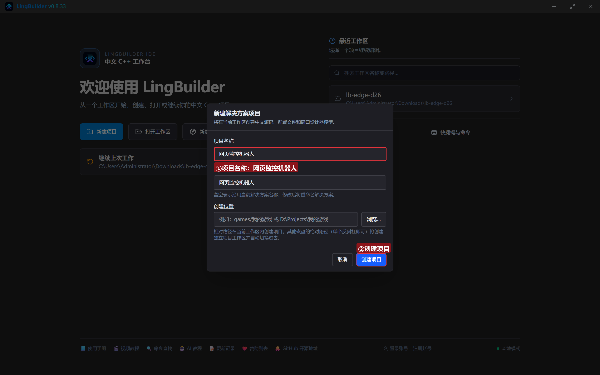
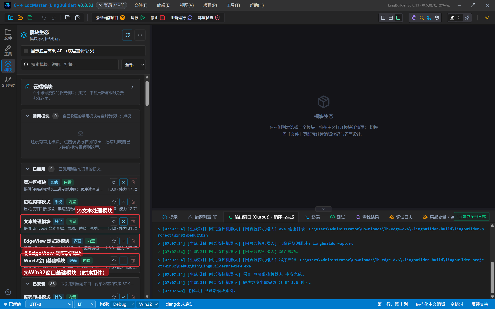
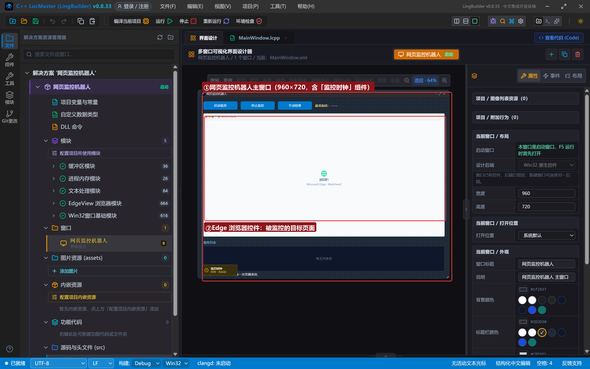
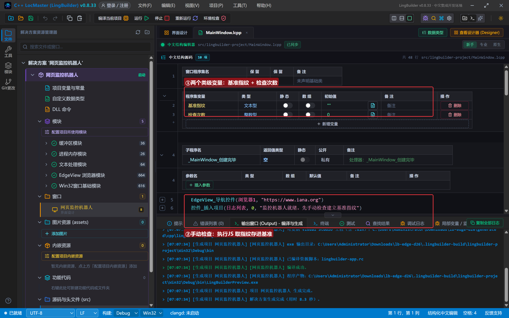
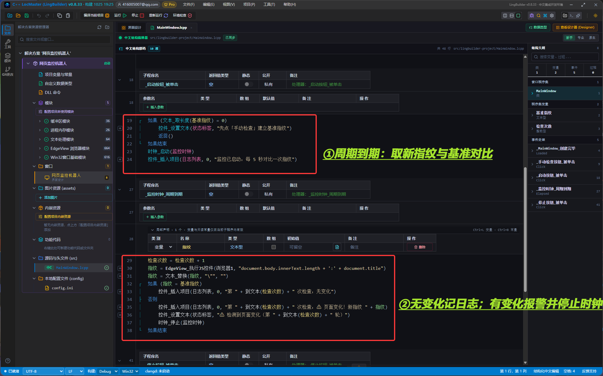
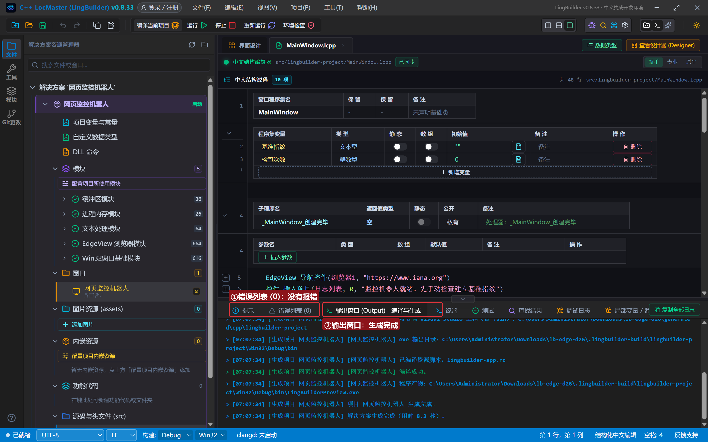
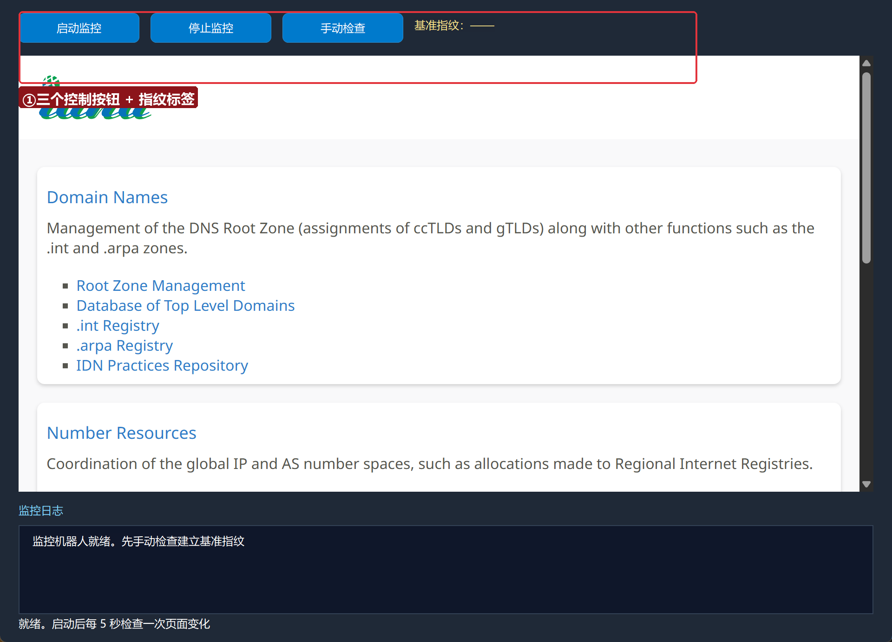
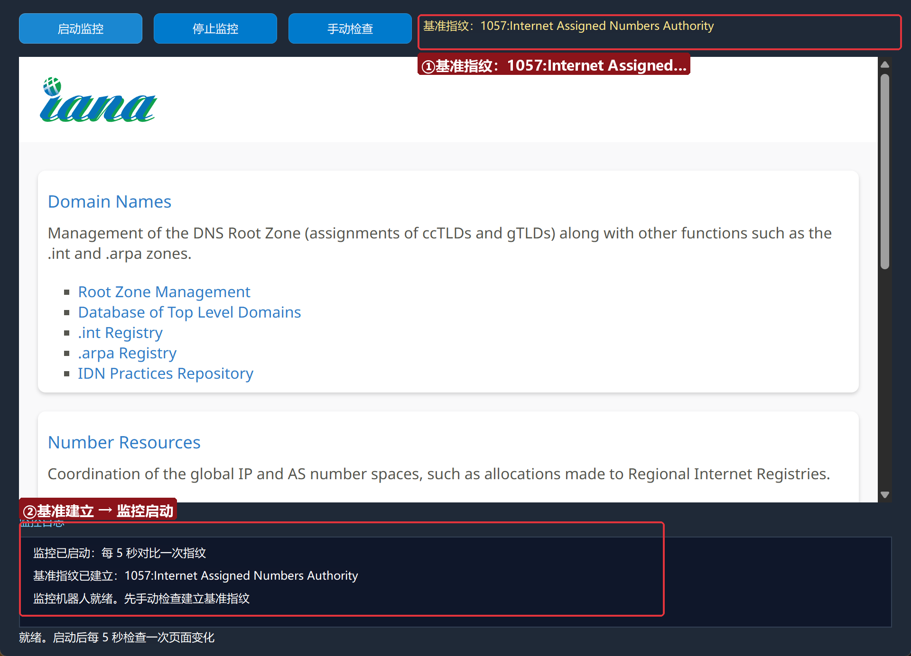
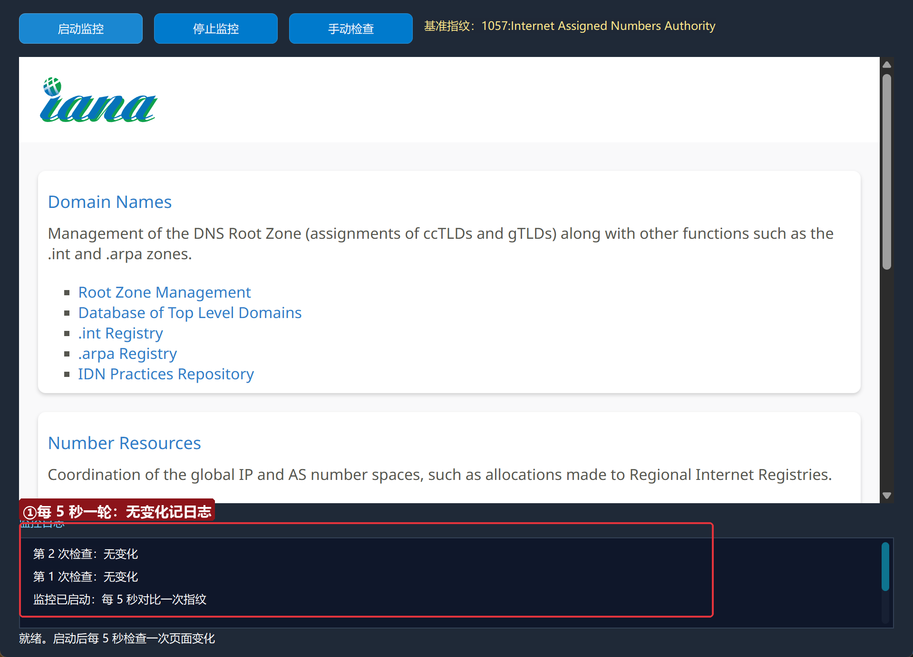
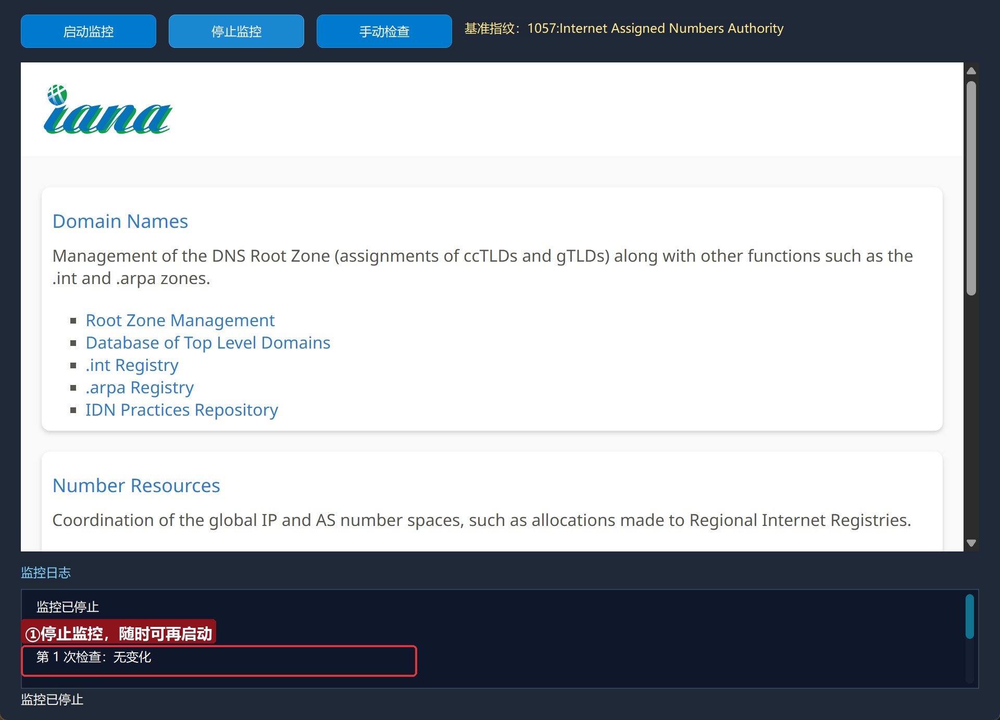

# Edge 合集 26 · 综合实战：网页监控机器人（收官集）

> 《LingBuilder Edge 浏览器合集》第 26 集（高级篇收官）。26 集所学**一锅端**：把「执行 JS 取数（第 5 集）＋时钟组件（第 11 集）＋指纹对比（第 7 集的清洗套路）」组装成一台**网页监控机器人**——定时抓取页面指纹、与基准对比、发现变化立即报警停机。这个骨架接上 CDP 无头（第 25 集）和推送（第 11 集）就能变成生产级监控。全程约 30 分钟。
>
> 前置要求：学过基础篇与高级篇核心集（5/7/11/21）。本集源码包见文末。

## 这一集将学会

- **指纹法监控**：把页面状态压成一个短字符串（长度+标题），对比即知变化
- 时钟周期 + 类级状态（基准指纹、检查次数）组成监控循环
- 变化检测的报警路径：记日志 → 改状态栏 → 停时钟（发现即停，避免刷屏）
- 综合工程的组织方式：状态变量集中、每个按钮单一职责

## 1. 监控机器人的三段式骨架

```
手动检查（一次）        时钟周期（每 5 秒）           发现变化
─────────────        ──────────────────          ──────────
执行JS取指纹    →     取新指纹 → 与基准对比    →    记日志+报警
存进基准指纹          相同：记"无变化"              停止时钟
```

指纹用 `页面文本长度 + ":" + 标题`——短、稳定、对内容变化极敏感。真实项目可以把指纹换成关键元素的文本、价格数字等。

## 2. 新建项目与启用模块

欢迎页「新建项目」，项目名称 **网页监控机器人**，「Windows 界面设计」：



模块确认三个已启用：**EdgeView 浏览器模块**、**文本处理模块**、**Win32窗口基础模块**（时钟组件在这里）：



## 3. 设计界面（含监控时钟组件）

| 控件 | 名称 | 显示内容 | 左距 | 顶距 | 宽度 | 高度 |
| --- | --- | --- | --- | --- | --- | --- |
| 按钮 | 启动按钮 | 启动监控 | 20 | 14 | 130 | 32 |
| 按钮 | 停止按钮 | 停止监控 | 162 | 14 | 130 | 32 |
| 按钮 | 手动检查按钮 | 手动检查 | 304 | 14 | 130 | 32 |
| 标签 | 指纹标签 | 基准指纹：—— | 446 | 19 | 480 | 22 |
| **Edge浏览器** | **浏览器1** | （拖入） | 20 | 60 | 920 | 470 |
| 标签 | 日志标题 | 监控日志 | 20 | 542 | 120 | 20 |
| 列表框 | 日志列表 | （清空） | 20 | 566 | 920 | 96 |
| 标签 | 状态标签 | 就绪。启动后每 5 秒检查一次页面变化 | 20 | 664 | 920 | 20 |

再加**时钟组件**「监控时钟」：周期 5000 毫秒、不自动启动、「周期到期」处理器 `_监控时钟_周期到期`。



## 4. 写代码

### 4.1 类级状态 + 建立基准

```lcpp
文本型 基准指纹 = ""
整数型 检查次数 = 0

事件 _手动检查按钮_被单击()
    局部 文本型 指纹
    指纹 = EdgeView_执行JS控件(浏览器1, "document.body.innerText.length + ':' + document.title")
    指纹 = 文本_替换(指纹, "\"", "")
    基准指纹 = 指纹
    控件_设置文本(指纹标签, "基准指纹：" + 指纹)
    控件_插入项目(日志列表, 0, "基准指纹已建立：" + 指纹)
结束
```

指纹 JS 是「数字拼接字符串」——返回 JSON 里数字没引号、字符串有，统一用 `文本_替换` 清洗（第 5 集套路）。基准指纹存类级变量，跨周期保留。



### 4.2 监控循环：对比、报警、自停

```lcpp
事件 _启动按钮_被单击()
    如果 (文本_取长度(基准指纹) = 0)
        控件_设置文本(状态标签, "先点「手动检查」建立基准指纹")
        返回()
    如果结束
    时钟_启动(监控时钟)
    控件_插入项目(日志列表, 0, "监控已启动：每 5 秒对比一次指纹")
结束

事件 _监控时钟_周期到期()
    局部 文本型 指纹
    检查次数 = 检查次数 + 1
    指纹 = EdgeView_执行JS控件(浏览器1, "document.body.innerText.length + ':' + document.title")
    指纹 = 文本_替换(指纹, "\"", "")
    如果 (指纹 = 基准指纹)
        控件_插入项目(日志列表, 0, "第 " + 到文本(检查次数) + " 次检查：无变化")
    否则
        控件_插入项目(日志列表, 0, "第 " + 到文本(检查次数) + " 次检查：⚠ 页面变化！新指纹 " + 指纹)
        控件_设置文本(状态标签, "⚠ 检测到页面变化（第 " + 到文本(检查次数) + " 轮）")
        时钟_停止(监控时钟)
    如果结束
结束

事件 _停止按钮_被单击()
    时钟_停止(监控时钟)
    控件_插入项目(日志列表, 0, "监控已停止")
    控件_设置文本(状态标签, "监控已停止")
结束
```

三处工程细节：启动前**校验基准已建立**（防呆）；变化时**先报警再停时钟**（发现即停，日志不被刷屏）；报警信息带上**轮次**便于回溯。



## 5. 编译：先看错误列表

错误列表 (0)，输出窗口「生成完成」：



## 6. 运行：机器人上岗

点「运行」：



### 6.1 建立基准并启动

点「手动检查」→「启动监控」——基准指纹上屏，监控开始：



### 6.2 监控中

每 5 秒一轮「无变化」日志——机器人安静地盯着页面：



### 6.3 停止

点「停止监控」：



## 7. 从 Demo 到生产：改造清单

1. **无头化**：把 EdgeBrowser 控件换成 `CDP_启动浏览器` + `CDP_取页面HTML`（第 25 集），机器人就能藏在后台；
2. **通知推送**：变化时调 `网页_异步访问` 打 webhook（进阶实战系列第 3 集），或企微/钉钉机器人；
3. **持久化**：基准指纹写文件（fs.core），重启程序不丢基准；
4. **多目标**：N 个无头实例 + 实例编号数组，一次盯多个页面（第 15 集套路）。

## 常见问题急救表

| 症状 | 原因 | 解法 |
| --- | --- | --- |
| 指纹每次都不同 | 页面含时间戳/轮播等动态内容 | 指纹改取「关键元素的 textContent」而非整页 |
| 启动按钮没反应 | 基准还没建立 | 先手动检查一次（程序已做防呆） |
| 变化了但没报警 | 时钟没启动或指纹清洗不一致 | 检查 时钟_启动 与两处 替换 的参数一致 |
| 想监控需登录的页面 | Cookie 不在 | 第 14 集批量注入登录态后再监控 |

## 本集小结 · 合集收官

- **指纹法**是页面监控的极简正解：状态压成短串，对比即知变化。
- 监控骨架三件套：类级状态 + 时钟周期 + 发现即停。
- 26 集路线回顾：内嵌浏览器 → 导航 → 事件 → JS → 取数 → 填表 → 查找 → 双向桥 → 无头/CDP → 会话/多开 → 下载/媒体/打印 → 综合实战。**从「把网页嵌进来」到「让网页为你打工」，这条路你已经走完了。**

## 源码包

本集完整源码已打包为 **网页监控机器人.lcpppkg**（随本教程同目录分发，官网示例源码区可下载）。在 LingBuilder 欢迎页点「打开工作区」，或直接双击 `.lcpppkg` 文件即可导入运行。

**合集完** 🎉 感谢一路同行。进阶方向：FBro 指纹浏览器合集（多账号防关联）、CEF3 合集（深度定制内核）。

[回合集总览](/guide/tutorials/edge)
