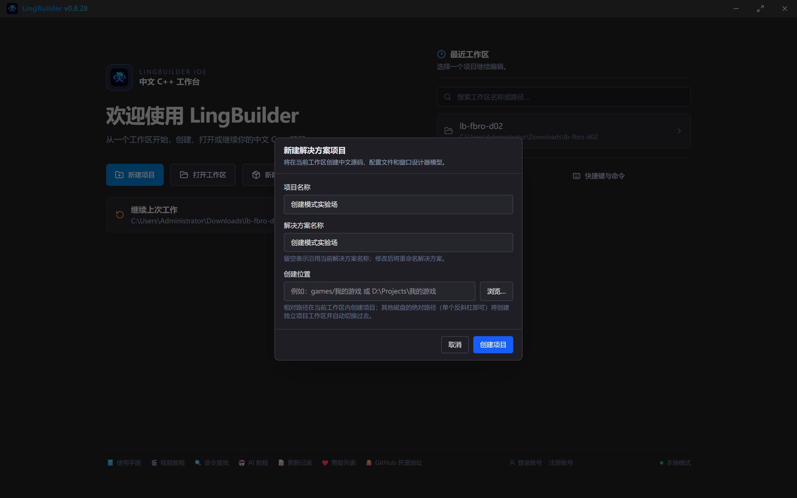
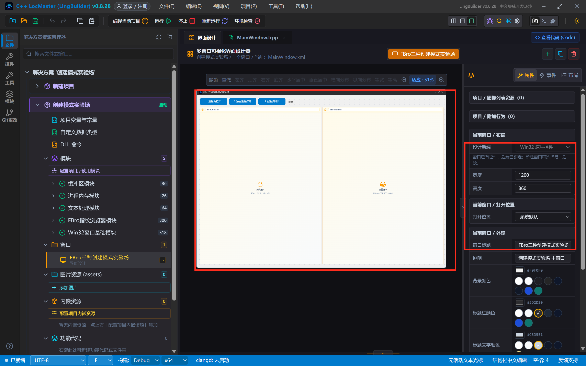
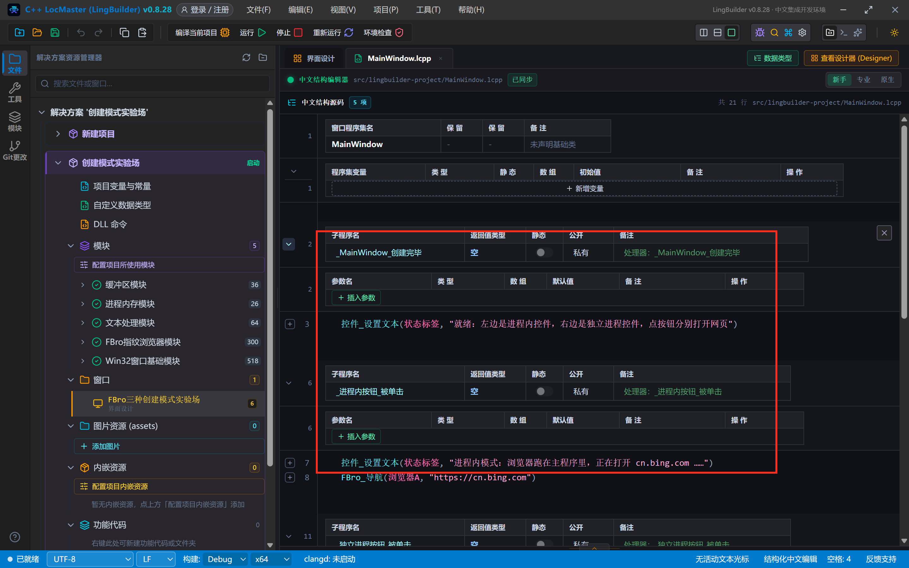
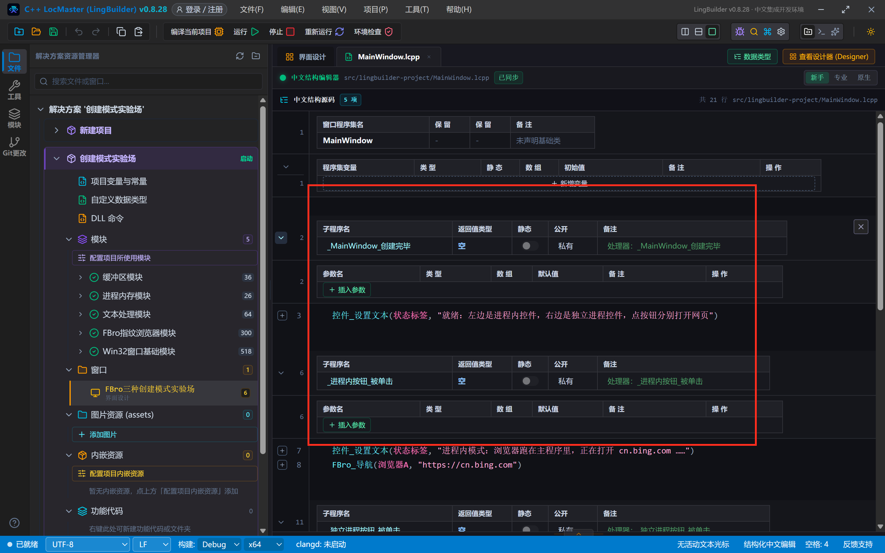
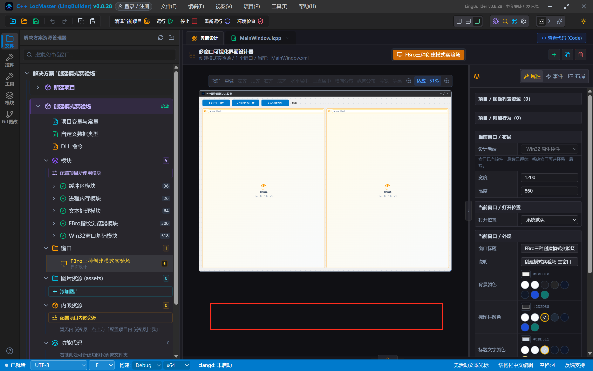
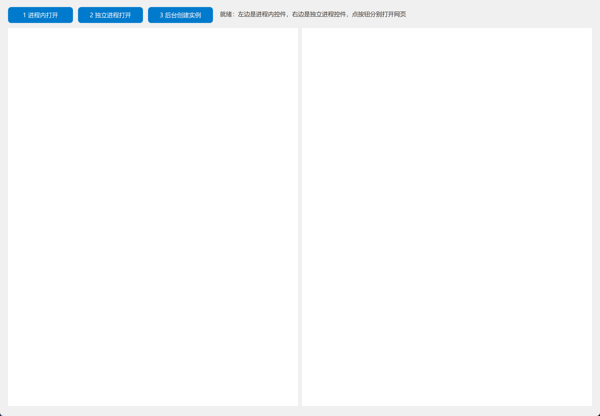
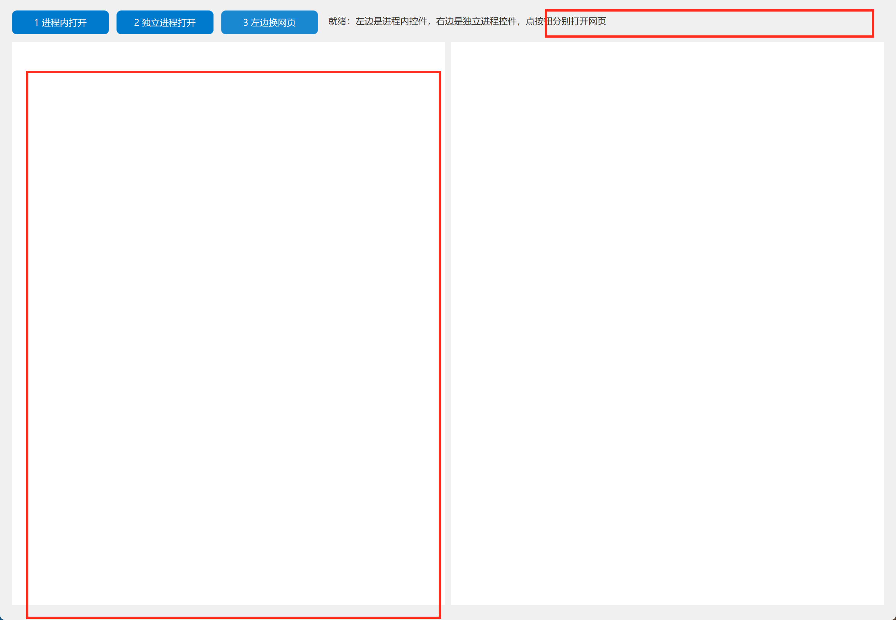
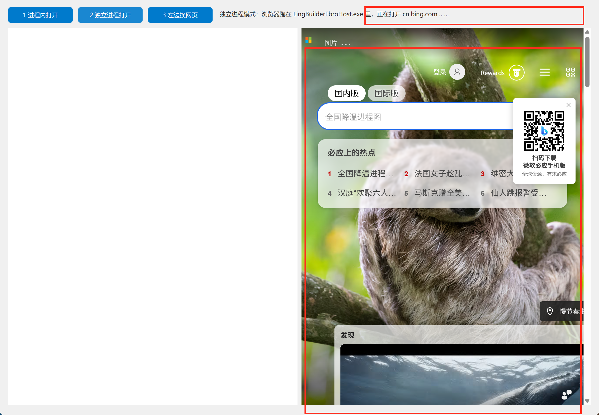
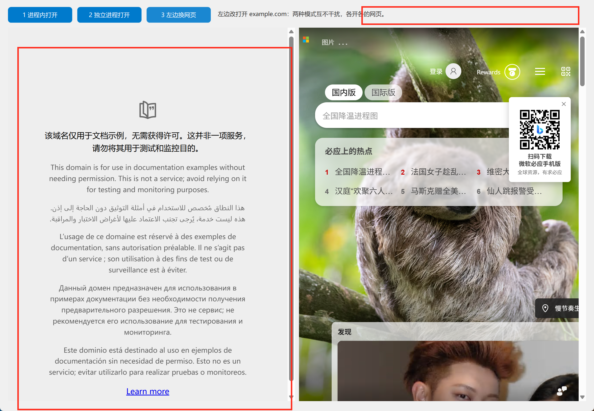
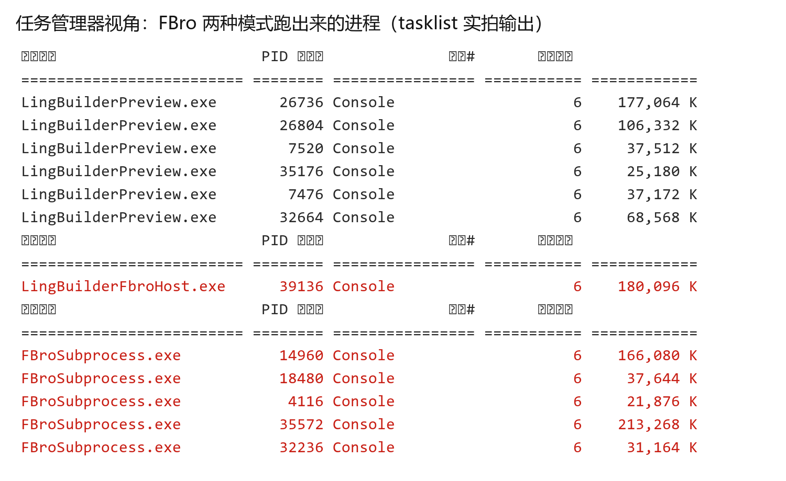

# FBro 合集 02 · 创建模式：进程内、独立进程与宿主架构

> 《LingBuilder FBro 指纹浏览器合集》第 2 集（基础篇）。上一集我们让 FBro 浏览器「跑起来」了，但它到底**跑在哪里**？本集做一个**创建模式实验场**：一个窗口里并排放两个 FBro 浏览器——左边**进程内**模式、右边**独立进程**模式，按钮一点就能对比两种架构的区别，还会用任务管理器实拍宿主进程。全程约 30 分钟。
>
> **模块获取**：FBro 指纹浏览器模块是**收费模块**（启用方式见第 1 集）。本集命令（`FBro_导航`）为非 VIP 命令，普通授权即可完整跟做。
>
> 前置要求：完成第 1 集。本集源码包见文末。

## 这一集你将学会

- FBro 的三种创建形态：**进程内**、**独立进程嵌入**、**后台创建**（各自适合什么场景）
- 控件的「**宿主模式**」属性：一行属性决定浏览器跑在哪个进程里
- `LingBuilderFbroHost.exe` 宿主进程：独立进程模式的载体，任务管理器里亲眼看到它
- 独立进程模式的实战价值：崩溃隔离、多开、指纹隔离

## 1. 先搞懂：浏览器跑在哪个进程里？

普通浏览器控件（比如第 1 集用的默认模式）是**进程内（in-process）**：浏览器内核直接加载在你的主程序进程里，像普通控件一样直接画在窗口上。优点是**省资源、启动快**；缺点也明显——内核一旦卡死或崩溃，整个程序跟着遭殃。

**独立进程**模式则把浏览器内核搬进一个专门的宿主进程 `LingBuilderFbroHost.exe`，你的窗口里只是「嵌」了它的画面。优点：

- **崩溃隔离**：浏览器崩了，主程序还活着；
- **真正的多开**：每个实例独立缓存、独立指纹（第 4 集展开）；
- 一个主程序可以带 N 个完全独立的浏览器。

两种模式怎么选？做工具、单浏览器场景用进程内就够了；做多账号、多店铺、需要隔离的场景，一律独立进程。

> 还有个第三形态「**后台创建**」（`FBro_后台创建`）：连窗口都不要，纯代码拉起一个看不见的浏览器实例去干活（取数、挂机）。它属于 FBro 的**无头家族**，和窗口里可见的 FBroBrowser 控件**进程级互斥**——同一个程序里声明了无头模式，可见的进程内浏览器就不再渲染内容。所以本集实验场不演示它，等大家学到进阶篇再说。

## 2. 新建项目

欢迎页点「新建项目」，项目名称填 **创建模式实验场**，模板选「Windows 界面设计」，点「创建项目」：



## 3. 设计界面：并排两个浏览器

窗口 1200×860。从控件面板拖 **两个 FBro浏览器** 进窗口，关键区别在属性面板的「**宿主模式**」：

| 控件 | 名称 | 宿主模式 | 左距 | 顶距 | 宽度 | 高度 |
| --- | --- | --- | --- | --- | --- | --- |
| 按钮 | 进程内按钮 / 独立进程按钮 / 后台创建按钮 | —（三个并排放在顶部） | 16 / 156 / 296 | 14 | 130 | 32 |
| 标签 | 状态标签 | — | 440 | 20 | 740 | 22 |
| FBro浏览器 | 浏览器A | **进程内**（默认） | 16 | 56 | 580 | 756 |
| FBro浏览器 | 浏览器B | **独立进程嵌入** | 604 | 56 | 580 | 756 |

选中「浏览器B」后在右侧属性面板把「宿主模式」改为**独立进程嵌入**——这就是本集唯一的关键设置：



注意两个浏览器的「打开地址」都留空：我们要用按钮控制它们什么时候打开什么网页，而不是一启动就自动加载。

## 4. 写代码

四个事件，全部用上一集学过的 `FBro_导航`，没有任何新命令：

上半部分（创建完毕 + 进程内按钮）：



下半部分（独立进程按钮 + 第三个按钮）：



```
类 MainWindow
    事件 _MainWindow_创建完毕()
        控件_设置文本(状态标签, "就绪：左边是进程内控件，右边是独立进程控件，点按钮分别打开网页")
    结束

    事件 _进程内按钮_被单击()
        控件_设置文本(状态标签, "进程内模式：浏览器跑在主程序里，正在打开 cn.bing.com ……")
        FBro_导航(浏览器A, "https://cn.bing.com")
    结束

    事件 _独立进程按钮_被单击()
        控件_设置文本(状态标签, "独立进程模式：浏览器跑在 LingBuilderFbroHost.exe 里，正在打开 cn.bing.com ……")
        FBro_导航(浏览器B, "https://cn.bing.com")
    结束

    事件 _后台创建按钮_被单击()
        控件_设置文本(状态标签, "左边改打开 example.com：两种模式互不干扰，各开各的网页。")
        FBro_导航(浏览器A, "https://example.com")
    结束
结束类
```

看清楚：**两个浏览器的代码写法完全一样**——`FBro_导航(浏览器A, …)` 和 `FBro_导航(浏览器B, …)`。架构差异全部由设计器里那个「宿主模式」属性决定，代码层不需要关心。这是 FBro 模块设计得很舒服的地方：**换模式零改码**。

## 5. 编译前先看错误列表

照例先看底部「错误列表」，确认 0 报错再点「编译当前项目」：



## 6. 运行：两种模式面对面

启动程序，两个浏览器都是空白的，状态栏提示你点按钮：



点「1 进程内打开」：左边（浏览器A，进程内）加载出必应首页，右边还是空白：



再点「2 独立进程打开」：右边（浏览器B，独立进程）也加载出必应——注意它第一次会慢几秒，因为 Windows 要先把宿主进程 `LingBuilderFbroHost.exe` 拉起来：



最后点「3 左边换网页」：左边导航到 example.com，右边纹丝不动——**两个浏览器互不干扰，各开各的网页**：



## 7. 任务管理器实拍：宿主进程真的存在

程序运行时打开任务管理器（或命令行跑 `tasklist`），能看到：

- `LingBuilderPreview.exe`——你的主程序（进程内浏览器就活在它身体里）；
- `LingBuilderFbroHost.exe`——**独立进程模式的宿主**，右边那个浏览器的家；
- `FBroSubprocess.exe` ×若干——Chromium 的渲染/网络子进程（每个浏览器实例一组）。



这张图就是「独立进程」四个字的字面意思：浏览器内核根本不在你的 exe 里，而在旁边这栋「宿舍楼」里。以后做多账号矩阵（第 29 集的终极实战），每个账号一间「宿舍」——独立缓存、独立指纹、独立代理，互不串门。

## 8. 红线与坑（本集实测）

- **「宿主模式」属性的生效时机**：它在浏览器创建时生效。程序运行中途改不了——要换模式就改属性重新编译。
- **独立进程首开偏慢**：宿主进程冷启动要几秒（还要过一遍 Windows 防火墙，第一次弹窗请点「允许」）。自动化测试时按「页面出现」轮询，不要按固定秒数硬等。
- **后台创建（无头家族）与可见控件互斥**：同一程序里两者不能共存。报「进程内浏览器不渲染」时，第一件事查是不是混用了无头声明。
- **`FBro_关闭(控件名)` 释放实例后画面不会立刻清空**：进程内模式关闭后残留在最后一帧画面上是正常现象，重新 `FBro_导航` 即恢复。

## 9. 源码包

本集完整工程：[FBro合集02-创建模式实验场.lcpppkg](https://www.lingbuilder.com/demos/fbro-02/FBro合集02-创建模式实验场.lcpppkg)，欢迎页「导入项目」即可打开。预览图：


## 下集预告

**03 集 · 导航与页面事件**：页面加载完成、标题变化、地址跳转……浏览器里发生的每件事都能通知你的代码。我们做一个「页面事件观察器」，把 FBro 的事件族第一次用起来。
