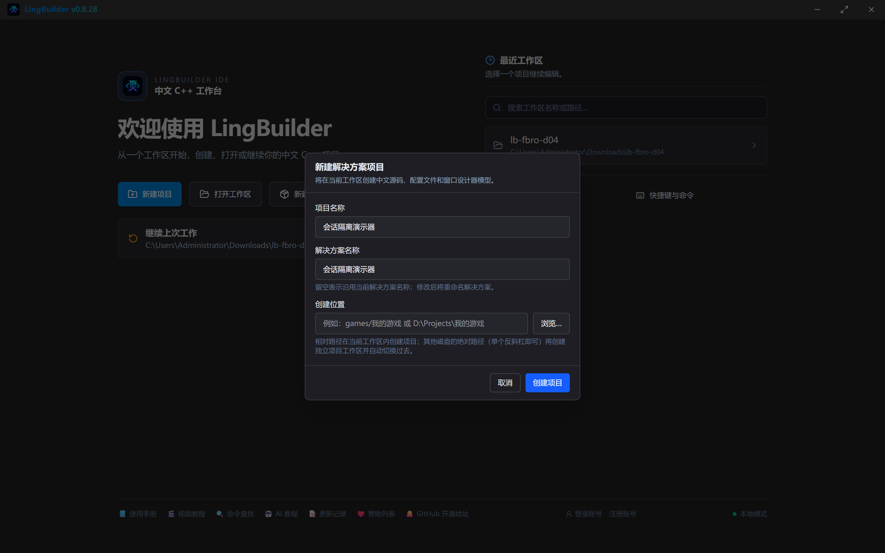
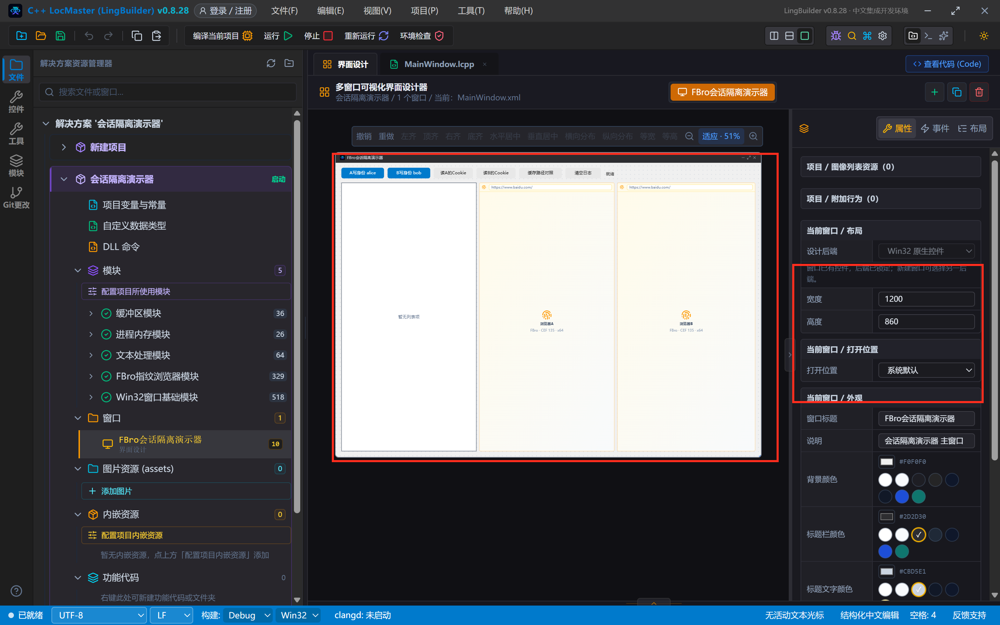
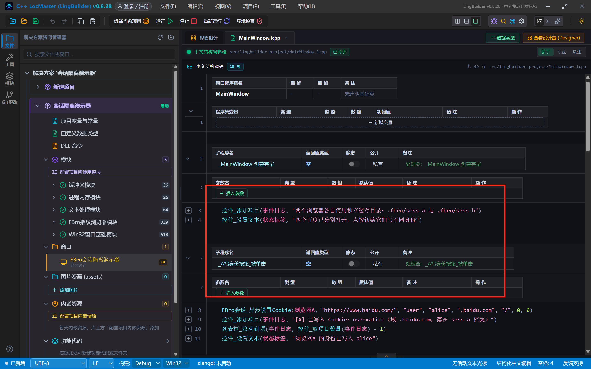
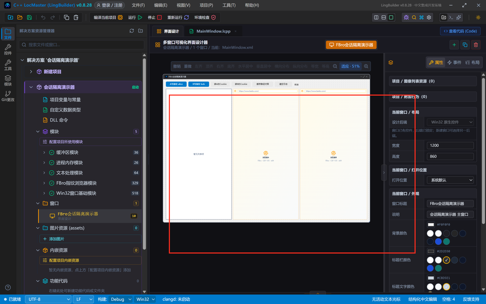
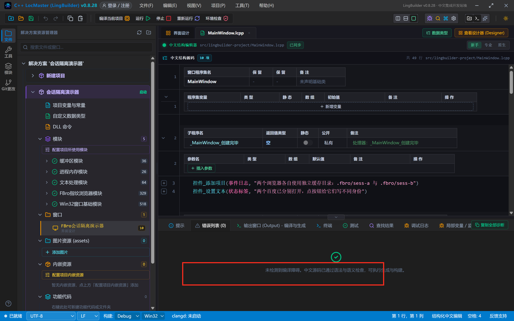
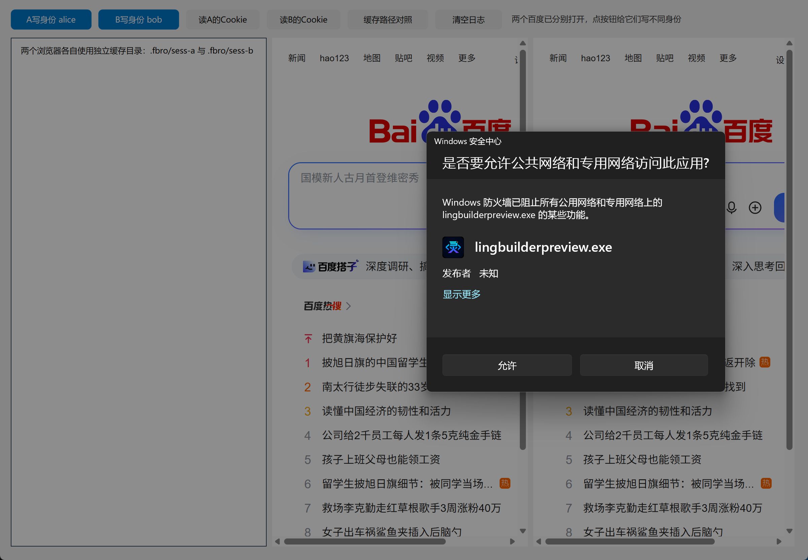
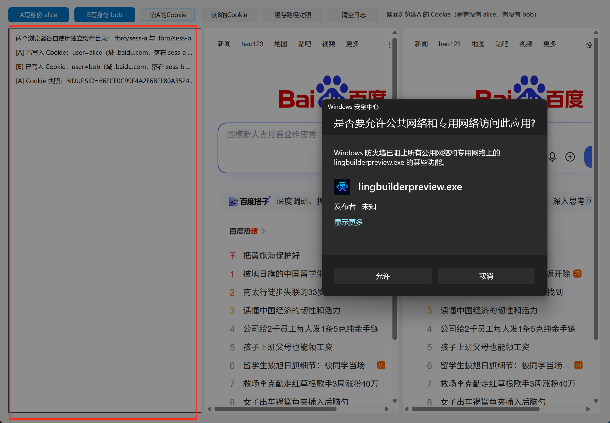
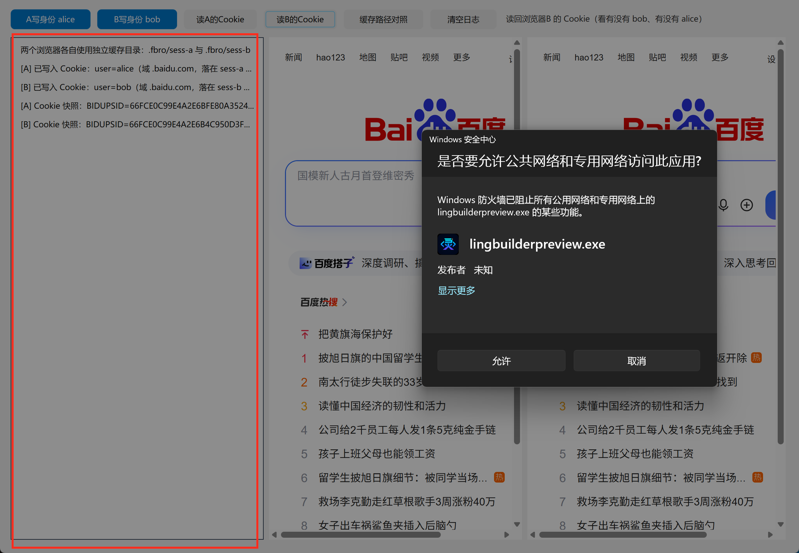
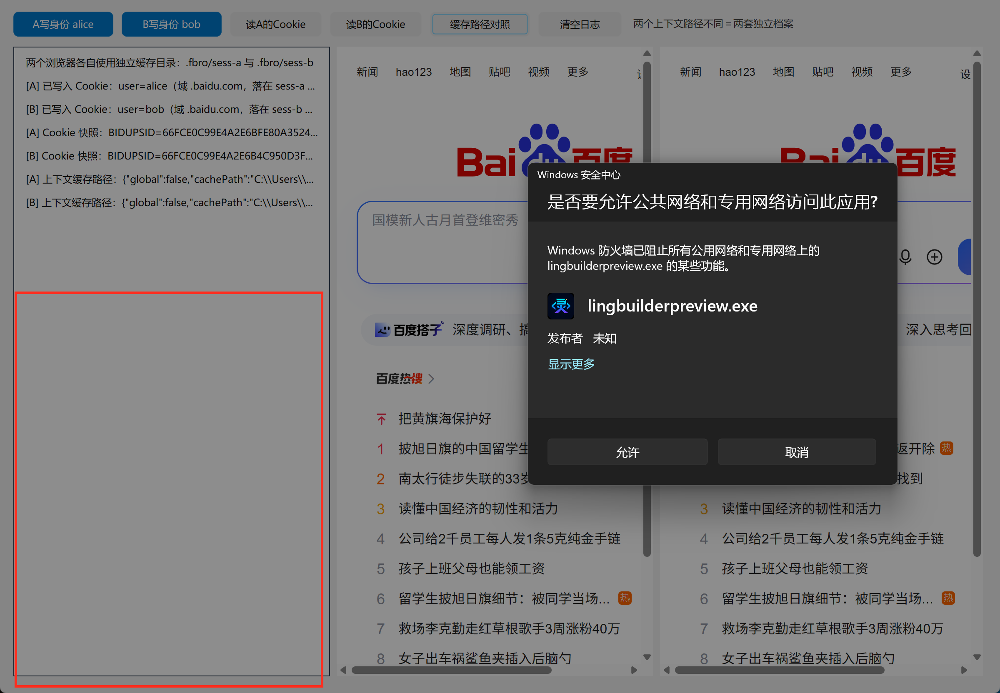

# FBro 合集 04 · 会话隔离与独立缓存目录：多开的第一块地基

> 《LingBuilder FBro 指纹浏览器合集》第 4 集（基础篇收官）。普通浏览器开十个窗口，登录的还是同一个账号——因为它们**共用一套 Cookie 和缓存**。指纹浏览器的多开防关联，第一步就是让每个浏览器有**自己的一套档案**。本集做一个「会话隔离演示器」：两个浏览器各写一个身份 Cookie，再互相读给对方看——**谁也看不见谁**。全程约 35 分钟。
>
> **模块获取**：FBro 指纹浏览器模块是**收费模块**（启用方式见第 1 集）。本集用到 `FBro会话_*` 命令（会话模块，非 VIP），普通授权即可完整跟做。
>
> 前置要求：完成第 1~3 集。本集源码包见文末。

## 这一集你将学会

- **缓存目录（cacheDir）属性**：一行属性给每个浏览器一套独立档案
- `FBro会话_异步设置Cookie`：给指定浏览器写入身份 Cookie
- `FBro会话_取Cookie`：读回 Cookie 快照，亲眼验证「A 看不到 B」
- `FBro会话_取上下文缓存路径`：拿到两个浏览器各自的物理档案路径
- 会话族的完整版图：Cookie 读写删、缓存清理、独立上下文（15 条命令）

## 1. 先搞懂：什么叫「一套档案」？

浏览器在你硬盘上存着一堆东西：Cookie（登录态）、LocalStorage、缓存图片、历史记录……它们都落在**一个目录**里。普通浏览器多开窗口＝同住一间房，谁的东西放哪大家都知道。

FBro 的做法：**每个浏览器实例指定自己的「缓存目录」**（cacheDir），档案各放各的屋：

```
.fbro/sess-a/   ← 浏览器A 的全部 Cookie、缓存、存储
.fbro/sess-b/   ← 浏览器B 的全部 Cookie、缓存、存储
```

效果：A 登录了淘宝，B 完全不知道；A 存了网页密码，B 用不上。**这就是多账号互不关联的第一块地基**——第 7 集往上加指纹、第 8 集再加代理，才拼成完整的「防关联」。

反过来，如果你**要**两个浏览器共享登录态（比如一个登录、一个干活），让它们的 cacheDir 写同一个目录就行。

## 2. 新建项目

项目名称填 **会话隔离演示器**，模板「Windows 界面设计」：



## 3. 设计界面：两个浏览器各带各的档案

窗口 1200×860：左边日志，中间浏览器A，右边浏览器B。**关键差异只在「缓存目录」属性**：

| 控件 | 名称 | 缓存目录（关键属性） | 位置尺寸 |
| --- | --- | --- | --- |
| 按钮×6 | A写身份 / B写身份 / 读A的Cookie / 读B的Cookie / 缓存路径对照 / 清空日志 | — | 顶距 14 一排 |
| 标签 | 状态标签 | — | 760,20 |
| 列表框 | 事件日志 | — | 16,56 380×756 |
| FBro浏览器 | 浏览器A | **`.fbro/sess-a`** | 404,56 380×756 |
| FBro浏览器 | 浏览器B | **`.fbro/sess-b`** | 792,56 388×756 |

两个浏览器的「打开地址」都是百度首页（等会拿百度的域名做 Cookie 实验）：



注意右下属性面板：选中浏览器A 时能看到「缓存目录」＝ `.fbro/sess-a`——**本集的教学点全在这一行属性上**。

## 4. 写代码

本集要启用**FBro会话模块**（项目里 enabledModuleIds 已含 `lingbuilder.fbro.session`；手动启用方式：模块页搜索「FBro会话」点启用）。

**写入身份**——给两个浏览器各写一个 Cookie（名字 user，值分别是 alice / bob，域 `.baidu.com`）：



**读取与对照**——读回 Cookie 快照、查上下文缓存路径：



完整代码：

```
类 MainWindow
    事件 _MainWindow_创建完毕()
        控件_添加项目(事件日志, "两个浏览器各自使用独立缓存目录：.fbro/sess-a 与 .fbro/sess-b")
        控件_设置文本(状态标签, "两个百度已分别打开，点按钮给它们写不同身份")
    结束

    事件 _A写身份按钮_被单击()
        FBro会话_异步设置Cookie(浏览器A, "https://www.baidu.com/", "user", "alice", ".baidu.com", "/", 0, 0)
        控件_添加项目(事件日志, "[A] 已写入 Cookie：user=alice（域 .baidu.com，落在 sess-a 档案）")
        列表框_滚动到项(事件日志, 控件_取项目数量(事件日志) - 1)
        控件_设置文本(状态标签, "浏览器A 的身份已写入 alice")
    结束

    事件 _B写身份按钮_被单击()
        FBro会话_异步设置Cookie(浏览器B, "https://www.baidu.com/", "user", "bob", ".baidu.com", "/", 0, 0)
        控件_添加项目(事件日志, "[B] 已写入 Cookie：user=bob（域 .baidu.com，落在 sess-b 档案）")
        列表框_滚动到项(事件日志, 控件_取项目数量(事件日志) - 1)
        控件_设置文本(状态标签, "浏览器B 的身份已写入 bob")
    结束

    事件 _读A按钮_被单击()
        局部 文本型 结果
        结果 = FBro会话_取Cookie(浏览器A, "https://www.baidu.com/")
        控件_添加项目(事件日志, "[A] Cookie 快照：" + 结果)
        列表框_滚动到项(事件日志, 控件_取项目数量(事件日志) - 1)
        控件_设置文本(状态标签, "读回浏览器A 的 Cookie（看有没有 alice、有没有 bob）")
    结束

    事件 _读B按钮_被单击()
        局部 文本型 结果
        结果 = FBro会话_取Cookie(浏览器B, "https://www.baidu.com/")
        控件_添加项目(事件日志, "[B] Cookie 快照：" + 结果)
        列表框_滚动到项(事件日志, 控件_取项目数量(事件日志) - 1)
        控件_设置文本(状态标签, "读回浏览器B 的 Cookie（看有没有 bob、有没有 alice）")
    结束

    事件 _缓存路径按钮_被单击()
        控件_添加项目(事件日志, "[A] 上下文缓存路径：" + FBro会话_取上下文缓存路径(浏览器A))
        控件_添加项目(事件日志, "[B] 上下文缓存路径：" + FBro会话_取上下文缓存路径(浏览器B))
        列表框_滚动到项(事件日志, 控件_取项目数量(事件日志) - 1)
        控件_设置文本(状态标签, "两个上下文路径不同＝两套独立档案")
    结束

    事件 _清空按钮_被单击()
        控件_清空项目(事件日志)
        控件_设置文本(状态标签, "日志已清空")
    结束
结束类
```

`FBro会话_异步设置Cookie` 的参数逐个解释：控件名（写给谁）、地址+域（Cookie 归属哪个网站域，这里用 `.baidu.com` 对所有百度子域生效）、名称/值（身份对）、路径（`/` 全站）、安全/仅HTTP（0 = 普通Cookie，HttpOnly 标志先关）。

## 5. 编译前先看错误列表

照例确认 0 报错再编译：



## 6. 运行：写入两个身份，然后互相偷看

启动程序，两个百度并排打开，日志提示两套缓存目录已就位：



先点「A写身份 alice」再点「B写身份 bob」，然后点「读A的Cookie」。日志打出浏览器A 的完整 Cookie 串——结尾是 **`user=alice`**，整串里**找不到 bob**：



再点「读B的Cookie」——结尾是 **`user=bob`**，整串里**找不到 alice**。两个浏览器谁也看不见谁的身份：



仔细看还能发现一个细节：A 和 B 的 Cookie 串里**连百度自己发的 `BAIDUID` 都不一样**（A 是 `…E6B02D4C…`，B 是 `…E6B42E66…`）——因为访问百度时它们就是两套档案，百度把它们当成两个独立的访客。这就是「隔离」的彻底程度。

最后点「缓存路径对照」，把两个浏览器的档案物理路径打出来看：



JSON 里 `global:false` 说明都不是全局共享上下文；`cachePath` 一个落在 `profile-sess-a-…`、一个落在 `profile-sess-b-…`——**两个真实存在的独立目录**。你的多账号矩阵就从这两个目录开始。

## 7. 会话族命令版图（15 条速览）

本集用了 3 条，整个会话族还有这些（后续集数用到再展开）：

| 命令 | 作用 |
| --- | --- |
| `FBro会话_取Cookie` / `异步取地址Cookie` / `异步取全部Cookie` | 读 Cookie（快照式 / 任务式 JSON） |
| `FBro会话_异步设置Cookie` | 写 Cookie（本集） |
| `FBro会话_异步删除Cookie` / `清空Cookie` | 删单个 / 清一批 |
| `FBro会话_异步刷新Cookie存储` | 把 Cookie 立刻刷进磁盘档案 |
| `FBro会话_设置代理认证` | 给隔离会话配带密码的代理（第 8 集） |
| `FBro会话_异步清理缓存` / `异步清理全局缓存` | 清实例缓存 / 清全局缓存 |
| `FBro会话_是否全局上下文` / `取上下文缓存路径` | 查档案归属（本集） |
| `FBro会话_创建上下文` / `使用上下文重建` | 运行时动态换档案（进阶） |

## 8. 红线与坑（本集实测）

- **`clearAllData:true` 类清理只用于槽位重置**：独立缓存目录里要保登录态，就不要随手清全局缓存——会把别的实例档案一起端掉。
- **设置 Cookie 是异步的**：`FBro会话_异步设置Cookie` 返回的是任务号不是结果。本集靠「按钮人肉分隔」自然等到了落库；写自动化时要等任务完成（或延时）再读。
- **`FBro会话_取Cookie` 返回的是桥接层最近快照**：刚写完立刻读可能读到旧值，访问一次目标站点再读最稳。
- **同一个网站在两个档案里是两个「访客」**：服务端给的 Cookie（如 BAIDUID）也会各自一份——做账号矩阵时这是期望行为，做「共享登录」时就要改用同一 cacheDir。

## 9. 源码包

本集完整工程：[FBro合集04-会话隔离演示器.lcpppkg](https://www.lingbuilder.com/demos/fbro-04/FBro合集04-会话隔离演示器.lcpppkg)，欢迎页「导入项目」即可打开。预览图：


## 基础篇收官

到这里基础篇 4 集完成：你已经会创建 FBro 浏览器（01）、分清三种宿主模式（02）、用事件接住浏览器的一举一动（03）、用独立缓存目录把多开档案分开（04）。接下来「指纹与多开篇」将往上加第二块地基——**指纹伪装**（05~10 集），敬请期待。
