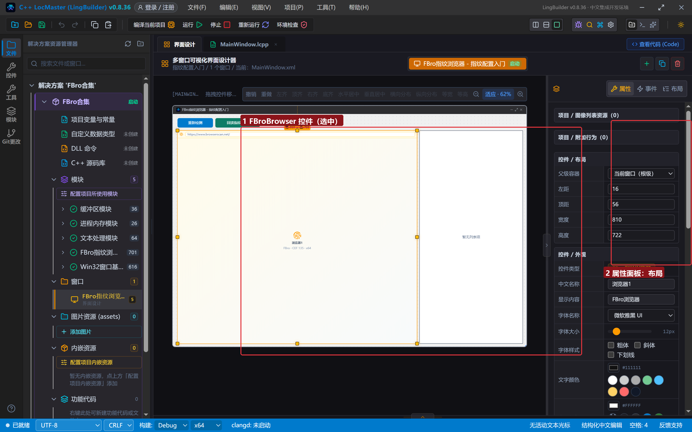
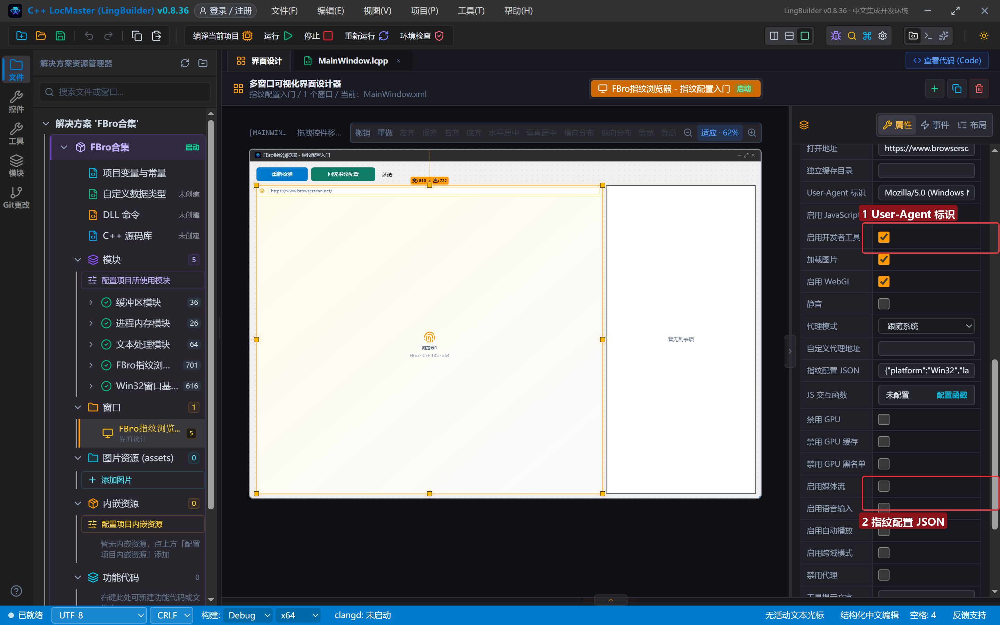
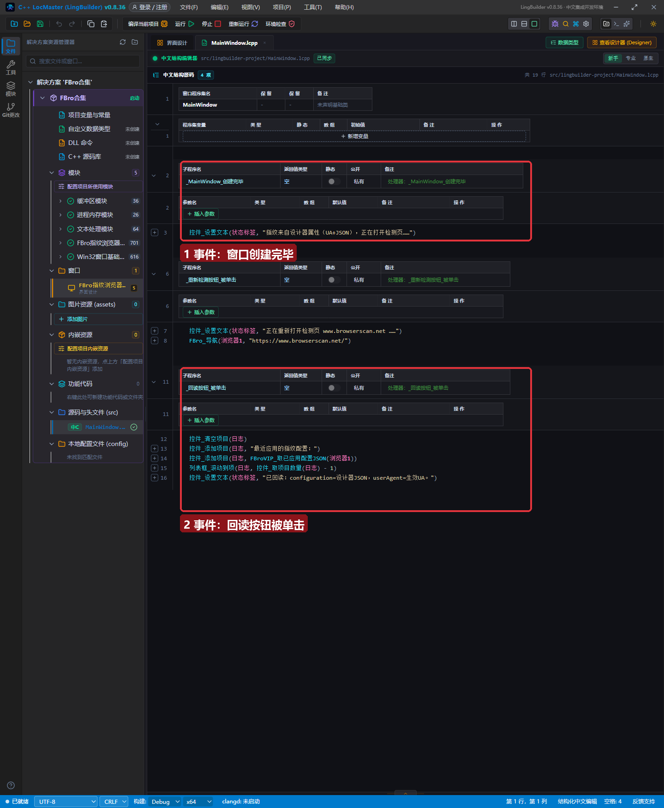
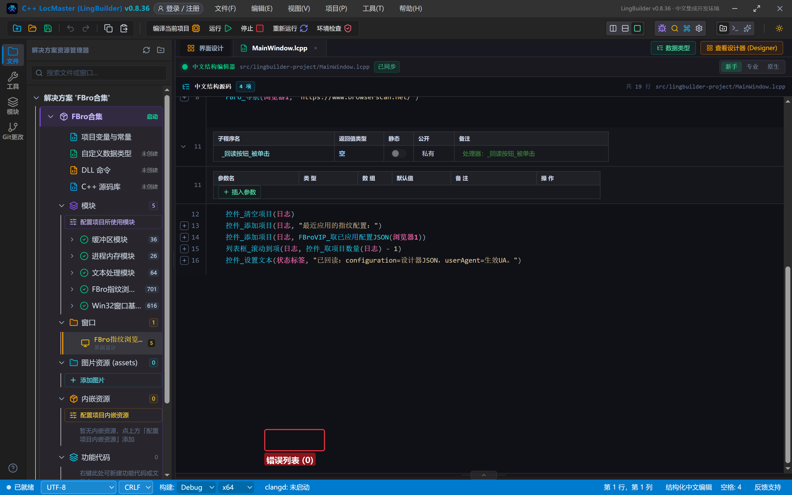
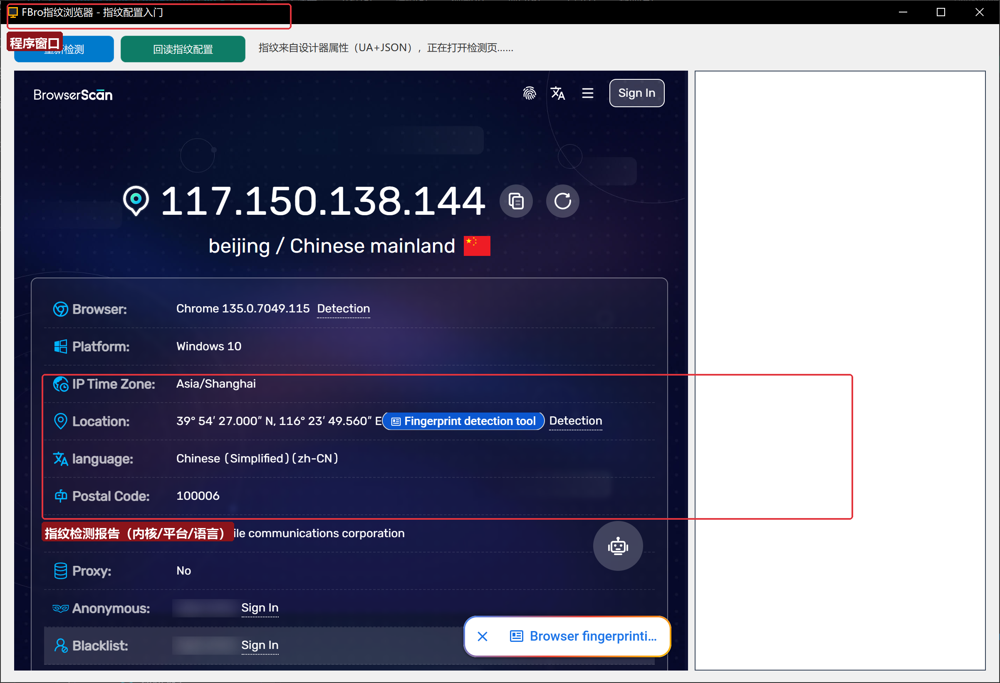
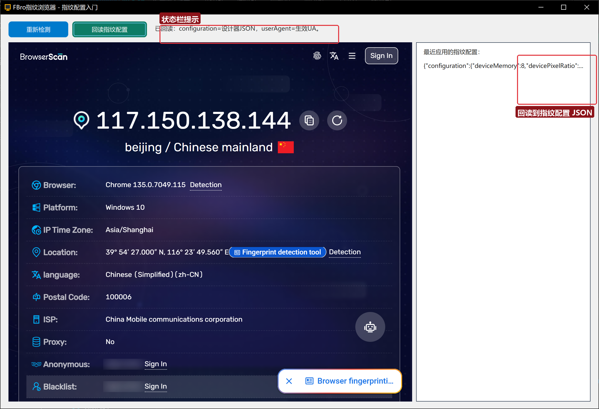

# FBro 合集 05 · 指纹配置入门：不写代码，设计器里给浏览器「整容」

> 《LingBuilder FBro 指纹浏览器合集》第 5 集（指纹与多开篇）。前四集我们学会了把 FBro 浏览器摆进窗口、导航、做会话隔离——但浏览器还是「素颜」的：网站看到的 Canvas、UA、屏幕、硬件全是这台电脑的真实值。从这一集起进入本合集的核心主题：**指纹伪装**。本集先讲最简单的一种方式——**全程不写指纹代码，在设计器属性面板里把「假身份」填好**，程序一启动浏览器就带着新身份上线。全程约 30 分钟。
>
> **模块获取**：FBro 指纹浏览器模块是**收费模块**，在模块生态里点「启用」按提示登录购买即可；本集还要额外启用 **FBro VIP 指纹模块（lingbuilder.fbro.vip）**，它提供 `FBroVIP_` 开头的命令（本集用它回读已生效的指纹配置）。
>
> **VIP/非 VIP 边界**：设计器属性里的指纹配置由 VIP 授权层生效；`FBroVIP_取已应用配置JSON` 是赞助会员命令。**没有赞助会员授权时本集程序能编译运行，但指纹不会生效**（诊断方法见第 8 节）。
>
> 前置要求：学过[第 1 集](../01_什么是指纹浏览器/README.md)（FBroBrowser 控件）和[第 4 集](../04_会话隔离与独立缓存目录/README.md)（会话隔离概念）。本集源码包见文末。

## 这一集你将学会

- 指纹配置的两种入口：**设计器属性方式**（本集）与纯代码 JSON 方式（第 6 集）
- FBroBrowser 控件的 **User-Agent 标识** 与 **指纹配置 JSON** 两个属性怎么填
- 指纹 JSON 的第一批常用键：平台、语言、硬件、屏幕、`webdriver`
- `FBroVIP_取已应用配置JSON(控件名)`：回读浏览器真正生效的指纹
- 一个重要内幕：**指纹在浏览器完全就绪后才应用**（0.8.37 起自动延迟重试，不再静默失败）

## 1. 先想清楚：把「假身份」放在哪？

FBro 给指纹配置留了两个入口：

| 入口 | 写法 | 适合场景 |
| --- | --- | --- |
| **设计器属性**（本集） | 选中控件，在属性面板填 JSON | 指纹固定不变、可视化直观、零代码 |
| **纯代码 JSON**（第 6 集） | `FBroVIP_应用指纹JSON(控件名, "...")` | 运行期动态换身份、批量随机化 |

两个入口最终走的是同一条通道：程序启动、浏览器创建完成后，把 JSON 交给 FBro 的 VIP 指纹引擎逐键应用。**键名写错不会报错，只会被静默跳过**——所以第 6 集会专门讲「权威键表」。本集先照抄下面给好的 JSON，感受流程。

## 2. 新建项目与启用模块

新建窗口项目 **指纹配置入门**。这一次要启用**两个** FBro 模块：打开模块生态，搜索「FBro」，把 **FBro指纹浏览器模块** 和 **FBro VIP 指纹模块** 都启用；同时确认 **Win32窗口基础模块** 在列（按钮/标签/列表框命令全靠它）。

## 3. 设计界面

窗口 1200×820，从上到下：一条工具栏（两个按钮+状态标签）、左边大浏览器、右边日志列表框：

| 控件 | 名称 | 显示内容/关键属性 | 左距 | 顶距 | 宽度 | 高度 |
| --- | --- | --- | --- | --- | --- | --- |
| 按钮 | 重新检测按钮 | 重新检测 | 16 | 14 | 120 | 32 |
| 按钮 | 回读按钮 | 回读指纹配置 | 144 | 14 | 150 | 32 |
| 标签 | 状态标签 | 就绪 | 310 | 20 | 520 | 22 |
| FBro浏览器 | 浏览器1 | 打开地址 = `https://www.browserscan.net/` | 16 | 56 | 810 | 722 |
| 列表框 | 日志 | （空） | 834 | 56 | 350 | 722 |



选中「浏览器1」控件（画布中带黄色选中框的就是），右侧属性面板可以看到它的全部属性。往下滚动，找到本集的两位主角：



## 4. 填指纹属性（本集核心一步）

### 4.1 User-Agent 标识

在「**User-Agent 标识**」里填一段自定义 UA（一行、不要换行）：

```
Mozilla/5.0 (Windows NT 10.0; Win64; x64) AppleWebKit/537.36 (KHTML, like Gecko) Chrome/124.0.0.0 Safari/537.36 LingBuilderDemo/5
```

它决定网站第一眼看到的「浏览器型号」。结尾的 `LingBuilderDemo/5` 是本集加的记号，方便在检测页确认 UA 已生效。

> ⚠️ **一致性提醒**：UA 里写的 Chrome 主版本不要和真实内核差太远。FBro 内核是 Chrome 135，检测页的「Browser」行显示的是内核真实版本（135.0.7049.115），来自 UA-CH（brands），改 UA 字符串改变不了它；老练的风控会核对「UA 字符串版本」与「brands 版本」是否一致——**写 124 会被标记为可疑**。正式伪装时要么把 UA 主版本写成 135，要么用第 6 集的内核版本指纹键一起改。本集为了演示「改了就是改了」故意保留 124。

### 4.2 指纹配置 JSON

在「**指纹配置 JSON**」里填（一整行，复制即可）：

```json
{"platform":"Win32","languages":"zh-CN,en","hardwareConcurrency":8,"deviceMemory":8,"devicePixelRatio":1.25,"webdriver":false,"screenWidth":1600,"screenHeight":900,"screenAvailWidth":1600,"screenAvailHeight":860,"screenColorDepth":24}
```

逐键解释（都是 `navigator` / `screen` 对象上网站能读到的值）：

| 键 | 含义 | 本集填的值 |
| --- | --- | --- |
| `platform` | 操作系统平台标识 | `Win32`（Windows 32/64 位程序都填这个） |
| `languages` | 浏览器语言列表 | `zh-CN,en`（中文优先，回退英文） |
| `hardwareConcurrency` | CPU 逻辑核心数 | 8（假装是 8 线程机器） |
| `deviceMemory` | 内存大小（GB，只可能是 0.25~8 的档位） | 8 |
| `devicePixelRatio` | 屏幕 DPI 缩放比 | 1.25（假装 125% 缩放的普通显示器） |
| `webdriver` | 是否自动化浏览器 | **`false`**（隐藏 Selenium/自动化痕迹的正确姿势） |
| `screenWidth` / `screenHeight` | 屏幕分辨率 | 1600×900 |
| `screenAvailWidth` / `screenAvailHeight` | 可用工作区（去掉任务栏） | 1600×860（底部留 40px 任务栏，自洽） |
| `screenColorDepth` | 颜色位深 | 24（几乎所有桌面都是 24） |

三条新手红线：

1. **值要自洽**：`screenAvailHeight` 比 `screenHeight` 小才对（任务栏占位）；`deviceMemory` 最大只能到 8（浏览器故意封顶防指纹，填 16 反而露馅）。
2. **键名大小写敏感**：写 `ScreenWidth` 等于没写。完整权威键表在第 6 集公布。
3. **这一层只是「种子」**：Canvas/WebGL/Audio 哈希、时区、GPU 字符串等深水区指纹在 `fingerprints`/`userAgent`/`geolocation` 等嵌套键里，第 6~8 集逐一展开。

## 5. 写代码

切到 `MainWindow.lcpp`，全文只有 19 行：



三个事件：

1. **窗口创建完毕**：提示「指纹来自设计器属性」——本集的指纹全部在属性面板里，代码只负责说话。
2. **重新检测按钮被单击**：`FBro_导航(浏览器1, "https://www.browserscan.net/")` 重新载入检测页（想多测几次时用）。
3. **回读按钮被单击**：清空日志 → 写入标题 → **`FBroVIP_取已应用配置JSON(浏览器1)`** 把浏览器**实际生效**的指纹配置读回来显示 → 滚动到最后一行。

「回读」为什么重要：设计器里填的是**你想要的身份**，回读看到的是**浏览器真正生效的身份**。两者对上了，才算配置成功。

## 6. 编译：先看错误列表

点工具栏「编译当前项目」。编译完成后先别急着运行——**看底部「错误列表」**：



显示 **错误列表 (0)**（未检测到编译障碍）才继续。如果列表里有红色条目，双击条目跳到出错行，对照第 5 节的代码逐字检查（本集最容易错的是把 `FBroVIP_` 拼错，以及没有启用「FBro VIP 指纹模块」导致命令报「未知命令」——回模块面板把两个 FBro 模块都启用即可）。

## 7. 运行验证

点「运行」。程序启动，浏览器自动打开 BrowserScan 检测页：



报告里能确认的：Browser=Chrome 135.0.7049.115（内核真实版本）、Platform=Windows 10、language=Chinese (Simplified)。**UA 字符串是否换成了我们填的那条**，滚动检测页到 User Agent 一行即可看到带 `LingBuilderDemo/5` 尾巴的新 UA。

点「回读指纹配置」：



右侧日志列出 `{"configuration":{...},"userAgent":{...}}`——`configuration` 就是设计器 JSON 被 VIP 引擎规范化后的样子，`userAgent` 部分是 UA 属性的生效回执。看到它，指纹就已经在浏览器里生效了。

## 8. 没生效？三步定位

1. **日志里回读出 `{}`**：指纹从未应用成功。检查是否启用了「FBro VIP 指纹模块」、是否有赞助会员授权；再点一次「回读」（0.8.37 之前的版本存在「浏览器未就绪时首次应用被静默丢弃」的问题，重新点一次或升级 IDE）。
2. **回读有内容但检测页没变化**：检查键名拼写（大小写敏感）；确认改完后重新编译运行（指纹在启动时应用一次，运行期改属性不会热生效）。
3. **Browser 行还是 124→135 对不上**：正常现象，见 4.1 的一致性提醒。

## 9. 内幕：指纹是什么时候应用上的？

设计器属性的指纹在**浏览器创建流程里自动应用**。这里有个曾经坑过很多人的细节：浏览器句柄刚建立时，CEF 与 VIP 控件还在异步初始化，立刻应用指纹会失败且不留痕迹。**0.8.37 起**，生成器会在首次应用失败后自动延迟重试（每 1.5 秒一次，最多 5 次），浏览器就绪后指纹必然落上——你什么都不用做，但要知道这件事：**程序刚启动的半秒内指纹可能还没生效**，别在这个窗口期做指纹检测。

## 10. 课后练习

1. 把 `hardwareConcurrency` 改成 4、`deviceMemory` 改成 4，重新编译，回读确认生效；
2. 给 `指纹配置 JSON` 追加 `"maxTouchPoints":5`，看检测页的「Touch 支持」是否变化；
3. 思考题：如果两个窗口各摆一个 FBroBrowser 控件、属性 JSON 完全相同，它们在网站眼里是「同一台电脑」吗？（答案在第 7 集：是——指纹相同就是关联，多开必须一人一套指纹。）

## 源码包

本集完整源码一键导入：[指纹配置入门.lcpppkg](指纹配置入门.lcpppkg)（LingBuilder 菜单「项目 → 打开 LCPP 源码包文件」）。
