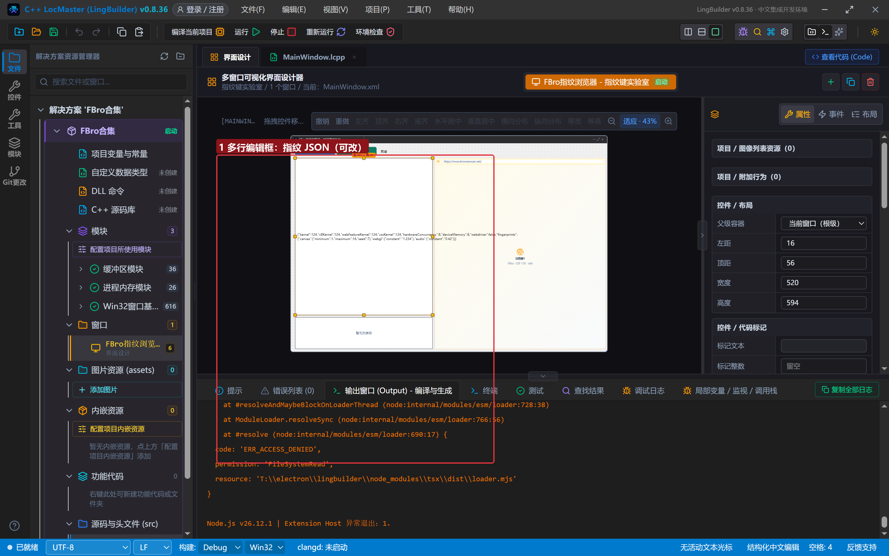
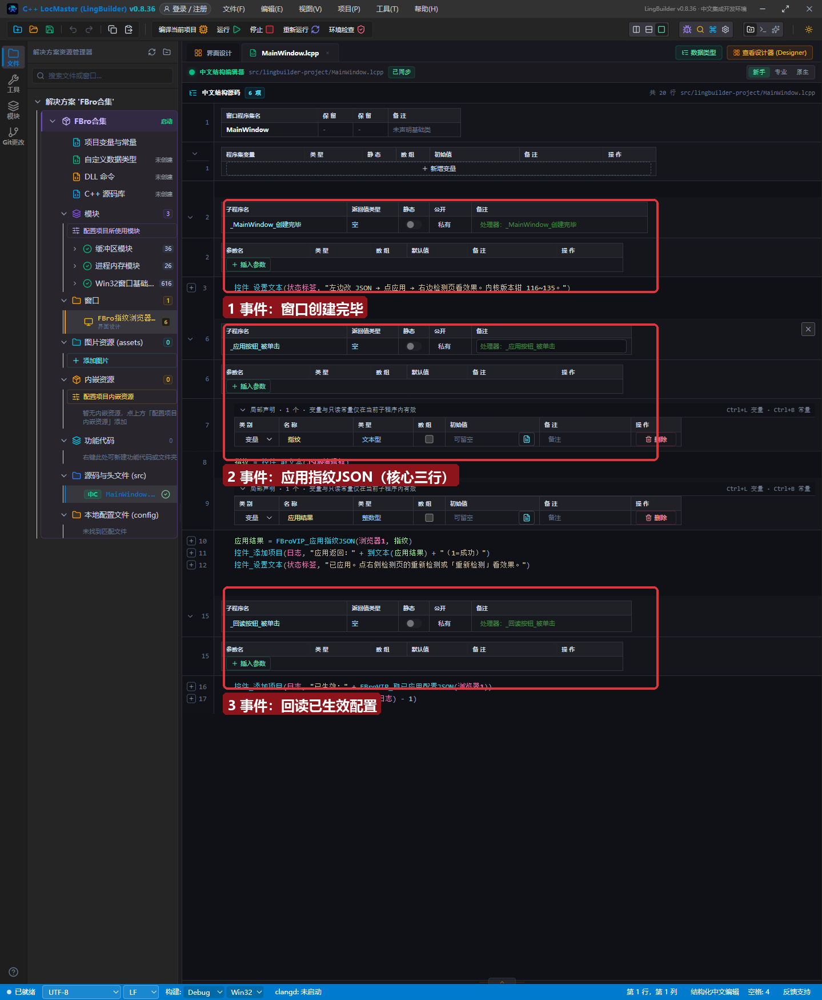
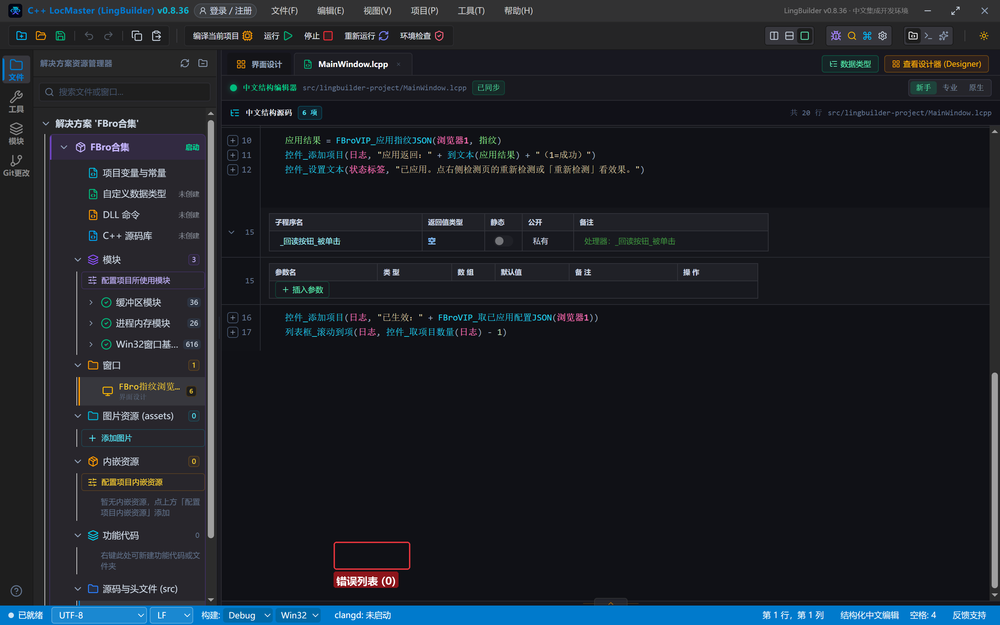
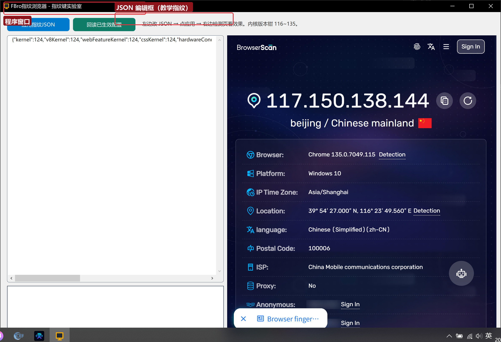
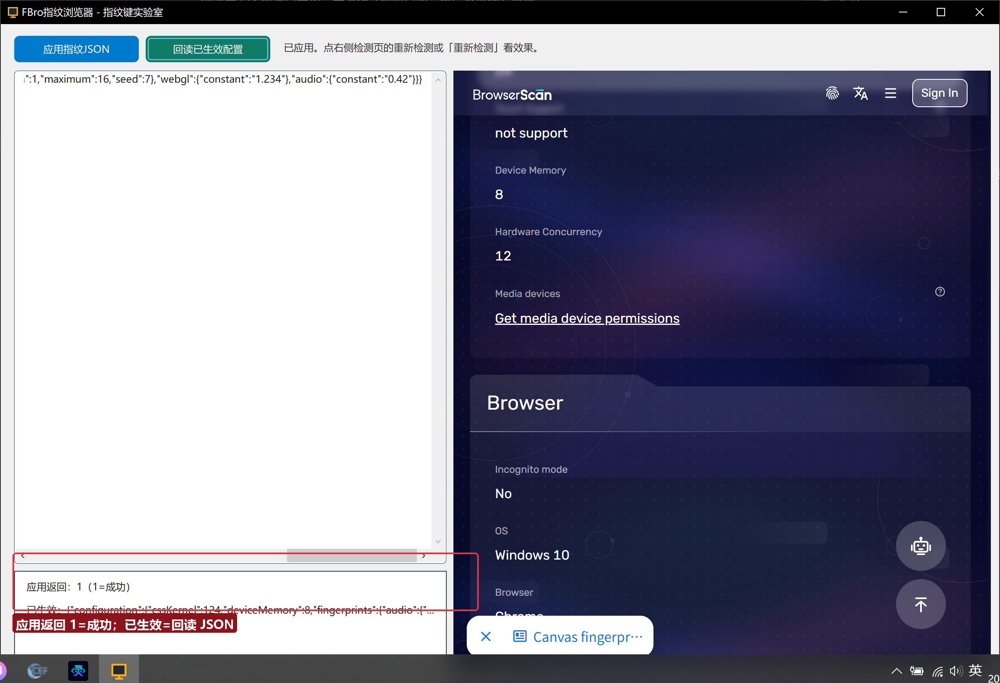

# FBro 合集 06 · 指纹 JSON 桥 schema 详解：权威键表与「键名错＝没设」

> 《LingBuilder FBro 指纹浏览器合集》第 6 集（指纹与多开篇）。第 5 集我们把指纹 JSON 填进了设计器属性，本集打开这层窗户纸：**JSON 到底怎么写、有哪些键、写错了会怎样**。本集做一个「指纹键实验室」：左边多行编辑框随便改 JSON，点「应用」立刻生效，右边检测页实时看效果——把权威键表当成化学元素表来做实验。全程约 40 分钟。
>
> **模块获取**：同第 5 集，启用 **FBro指纹浏览器模块** + **FBro VIP 指纹模块**（本集的 `FBroVIP_应用指纹JSON` 是 VIP 命令，需要赞助会员授权）。
>
> 前置要求：学过[第 5 集](../05_指纹配置入门/README.md)。本集源码包见文末。

## 这一集你将学会

- `FBroVIP_应用指纹JSON(控件名, JSON文本)`：运行期动态应用指纹（第 5 集属性方式的代码版）
- **权威键表**：顶层键按功能分组的完整清单与填写规则
- 两条最重要的红线：**键名错＝没设**、**返回 ≥0 ≠ 生效**（正确的验证姿势是回读）
- `fingerprints` 嵌套键：Canvas/WebGL/Audio 哈希的「固定值」与「随机区间」两种形态
- 内核版本四键（`kernel`/`v8Kernel`/`webFeatureKernel`/`cssKernel`）与 **116~135 钳制**

## 1. 界面与工作流

窗口 1200×820，四个区域：顶部按钮栏（应用指纹JSON / 回读已生效配置 / 状态标签）、左侧多行编辑框（JSON 草稿，预填教学样本）、右侧浏览器（BrowserScan 检测页）、左下日志列表框：



实验工作流：**改编辑框里的 JSON → 点「应用指纹JSON」→ 看日志里的返回码 → 点检测页重新检测看效果 → 点「回读已生效配置」确认**。

## 2. 写代码（17 行）



核心是「应用按钮被单击」里的三行：

```
指纹 = 控件_取文本(JSON编辑框)          '把编辑框文本取下来
应用结果 = FBroVIP_应用指纹JSON(浏览器1, 指纹)   '整串交给 VIP 引擎
控件_添加项目(日志, "应用返回：" + 到文本(应用结果) + "（1=成功）")
```

`FBroVIP_应用指纹JSON` 的返回值语义：

| 返回值 | 含义 | 处置 |
| --- | --- | --- |
| `1` | 应用成功 | 点「回读」确认，再看检测页 |
| `0` | 控件不存在或浏览器未就绪 | 延迟一会再点一次 |
| `-2` | JSON 文本是空的 | 检查编辑框内容 |
| `-3` | JSON 不是合法对象 | 少了 `{}`、多了逗号、引号没闭合 |
| `-4` | **本进程没有拿到 VIP Key** | 用 IDE 的「运行/F5」启动（会注入授权），别双击 exe |
| `-5` | Key 传了但联网校验失败 | 检查赞助会员授权状态、网络 |

## 3. 权威键表（速查版）

应用成功后点「回读已生效配置」，日志里会出现规范化后的 JSON。以下按功能分组列出常用顶层键（全部**大小写敏感**）：

### 3.1 Navigator 基础

| 键 | 类型 | 说明 |
| --- | --- | --- |
| `platform` | 文本 | `"Win32"`；Mac 伪装才填 `"MacIntel"` |
| `languages` / `acceptLanguages` | 文本 | `"zh-CN,en"`；与 IP 归属地保持一致 |
| `hardwareConcurrency` | 整数 | CPU 线程数（2~32 常见） |
| `deviceMemory` | 整数 | 内存 GB，**最大 8**（浏览器封顶防指纹） |
| `webdriver` | 布尔 | 自动化标记，**隐藏自动化填 `false`** |
| `cookieEnabled` / `javaEnabled` / `online` / `isTrusted` | 布尔 | 一般不动 |
| `devicePixelRatio` | 小数 | DPI 缩放（1 / 1.25 / 1.5 / 2） |
| `maxTouchPoints` | 整数 | 0=桌面、5=触屏；与 UA 里的机型匹配 |

### 3.2 屏幕

`screenWidth` / `screenHeight` / `screenAvailWidth` / `screenAvailHeight` / `screenX` / `screenY` / `screenColorDepth` / `screenPixelDepth`（整数）。**自洽规则**：`avail` 比 `screen` 小 40（任务栏）；`ColorDepth` 桌面填 24。

### 3.3 内核版本四键（钳 116~135）

`kernel` / `v8Kernel` / `webFeatureKernel` / `cssKernel`（整数）。它们决定 JS 引擎报出的特性版本，**取值被钳制在 116~135**（FBro 内核为 Chrome 135）。填 140 会被钳到 135；写死真实内核 135 反而会跟官方指纹样本「撞衫」，被 BrowserScan 的 Browser 行标红——**建议填 124 左右的常见值**，并让 UA 字符串的主版本与它一致。

### 3.4 画布与音频指纹 `fingerprints`（嵌套）

```json
"fingerprints": {
  "canvas": { "minimum": 1, "maximum": 16, "seed": 7 },
  "webgl":  { "constant": "1.234" },
  "audio":  { "constant": "0.42" }
}
```

- **`constant` 形态**：固定噪声值，每次渲染偏移恒定（稳定伪装某个「特定显卡」）；
- **`minimum`/`maximum`/`seed` 形态**：每次渲染在区间内随机（`seed` 固定时随机序列可复现）。
- `webgl` 的 constant 是渲染器哈希偏移；`audio` 是音频栈噪声系数。

### 3.5 User-Agent 嵌套对象 `userAgent`

第 5 集的「User-Agent 标识」属性只改 UA 字符串；要连 UA-CH（brands、platformVersion、mobile）一起伪装，用嵌套对象：

```json
"userAgent": {
  "mainUserAgent": "Mozilla/5.0 ... Chrome/124.0.0.0 Safari/537.36",
  "platform": "Windows",
  "platformVersion": "10.0.0",
  "architecture": "x86",
  "bitness": "64",
  "mobile": false,
  "brands": "[{\"brand\":\"Chromium\",\"version\":\"124\"}]"
}
```

### 3.6 其他分组（本集列出，后续集展开）

- **GPU**：`gpuVendor` / `gpuRenderer`（WebGL 报告字符串）、`gpuSubgroupMinSize/MaxSize`
- **时区/地理**：`timeZone`、`geolocation:{latitude,longitude,...}`
- **电池**：`battery:{charging,level,...}`
- **WebRTC**：`webrtc:{publicIp,localIp}`（防真实 IP 泄露）
- **控制台钳制**：`disableConsole*` 全族、`disableDebugger`
- **会话**：`clearAllData`（槽位重置专用；**保登录态绝不要发**）

## 4. 红线两条（背下来）

1. **键名错＝没设**：桥解析 JSON 后逐键查找，未知键**静默跳过**、不报错。写 `"ScreenWidth":1600` 不会失败也不会生效——唯一的发现方式是「回读」里没有它。改完必回读。
2. **返回 ≥0 ≠ 生效**：返回 1 只代表「JSON 合法且已交给引擎」，个别键在特定内核版本上可能不被支持。**回读输出才是生效事实**。

## 5. 编译与运行



编译后错误列表 (0) 再运行。程序启动后右侧已打开 BrowserScan：



点「应用指纹JSON」（编辑框预填的教学样本把内核四键改成 124、Canvas 指纹设为 [1,16] 随机、WebGL/Audio 固定值），日志显示返回码：



`应用返回：1（1=成功）`、`已生效：{"configuration":{"cssKernel":124,...}}`——预填键全部生效。到右侧检测页点「重新检测」，Canvas 哈希会随每次刷新在设定区间内波动（随机形态生效的直接证据）。

## 6. 实验任务（本集的作业就是做实验）

1. 把 `kernel` 改成 `140` → 应用 → 回读：看它被钳成了多少；
2. 把 `"hardwareConcurrency"` 故意拼成 `"HardwareConcurrency"` → 应用 → 回读：确认键被静默跳过（红线 1 实证）；
3. 把 `{"` 删掉一个引号 → 应用：观察返回 `-3`（非法 JSON 的反馈）；
4. Canvas 的 `constant` 与随机区间两种形态各测一次，连续刷新检测页对比哈希稳定性。

## 源码包

本集完整源码一键导入：[指纹键实验室.lcpppkg](指纹键实验室.lcpppkg)。
