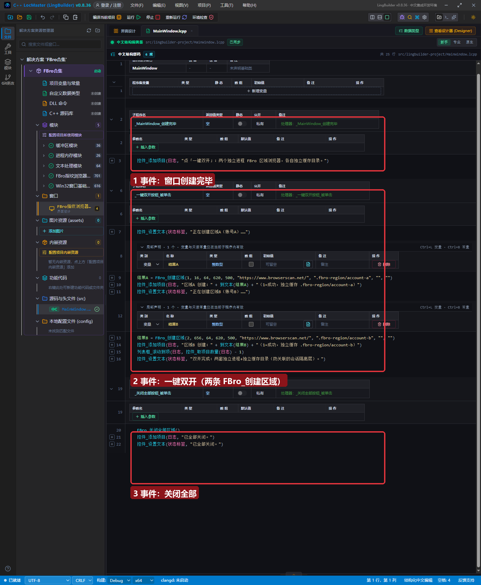
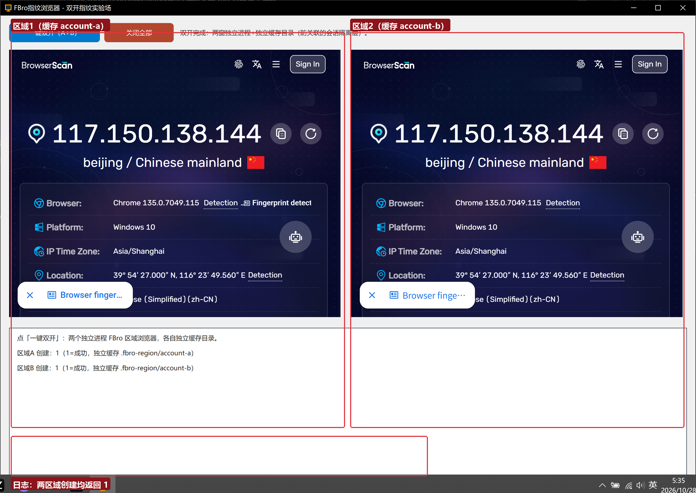

# FBro 合集 07 · 多开防关联：区域双开与独立缓存

> 《LingBuilder FBro 指纹浏览器合集》第 7 集（指纹与多开篇）。多开防关联拆开是三件事：**独立会话（缓存目录）**、**独立指纹**、**独立 IP（代理）**。本集做第一件也是最稳的一件——用 **FBro 区域浏览器（`FBro_创建区域`）** 在同一个窗口里双开两个互相隔离的浏览器，各自独立缓存目录、各自独立进程。全程约 30 分钟。
>
> **模块获取**：启用 **FBro指纹浏览器模块** 即可（本集命令全部非 VIP）。
>
> 前置要求：学过[第 4 集](../04_会话隔离与独立缓存目录/README.md)（缓存目录=会话隔离的原理）。本集源码包见文末。

## 这一集你将学会

- `FBro_创建区域(编号, 左, 顶, 宽, 高, 地址, 缓存目录, 代理, UA)`：在窗口任意矩形内嵌一个独立进程 FBro 浏览器
- 多开的**会话隔离层**：每区域一个独立缓存目录 = 独立 Cookie/存储/会话
- `FBro_关闭全部区域` / `FBro_区域导航` / `FBro_区域取标题` 等区域族命令
- 多开防关联的三层模型，以及每层在本合集哪一集展开

## 1. 多开防关联的三层模型

| 层 | 作用 | 本集 | 后续集 |
| --- | --- | --- | --- |
| **会话隔离**（独立缓存目录） | 两浏览器 Cookie/登录态/存储互不相通 | ✅ 本集主角 | 第 4 集原理 |
| **指纹差异**（Canvas/UA/硬件…） | 两浏览器看起来像两台电脑 | 第 5/6 集的属性与 JSON 方式（对控件实例） | 第 8 集 |
| **IP 隔离**（代理） | 两浏览器出口 IP 不同 | 区域参数预留了代理位 | 第 8 集实例代理 |

一句话：**会话不同=不同「人」；指纹不同=不同「电脑」；IP 不同=不同「地点」**。三层齐了，网站才认不出关联。本集先把「不同的人」做出来。

## 2. 界面与代码

窗口 1300×920：顶部「一键双开（A+B）」「关闭全部」两个按钮+状态标签；下方 1268×300 的日志列表框。区域浏览器不需要设计器控件——**纯代码创建**：



核心两行（账号 A 与账号 B 完全对称）：

```
结果A = FBro_创建区域(1, 16, 64, 620, 500, "https://www.browserscan.net/", ".fbro-region/account-a", "", "")
结果B = FBro_创建区域(2, 656, 64, 620, 500, "https://www.browserscan.net/", ".fbro-region/account-b", "", "")
```

九个参数逐个说：

| 参数 | 值 | 说明 |
| --- | --- | --- |
| 实例编号 | `1` / `2` | 后续 `FBro_区域导航(编号,…)` 等按编号寻址 |
| 左/顶/宽/高 | `16,64,620,500` | 窗口客户区内的矩形（逻辑像素） |
| 地址 | `https://www.browserscan.net/` | 创建完成自动导航 |
| **缓存目录** | `.fbro-region/account-a` | **相对 exe 目录**；两区域必须不同目录 |
| 代理地址 | `""` | 空=直连；第 8 集填 `http://host:port` |
| 用户代理 | `""` | 自定义 UA（见下方已知问题） |

关闭用 `FBro_关闭全部区域()` 一键回收（也有 `FBro_关闭区域(编号)` 单关）。

## 3. 运行验证



点「一键双开」后：两个区域并排渲染，各自打开 BrowserScan；日志两行「区域A 创建：1 / 区域B 创建：1」。**隔离证据**在磁盘上——exe 旁多出 `.fbro-region/account-a/` 与 `.fbro-region/account-b/` 两个目录（各自的 Cache/Cookies/Local Storage），两窗口的登录态从此互不相通。

## 4. 已知问题（0.8.36 实测，正文必读）

1. **区域 UA 参数暂未生效**：`FBro_创建区域` 的「用户代理」参数（第 9 参）在 0.8.36 实测未应用到 `navigator.userAgent`（HTTP 头同样未变，httpbin 回显实证）。UA 差异化请用第 5/6 集的方式（FBroBrowser 控件的属性/`FBroVIP_应用指纹JSON`——控件路径已验证）。0.8.37 起生成器在区域导航前自动经宿主 RPC 补设 UA（含官方 VIP UA-Data 通道），修复待随包验证。
2. **区域 RPC 导航就绪时序**：区域创建后立即调 `FBro_区域导航` 会因宿主进程「启动中」而失败（返回 0），**先轮询 `FBro_区域是否存活(编号)`（=1 即就绪）再导航**。本集示例用「创建时直传地址」避开该时序（创建内置导航不受影响）。

## 5. 与「原生UI 多开链」的关系

大纲里的五步纯代码多开链（`FBro_后台创建`→`FBroVIP_实例设置新窗口转标签页`→`FBroVIP_实例应用指纹JSON`→`FBro_实例打开原生UI`→弹窗补指纹+导航）适合「弹独立顶层 Chrome 窗口」的场景。**0.8.36 实测该链在「弹窗补指纹」一步于 FBrowserVIP.dll 内崩溃（0xc0000005，官方闭源 DLL 内部）**，已按原样记录待官方排查；在修复落地前，多开场景请使用本集的区域方式（稳定）或第 4 集的多控件方式。

## 6. 课后练习

1. 把区域 2 的缓存目录改成与区域 1 相同 → 观察创建失败（目录被占用），体会「缓存目录=会话身份」；
2. 登录任一网站于区域 1，刷新区域 2 确认登录态不相通；
3. 思考：两个区域假如 UA、指纹、IP 全部相同，只做缓存隔离，网站能从哪些维度把两个「人」关联起来？（引出第 8 集）

## 源码包

本集完整源码一键导入：[双开指纹实验场.lcpppkg](双开指纹实验场.lcpppkg)。
