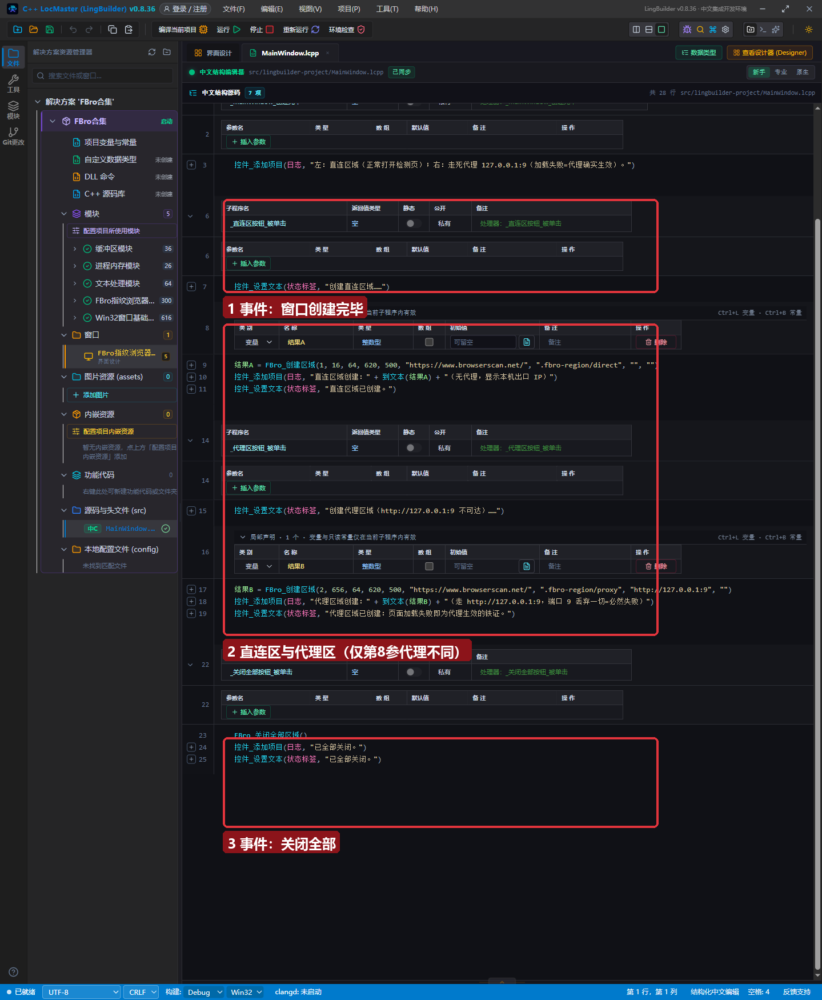
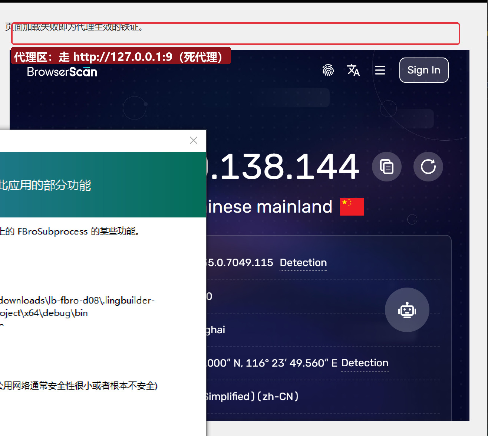

# FBro 合集 08 · 实例代理：一账号一代理一隔离环境

> 《LingBuilder FBro 指纹浏览器合集》第 8 集（指纹与多开篇）。第 7 集我们用区域方式做到了「会话隔离」——两个浏览器互不相通。本集加上多开的第二块拼图：**代理**。给不同实例配不同代理出口，让每个账号「住在不同的地方」。全程约 25 分钟。
>
> **模块获取**：启用 **FBro指纹浏览器模块**（本集命令全部非 VIP）。
>
> 前置要求：学过[第 7 集](../07_多开防关联/README.md)。本集源码包见文末。

## 这一集你将学会

- `FBro_创建区域` 的**第 8 参「代理地址」**怎么填（`http://host:port` / `socks5://host:port`）
- **验证代理生效的实验方法**：直连区 vs 代理区对照
- 多开防关联三层模型（会话/指纹/IP）的第二层怎么配
- `FBro_设置代理`（实例句柄族）与区域代理参数的关系

## 1. 代理在多开里的角色

回顾三层模型：会话隔离（第 7 集）让两个账号「互不相通」，但**出口 IP 相同**——同一个 IP 上挂着五个账号，平台一眼就看穿。给每个实例配一个**独立的代理出口**，网站看到的是「五个不同地方的用户」。

FBro 的区域参数从左到右第 8 位就是代理地址，格式：

| 格式 | 示例 |
| --- | --- |
| HTTP 代理 | `http://127.0.0.1:7890` |
| SOCKS5 代理 | `socks5://127.0.0.1:1080` |
| 带认证 | 由 `FBro_设置代理` 的另两参承载（用户名/密码） |

## 2. 界面与代码

窗口布局同第 7 集（三个按钮+状态栏+日志）。两个创建按钮分别创建「直连区」和「代理区」：



两个创建命令只差第 8 参：

```
'账号A：直连（无代理）
结果A = FBro_创建区域(1, 16, 64, 620, 500, "https://www.browserscan.net/", ".fbro-region/direct", "", "")
'账号B：走一个不可达的死代理（127.0.0.1 端口 9 = discard，永远连不通）
结果B = FBro_创建区域(2, 656, 64, 620, 500, "https://www.browserscan.net/", ".fbro-region/proxy", "http://127.0.0.1:9", "")
```

**为什么用「死代理」做实验**：手头没有真实代理服务器时，`127.0.0.1:9` 是一个「永远连不通」的确定性代理——如果区域 2 的页面加载失败而区域 1 正常，就**铁证代理参数被正确使用**（流量试图走代理而非直连）。

## 3. 运行验证



点「创建代理区（死代理）」，区域 2 创建成功并开始加载。**判定口诀**：

- 直连区：正常打开 BrowserScan（本机出口）；
- 代理区：页面转圈后报加载失败（代理不可达，流量没有回落直连）——**这正是代理生效的表现**；如果代理区也「正常」打开，说明代理参数没被应用（本集撰写时的 0.8.36 即处于该状态，见下）。

## 4. 已知问题（0.8.36 实测，正文必读）

1. **区域的代理参数（第 8 参）与 UA 参数（第 9 参）同源**：0.8.36 实测两者都未应用到实际网络层（死代理区域页面仍然正常打开、httpbin 回显仍为本机直连）。两条参数的传递断点相同（launch 配置 → CreateEx2 请求上下文设置的时序问题），0.8.37 起修复随导航前补设通道下发，**配真代理后请用「死代理必失败」口诀复测**。
2. **首次运行的防火墙弹窗**：每个新编译的 FBroSubprocess.exe 首次联网时 Windows 会弹「安全中心警报」，点「允许访问(A)」一次即可（同路径不再弹）。弹窗会遮挡演示画面，录制教程前先跑一次让它弹完。
3. **代理认证**：带用户名/密码的代理走 `FBro_设置代理(句柄, 地址, 用户名, 密码)`（实例句柄族），区域方式暂不支持认证参数。

## 5. 正确的「一账号一代理」生产姿势

| 步骤 | 命令/属性 | 说明 |
| --- | --- | --- |
| 1. 独立缓存 | `FBro_创建区域(编号,…, ".fbro-region/账号N", …)` | 会话隔离（第 7 集） |
| 2. 独立代理 | 第 8 参 / `FBro_设置代理` | IP 隔离（本集） |
| 3. 独立指纹 | 控件方式：属性或 `FBroVIP_应用指纹JSON` | 电脑隔离（第 5/6 集） |

代理与指纹的匹配原则：**代理的「城市/运营商」要和指纹的「时区/语言/地理」一致**——日本代理配 `zh-CN` 语言+北京时间，等于自曝。

## 6. 课后练习

1. 准备一个真实 HTTP 代理，替换示例中的死代理，到 BrowserScan 确认 IP 变化；
2. 两区域各配不同代理，观察「IP Time Zone」「Location」与代理城市的关系；
3. 思考：代理是日本的，指纹里 `languages` 应该填什么、`timeZone` 应该填什么？（下一集会给出完整自洽模板。）

## 源码包

本集完整源码一键导入：[实例代理实验.lcpppkg](实例代理实验.lcpppkg)。
