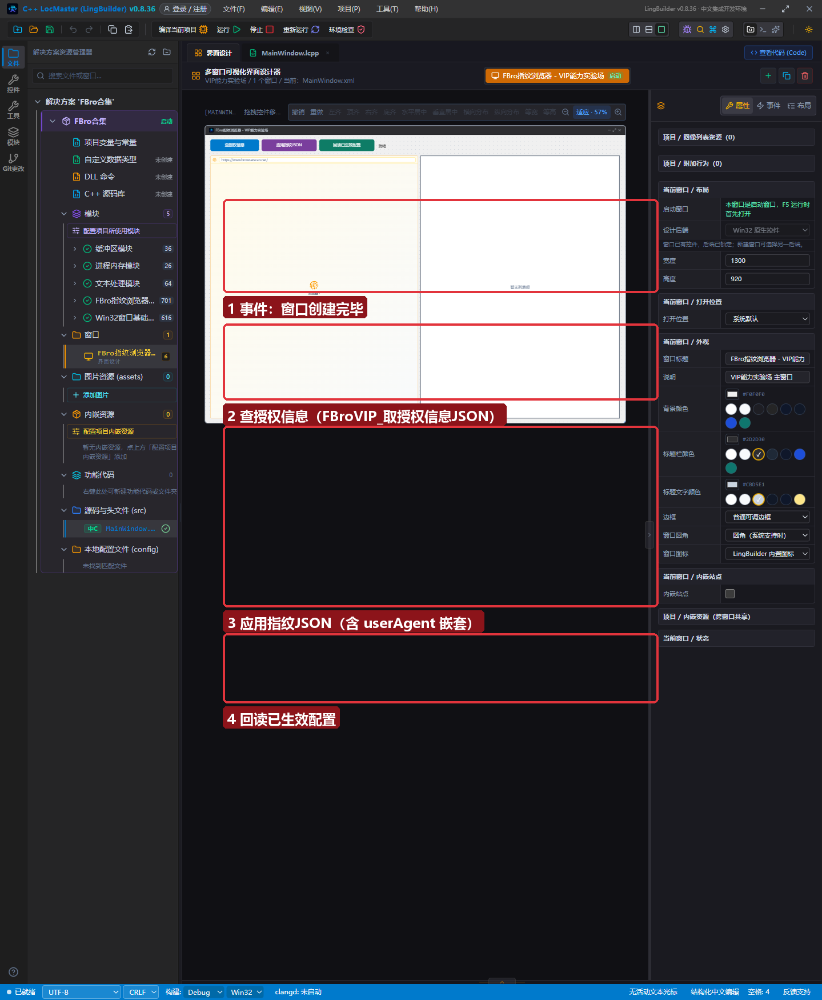
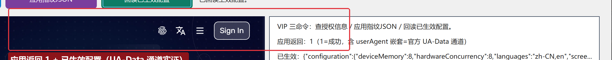

# FBro 合集 09 · VIP 能力：授权体系与 VIP 命令族

> 《LingBuilder FBro 指纹浏览器合集》第 9 集（指纹与多开篇）。FBro 共 465 条命令，其中 `FBroVIP_` 开头的 **16 条是赞助会员命令**（指纹 JSON 应用、UA-Data、授权查询、调用计数等）。本集讲清楚三件事：**授权体系怎么工作**、**哪些能力是 VIP**、**VIP 命令的返回码怎么读**。全程约 25 分钟。
>
> **模块获取**：启用 **FBro指纹浏览器模块 + FBro VIP 指纹模块**；VIP 命令需要赞助会员授权（Key 由 IDE 注入，见第 3 节）。
>
> 前置要求：学过[第 6 集](../06_指纹JSON桥schema详解/README.md)。本集源码包见文末。

## 这一集你将学会

- `FBroVIP_取授权信息JSON()`：一条命令看清授权状态（脱敏、不含 Key）
- VIP 授权链路：Key → IDE 环境变量 → 桥 → 官方 DLL 校验，**为什么双击 exe 会失效**
- `FBroVIP_应用指纹JSON` 的 **userAgent 嵌套 = 官方 UA-Data 通道**（改 navigator.userAgent + UA-CH 的正道）
- 三条最常用 VIP 命令的返回码语义

## 1. VIP 族地图（16 条命令分五类）

| 类别 | 命令 | 用途 |
| --- | --- | --- |
| **授权查询** | `FBroVIP_取授权信息JSON` / `取调用次数` / `清空调用次数` | 排查授权问题的第一入口 |
| **指纹应用** | `FBroVIP_应用指纹JSON`（控件） / `FBroVIP_实例应用指纹JSON`（实例句柄） | 第 6 集主角 |
| **指纹回读** | `FBroVIP_取已应用配置JSON` | 生效事实的唯一来源 |
| **窗口行为** | `FBroVIP_实例设置新窗口转标签页` | 弹窗内 `target=_blank` 转标签页 |
| **批量分发** | `FBroVIP_DOM/扩展/资源规则/开发者工具异步命令` | 单项命令的批量入口 |

## 2. 界面与代码

窗口 1300×920：左 FBroBrowser（BrowserScan）、右日志；三个按钮=三条 VIP 命令：



## 3. 授权体系怎么工作（重要，决定你能不能跑通）

Key 的传递链路（**全程不落盘、不进源码**）：

```
IDE「设置 → 浏览器凭据」保存 Key（safeStorage 加密）
   → IDE 受控运行（工具栏「运行」/F5）时注入环境变量 LINGBUILDER_FBRO_VIP_KEY
   → 桥 DLL 初始化读取一次并立即清除
   → FBroHsOnlineLicenseControl_SetKey 联网校验 → g_license_valid
```

三条硬规则：

1. **双击 exe / 脚本启动 = 没有环境变量 = VIP 命令全部返回 -4**（「本进程没有拿到 Key」）。
2. **-5 = Key 传进来了但校验失败**（Key 错/过期/机器不符/断网）。
3. 判定口诀：**-4 查「有没有传」，-5 查「对不对」**；先点「查授权信息」看 `licenseAttempted`/`licenseValid` 两个字段。

## 4. 运行验证

点「查授权信息」——日志回读脱敏 JSON：

```
授权信息：{"licenseAttempted":true,"licenseValid":true,...}
```

点「应用指纹JSON」——本集样本带了 **`userAgent` 嵌套对象**（`mainUserAgent`/`platform`/`platformVersion`/`architecture`/`bitness`/`mobile`），这是官方 **UA-Data 通道**：同时改写 `navigator.userAgent` 与 UA-CH（brands/platformVersion），比第 5 集的 UA 属性更彻底：



日志 `应用返回：1` + `已生效：{"configuration":{...}}`——userAgent 嵌套已进入生效配置。刷新左侧检测页，User Agent 行会变成带 `VipDemo/9` 尾巴的新 UA，UA-CH 一致性检查也会通过（**这就是第 5 集预告的「UA 与内核 brands 一致性」的正解**）。

## 5. 返回码速查（VIP 命令通用）

| 返回 | 含义 |
| --- | --- |
| `1` / `>0` | 成功 |
| `0` | 控件/实例不存在或浏览器未就绪（延迟重试） |
| `-1` | 实例句柄无效或浏览器尚未就绪（可延迟重试） |
| `-2` | JSON 为空 |
| `-3` | JSON 不是合法对象 |
| `-4` | 进程里没有 VIP Key（用 IDE 运行） |
| `-5` | Key 校验失败（查授权信息里的 error 字段） |

## 6. 已知问题（0.8.36 实测）

`FBro_实例打开原生UI`（Chrome 原生 UI 弹窗链）在 0.8.36 存在崩溃缺陷（触发点在官方 FBrowserVIP.dll 内部，含弹窗期指纹应用；`FBroVIP_实例设置新窗口转标签页` 同链路受影响）。**窗口化多开请使用第 7 集的区域方式**；缺陷详情与修复进展见 `docs/FUTURE_OPTIMIZATIONS.md`。控件路径的 VIP 命令（本集三条）不受影响。

## 7. 课后练习

1. 点「查授权信息」，记下 `machineCode`（机器码）——这就是赞助授权绑定的本机标识；
2. 用第 6 集的「拼错键名」方法对 userAgent 嵌套做一次实验（`MainUserAgent` 大写 M → 静默跳过）；
3. 思考：为什么 Key 不写进源码？（源码包会被分享，Key 跟着泄露；环境变量注入让 Key 留在本机。）

## 源码包

本集完整源码一键导入：[VIP能力实验场.lcpppkg](VIP能力实验场.lcpppkg)。
