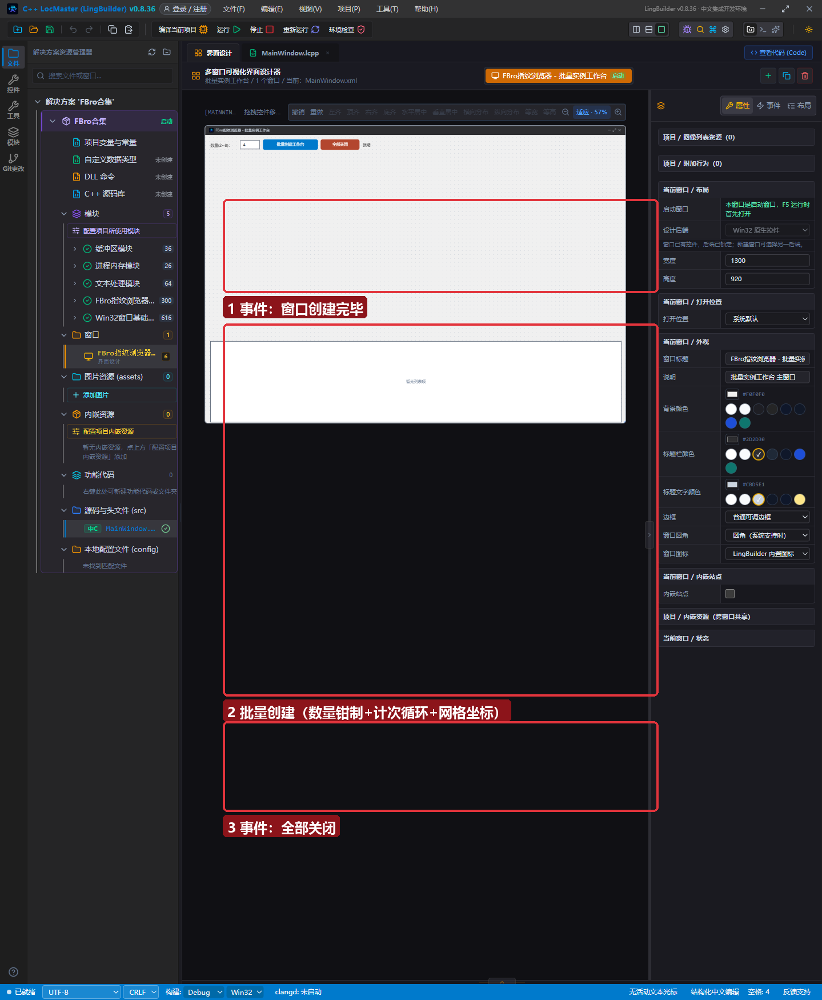
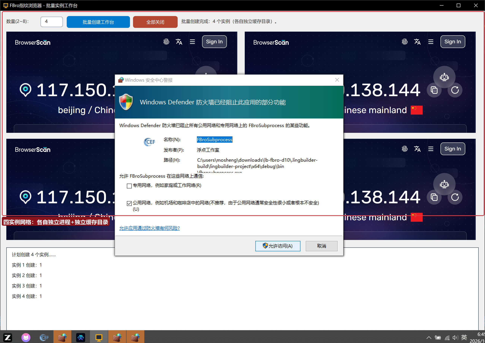

# FBro 合集 10 · 批量实例工作台：循环创建与网格布局

> 《LingBuilder FBro 指纹浏览器合集》第 10 集（指纹与多开篇）。第 7 集手工双开，本集把多开升级为**批量**：输入数量（2~8），一个计次循环批量创建区域实例、自动网格排布、每实例独立缓存目录——一个「多账号工作台」的雏形。全程约 25 分钟。
>
> **模块获取**：启用 **FBro指纹浏览器模块**（全部非 VIP 命令）。
>
> 前置要求：学过[第 7 集](../07_多开防关联/README.md)。本集源码包见文末。

## 这一集你将学会

- **计次循环首/计次循环尾** 批量创建区域实例
- 循环内计算网格坐标（两列布局的行列换算）
- 字符串拼数字：`".fbro-region/account-" + 到文本(序号)`
- 输入钳制：把用户输入的数量限制在安全区间（2~8）
- `FBro_关闭全部区域` 一键回收

## 1. 界面与代码

窗口 1300×920：顶部数量输入框（默认 4）+「批量创建工作台」「全部关闭」+状态栏；底部日志。区域实例**不占设计器控件**——全部运行期创建：

三个语法点（新手最容易错）：

1. **输入钳制**：用户可能输入 1 或 100——先 `如果 (数量 < 2)` / `如果 (数量 > 8)` 夹到安全区间（每实例一个 CEF 进程组，8 个已是较重负载）；
2. **网格坐标**：两列布局，`列 = (序号 - 1) % 2`（除2取余）、`行 = (序号 - 1) / 2`（整数除法）——序号 1~8 依次落到 (0,0) (1,0) (0,1) (1,1)…；
3. **缓存目录拼序号**：`".fbro-region/account-" + 到文本(序号)`——每个实例独立目录，互不串会话。

## 2. 运行验证

数量填 4 点「批量创建工作台」：2×2 网格四个 BrowserScan 同时渲染，日志逐行「实例 N 创建：1」。磁盘上 `.fbro-region/account-1` 到 `account-4` 四个独立缓存目录同时生成——四套完全隔离的会话。

## 3. 批量多开的资源账

每个区域实例是一个完整 CEF 进程组（数百 MB 内存+独立磁盘缓存）。批量的三个工程红线：

1. **内存**：8 实例 ≈ 2~4 GB，16GB 内存机器建议 ≤8；
2. **启动节流**：第 29 集综合实战会把「每轮最多建 3 个」的节流加进批量逻辑（CEF 同时启动会互相抢 CPU）；
3. **关闭回收**：窗口关闭时务必 `FBro_关闭全部区域()`（示例已挂在「全部关闭」按钮；直接叉掉窗口运行时也会回收，但显式关闭更干净）。

## 4. 已知问题（0.8.36）

同第 7 集：区域 UA/代理参数暂未生效（修复随 0.8.37 下发）；`FBro_区域导航` 需在区域就绪后调用。批量创建时每个实例的创建调用之间无需延时（`FBro_创建区域` 内部已按进程组排队），但导航类操作要等各自就绪。

## 5. 课后练习

1. 把网格改三列：`列 = (序号 - 1) % 3`、宽 420、`x = 16 + 列 * 424`；
2. 数量上限改 6，观察内存占用（任务管理器看 FBroSubprocess 进程组）；
3. 预习：给每个实例一个不同的缓存目录名格式（如 `shop-01`、`shop-02`），为第 29 集矩阵管理器做铺垫。

## 源码包

本集完整源码一键导入：[批量实例工作台.lcpppkg](批量实例工作台.lcpppkg)。
