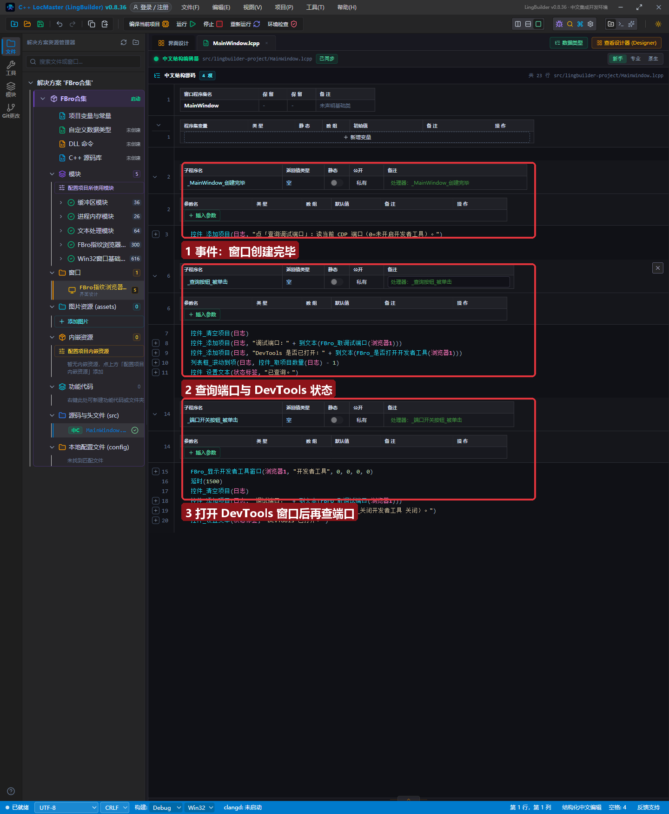
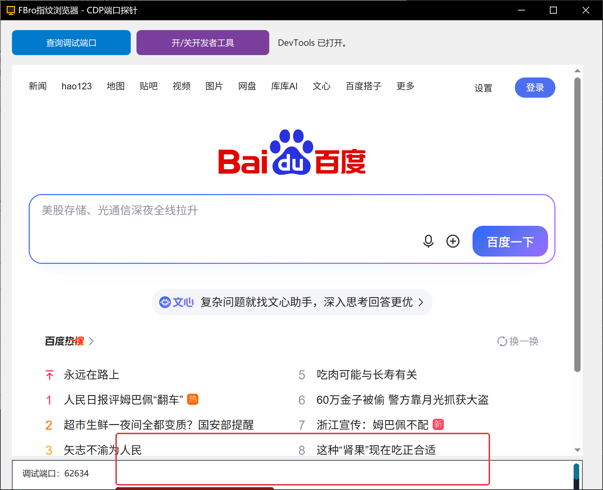

# FBro 合集 11 · CDP 调试端口与连接：让外部工具接管浏览器

> 《LingBuilder FBro 指纹浏览器合集》第 11 集（自动化篇）。从这一集起进入**自动化篇**：CDP（Chrome DevTools Protocol）是 Chromium 官方的调试协议——Selenium、Playwright、Puppeteer 全都靠它驱动浏览器。FBro 把 CDP 端口开放给你：**一条命令拿到端口号，任何 CDP 工具都能接管这台指纹浏览器**。本集先讲端口语义与开关方法。全程约 25 分钟。
>
> **模块获取**：启用 **FBro指纹浏览器模块**（本集命令全部非 VIP）。
>
> 前置要求：会新建窗口项目、会摆控件。本集源码包见文末。

## 这一集你将学会

- `FBro_取调试端口(控件名)`：读当前 CDP 调试端口的**两种模式语义**
- `FBro_显示开发者工具窗口`：打开官方 DevTools（也是确认 CDP 活着的直观方式）
- 端口连通的验证方法：浏览器访问 `http://127.0.0.1:端口/json/version`
- 两种模式下端口语义的区别（进程内 vs 独立进程）

## 1. CDP 端口的两模式语义

`FBro_取调试端口(控件名)` 的返回值随进程模式而不同：

| 进程模式 | 端口语义 |
| --- | --- |
| **进程内**（本集） | 初始化时按控件的「启用开发者工具」属性**预留回环端口**；任一进程内控件启用 DevTools 即开启。返回 0 = 尚未初始化/未启用/预留失败 |
| **独立进程**（第 2 集） | 返回宿主进程的 CDP 端口（宿主启动即确定） |

**CDP 端点三件套**（拿到端口后，浏览器访问即可验证连通）：

```
http://127.0.0.1:端口/json/version   ← 版本信息（最直观）
http://127.0.0.1:端口/json/list      ← 可接管的页面列表
http://127.0.0.1:端口/json           ← 同 list
```

## 2. 界面与代码

窗口 860×700：两个按钮（查询调试端口 / 开·关开发者工具）+ FBroBrowser（百度）+ 日志条：



查询按钮两行核心：

```
控件_添加项目(日志, "调试端口：" + 到文本(FBro_取调试端口(浏览器1)))
控件_添加项目(日志, "DevTools 是否已打开：" + 到文本(FBro_是否打开开发者工具(浏览器1)))
```

「开/关开发者工具」按钮调 `FBro_显示开发者工具窗口(浏览器1, "开发者工具", 0, 0, 0, 0)`——位置尺寸全传 0 用默认值；这是个**异步任务**命令（返回任务句柄，可用 `FBro任务_*` 读取），打开后再查端口。

## 3. 运行验证



点「开/关开发者工具」：官方 DevTools 窗口弹出；日志显示 **调试端口：62634**（每次启动端口号不同，动态分配）。此时把 `http://127.0.0.1:62634/json/version` 粘到任意浏览器——返回 JSON（`"Browser": "Chrome/135..."`），CDP 端点活着。

**这就是自动化的入口**：Selenium 里 `ChromeOptions.debugger_address = "127.0.0.1:62634"`，Playwright 里 `connect_over_cdp("http://127.0.0.1:62634")`——外部工具从此接管**这台带着指纹的浏览器**（下一集实战）。

## 4. 端口语义三条红线

1. **返回 0 ≠ 出错**：进程内模式下「启用开发者工具」属性没勾、或浏览器尚未创建完成，都返回 0——先确认属性与就绪状态再查；
2. **端口是回环的**：只监听 `127.0.0.1`，外部机器连不上（安全设计，不要试图暴露到局域网）；
3. **端口每次启动会变**：自动化脚本要**每次先调 `FBro_取调试端口` 再连接**，不要写死端口号。

## 5. 课后练习

1. 把 `enableDevTools` 属性关掉重新编译，查端口确认返回 0；再打开属性验证恢复；
2. 拿端口访问 `/json/list`，找到百度标签页的 `id`（下一集连接的凭证）；
3. 思考：独立进程模式下多开 4 个区域，`FBro_取调试端口` 会返回几个端口？（提示：每个宿主进程一个端口，区域族有独立的端口查询方式，第 12 集展开。）

## 源码包

本集完整源码一键导入：[CDP端口探针.lcpppkg](CDP端口探针.lcpppkg)。
