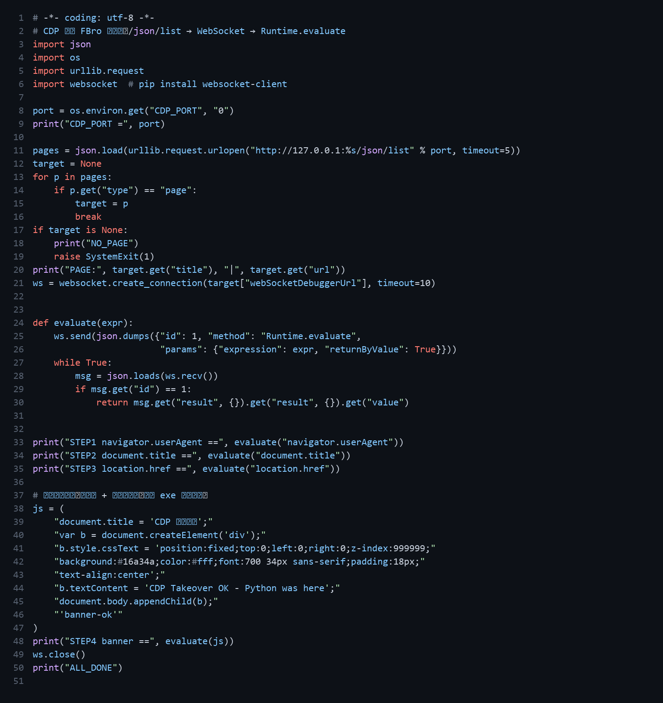

# FBro 合集 12 · CDP 自动化实战：让外部 Python 接管指纹浏览器

> 《LingBuilder FBro 指纹浏览器合集》第 12 集（自动化篇）。第 11 集拿到了 CDP 端口，本集真刀真枪：**用十几行 Python 通过 CDP 接管 FBro 浏览器**——读取页面 UA/标题、修改页面标题、在页面上画一条横幅。这就是「外部自动化工具 + 指纹浏览器」的标准接入姿势。全程约 30 分钟。
>
> **模块获取**：启用 **FBro指纹浏览器模块**。
>
> 前置要求：学过[第 11 集](../11_CDP调试端口与连接/README.md)；电脑装有 Python 3 与 `websocket-client`（`pip install websocket-client`）。本集源码包见文末。

## 1. 接管原理一页纸

```
FBro 程序（带指纹的浏览器）
   ↑ 调试端口 127.0.0.1:62634（第 11 集 FBro_取调试端口 拿到）
外部 Python
   1) GET  http://127.0.0.1:62634/json/list   → 页面列表（含 webSocketDebuggerUrl）
   2) WebSocket 连上目标页面的调试地址
   3) 发 {"method":"Runtime.evaluate","params":{"expression":"JS代码"}}
   4) 浏览器执行 JS，把结果送回来
```

外部代码**不注入、不Hook、不破坏指纹**——它只是在浏览器「自己的调试口」上发号施令，网站看到的一切仍是那台「假电脑」。

## 2. 驱动脚本（完整源码）



脚本流程与逐段说明：

| 步骤 | 代码 | 作用 |
| --- | --- | --- |
| ① 拿页面列表 | `urllib.urlopen("…/json/list")` | 每个标签页一条记录，取第一个 `type=="page"` |
| ② 连调试 WS | `websocket.create_connection(webSocketDebuggerUrl)` | 直连该页面的调试通道 |
| ③ 执行 JS | `Runtime.evaluate` + `returnByValue` | 返回值直接 JSON 化送回 |
| ④ 三连读 | `navigator.userAgent` / `document.title` / `location.href` | 验证看到的还是指纹身份 |
| ⑤ 外部改页 | 改 `document.title` + 插入绿色横幅 | **眼见为实**：外部代码确实在这台浏览器里跑 |

## 3. 运行流程

1. 运行 FBro 程序（窗口里浏览器已打开百度）；点「查询调试端口」，状态栏显示端口号；
2. 把端口号填进 `cdp_drive.py` 同目录环境变量（`set CDP_PORT=62634`）或直接改脚本首行；
3. `python cdp_drive.py`——控制台依次打印：

```
CDP_PORT = 62634
PAGE: 百度一下，你就知道 | https://www.baidu.com/
STEP1 navigator.userAgent == Mozilla/5.0 ... Chrome/135.0.0.0 Safari/537.36
STEP2 document.title == 百度一下，你就知道
STEP3 location.href == https://www.baidu.com/
STEP4 banner == banner-ok
ALL_DONE
```

4. 回看 FBro 程序窗口：**页面顶部出现绿色横幅「CDP Takeover OK - Python was here」**，标题栏变成「CDP 接管成功」——外部接管实证完成。

## 4. 配合指纹的意义（本集的「为什么」）

普通浏览器也能被 CDP 接管——**重点是接管的对象**：这台浏览器带着完整的指纹身份（第 5/6 集配置）+ 独立会话（第 4/7 集）+ 独立代理（第 8 集）。外部自动化代码通过 CDP 操作的每一秒，网站看到的是**那台假电脑上的那个账号**。自动化与防关联在此汇合：

| 你想要的 | 组合 |
| --- | --- |
| 批量自动化多账号 | 第 10 集批量多开 + 本集每实例一个 CDP 端口 |
| 自动化中保持身份一致 | 第 5/6 集固定指纹 + 本集接管 |
| 自动化中换身份 | 第 6 集 `FBroVIP_应用指纹JSON`（可在接管前调用） |

## 5. 三个实战提示

1. **页面要选对**：`/json/list` 里可能有多个 page（弹窗/iframe 宿主），按 `url` 关键字过滤目标页再连；
2. **执行是异步的**：`Runtime.evaluate` 立即返回，页面跳转类 JS 要配合 `setTimeout` 或轮询取结果；
3. **别关 DevTools**：进程内模式的 CDP 端口与「启用开发者工具」属性绑定（第 11 集），属性关了端口就没了。

## 6. 课后练习

1. 在 STEP4 后追加一步：`evaluate("location.href='https://www.browserscan.net/'")`，让浏览器跳到指纹检测页；
2. 把脚本改成**循环监听**：每 10 秒读一次 `document.title` 打印（提示：WS 连接保持 + `time.sleep`）；
3. 思考：如果同一程序里有 4 个区域实例（第 10 集），每个实例的 CDP 端口如何区分？（提示：每实例独立宿主进程=独立端口；区域族后续提供按编号查询的入口。）

## 源码包

- FBro 程序源码：[CDP自动化实战.lcpppkg](CDP自动化实战.lcpppkg)；
- 外部驱动脚本：`cdp_drive.py`（已含在上方代码图中，可直接抄录）。
