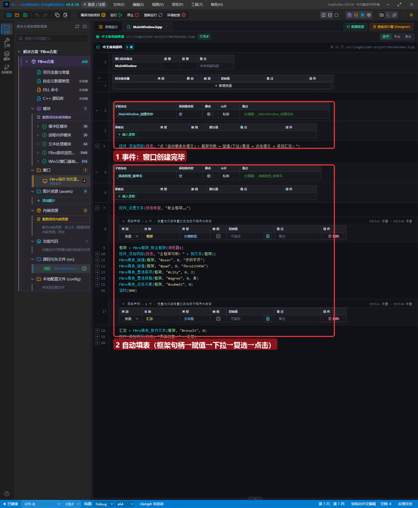
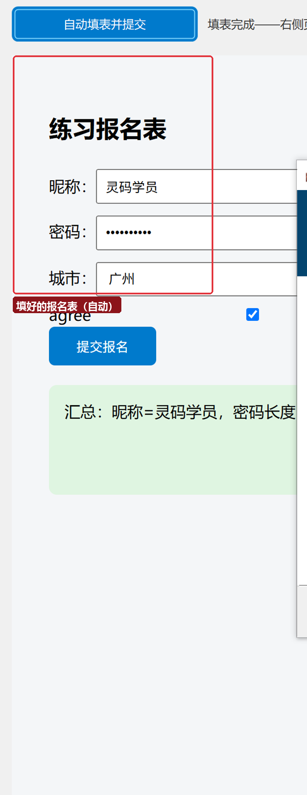

# FBro 合集 13 · 网页填表（一）：自动填写与提交报名表

> 《LingBuilder FBro 指纹浏览器合集》第 13 集（自动化篇）。「网页填表」是自动化最常用的能力：自动输入昵称密码、选择下拉框、勾选协议、点提交按钮。本集做一个**练习报名表**页面，用 FBro 填表族命令全自动完成一遍——填完页面自己显示汇总，填没填对一目了然。全程约 30 分钟。
>
> **模块获取**：启用 **FBro指纹浏览器模块 + FBro自动化模块**（填表族命令在自动化模块里，本集最重要的一个开关）。
>
> 前置要求：学过[第 11 集](../11_CDP调试端口与连接/README.md)（框架句柄概念）。本集源码包见文末（含练习页 form.html）。

## 这一集你将学会

- `FBro框架_取主框架(控件名)`：拿页面主框架句柄（填表族命令的第一参数）
- `FBro填表_赋值(框架, "#选择器", 0, 值)`：CSS 选择器定位输入框并赋值
- `FBro填表_置选择项`（下拉）/ `FBro填表_置选择框`（复选）/ `FBro填表_点击元素`（按钮）
- `FBro填表_取内文本`：读回页面元素文本（验证填表结果）

## 1. CSS 选择器一分钟入门

填表族用 **CSS 选择器**找页面元素。最常用的三种写法：

| 选择器 | 匹配 | 示例 |
| --- | --- | --- |
| `#名字` | `id="名字"` 的元素（**唯一，最常用**） | `#user` → `<input id="user">` |
| `.类名` | `class="类名"` 的元素 | `.input-box` |
| `表单#login input` | 组合定位 | login 表单里的输入框 |

**先看页面的 id 再写选择器**：浏览器 F12 → 元素面板，找到输入框的 `id` 属性即可。本集练习页的元素 id：`#user`（昵称）、`#pwd`（密码）、`#city`（城市下拉）、`#agree`（协议复选）、`#submit`（提交按钮）、`#result`（汇总区）。

## 2. 界面与代码

窗口 1300×920：整个客户区是 FBroBrowser（加载本地练习页 `form.html`，随源码包分发），顶部「自动填表并提交」按钮：



事件处理器完整六步：

```
框架 = FBro框架_取主框架(浏览器1)
FBro填表_赋值(框架, "#user", 0, "灵码学员")
FBro填表_赋值(框架, "#pwd", 0, "fbro123456")
FBro填表_置选择项(框架, "#city", 0, 2)
FBro填表_置选择框(框架, "#agree", 0, 真)
FBro填表_点击元素(框架, "#submit", 0)
```

参数规律（填表族全族一致）：**框架句柄 → CSS 选择器 → 序号 → 值/动作**。「序号」用于同名选择器命中多个元素时选第几个（从 0 起；唯一元素传 0）。

## 3. 运行验证



点「自动填表并提交」：昵称、密码自动输入，城市自动选中「广州」（`置选择项` 序号 2=第三个选项），协议自动勾上，提交按钮自动点击——页面绿色汇总区显示 `汇总：昵称=灵码学员，密码长度=10，城市=广州，已同意=真`。**汇总由页面自己的 JS 生成**——不是我们写进去的，所以它能证明每一步都真实生效。

顶部状态栏同步显示「填表完成」：


## 4. 三个新手坑

1. **取主框架要在页面加载后**：刚创建浏览器立即取框架可能拿到无效句柄（返回 0）——等待加载完成（`FBro_实例等待加载超时` 或事件「LoadEnd」）后再取；
2. **赋值对 JS 渲染页要配「触发事件」**：有些网站监听 `input`/`change` 事件才认值，赋值后补一句 `FBro填表_触发事件(框架, "#user", 0, "change")`；
3. **序号从 0 起**：`#city` 只有一个，传 0；如果页面有 5 个同名 `.radio`，第 3 个是序号 2。

## 5. 课后练习

1. 给练习页加一个「邮箱」输入框（`<input id="email">`），填表代码里补一行赋值；
2. 把城市改成 `置选择项(框架, "#city", 0, 3)`，看汇总变成「深圳」；
3. 用 `FBro填表_取值(框架, "#user", 0)` 把昵称读回来显示在日志（下一集「取值回读」的主角）。

## 源码包

本集完整源码一键导入：[网页填表入门.lcpppkg](网页填表入门.lcpppkg)（含练习页 form.html，导入后按 F5 即可运行）。
