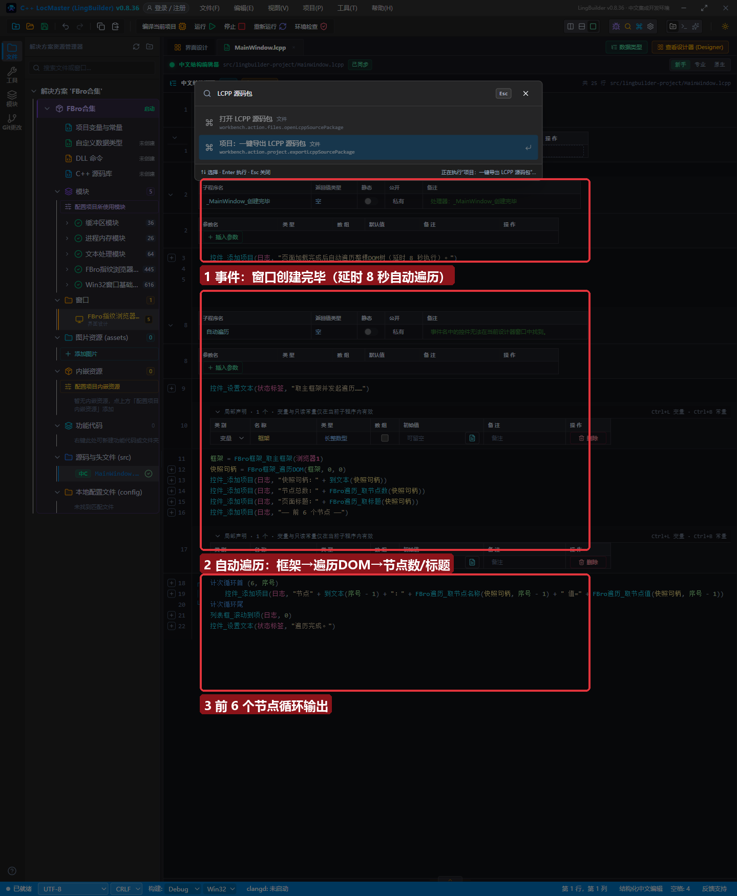
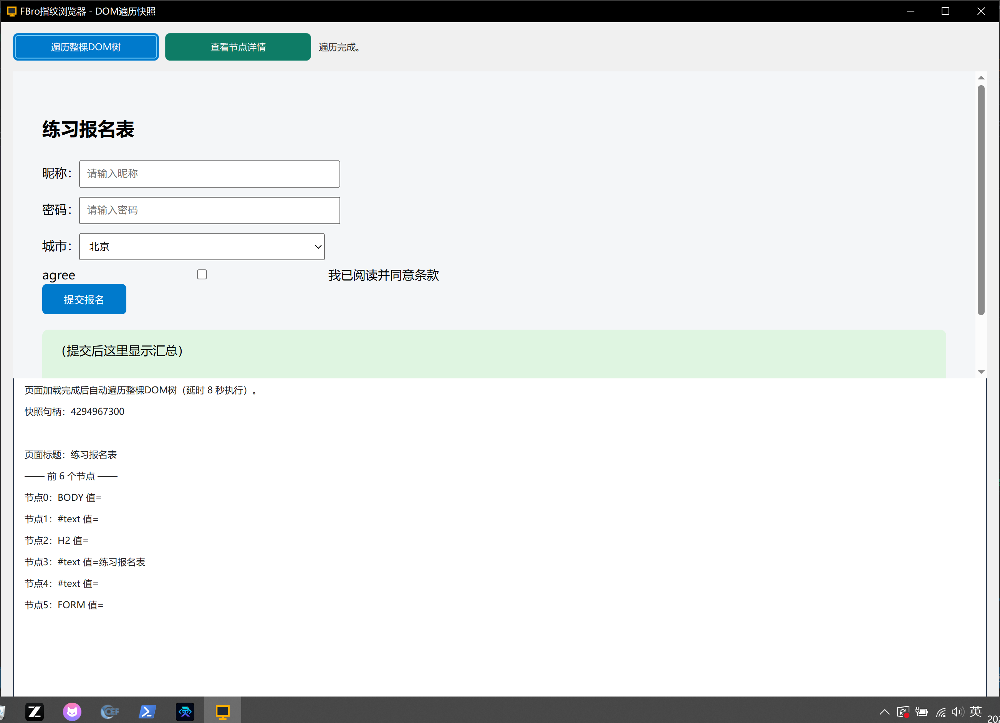

# FBro 合集 15 · DOM 遍历快照（一）：整树读取

> 《LingBuilder FBro 指纹浏览器合集》第 15 集（自动化篇）。前面的填表是「按选择器找一个元素」，本集的 **DOM 遍历快照**是「一次性把整棵页面树拍下来」：一条命令拿到快照句柄，页面里所有节点（BODY、H2、FORM、INPUT……）都能按序号访问名称、值、路径、属性。全程约 25 分钟。
>
> **模块获取**：启用 **FBro指纹浏览器模块 + FBro自动化模块**（遍历族在自动化模块）。
>
> 前置要求：学过[第 13 集](../13_网页填表一/README.md)。本集源码包见文末（含练习页 form.html）。

## 这一集你将学会

- `FBro框架_遍历DOM(框架, 深度, 节点数)`：生成整树快照（深度/节点数传 0 用默认 16/4000）
- `FBro遍历_取节点数 / 取标题 / 取节点名称 / 取节点值`：按序号访问快照节点
- 全局变量保存快照句柄、延时自动执行、计次循环输出节点列表

## 1. 快照机制一分钟

`FBro框架_遍历DOM` 不是逐个查元素——它**同步遍历整棵树并序列化成一份受管快照**，返回快照句柄。之后所有 `FBro遍历_*` 命令都拿这个句柄按**节点序号**（0 起）访问。三条红线：

1. **快照是瞬时的**：页面后续变化不会反映到旧快照，需要重新遍历；
2. **句柄存全局变量**：跨事件访问快照必须用项目全局变量保存句柄；
3. **遍历要在页面加载完成后**：本集用 `延时(8000)` + 直接调用子程序（Loaded 后 8 秒自动执行）。

## 2. 界面与代码

窗口 1300×940：上半 FBroBrowser（加载练习报名表页），下半日志列表框。**不需要任何点击**——窗口创建完毕后延时 8 秒自动遍历并输出：



核心三行：

```
框架 = FBro框架_取主框架(浏览器1)
快照句柄 = FBro框架_遍历DOM(框架, 0, 0)
控件_添加项目(日志, "节点总数：" + FBro遍历_取节点数(快照句柄))
```

## 3. 运行验证



程序启动 8 秒后自动遍历，日志依次输出：快照句柄（4294967300）、节点总数、页面标题（练习报名表）、前 6 个节点明细（BODY / #text / H2 / #text「练习报名表」/ #text / FORM）——**页面整棵树已被快照捕获**。

## 4. 两个新手坑

1. **`全局变量.快照句柄` 是错误写法**：项目全局变量直接写名字 `快照句柄`（在「项目全局变量.lcpp」里用 `全局 长整数型 快照句柄 = 0` 声明），没有前缀；
2. **`延时(8000, &子程序)` 双参版**：处理器子程序必须是**无参**的；如果只想等一下再顺序执行，用单参 `延时(8000)` 后直接调子程序名更直观。

## 5. 课后练习

1. 把 `取节点名称` 换成 `取节点类型`，观察节点类型数字的分布（1=元素、3=文本）；
2. 把最大深度从 0（默认 16）改成 2，看节点总数骤减；
3. 预习：下一集用 `FBro遍历_按路径设属性` **写回**页面节点（快照路径 → 定位 → 修改）。

## 源码包

本集完整源码一键导入：[DOM遍历快照.lcpppkg](DOM遍历快照.lcpppkg)（含练习页 form.html）。
