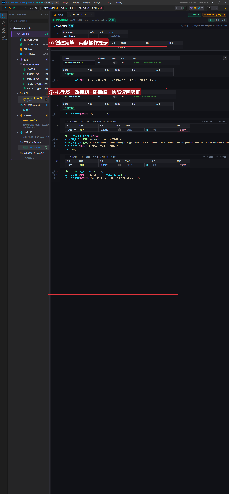

# FBro 合集 17 · JS 交互与本地页面：执行 JS 改页面 + 快照读回验证

> 《LingBuilder FBro 指纹浏览器合集》第 17 集（自动化篇）。`FBro框架_执行JS` 是「万能通道」：一行命令在页面里执行任意 JavaScript——改标题、插横幅、点按钮、读状态都行。本集做一个**写入+读回验证**的闭环：JS 写入页面后，再用 DOM 快照把改动读回来证明生效。全程约 25 分钟。
>
> **模块获取**：启用 **FBro指纹浏览器模块 + FBro自动化模块**。
>
> 前置要求：学过[第 15 集](../15_DOM遍历快照一/README.md)（快照读回）。本集源码包见文末。

## 这一集你将学会

- `FBro框架_取主框架(控件名)` + `FBro框架_执行JS(框架, JS代码, "", 1)`：万能执行通道
- **JS 写入 + DOM 快照读回**的验证闭环（执行不返回值，用快照证明改动生效）
- 多条 JS 语句分次执行的最佳实践

## 1. 执行 JS 一分钟

```
框架 = FBro框架_取主框架(浏览器1)
FBro框架_执行JS(框架, "document.title='JS 已接管本页'", "", 1)
```

参数：框架句柄 → JS 代码 → 脚本地址（传空）→ 起始行（传 1）。**注意：执行命令不返回 JS 结果**——要验证效果，用第 15 集的 DOM 快照读回，或让 JS 把结果写到页面里再用 `FBro填表_取值/取内文本` 读。

## 2. 界面与代码

窗口 1300×940：FBroBrowser（百度）+ 日志。「执行JS读写页面」按钮做两件事：



```
FBro框架_执行JS(框架, "document.title='JS 已接管本页'", "", 1)
FBro框架_执行JS(框架, "var b=document.createElement('div');b.style.cssText='...';b.textContent='JS Takeover OK';document.body.appendChild(b)", "", 1)
```

JS 写完后**再用快照读回验证**：`快照标题 = FBro遍历_取标题(快照)`——若快照标题是「JS 已接管本页」，写入实证完成。

## 3. 运行验证

点按钮后：页面顶部插入绿色横幅、标签标题改变；日志显示「快照标题 = JS 已接管本页」——**写入+读回闭环完成**。

## 4. 三个实战提示

1. **多条 JS 分次执行**：每条 `执行JS` 独立成行，比塞一条超长 JS 可读；
2. **JS 里的引号**：JS 字符串用单引号（`'文本'`），与 lcpp 的双引号字符串区分，避免转义混乱；
3. **中文写回页面**：JS 字符串里的中文直接写即可（UTF-16 全程传递），只有 base64+eval 注入才会乱码（那是第 13~16 集视频里官方老示例的做法，不必用）。

## 5. 课后练习

1. 执行 JS 在页面里插入一个 5 秒后自动消失的提示条（`setTimeout` 移除）；
2. 用快照读回验证 `document.title` 的修改（对照第 15 集输出格式）；
3. 思考：JS 改动会进 DOM 快照吗？（会——快照遍历的是当前实时 DOM。）

## 源码包

本集完整源码一键导入：[JS交互与本地页面.lcpppkg](JS交互与本地页面.lcpppkg)。
