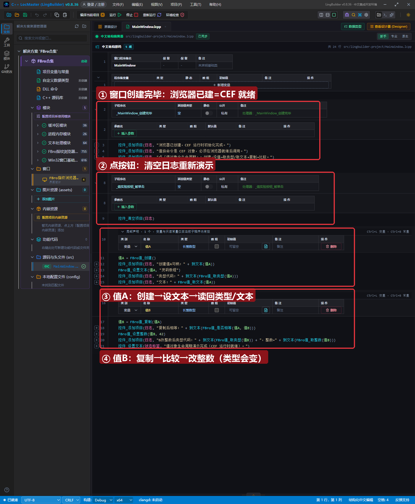
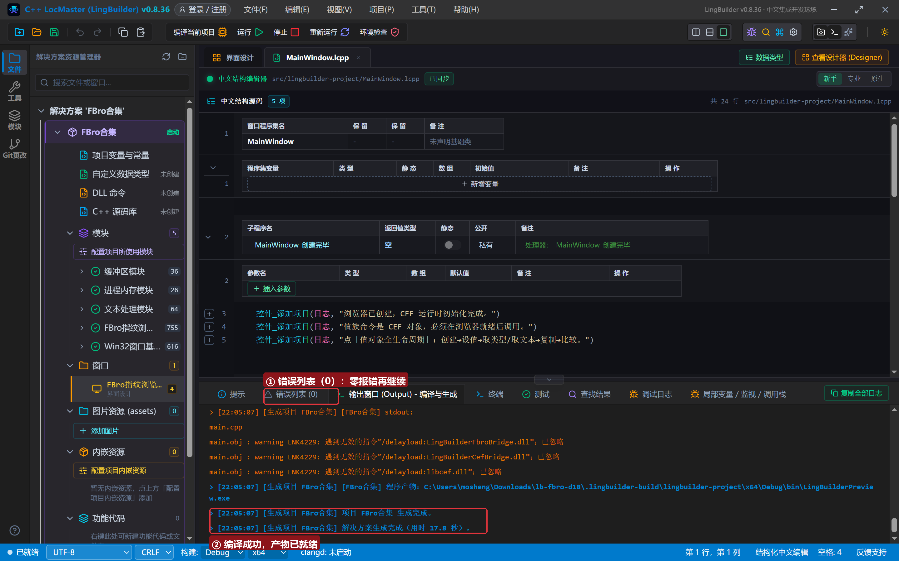
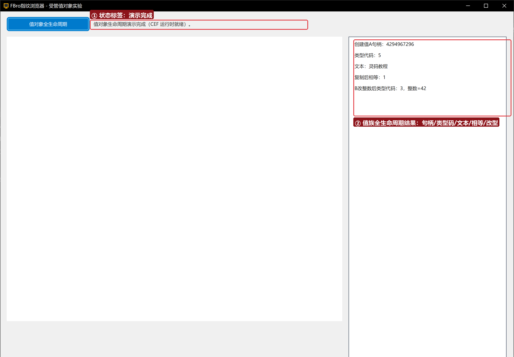

# FBro 合集 18 · 同步辅助类（一）：受管值对象——句柄生命周期与「CEF 就绪」红线

> 《LingBuilder FBro 指纹浏览器合集》第 18 集（自动化篇）。FBro 的「同步辅助类」（官方 HsValue/HsDom/HsList/HsBool/HsInt/HsStr 一族）是把网页数据搬到本地代码里**同步**操作的载体；在 LingBuilder 里它们统一表现为**长整数型受管句柄**。本集用「值族 23 条命令」做一次全生命周期实验：创建→设值→取类型/取文本→复制→比较→改类型。全程约 25 分钟。
>
> **模块获取**：启用 **FBro指纹浏览器模块**（值/字典/列表等对象族在其 fbro.objects 子模块，漏启用会整批报「未知命令」）+ Win32窗口基础模块。
>
> 前置要求：学过[第 15 集](../15_DOM遍历快照一/README.md)——DOM 快照句柄就是同一套受管机制。本集源码包见文末。

## 这一集你将学会

- **受管句柄体系**：句柄＝长整数型局部变量，官方对象由桥统一托管
- 值族核心命令：`FBro值_创建/设置文本/取类型/取文本/复制/是否相等/设置整数/取整数`
- ⚠️ 本集最重要的红线：**值族命令是 CEF 对象，必须在浏览器创建后调用**——无浏览器的「纯值」工程会在第一个 `FBro值_创建` 时直接崩溃

## 1. 受管句柄一分钟

```
值A = FBro值_创建()
```

返回长整数型句柄（实测首个句柄是 4294967296，即 2³² 起跳）。句柄不是指针：不能当数算、不能自己释放内存；用完可 `FBro对象_释放`，或交给父对象/容器托管。第 15~16 集里拿到的「快照句柄」「节点句柄」与第 19 集的列表句柄，生命周期规则与本集完全一致——一通百通。

## 2. 界面与代码

窗口 1300×940：FBroBrowser（about:blank，**专职把 CEF 运行时拉起来**）+ 右侧日志。



点「值对象全生命周期」按钮执行：

```
值A = FBro值_创建()
FBro值_设置文本(值A, "灵码教程")
控件_添加项目(日志, "类型代码：" + 到文本(FBro值_取类型(值A)))
控件_添加项目(日志, "文本：" + FBro值_取文本(值A))
值B = FBro值_复制(值A)
控件_添加项目(日志, "复制后相等：" + 到文本(FBro值_是否相等(值A, 值B)))
FBro值_设置整数(值B, 42)
控件_添加项目(日志, "B改整数后类型代码：" + 到文本(FBro值_取类型(值B)) + "，整数=" + 到文本(FBro值_取整数(值B)))
```



## 3. 运行验证



日志逐行输出：创建句柄 4294967296 → 类型代码 5（文本）→ 文本「灵码教程」→ 复制后相等 1 → B 改整数后类型代码 3、整数=42。**同一个值对象，类型随内容从文本变整数**——这就是「受管值」：类型是运行期属性，不用提前声明。

类型代码对照 CEF 值类型枚举：3=整数、4=小数、5=文本、2=逻辑、7=字典、8=列表（1=空、0=无效）。

## 4. 三条实战红线

1. **「CEF 就绪」红线（本集核心）**：`FBro值_创建` 返回的是 `CefRefPtr<CefValue>`（见官方 FBroValue.h）——没有浏览器控件的工程，CEF 从未初始化，首个值族调用直接把进程带崩（libcef 崩溃、无任何弹窗）。**工程里放一个 FBroBrowser 控件（哪怕停在 about:blank）即可根治**；
2. **整数拼字符串必须包 `到文本()`**：`"类型：" + FBro值_取类型(值A)` 会生成「指针+整数+指针」的 C++ 直接编译失败（C2110），且 IDE 错误列表可能不显示编译器输出——拼数字一律 `到文本()`；
3. **比较与复制是深拷贝语义**：`FBro值_复制` 产生独立对象（改 B 不影响 A）；`FBro值_是否相等` 比的是内容而非句柄。

## 5. 课后练习

1. 把 值B 依次设置逻辑、小数、空值，每次取类型并记录代码变化；
2. 用 `FBro值_取字典/取列表` 观察父对象托管：值被释放后字典句柄还能用吗？
3. 思考：为什么 4294967296 = 2³²？（桥把「官方对象指针注册表」的槽位号放在高 32 位——句柄本身不含真实地址。）

## 源码包

本集完整源码一键导入：[同步辅助类一.lcpppkg](同步辅助类一.lcpppkg)。
