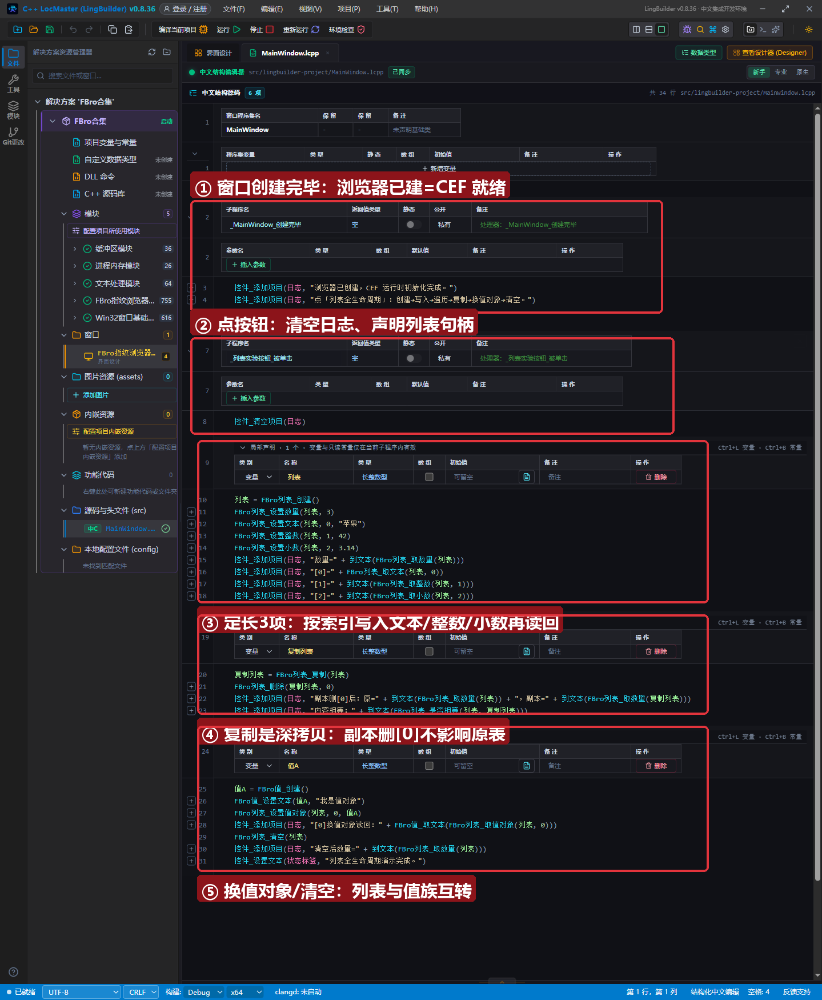
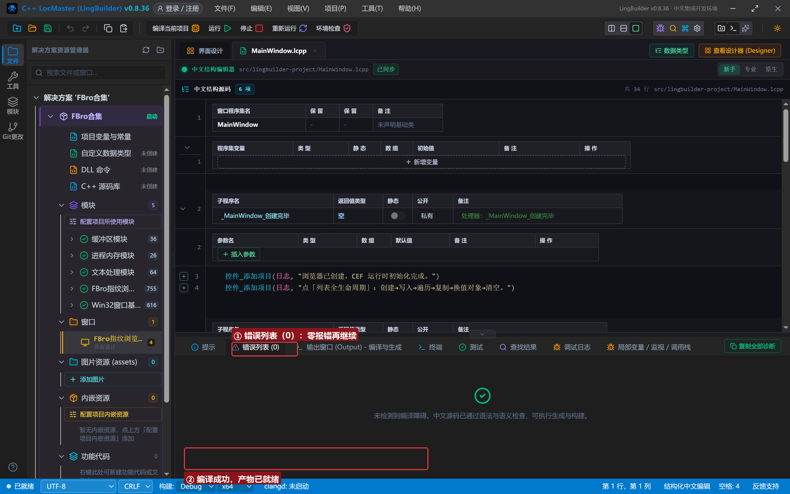
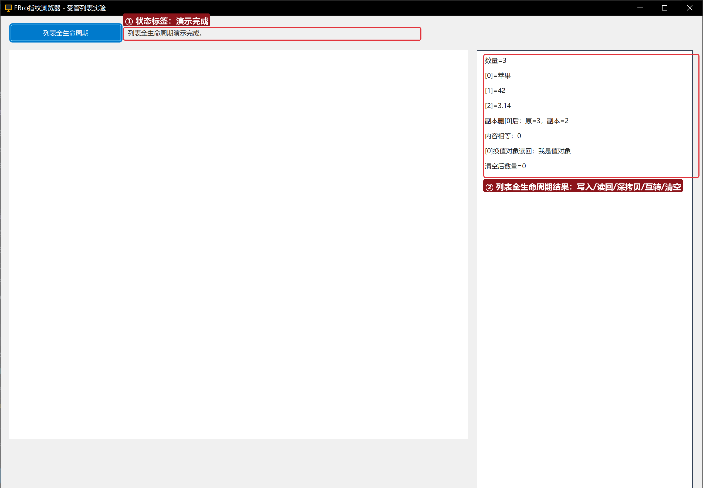

# FBro 合集 19 · 同步辅助类（二）：受管列表——按索引读写与「值/列表互转」

> 《LingBuilder FBro 指纹浏览器合集》第 19 集（自动化篇）。同步辅助类的第二站是**受管列表**（官方 HsList，LingBuilder 命令族 `FBro列表_*` 共 29 条）：定长数组语义，按索引读写任意类型，能和第 18 集的值对象互转。本集做一次全生命周期实验：创建→定长→三类型写入→读回→深拷贝对照→换值对象→清空。全程约 25 分钟。
>
> **模块获取**：启用 **FBro指纹浏览器模块**（列表族在 fbro.objects 子模块）+ Win32窗口基础模块。
>
> 前置要求：学过[第 18 集](../18_同步辅助类一/README.md)（受管句柄与「CEF 就绪」红线）。本集源码包见文末。

## 这一集你将学会

- `FBro列表_创建/设置数量/取数量`：受管列表是**定长数组**——先定长度再按索引写
- `FBro列表_设置文本/设置整数/设置小数` 与 `取文本/取整数/取小数`：同一列表里每项类型可以不同
- `FBro列表_复制/删除/是否相等/清空`：深拷贝语义
- `FBro列表_设置值对象/取值对象`：列表 ↔ 值族互转的桥

## 1. 受管列表一分钟

```
列表 = FBro列表_创建()
FBro列表_设置数量(列表, 3)
FBro列表_设置文本(列表, 0, "苹果")
```

**索引从 0 开始**（区别于中文编程常见的「计次从 1 计」）。列表长度用 `设置数量` 显式给定，写入前必须先定长；`删除` 会把后面的项前移、长度减一。

## 2. 界面与代码

窗口 1300×940：FBroBrowser（about:blank，负责把 CEF 运行时拉起来——第 18 集讲过的红线）+ 右侧日志。



「列表全生命周期」按钮执行四段实验：③ 定长 3 项按索引写入文本/整数/小数再逐项读回；④ 复制副本并删除副本的 [0]，对照原表数量不变；⑤ 在原表 [0] 换入一个值对象再读回，最后清空。



## 3. 运行验证



日志逐行输出：数量=3 → [0]=苹果 → [1]=42 → [2]=3.14 → 副本删[0]后：原=3，副本=2 → 内容相等：0 → [0]换值对象读回：我是值对象 → 清空后数量=0。**每一步都与代码一一对应**。

## 4. 三条实战提示

1. **写入前必须定长**：`CefListValue` 不支持追加式 `加成员`——先 `设置数量` 再按索引写，越界写入返回错误码不改数据；
2. **取值命令按类型取**：[1] 存的是整数就用 `取整数`，用 `取文本` 取整数项会拿不到预期内容；不确定类型时用 `FBro列表_取类型` 先探一下（类型代码同第 18 集对照表）；
3. **`设置值对象` 之后原值句柄归列表管**：第 18 集的「被拥有」概念在这里生效——别再手动释放已交出去的值对象。

## 5. 课后练习

1. 用计次循环写入 1~10 十个整数再逐项读出（复习第 10 集的计次循环）；
2. 用 `FBro列表_取列表/设置列表` 做一个嵌套列表（列表的列表）；
3. 思考：为什么 `内容相等：0`？——`是否相等` 逐项比内容，副本删过一项自然不相等。

## 源码包

本集完整源码一键导入：[同步辅助类二.lcpppkg](同步辅助类二.lcpppkg)。
