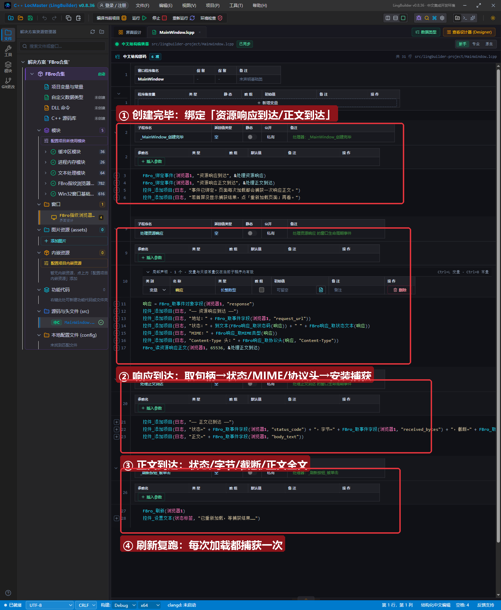
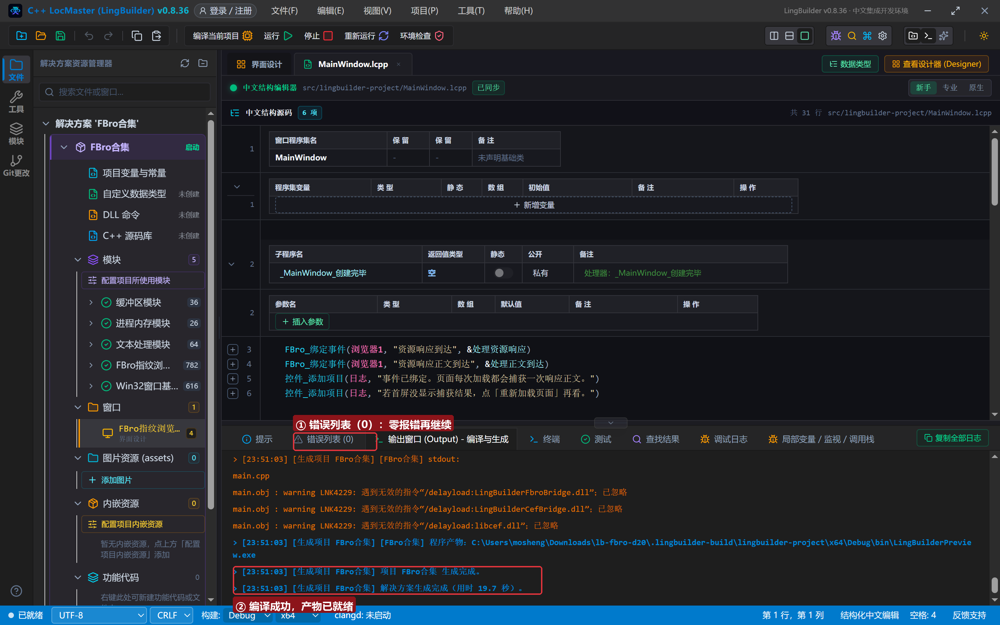
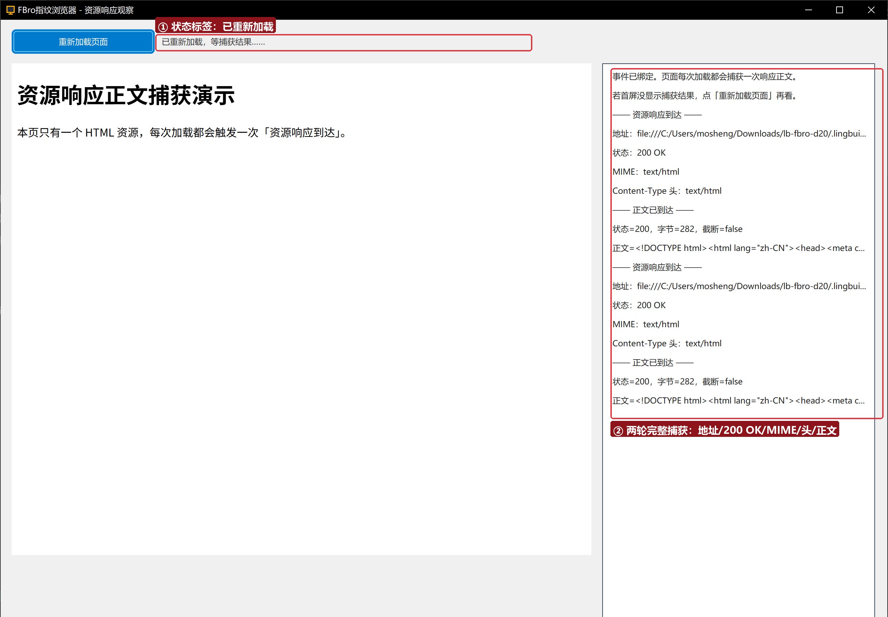

# FBro 合集 20 · 获取资源响应正文：`FBro_读资源响应正文` + 响应族读取

> 《LingBuilder FBro 指纹浏览器合集》第 20 集（拦截与协议篇）。网页里每一个资源（HTML/JS/图片/接口）到达时都会触发**「资源响应到达」**事件；在这一事件里安装 `FBro_读资源响应正文`，就能把响应正文（body）完整拿到手——这是抓接口数据、存网页快照、做响应分析的第一块积木。全程约 25 分钟。
>
> **模块获取**：启用 **FBro指纹浏览器模块**（本集用事件族 fbro.events 子模块 + 响应族）+ Win32窗口基础模块。
>
> 前置要求：学过[第 03 集](../03_导航与页面事件/README.md)（`FBro_绑定事件`）。本集源码包见文末。

## 这一集你将学会

- `FBro_绑定事件(浏览器1, "资源响应到达", &处理器)`：资源级事件（每次加载触发 N 次，N＝资源数）
- `FBro_取事件对象字段(浏览器1, "response")`：从事件包取出**响应受管句柄**（64 位长整数型）
- `FBro响应_取状态码/取状态文本/取MIME类型/取协议头`：响应族四连读
- `FBro_读资源响应正文(浏览器1, 最大字节数, &完成处理器)`：**有界正文捕获**，完成后触发「资源响应正文到达」
- `FBro_取事件字段(浏览器1, "status_code/received_bytes/truncated/body_text")`：读取捕获结果

## 1. 两段式事件一分钟

资源正文不是一次事件拿到的——它是**两段式**：

```
事件 处理资源响应()                    ← 第一段：响应头先到
    响应 = FBro_取事件对象字段(浏览器1, "response")
    控件_添加项目(日志, "状态：" + 到文本(FBro响应_取状态码(响应)) + " " + FBro响应_取状态文本(响应))
    控件_添加项目(日志, "MIME：" + FBro响应_取MIME类型(响应))
    FBro_读资源响应正文(浏览器1, 65536, &处理正文到达)   ← 安装有界捕获
结束

事件 处理正文到达()                    ← 第二段：正文收完后触发
    控件_添加项目(日志, "状态=" + FBro_取事件字段(浏览器1, "status_code") + "，字节=" + FBro_取事件字段(浏览器1, "received_bytes") + "，截断=" + FBro_取事件字段(浏览器1, "truncated"))
    控件_添加项目(日志, "正文=" + FBro_取事件字段(浏览器1, "body_text"))
结束
```

`FBro_读资源响应正文` **只能在「资源响应到达」处理器里调用**（它服务的是“当前这个响应”）；最大字节数是护栏，超长会被 `truncated=true` 标记，不会撑爆内存。

## 2. 界面与代码

窗口 1300×940：FBroBrowser（加载本地 `page.html`，全页只有一个 HTML 资源，日志干净）+ 右侧日志 + 「重新加载页面」按钮。





## 3. 运行验证



每轮加载输出一组完整记录：地址（`file:///…/page.html`）→ 状态 200 OK → MIME text/html → Content-Type 头 text/html → 正文已到达（状态=200，字节=282，截断=false）→ 正文 `<!DOCTYPE html>…` 全文。点「重新加载页面」再跑一轮，结果一致。

## 4. 三条实战红线

1. **正文捕获只装一次**：同一响应重复调用 `读资源响应正文` 没有意义；每次「资源响应到达」对应一次安装。只想抓特定资源时，在处理器里按 `request_url` 过滤再安装；
2. **地址在请求不在响应**：`FBro响应_取地址` 对真实响应常为空——URL 挂在请求上，读事件包的 `request_url` 字段（或完成事件包的 `url` 字段）；
3. **`body_text` 是按 UTF-8 解码的文本**；二进制资源（图片/字体）请改读 `body_base64`。

## 5. 课后练习

1. 给处理器加 `request_url` 过滤，只捕获 `.html` 结尾的资源；
2. 把 `最大字节数` 改成 16 再加载，观察 `truncated=true` 与正文被截断；
3. 思考：为什么首屏日志可能没有捕获结果？（绑定发生在「创建完毕」，首屏资源可能在绑定前已经到达——点「重新加载页面」即可。）

## 源码包

本集完整源码一键导入：[获取资源响应正文.lcpppkg](获取资源响应正文.lcpppkg)（含 `page.html` 演示页，导入后把它复制到构建输出 bin 目录即可）。
