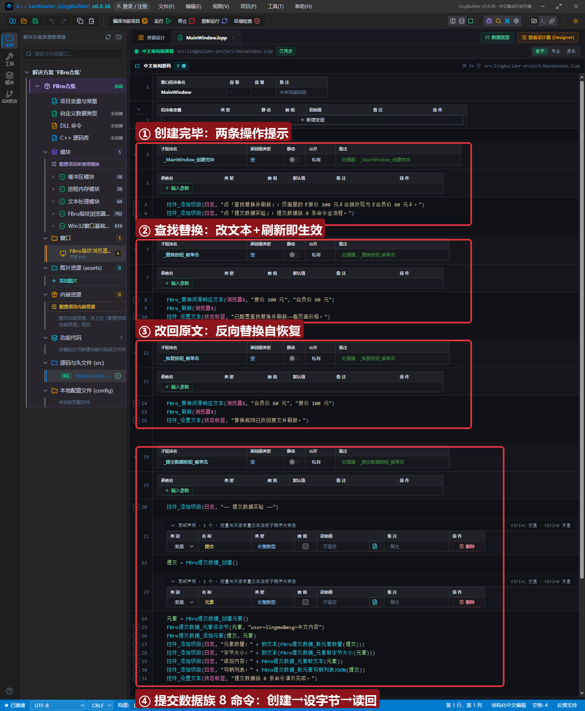
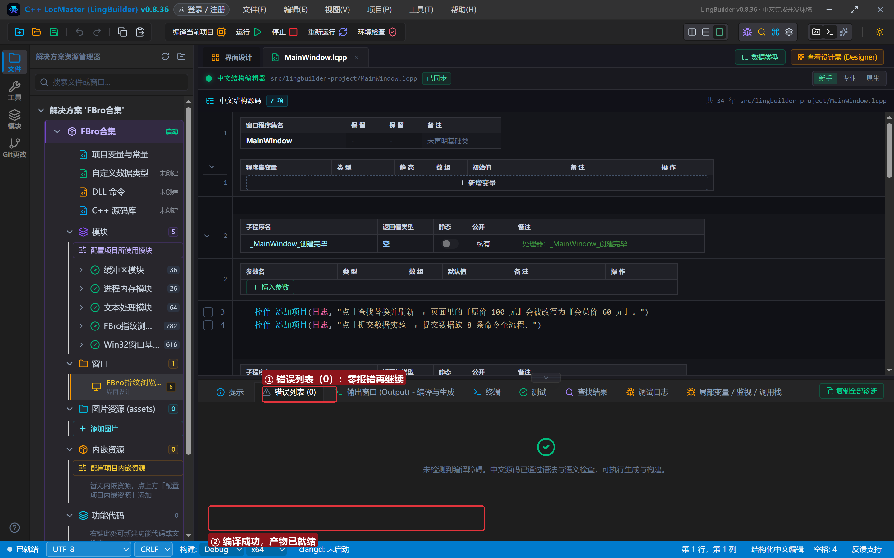
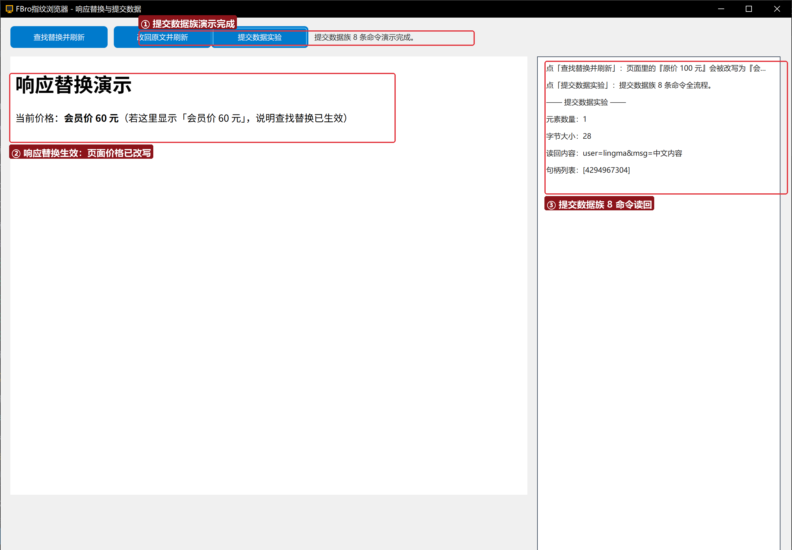

# FBro 合集 21 · 修改资源响应与提交数据：`FBro_替换资源响应文本` + 提交数据族

> 《LingBuilder FBro 指纹浏览器合集》第 21 集（拦截与协议篇）。上一集是「读」响应，这一集是「改」响应：一行 `FBro_替换资源响应文本` 就能把网页正文里的指定文本改写掉（二进制安全、流式处理、刷新即生效）。顺手把「提交数据族」8 条命令全流程走一遍——POST 请求体在代码里长什么样。全程约 25 分钟。
>
> **模块获取**：启用 **FBro指纹浏览器模块** + Win32窗口基础模块。
>
> 前置要求：学过[第 20 集](../20_获取资源响应正文/README.md)（资源事件与正文捕获）。本集源码包见文末。

## 这一集你将学会

- `FBro_替换资源响应文本(控件名, 查找内容, 替换内容)`：响应正文查找替换（按 UTF-8 字节匹配，替换为空＝删除）
- `FBro_替换资源响应内容(控件名, 地址, 内容)` / `FBro_替换资源响应文件(控件名, 地址, 文件路径)`：按地址整体替换（进阶）
- 提交数据族 8 条：`FBro提交数据_创建/创建元素/元素设字节/添加元素/取元素数量/元素取字节大小/元素取文本/取元素句柄列表JSON`

## 1. 响应替换一分钟

```
FBro_替换资源响应文本(浏览器1, "原价 100 元", "会员价 60 元")
FBro_刷新(浏览器1)
```

替换规则对**之后开始加载的资源**生效——所以配完规则要刷新一次。重复调用以最后一次为准：把两个参数反过来再调一次，就实现了「改回原文」的自恢复。

三条替换命令的分工：`替换资源响应文本` 是「正文里找什么改什么」；`替换资源响应内容/文件` 是「这个地址的响应整个换掉」（按地址精确匹配，内容/文件整体返回）。

## 2. 界面与代码

窗口 1300×940：FBroBrowser（本地 `page.html`，页面上写着「原价 100 元」）+ 三个按钮 + 右侧日志。





## 3. 运行验证



点「查找替换并刷新」：页面价格变成**会员价 60 元**——不是网页自己改的，是响应正文在到达页面之前被改写；点「改回原文并刷新」复原。点「提交数据实验」：日志输出元素数量 1、字节大小 28、读回内容 `user=lingma&msg=中文内容`（中文按 UTF-8 计 12 字节）、句柄列表 `[4294967304]`。

## 4. 三条实战提示

1. **改回原文也是一条替换规则**：查找替换没有「清除」动作，把参数反过来调一次即可（整体替换才用 `FBro_清除资源响应替换`）；
2. **`元素设字节` 按文本传入、按 UTF-8 存储**：日志里 28 字节 = 16 个 ASCII + 「中文内容」4 个汉字 ×3 字节 + `msg=` 等；读回用 `元素取文本` 自动按 UTF-8 解码；
3. **提交数据对象是给 POST 用的**：第 23 集的 `FBro请求_组合设置` 会把它挂到请求上真正发出去，本集先熟悉它的组装与读回。

## 5. 课后练习

1. 用 `替换资源响应文本` 把页面标题改成自己的名字，再改回来；
2. 组装一个两个元素的提交数据对象，观察 `取元素数量` 与 `句柄列表JSON` 的变化；
3. 思考：替换发生在哪个环节？（响应过滤器——正文流经浏览器之前，所以页面拿到的是改写后的版本。）

## 源码包

本集完整源码一键导入：[修改资源响应与提交数据.lcpppkg](修改资源响应与提交数据.lcpppkg)（含 `page.html`，导入后复制到构建输出 bin 目录）。
