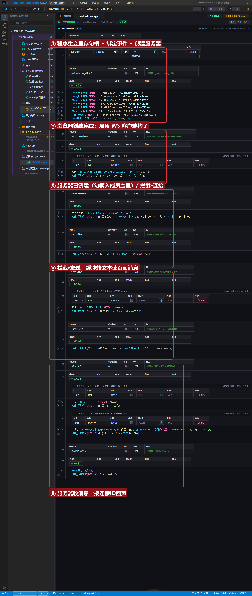
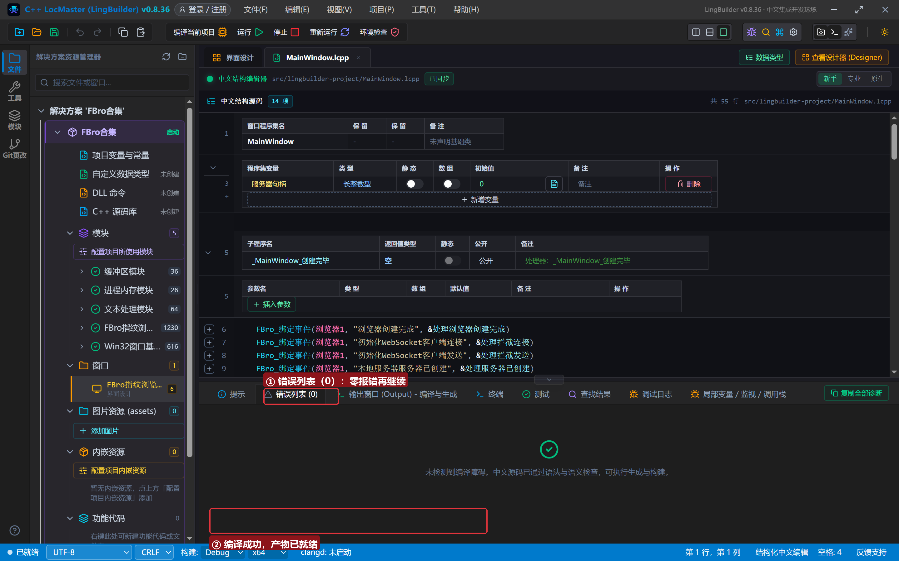
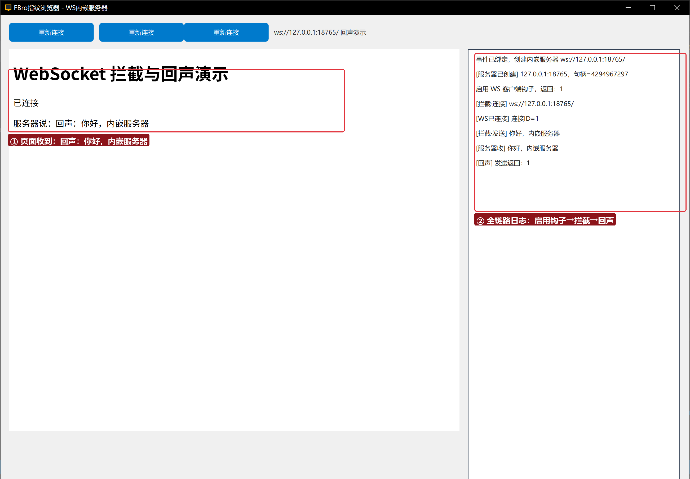

# FBro 合集 22 · WS 拦截与内嵌服务器：五钩子 + `FBro服务器_*` + `FBroWS客户端_*`

> 《LingBuilder FBro 指纹浏览器合集》第 22 集（拦截与协议篇）。这一集把两件事接成一个闭环：① 用**内嵌 HTTP/WebSocket 服务器**（`FBro服务器_*` 6 条）在浏览器进程里起一个 `ws://127.0.0.1:18765/` 回声服务；② 打开 **WS 客户端五钩子**（`初始化WebSocket客户端*`），页面里 `new WebSocket` 的连接与发送都会被代码截获。全程约 30 分钟。
>
> **模块获取**：启用 **FBro指纹浏览器模块**（本集还需 fbro.network 高级网络 + fbro.events 事件 + fbro.vip 三个子模块，漏启用会整批「未知命令」）+ Win32窗口基础模块。
>
> 前置要求：学过[第 03 集](../03_导航与页面事件/README.md)（`FBro_绑定事件`）。本集源码包见文末。

## 这一集你将学会

- `FBro服务器_创建(控件名, "127.0.0.1", 端口, 最大连接数)`：内嵌服务器随浏览器实例存活
- `FBroVIP_浏览器指纹_设置启用WebSocket客户端钩子(浏览器1, "1")`：**五钩子必须先启用**，否则页面 WS 连接不会被拦截
- 五钩子之「连接/发送」：`初始化WebSocket客户端连接`（读到 url）、`初始化WebSocket客户端发送`（`FBro_取事件对象字段(浏览器1,"data")` + `FBro缓冲_转文本` 读出页面消息）
- 服务器侧：`本地服务器WebSocket消息到达` 事件（字段 `text`/`connectionId`）+ `FBro服务器_发送WebSocket文本` 回声
- 类成员变量：`私有 长整数型 服务器句柄 = 0`——跨事件记住服务器句柄

## 1. 闭环一分钟

```
私有
    长整数型 服务器句柄 = 0
公开
    事件 处理浏览器创建完成()
        FBroVIP_浏览器指纹_设置启用WebSocket客户端钩子(浏览器1, "1")
    结束

    事件 处理WS消息()
        原文 = FBro_取事件字段(浏览器1, "text")
        FBro服务器_发送WebSocket文本(服务器句柄, 到整数(FBro_取事件字段(浏览器1, "connectionId")), "回声：" + 原文)
    结束
```

数据流：页面 `ws.send("你好，内嵌服务器")` → **拦截·发送钩子**先看到 → 服务器收到 → 代码按 `connectionId` 回发「回声：…」→ 页面 `onmessage` 显示。

## 2. 界面与代码

窗口 1300×940：FBroBrowser（本地 `page.html`，连 `ws://127.0.0.1:18765/` 并自动重试）+ 右侧日志 + 「重新连接」按钮。





## 3. 运行验证



日志按顺序落 line：[服务器已创建] 127.0.0.1:18765（句柄=4294967297）→ 启用 WS 客户端钩子，返回：1 → [拦截·连接] ws://127.0.0.1:18765/ → [WS已连接] 连接ID=1 → [拦截·发送] 你好，内嵌服务器 → [服务器收] 你好，内嵌服务器 → [回声] 发送返回：1。页面同步显示「服务器说：回声：你好，内嵌服务器」。

## 4. 四条实战红线

1. **钩子必须先启用**：没调 `设置启用WebSocket客户端钩子` 时五钩子一条都不会触发（连接/发送照样通，只是「看不见」）；返回 1 = 已启用；
2. **服务器事件不带 server 字段**：`本地服务器*` 事件的字段只有 `connectionId`/`text`/`data`/`size` 等——服务器句柄要在「本地服务器服务器已创建」里用 `FBro_取事件对象字段(浏览器1, "server")` 取一次，存进**类成员变量**（数据钩子改写要 Base64，本集只做观察与回声）；
3. **WS 客户端句柄是事件期句柄**：只在 `初始化WebSocket客户端*` 处理器内有效，别存起来跨事件用；
4. **页面连不上会自动重试**：演示页带了 1 秒重连循环——服务器创建与页面加载有先后，重试让时序不再敏感。

## 5. 课后练习

1. 在「拦截·发送」里打印 `FBroWS客户端_取地址(句柄)` 与 `FBroWS客户端_是否空(句柄)`；
2. 把回声改成大写化或加时间戳，页面立即看到差异；
3. 思考：为什么连接钩子在「启用」之后才触发？（钩子只对启用后新建的 WS 连接生效——启用前已建立的连接不补拦。）

## 源码包

本集完整源码一键导入：[WS拦截与内嵌服务器.lcpppkg](WS拦截与内嵌服务器.lcpppkg)（含 `page.html`，导入后复制到构建输出 bin 目录）。
