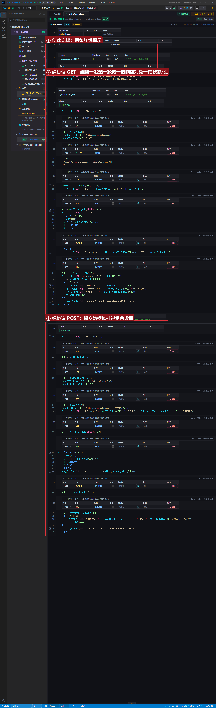
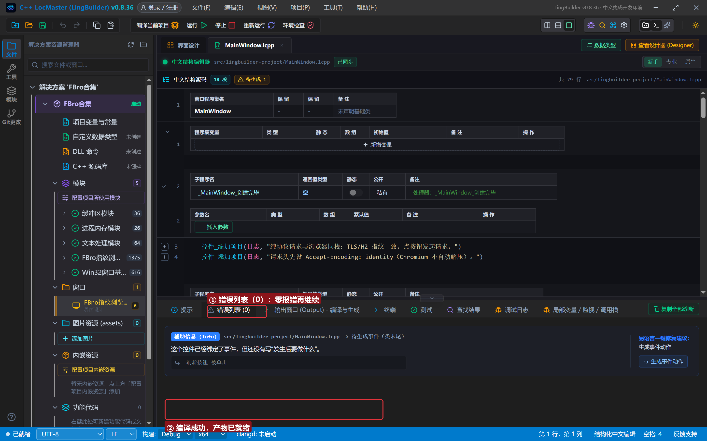
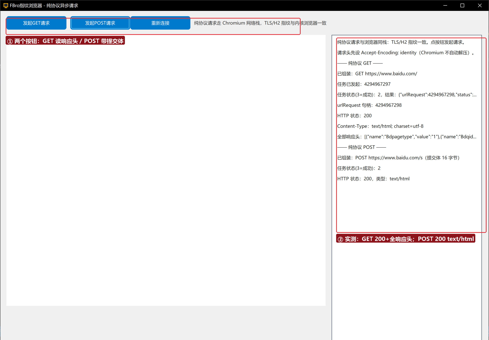

# FBro 合集 23 · 异步请求与网络族：纯协议 GET/POST（`FBro异步请求_发起`）

> 《LingBuilder FBro 指纹浏览器合集》第 23 集（拦截与协议篇）。不开网页、不发截图——**纯协议请求**直接走 Chromium 网络栈：TLS/HTTP2 指纹与内核浏览器完全一致，接口风控按「真浏览器」放行。本集完成 GET（读状态码+响应头）与 POST（带提交体）两条链路。全程约 30 分钟。
>
> **模块获取**：启用 **FBro指纹浏览器模块**（本集还需 fbro.network 高级网络 + fbro.automation + fbro.objects 子模块）+ Win32窗口基础模块。
>
> 前置要求：学过[第 21 集](../21_修改资源响应与提交数据/README.md)（提交数据族）。本集源码包见文末。

## 这一集你将学会

- `FBro请求_创建/设置地址/设置方法/设置头映射JSON` 与 `FBro请求_组合设置`（请求族 8 条）
- `FBro异步请求_发起(浏览器1, 请求)`：把请求交给浏览器的网络栈异步执行，返回任务句柄
- `FBro任务_取状态/取对象` + `FBro异步请求_取响应对象`：拿到响应句柄后用第 20 集的响应族读取
- 轮询等待模式：`计次循环首 + 延时 + 跳出循环`

## 1. 纯协议 GET 一分钟

```
请求 = FBro请求_创建()
FBro请求_设置地址(请求, "https://www.baidu.com/")
FBro请求_设置方法(请求, "GET")
FBro请求_设置头映射JSON(请求, 头JSON)     ← [{"name":"Accept-Encoding","value":"identity"}]
任务 = FBro异步请求_发起(浏览器1, 请求)
计次循环首 (10, 轮次)
    延时(2000)
    如果 (FBro任务_取状态(任务) <> 2)
        跳出循环
    如果结束
计次循环尾
请求句柄 = FBro任务_取对象(任务)          ← urlRequest 句柄
响应 = FBro异步请求_取响应对象(请求句柄)   ← 响应句柄，响应族随便读
```

**两条铁律**：① 请求头先设 `Accept-Encoding: identity`（Chromium 不自动解压正文，压缩正文会读出乱码）；② **发起前所有设置调用必须完成**——「带初始化的局部变量声明」会被提升到子程序最前，把设置类调用排到发起之后（此时对象已只读），所以多步流程要先声明不带初值、再按序赋值。

## 2. 界面与代码

窗口 1300×940：FBroBrowser（about:blank，只为初始化网络栈）+ 两个按钮 + 右侧日志。





## 3. 运行验证



GET：任务发起 → `urlRequest 句柄：4294967298` → **HTTP 状态：200** → `Content-Type：text/html; charset=utf-8` → 全部响应头 JSON（Bdpagetype/Bdqid…百度真实响应头）。POST：提交体 16 字节（`wd=FBro&ie=utf-8`）→ `POST https://www.baidu.com/s` → **HTTP 状态：200，类型：text/html**。

## 4. 三条实战提示

1. **不要用 `FBro任务_等待` 死等**：在按钮处理器里同步等待会挡住完成回调（实测 20 秒后仍「进行中」）；用「延时+轮询状态」让消息循环保持呼吸；
2. **响应头到了就能读**：实测任务状态还是 2（正文未收完）时 `取响应对象` 已经能拿到 200 与全部响应头——读头不必等正文；要收正文用 `FBro网络_取下载数据事件` 领块（第 24 集实战）；
3. **`取响应对象` 的参数是 urlRequest 句柄不是任务句柄**：从 `FBro任务_取对象(任务)` 拿；判空用 `<> 0`，别用 `> 0`（句柄按长整数打印是负数）。

## 5. 课后练习

1. 把 GET 换成 `https://httpbin.org/headers`，观察服务端看到的请求头；
2. 给 POST 换一个自己的接口地址，用 `FBro响应_取协议头映射JSON` 对拍服务端日志；
3. 思考：为什么纯协议请求不弹浏览器窗口也能带完整的 TLS 指纹？（网络栈在浏览器进程里，与页面加载共用同一套会话上下文。）

## 源码包

本集完整源码一键导入：[异步请求与网络族.lcpppkg](异步请求与网络族.lcpppkg)。
