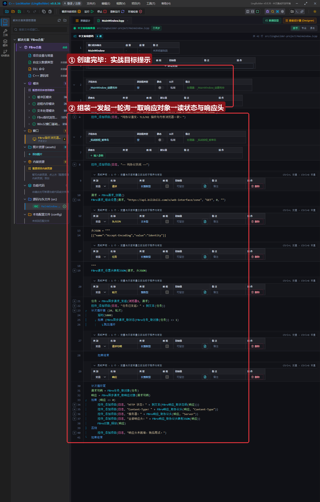
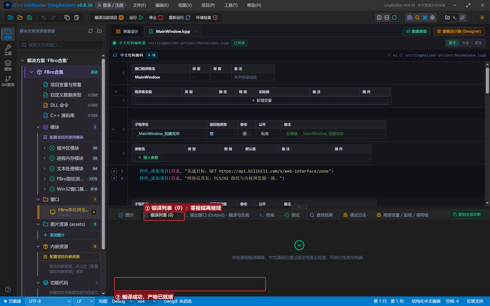
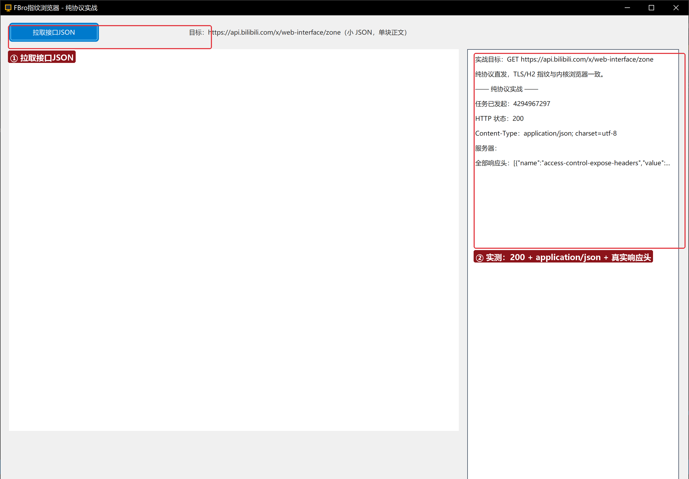

# FBro 合集 24 · 纯协议请求实战：带 TLS 指纹直连真实接口

> 《LingBuilder FBro 指纹浏览器合集》第 24 集（拦截与协议篇）。实战收官：不开浏览器窗口，用 `FBro异步请求_发起` 直连**真实线上接口**（B 站 `x/web-interface/zone`），验证「TLS/H2 指纹与内核浏览器一致」——风控按真浏览器放行，返回 200 与完整 JSON 头。全程约 25 分钟。
>
> **模块获取**：启用 **FBro指纹浏览器模块**（fbro.network 高级网络 + fbro.automation + fbro.objects 子模块）+ Win32窗口基础模块。
>
> 前置要求：学过[第 23 集](../23_异步请求与网络族/README.md)（请求族与轮询模式）。本集源码包见文末。

## 这一集你将学会

- `FBro请求_组合设置(请求, 地址, "GET", 0, "")`：一步组装纯协议请求
- `FBro请求_设置头映射JSON` + 三引号文本块写 JSON 数组
- `FBro异步请求_发起` 后的**延时轮询**节奏（`FBro异步请求_取状态` 探测 URL 请求官方状态）
- `FBro异步请求_取响应对象` → `FBro响应_取状态码/取协议头/取协议头映射JSON` 读真实站点响应

## 1. 实战代码一分钟

```
请求 = FBro请求_创建()
FBro请求_组合设置(请求, "https://api.bilibili.com/x/web-interface/zone", "GET", 0, "")
FBro请求_设置头映射JSON(请求, 头JSON)   ← [{"name":"Accept-Encoding","value":"identity"}]
任务 = FBro异步请求_发起(浏览器1, 请求)
计次循环首 (20, 轮次)
    延时(1000)
    如果 (FBro异步请求_取状态(FBro任务_取对象(任务)) <> 1)
        跳出循环
    如果结束
计次循环尾
响应 = FBro异步请求_取响应对象(FBro任务_取对象(任务))
```

`FBro异步请求_取状态` 返回官方状态（1=未知 2=进行中 3=成功 4=失败）——响应头一到就能读到 200，不必等正文收完。

## 2. 界面与代码

窗口 1300×940：FBroBrowser（about:blank，只为初始化网络栈与指纹上下文）+ 「拉取接口JSON」按钮 + 右侧日志。





## 3. 运行验证



单按钮一次点击：任务发起 → **HTTP 状态：200** → `Content-Type：application/json; charset=utf-8` → 全部响应头 JSON（access-control-expose-headers 等B站真实响应头）。风控视角：这是一个「Chrome 135 内核」发出的标准请求，不是脚本工具的特征握手。

## 4. 三条实战提示

1. **`Accept-Encoding: identity` 别忘**：纯协议请求不自动解压，让服务端直接给明文最省事；
2. **读响应头不依赖任务完成**：`取响应对象` 在响应头到达后即可调用（实测任务状态还是 2 时已能读 200）；要收完整正文用 `FBro网络_取下载数据事件` 领块（多块先拼十六进制再一次性解码，防 UTF-8 块边界切字）；
3. **会话上下文随浏览器**：请求走当前 FBro 浏览器实例的 RequestContext——第 08 集的实例代理、第 06 集的指纹对纯协议请求同样生效。

## 5. 课后练习

1. 换成你自己的业务接口，把响应头全部落日志对比抓包；
2. 用第 21 集的提交数据族组装表单，POST 到业务接口；
3. 思考：为什么纯协议请求不走 FBroBrowser 控件也能带指纹？（网络栈与页面加载同栈同上下文，TLS ClientHello 由同一套 Chromium 代码发出。）

## 源码包

本集完整源码一键导入：[纯协议请求实战.lcpppkg](纯协议请求实战.lcpppkg)。
