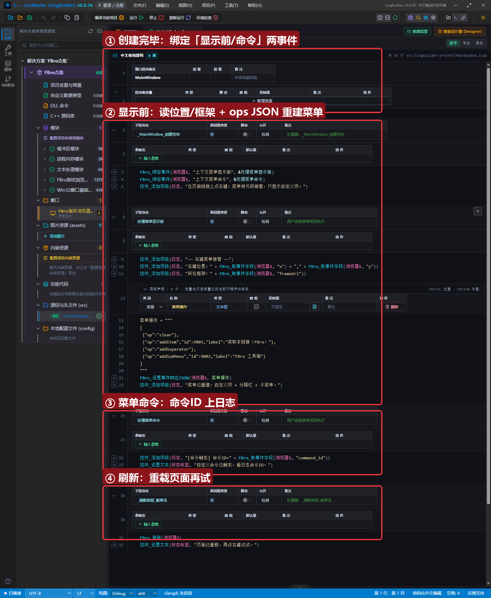
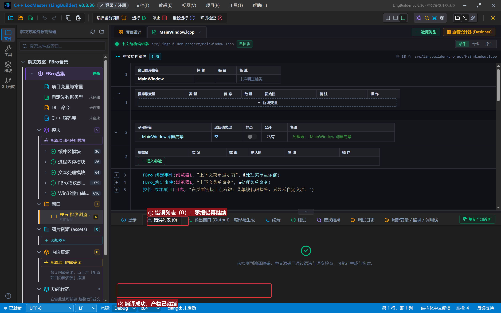
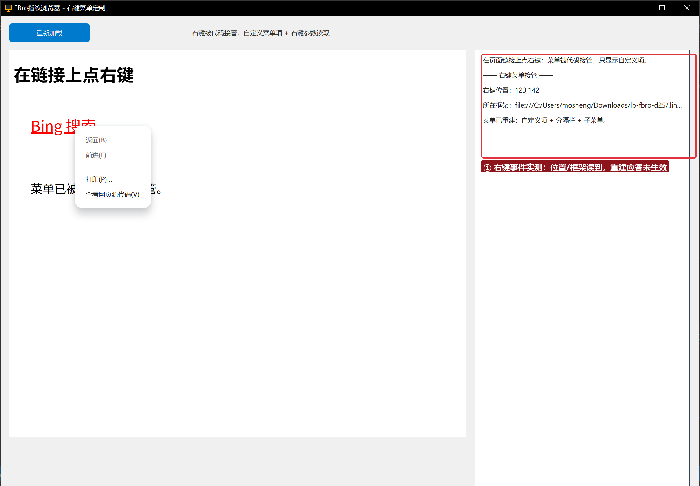

# FBro 合集 25 · 右键菜单事件与参数：`上下文菜单显示前` 实测

> 《LingBuilder FBro 指纹浏览器合集》第 25 集（界面与杂项篇）。网页里点右键会发生什么？`上下文菜单显示前` 事件把**右键坐标、所在框架**等参数第一时间交给你的代码；用户点了菜单项后 `上下文菜单命令` 事件带上命令 ID 再来一次。本集把两个事件接起来实测，并给出菜单重建（ops JSON）的机制与 0.8.36 的已知限制。全程约 25 分钟。
>
> **模块获取**：启用 **FBro指纹浏览器模块**（菜单族 35＋右键参数族 19 在主模块）+ Win32窗口基础模块。
>
> 前置要求：学过[第 03 集](../03_导航与页面事件/README.md)（`FBro_绑定事件`）。本集源码包见文末。

## 这一集你将学会

- `FBro_绑定事件(浏览器1, "上下文菜单显示前", &处理器)`：右键弹出前第一现场
- 事件字段读取：`x`/`y`（右键坐标）、`frameUrl`（所在框架地址）——用 `FBro_取事件字段`
- 菜单重建机制：`FBro_设置事件响应JSON` + ops 数组（`clear`/`addItem`/`addSeparator`/`addSubMenu`…）
- `上下文菜单命令` 事件：`command_id` 字段定位用户点了哪一项

## 1. 事件一分钟

```
事件 处理菜单显示前()
    控件_添加项目(日志, "右键位置：" + FBro_取事件字段(浏览器1, "x") + "," + FBro_取事件字段(浏览器1, "y"))
    控件_添加项目(日志, "所在框架：" + FBro_取事件字段(浏览器1, "frameUrl"))
    局部 文本型 菜单操作
    菜单操作 = """
[
 {"op":"clear"},
 {"op":"addItem","id":9001,"label":"读取本链接（FBro）"},
 {"op":"addSeparator"},
 {"op":"addSubMenu","id":9002,"label":"FBro 工具箱"}
]
"""
    FBro_设置事件响应JSON(浏览器1, 菜单操作)
结束
```

菜单重建走**应答通道**：处理器里用 `FBro_设置事件响应JSON` 回一份 ops 数组，桥在事件返回后按序应用到菜单模型（clear→addItem→addSeparator→addSubMenu…）。

## 2. 界面与代码

窗口 1300×940：FBroBrowser（本地 `page.html`，页面上有一个 Bing 链接）+ 「重新加载」按钮 + 右侧日志。





## 3. 运行验证

在链接上点右键：日志立刻记下 `右键位置：123,142` 与 `所在框架：file:///…/page.html`，同时浏览器弹出菜单：




## 4. ⚠️ 0.8.36 已知限制（重要）

**菜单重建应答在 0.8.36 exe 中未生效**：`设置事件响应JSON` 的 ops 数组已正确设置（日志可见），但菜单仍显示默认项。根因是 `上下文菜单显示前` 的同步派发未按预期走通——事件期 `menuHandle`/`paramsHandle` 句柄在处理器读取前就被回收（读参数得到 -7/0），应答也丢失。该问题已入档待官方层修复；**本集的坐标/框架读取与命令事件是可用的**，菜单重建代码可以先写好，修复后无需改代码。

## 5. 课后练习

1. 把右键位置换算成页面 CSS 坐标，对照 `page.html` 里链接的位置验证精度；
2. 绑定 `上下文菜单已关闭` 事件，统计每次右键到关闭的时长；
3. 思考：为什么事件期句柄不能存起来跨事件使用？（句柄在事件结束即回收，这是「事件期句柄」通用规则——下载、响应、右键参数都一样。）

## 源码包

本集完整源码一键导入：[右键菜单定制.lcpppkg](右键菜单定制.lcpppkg)（含 `page.html`，导入后复制到构建输出 bin 目录）。
