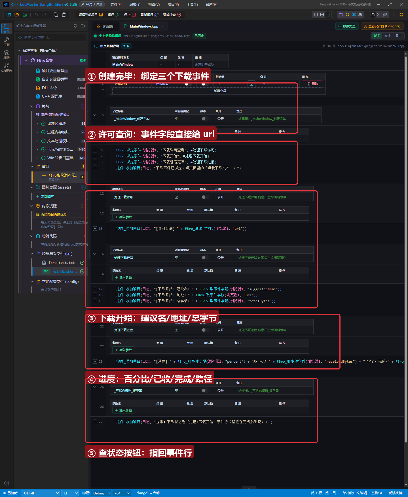
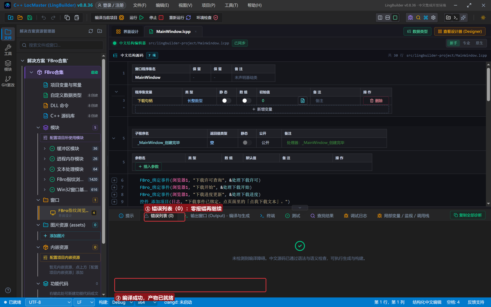
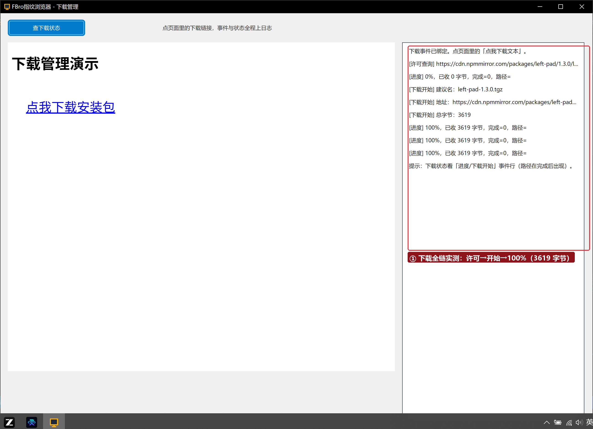

# FBro 合集 26 · 下载管理：`下载许可查询/下载开始/下载进度更新` 三事件全链

> 《LingBuilder FBro 指纹浏览器合集》第 26 集（界面与杂项篇）。浏览器里点一个下载链接，背后是三连事件：**许可查询 → 下载开始 → 下载进度更新**。本集把三件事全部接上日志，实测一次真实 HTTPS 下载（npmmirror 安装包，3619 字节）。全程约 25 分钟。
>
> **模块获取**：启用 **FBro指纹浏览器模块**（下载族 16 在 fbro.transfer 传输子模块，漏启用会「未知命令」）+ Win32窗口基础模块。
>
> 前置要求：学过[第 03 集](../03_导航与页面事件/README.md)（`FBro_绑定事件`）。本集源码包见文末。

## 这一集你将学会

- `下载许可查询`：decision 事件，事件字段 `url` 直接给出下载地址
- `下载开始`：字段 `suggestedName`（服务器建议文件名）、`url`、`totalBytes`
- `下载进度更新`：字段 `percent`/`receivedBytes`/`isComplete`/`fullPath`
- **用事件字段、不用下载句柄**：事件期句柄会被回收，字段才是稳定数据源

## 1. 三事件一分钟

```
事件 处理下载许可()
    控件_添加项目(日志, "[许可查询] " + FBro_取事件字段(浏览器1, "url"))
结束

事件 处理下载开始()
    控件_添加项目(日志, "[下载开始] 建议名：" + FBro_取事件字段(浏览器1, "suggestedName"))
结束

事件 处理下载进度()
    控件_添加项目(日志, "[进度] " + FBro_取事件字段(浏览器1, "percent") + "%，已收 " + FBro_取事件字段(浏览器1, "receivedBytes") + " 字节，完成=" + FBro_取事件字段(浏览器1, "isComplete"))
结束
```

三个事件都在「创建完毕」里用 `FBro_绑定事件` 挂上即可，顺序与浏览器内部流程一致：先许可、再开始、后进度（可能多次）。

## 2. 界面与代码

窗口 1300×940：FBroBrowser（本地 `page.html`，放一个指向 npmmirror 安装包的链接）+ 「查下载状态」按钮 + 右侧日志。





## 3. 运行验证

点页面里的「点我下载安装包」链接，日志按顺序记录全链：



`[许可查询] https://cdn.npmmirror.com/...` → `[进度] 0%` → `[下载开始] 建议名：left-pad-1.3.0.tgz`（地址与总字节 3619）→ `[进度] 100%，已收 3619 字节`。小文件秒完，进度行从 0% 直跳 100% 属正常。

## 4. 三条实战提示

1. **读字段别攥句柄**：`下载句柄` 是事件期句柄（第 25 集的同款规则），本集全部用事件字段——`suggestedName/percent/receivedBytes/fullPath` 都是字符串直接拼；
2. **`fullPath` 在完成后才有值**：下载中路径可能为空，落盘信息以最后一次进度事件为准；
3. **file:// 与 download 属性**：本地 `file://` 链接和 `download` 属性在 0.8.36 不触发下载事件，演示请用 HTTP(S) 附件直链（Content-Type 非页面类型，如 `.tgz`）。

## 5. 课后练习

1. 在「许可查询」里按 `url` 过滤，只放行白名单域名的下载；
2. 进度行改成每 10% 记一条（比对 `percent` 前后值）；
3. 思考：为什么小文件看不到中间百分比？（进度事件按数据到达触发，3619 字节一次到齐。）

## 源码包

本集完整源码一键导入：[下载管理.lcpppkg](下载管理.lcpppkg)（含 `page.html`，导入后复制到构建输出 bin 目录）。
