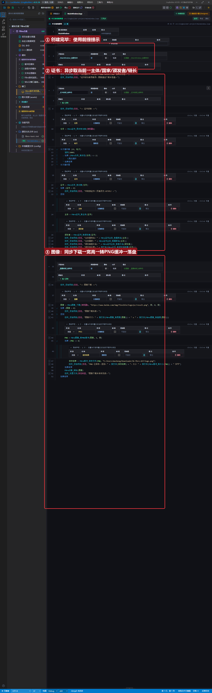
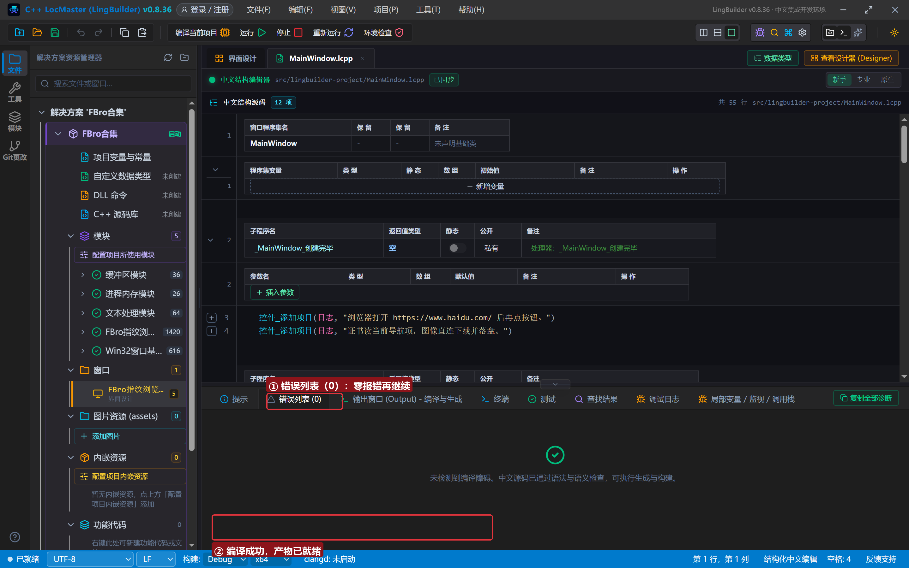
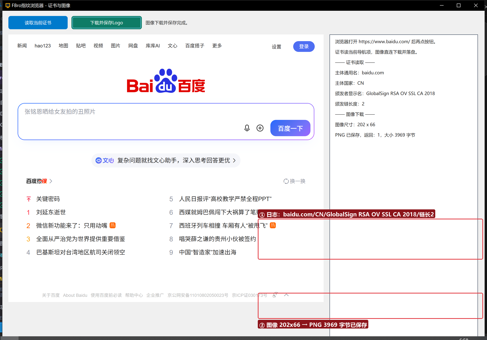

# FBro 合集 27 · 证书与图像：`FBro证书_*` 读 TLS 证书 + `FBro图像_*` 下载落盘

> 《LingBuilder FBro 指纹浏览器合集》第 27 集（界面与杂项篇）。两条独立小链路：① 浏览器打开 HTTPS 站点后，`FBro证书_异步取当前` 把当前导航项的 **TLS 证书**交到你手里（主体/颁发者/颁发链）；② `FBro图像_下载` 直连下载一张网络图片，量完尺寸**转 PNG 落盘**。全程约 25 分钟。
>
> **模块获取**：启用 **FBro指纹浏览器模块** + Win32窗口基础模块 + std.bytes（缓冲落盘）。
>
> 前置要求：学过[第 23 集](../23_异步请求与网络族/README.md)（任务轮询模式）。本集源码包见文末。

## 这一集你将学会

- `FBro证书_异步取当前(控件名)` → 任务 → `FBro任务_取对象` 得证书句柄
- `FBro证书_取主体/取颁发者` → 主体句柄 → `FBro证书主体_取通用名/取国家名/取显示名`
- `FBro证书_取颁发链数量`：证书链一共有几级
- `FBro图像_下载(控件名, 地址, 假, 0, 假)`：同步下载直回图像句柄
- `FBro图像_取宽度/取高度` → `FBro图像_转PNG缓冲` → `FBro缓冲_保存文件` 落盘

## 1. 两条链路一分钟

```
' 证书：先让浏览器打开 https 站点
任务 = FBro证书_异步取当前(浏览器1)
' 延时轮询到任务完成后：
证书 = FBro任务_取对象(任务)
主体 = FBro证书_取主体(证书)
日志 = FBro证书主体_取通用名(主体)

' 图像：同步下载，60 秒超时
图像 = FBro图像_下载(浏览器1, "https://www.baidu.com/img/flexible/logo/pc/result.png", 假, 0, 假)
PNG = FBro图像_转PNG缓冲(图像, 1, 假)
FBro缓冲_保存文件(PNG, "C:/path/logo.png")
```

注意：证书读的是「当前可见导航项」——**先让浏览器导航到 HTTPS 页面再点按钮**；`FBro图像_下载` 是同步命令，会阻塞到下载完成（失败返回 0）。

## 2. 界面与代码

窗口 1300×940：FBroBrowser（设计器 URL 直接填 `https://www.baidu.com/`）+ 两个按钮 + 右侧日志。





## 3. 运行验证



证书：`主体通用名：baidu.com`、`主体国家：CN`、`颁发者显示名：GlobalSign RSA OV SSL CA 2018`、`颁发链长度：2`。图像：`图像尺寸：202 x 66`、`PNG 已保存，返回：1，大小 3969 字节`——到保存路径确认 `logo.png` 可以直接打开。

## 4. 三条实战提示

1. **证书是异步、图像是同步**：证书要「任务+轮询」，图像一行拿句柄——同一集里两种风格对照着记；
2. **句柄用完要释放**：`FBro对象_释放(图像)`；证书/主体/颁发者句柄同理（本演示进程随即退出，未逐一释放）；
3. **`转PNG缓冲` 的缩放因子传 1**：要高清改 2（2x 像素），透明类型参数只对位图缓冲有意义。

## 5. 课后练习

1. 给证书读取加「有效期」两行（`取生效时间/取失效时间`，Unix 秒自行换算）；
2. 把图像下载换成自己网站的头像 URL，保存后用画图打开核对；
3. 思考：为什么证书要从「当前可见导航项」取？（证书属于当前导航项，页面一旦跳转，证书随之变化。）

## 源码包

本集完整源码一键导入：[证书与图像.lcpppkg](证书与图像.lcpppkg)。
