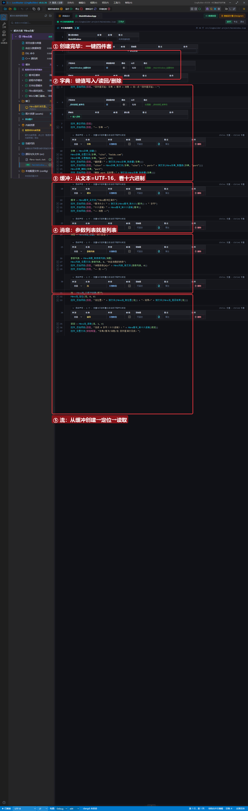
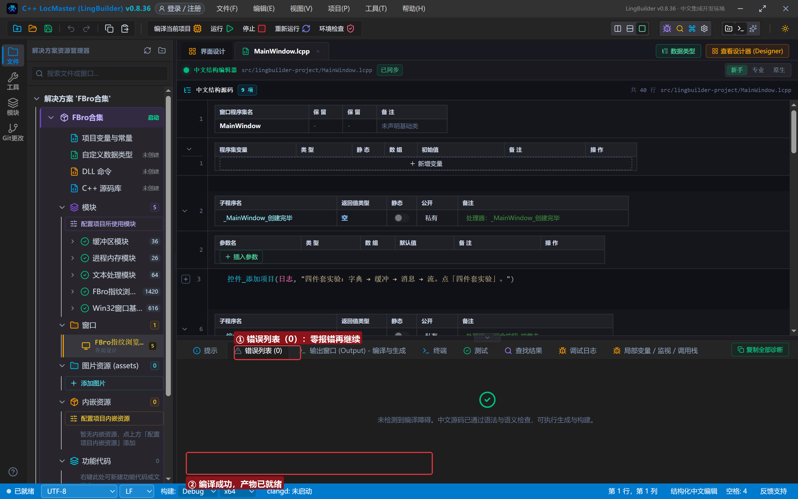
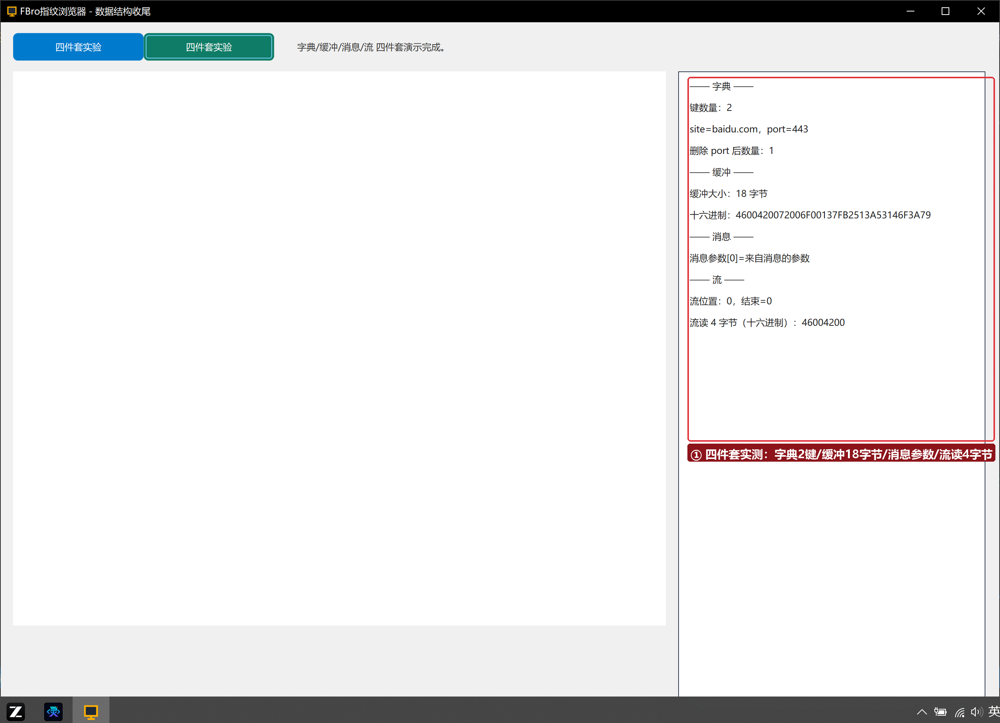

# FBro 合集 28 · 数据结构四件套：字典/缓冲/消息/流 收尾

> 《LingBuilder FBro 指纹浏览器合集》第 28 集（界面与杂项篇）。同步辅助类收官：**字典**（30 条，键值容器）、**缓冲**（7 条，二进制字节袋）、**消息**（2 条，进程消息组装）、**流**（7 条，顺序读写）。一个按钮跑完四件套，把散落前几集的「受管对象家族」拼成完整地图。全程约 25 分钟。
>
> **模块获取**：启用 **FBro指纹浏览器模块**（fbro.objects 子模块）+ Win32窗口基础模块。
>
> 前置要求：学过[第 18 集](../18_同步辅助类一/README.md)（受管句柄）与[第 19 集](../19_同步辅助类二/README.md)（列表）。本集源码包见文末。

## 这一集你将学会

- `FBro字典_创建/设置文本/设置整数/取文本/取整数/删除/取数量`：按「键」读写的容器，同一字典可混装不同类型
- `FBro缓冲_从文本/取大小/转十六进制`：二进制字节袋；**从文本 = UTF-16 字节**
- `FBro消息_创建/取参数列表`：进程消息的参数区就是一个列表（配 `FBro列表_*` 读写）
- `FBro流_从缓冲创建/定位/取位置/是否结束/读取`：内存顺序读取

## 1. 四件套一分钟

```
字典 = FBro字典_创建()
FBro字典_设置文本(字典, "site", "baidu.com")
FBro字典_设置整数(字典, "port", 443)

缓冲 = FBro缓冲_从文本("FBro缓冲区演示")      ← 18 字节 = 9 字 × UTF-16
消息 = FBro消息_创建("演示通道")
参数列表 = FBro消息_取参数列表(消息)
FBro列表_设置文本(参数列表, 0, "来自消息的参数")

流 = FBro流_从缓冲创建(缓冲)
FBro流_定位(流, 0, 0)
读回 = FBro流_读取(流, 1, 4)                  ← 读前 4 字节
```

## 2. 界面与代码

窗口 1300×940：FBroBrowser（about:blank，只为 CEF 运行时就绪）+ 「四件套实验」按钮 + 右侧日志。





## 3. 运行验证



字典：键数量 2 → `site=baidu.com，port=443` → 删除 port 后数量 1。缓冲：18 字节，十六进制 `4600420072006F00…`——`46 00`='F'、`42 00`='B'，**UTF-16LE 一目了然**。消息：参数[0]=来自消息的参数。流：位置 0、结束=0、读 4 字节=`46004200`（'F''B'）。

## 4. 三条实战提示

1. **`FBro缓冲_从文本` 存的是 UTF-16**：`转文本` 按 UTF-8 解码会对不上（ASCII 也只出第一个字符）——看字节用 `转十六进制`，拿文本长度自己按「字节数÷2」算；
2. **字典不用先定长**：与列表（先 `设置数量`）不同，字典按键写入自动长出；
3. **`FBro流_读取(流, 1, 4)` = 读 4 个 1 字节元素**：第二参是元素大小、第三参是元素数量，返回新缓冲句柄。

## 5. 课后练习

1. 字典里再嵌一个列表（`FBro字典_取值对象` + 第 19 集的列表命令）；
2. 用流读完整个缓冲并统计字节数（循环 + `是否结束`）；
3. 思考：消息的参数列表为什么用「列表」而不是字典？（进程消息参数按位置传递，跨进程保序不保名。）

## 源码包

本集完整源码一键导入：[数据结构四件套.lcpppkg](数据结构四件套.lcpppkg)。
