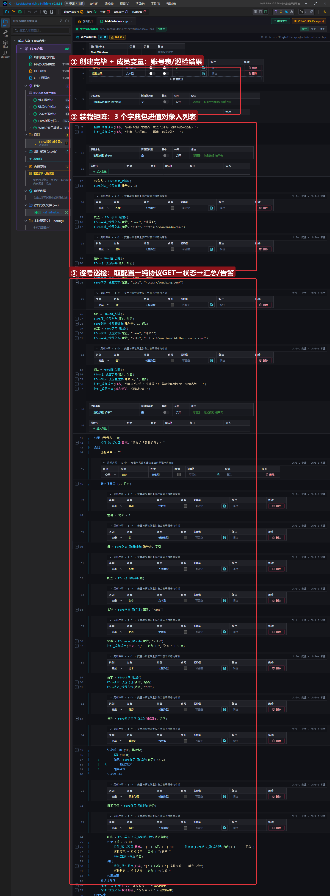
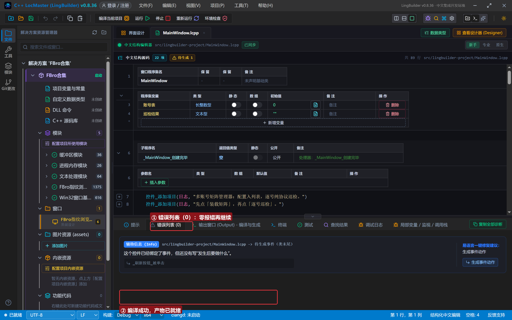
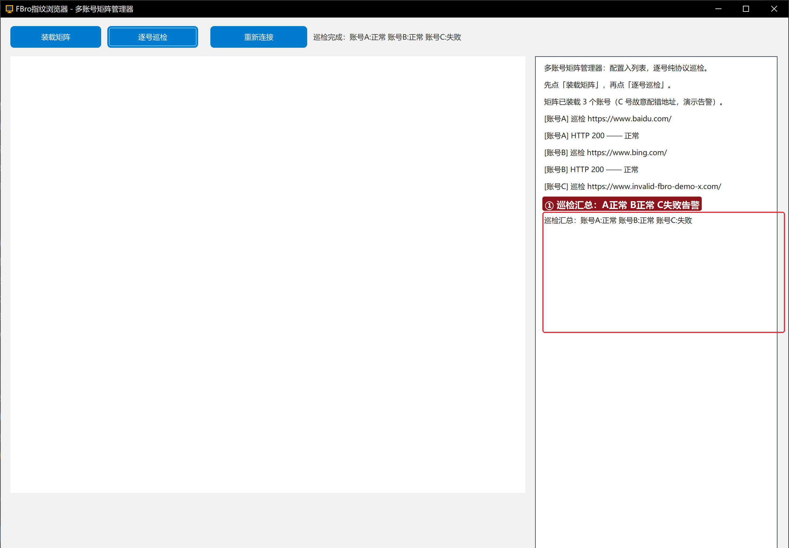

# FBro 合集 29 · 综合实战：多账号矩阵管理器（列表＋字典＋纯协议＋告警）

> 《LingBuilder FBro 指纹浏览器合集》第 29 集（收官实战）。把全系列积木拼成一件真工具：**多账号配置表**（列表＋值对象＋字典）→ **逐号纯协议巡检**（第 23/24 集的请求族）→ **状态汇总与失败告警**（状态栏+日志）。3 个账号里故意埋一个坏地址，验证告警分支。全程约 30 分钟。
>
> **模块获取**：启用 **FBro指纹浏览器模块**（fbro.objects/fbro.automation/fbro.network 子模块）+ Win32窗口基础模块 + std.text。
>
> 前置要求：学过[第 18/19 集](../18_同步辅助类一/README.md)（受管容器）、[第 23 集](../23_异步请求与网络族/README.md)（纯协议请求）。本集源码包见文末。

## 这一集你将学会

- **配置入矩阵**：`FBro字典_创建` 装账号配置 → `FBro值_创建`+`FBro值_设置字典` 打包 → `FBro列表_设置值对象` 存入账号表
- **逐号巡检**：`计次循环` + `FBro列表_取值对象`+`FBro值_取字典` 取回配置 → `FBro异步请求_发起` 纯协议 GET → 状态码判定
- **汇总与告警**：成员变量累积结果串，异常号触发告警写状态栏

## 1. 装载矩阵一分钟

```
账号表 = FBro列表_创建()
FBro列表_设置数量(账号表, 3)
配置 = FBro字典_创建()
FBro字典_设置文本(配置, "name", "账号A")
FBro字典_设置文本(配置, "site", "https://www.baidu.com/")
值0 = FBro值_创建()
FBro值_设置字典(值0, 配置)
FBro列表_设置值对象(账号表, 0, 值0)
```

**字典要打包进「值」才能入列表**——`设置值对象` 收的是 Value 句柄，这是受管容器之间的标准装箱动作（第 18 集的 `值_取字典` 是反向拆箱）。

## 2. 巡检循环一分钟

```
计次循环首 (3, 轮次)
    索引 = 轮次 - 1
    值 = FBro列表_取值对象(账号表, 索引)
    配置 = FBro值_取字典(值)
    名称 = FBro字典_取文本(配置, "name")
    站点 = FBro字典_取文本(配置, "site")
    ' 组装 GET → 发起 → 延时轮询 → 取响应对象
    如果 (响应 <> 0)
        巡检结果 = 巡检结果 + 名称 + ":正常 "
    否则
        巡检结果 = 巡检结果 + 名称 + ":失败 "
    如果结束
计次循环尾
```

## 3. 界面与代码

窗口 1300×940：FBroBrowser（about:blank，网络栈上下文）+ 「装载矩阵」「逐号巡检」两按钮 + 右侧日志。





## 4. 运行验证



装载：`矩阵已装载 3 个账号（C 号故意配错地址，演示告警）`。巡检：`[账号A] HTTP 200 —— 正常`、`[账号B] HTTP 200 —— 正常`、`[账号C] 连接失败 —— 触发告警`、`巡检汇总：账号A:正常 账号B:正常 账号C:失败`——状态栏同步显示汇总，失败号一眼可辨。

## 5. 三条实战提示

1. **容器装箱是双向的**：入列表「值_设置字典→设置值对象」，出列表「取值对象→值_取字典」——拆箱类型错了句柄全空；
2. **巡检地址故意配错一个**：告警分支必须真跑过才算验证（全绿的巡检脚本没测过失败路径）；
3. **生产扩展**：把巡检结果接[第 10 集](../10_批量实例工作台/README.md)的多实例工作台、或经 web.http 推送到企业微信机器人——结构已就位，只换告警出口。

## 6. 全系列收官

29 集全齐：指纹与多开（05~10）、自动化（11~17）、同步辅助类（18~19）、拦截与协议（20~24）、界面与杂项（25~28）到本集综合实战。所有源码包可在 IDE 一键导入复跑。

## 源码包

本集完整源码一键导入：[多账号矩阵管理器.lcpppkg](多账号矩阵管理器.lcpppkg)。
