# NE 合集 01 · 初识 new_emoji：自绘引擎与第一个现代窗口

> 《LingBuilder new_emoji 合集》第 1 集（入门篇）。从这一集起，我们学习 **new_emoji 原生界面库（lingbuilder.new_emoji.ui）**——一个基于 Direct2D/DirectWrite 的自绘 UI 引擎，自带 **93 个现代风格组件**，还原生支持**彩色 Emoji 表情**。本集做一个「我的第一个现代窗口」：深色主题、圆角卡片、流式布局、虚线分割线，每个控件上都带彩色 Emoji，彻底告别 Windows 98 风格。全程约 30 分钟。
>
> 前置要求：会新建项目、认识 LingBuilder 工作台（学过[零基础入门系列](/guide/tutorials/beginner)即可）。new_emoji 是**收费模块**，使用前需要登录 LingBuilder 账号完成授权（本集第 3 步会带你操作）。本集源码包见文末。

## 这一集你将学会

- **启用收费模块**：登录 LingBuilder 账号，一键完成 new_emoji 模块授权
- **切换设计后端**：把窗口从「Win32 原生控件」切换到「new_emoji 模块」
- **5 个布局类组件**：容器 Container、布局 Layout、边框 Border、间距 Space、分割线 Divider
- **彩色 Emoji**：直接把 🚀🎉🧩 写进控件文字，运行后就是彩色的
- `控件_设置文本`：窗口创建完毕时，用中文代码更新界面文字

## 1. 三十秒理解：什么是 NE 自绘引擎

传统 Win32 程序的按钮、编辑框是 Windows 系统画的，长什么样子系统说了算——所以大家写出来的程序都长一张「Windows 98 脸」。**new_emoji 把画笔拿了回来**：窗口和全部控件都由 Direct2D 引擎自己绘制，所以可以是圆角的、深色的、带彩色 Emoji 的、有悬停动画的——这就是「自绘」。

它不是一个独立软件，而是设计器里的 **93 个新控件**：从工具箱拖进来，摆好位置，写几行中文代码，F5 运行。你之前的窗口项目经验全部适用。

本集只用到 1 条命令（模块共 4000+ 条，慢慢学不着急）：

| 命令 | 作用 |
| --- | --- |
| `控件_设置文本(控件名, "文字")` | 更新一个控件的显示文字 |

## 2. 新建项目

欢迎页点「**新建项目**」：

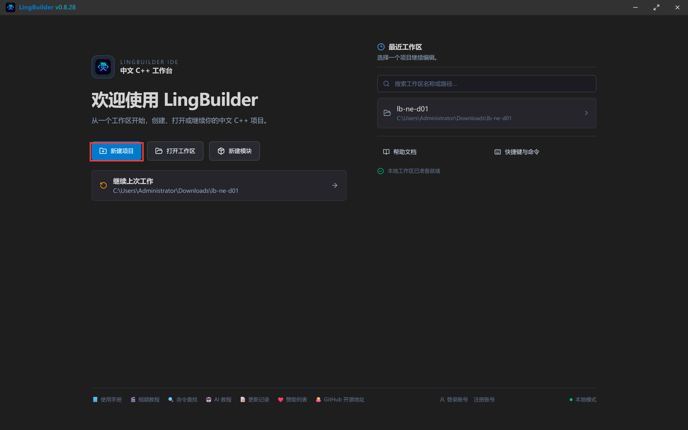

模板选「**Windows 界面设计**」，点「选择此类型」：

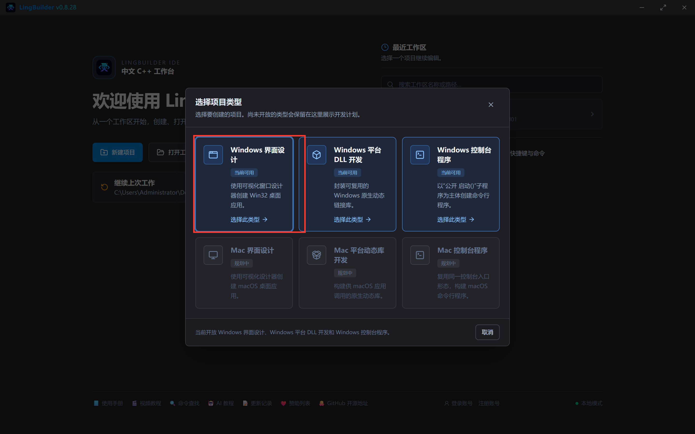

项目名称填 **现代窗口初体验**，解决方案名称会自动跟着填，创建位置留空（就在当前工作区创建），点「创建项目」：

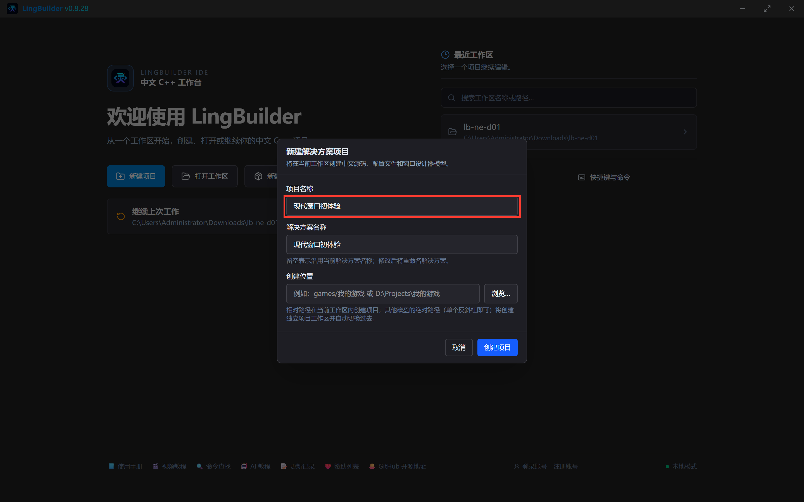

创建完成，进入工作台：

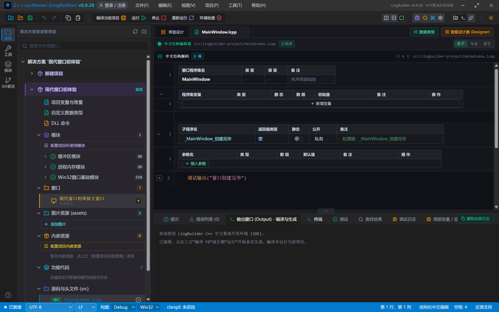

## 3. 启用 new_emoji 模块（含账号授权）

点左侧活动栏的「**模块**」图标打开模块生态，在搜索框输入「**原生界面**」，找到「**new_emoji 原生界面库**」，点行右侧的「**启用**」开关（✓ 按钮）：

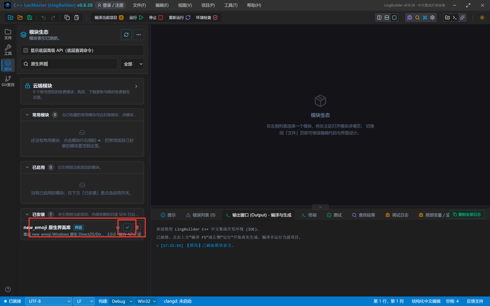

> new_emoji 是收费模块。第一次点「启用」会弹出登录框：填入你的 LingBuilder 账号邮箱和密码，点「登录」。登录成功后 IDE 会自动刷新模块授权并继续启用，不需要你再做别的。注册后需要在邮箱里完成一次验证，收费模块权益就绑定在这个账号上。

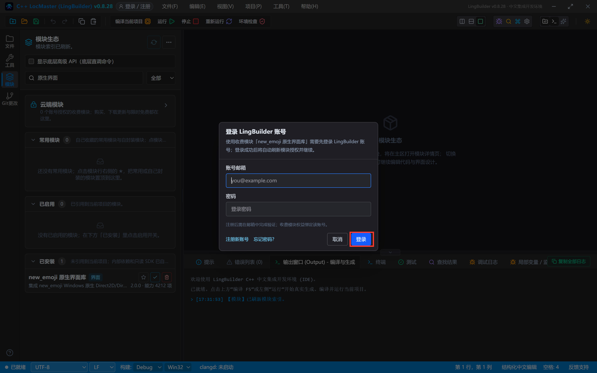

启用成功后，「已启用」分组里就能看到「new_emoji 原生界面库」（界面分类，2.0.0 版）：

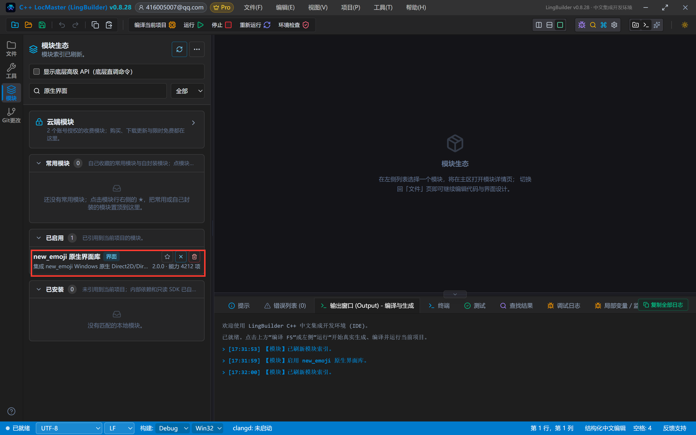

> 小知识：每个命令都有自己的「家」（模块）。编译时报「未知的命令」，第一反应就是查对应模块启用了没有。

## 4. 把窗口切换到 NE 后端

new_emoji 的组件**只出现在 NE 后端的窗口里**。点编辑区的「**界面设计**」页签打开设计器，在画布空白处点一下（选中窗口本身），右侧属性面板找到「当前窗口 / 布局」→「**设计后端**」，把它从「Win32 原生控件」切换成「**new_emoji 模块**」：

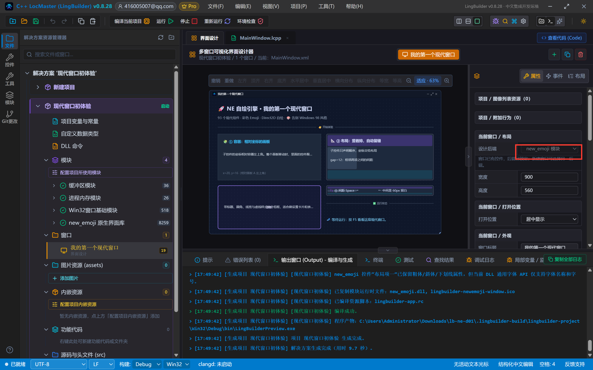

> 注意：**窗口里已经有控件的时候，设计后端会被锁定**，不能再切换。所以要先切后端、再摆控件。本集从空窗口开始，正好。

## 5. 设计界面

切换后端后，点左侧活动栏的「**控件**」图标打开工具箱——最下面多了一组「**New_Emoji 控件**」，整整 93 个：

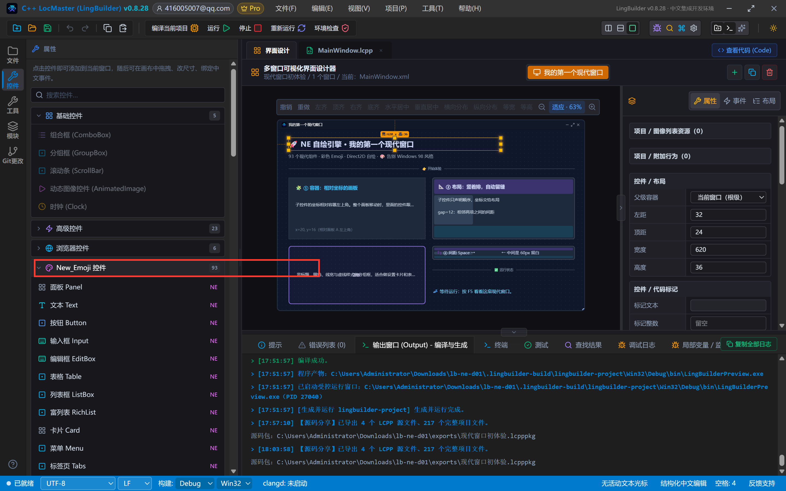

窗口做 900×560，深色底。从工具箱点（或拖）以下组件进窗口。先摆 5 个「容器类」组件，再往容器里放「文本」组件当说明文字。**容器里的子控件直接拖到目标位置即可**——画布记录它的位置，生成 C++ 时会自动换算成「相对容器左上角」的坐标：

| 控件 | 名称 | 显示内容 | 左距 | 顶距 | 宽度 | 高度 |
| --- | --- | --- | --- | --- | --- | --- |
| 文本 Text | 标题文本 | 🚀 NE 自绘引擎 · 我的第一个现代窗口 | 32 | 24 | 620 | 36 |
| 文本 Text | 副标题文本 | 93 个现代组件 · 彩色 Emoji · Direct2D 自绘 · 🎨 告别 Windows 98 风格 | 32 | 66 | 620 | 24 |
| 分割线 Divider | 标题分割线 | 👉 开始体验 | 32 | 100 | 836 | 28 |
| **容器 Container** | **面板A** | （内容清空） | 32 | 140 | 400 | 180 |
| 文本 Text | 面板A标题 | 🧩 ① 容器：相对坐标的画板（放入面板A） | 52 | 156 | 360 | 28 |
| 文本 Text | 面板A正文 | 子控件的坐标相对容器左上角……（放入面板A） | 52 | 194 | 356 | 52 |
| 文本 Text | 面板A坐标注 | x=20, y=16（相对面板 A 左上角）（放入面板A） | 52 | 280 | 356 | 24 |
| **布局 Layout** | **布局B** | （内容清空） | 452 | 140 | 416 | 180 |
| 文本 Text | 布局项一 | 📐 ② 布局：竖着排，自动留缝（放入布局B） | 468 | 152 | 380 | 30 |
| 文本 Text | 布局项二 | 子控件只声明顺序，坐标交给布局（放入布局B） | 468 | 192 | 380 | 26 |
| 文本 Text | 布局项三 | gap=12：相邻两项之间的间距（放入布局B） | 468 | 228 | 380 | 26 |
| **边框 Border** | **边框C** | （内容清空） | 32 | 340 | 400 | 170 |
| 文本 Text | 边框C正文 | 带标题、圆角……🎁（放入边框C） | 56 | 384 | 352 | 80 |
| 布局 Layout | 布局C | （内容清空） | 452 | 340 | 416 | 40 |
| 文本 Text | 间距左标签 | 👣 ④ 间距 Space →（放入布局C） | 464 | 344 | 130 | 32 |
| 间距 Space | 间距S | （清空）（放入布局C） | 594 | 344 | 60 | 32 |
| 文本 Text | 间距右标签 | ← 中间是 60px 留白（放入布局C） | 654 | 344 | 200 | 32 |
| 分割线 Divider | 状态分割线 | ✅ 运行状态 | 452 | 396 | 416 | 28 |
| 文本 Text | 状态文本 | 💤 等待运行：按 F5 看看这扇现代窗口。 | 452 | 436 | 416 | 74 |

几个属性在右侧属性面板里改一下：

- **面板A**：属性「流式布局 flowEnabled」取消勾选（我们想手动摆里面的文字）；「背景色」填 `#FF1E293B`，「边框色」填 `#FF334155`
- **布局B**：「布局方向」选 **垂直**，「子元素间距 gap」填 `12`，「背景色」填 `#FF1E293B`
- **边框C**：「标题」填 `🎁 ③ 边框`，「圆角」填 `12`，「边框宽度」填 `2`，「边框色」填 `#FF38BDF8`
- **布局C**：「布局方向」保持 **水平**，「背景色」填 `#FF1E293B`
- **状态分割线**：勾选「**虚线**」，「线条颜色」填 `#FF334155`
- **面板A正文 / 边框C正文 / 状态文本**：勾选「自动换行」（长文字才不会超出去）

摆完的设计器画布（画布上容器里的子控件以占位块预览，运行后就是真实效果）：

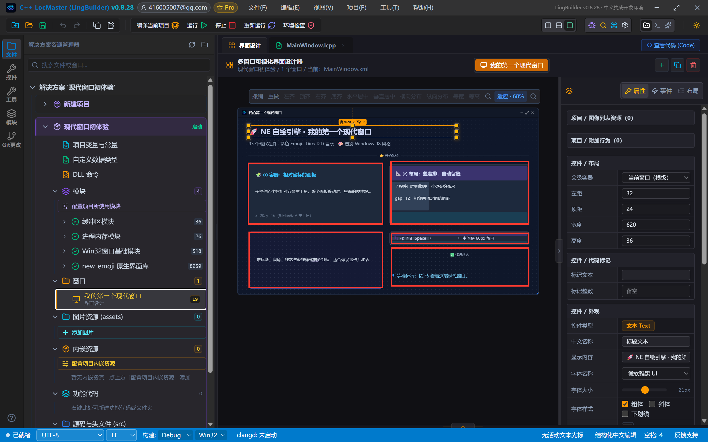

> 红线：**NE 组件只能从工具箱拖进设计器**，不要在代码里用「控件_创建NE容器」这类命令创建控件——设计器模型才是正路，画布可见、门禁可查。

## 6. 写代码：窗口创建完毕时更新状态文字

点「MainWindow.lcpp」页签，在 `_MainWindow_创建完毕` 事件里加一行 `控件_设置文本`：

```lcpp
类 MainWindow
    事件 _MainWindow_创建完毕()
        控件_设置文本(状态文本, "🎉 NE 自绘引擎运行中：彩色 Emoji、容器、布局、边框、间距、分割线已全部就位。")
        调试输出("现代窗口已创建完毕")
    结束
结束类
```

`控件_设置文本(控件名, 文字)` 是模块提供的通用命令：第一个参数直接写设计器里的控件**中文名称**（不用引号），第二个参数是要显示的文字（引号包起来，Emoji 直接打进去）。窗口一创建完毕，状态文本就从「💤 等待运行」变成「🎉 已就位」。

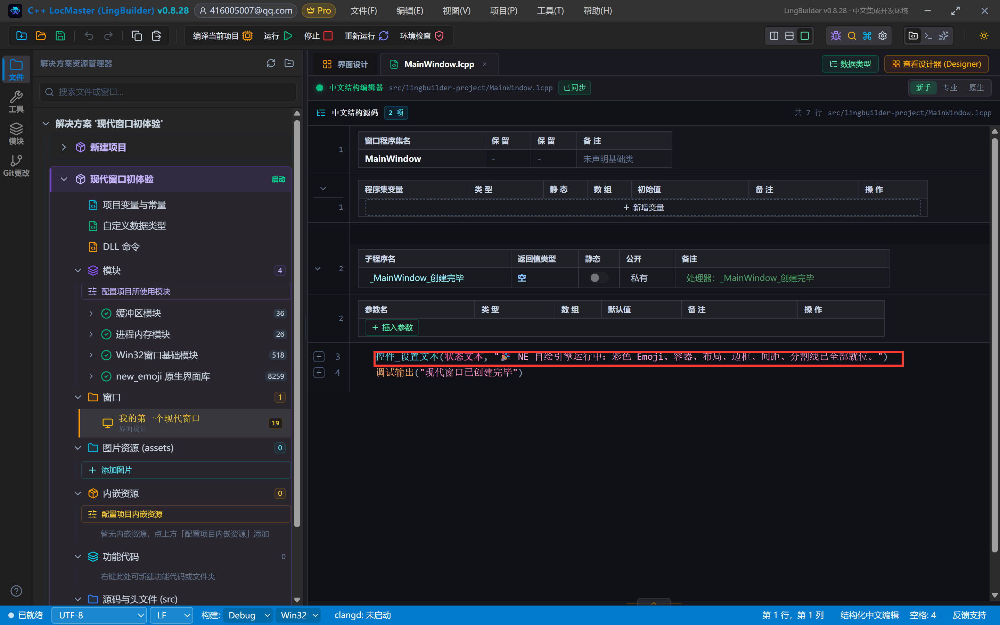

## 7. 编译前先看错误列表

点工具栏「**编译当前项目**」。编译完成后，先别急着看窗口——看底部的「**错误列表**」：

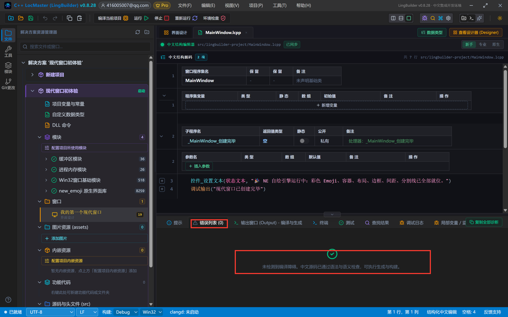

「错误列表 (0)」+ 绿色对勾，说明中文源码通过了语法与语义检查。养成习惯：**每次编译先看这里**，有报错先修报错，再谈运行。

## 8. 运行！看这扇现代窗口

点工具栏「**运行**」。跑起来的窗口长这样：

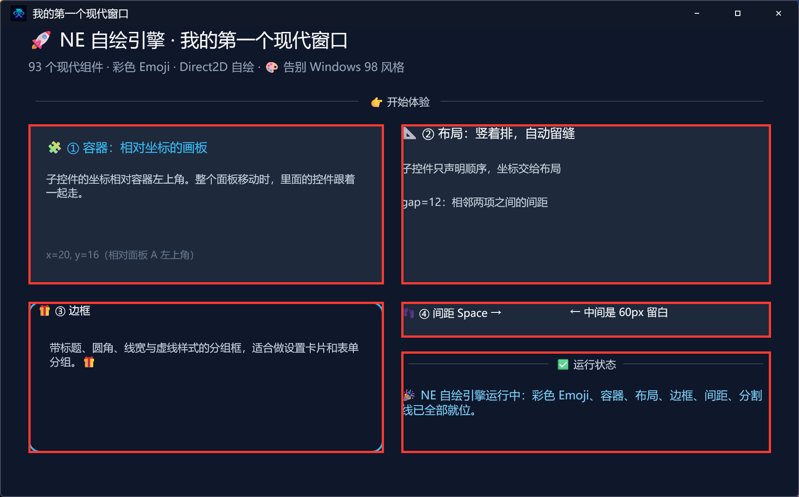

对照设计器逐个看：

- **① 容器**：面板A 是一块圆角面板，里面的标题、正文、坐标注跟着它走——把面板A整体挪个位置，三个字也一起挪
- **② 布局**：布局B 里的三行文字**垂直排列、每行间隔 12px**——这是 `gap=12` 的功劳，我们只声明了顺序，没算坐标
- **③ 边框**：带标题「🎁 ③ 边框」、12px 圆角、2px 天蓝色描边的分组框
- **④ 间距**：布局C 水平排了「左标签 + 60px 间距 + 右标签」，中间那段留白就是 Space 干的
- **⑤ 分割线**：「✅ 运行状态」是虚线分割线（带文字的分割线，文字自动嵌在线中间）
- **状态文本**：已经是「🎉 NE 自绘引擎运行中……」——这就是第 6 步那行代码改的
- **彩色 Emoji**：🚀🎨🧩📐🎁👣✅💤 全部是**彩色**的——这是 NE 引擎 DirectWrite 彩色字体渲染的功劳，写进文字里就彩色的，不需要任何额外处理

关掉窗口，回到 IDE，本集完成。

## 9. 导出源码包（分享给别人）

命令面板（工具栏 🔍 图标）执行「**项目：一键导出 LCPP 源码包**」，选个保存位置即可得到 `.lcpppkg` 文件。别人在 LingBuilder 里双击导入，就能得到和你一模一样的整个工作区（含窗口设计和全部源码）。

## 本集源码包

- 网页版：[01-初识NE现代窗口.lcpppkg](https://lingbuilder.com/demos)（示例源码区可下载）
- 预览图见上方「运行窗口」。

## 下一集预告

02 集「文本与按钮」：Text 的对齐/换行/省略、Button 的 6 种外观变体（variant）、图标按钮、链接、标签、徽标、图标与状态点——8 个最常用组件做出一个「现代按钮工坊」。
