# NE 合集 02 · 文本与按钮：8 个最常用组件

> 《LingBuilder new_emoji 合集》第 2 集（入门篇）。上一集我们认识了 NE 自绘引擎和 5 个布局组件，这一集把**最常用的 8 个「内容组件」**一次学全：文本 Text、按钮 Button、图标按钮 IconButton、链接 Link、标签 Tag、徽标 Badge、图标 Icon、状态点 StatusDot。做完的「现代按钮工坊」能点、能数数、能弹提示，彩色 Emoji 满屏飞。全程约 35 分钟。
>
> 前置要求：完成[第 01 集](/guide/tutorials/new-emoji-01)（会启用模块、切设计后端、拖控件、F5 运行）。本集源码包见文末。

## 这一集你将学会

- **Button 的外观变体 `variant`**：0 默认 / 1 主要 / 2 成功 / 3 警告 / 4 危险 / 5 文本 / 6 信息
- **IconButton 图标按钮**：Emoji 当图标、`badge` 未读数、悬停变色、`tooltip` 悬停提示
- **Link 链接**：`href` + `autoOpen`（自动打开要谨慎）
- **Tag 标签**：4 种类型色（信息/成功/警告/错误）
- **Badge 独立徽标**、**Icon 图标**（可缩放）、**StatusDot 状态点**（带呼吸动画）
- **项目全局变量** + `到文本()`：跨事件累计点击次数

## 1. 命令预告

本集新命令只有 2 条，都很短：

| 命令 | 作用 |
| --- | --- |
| `到文本(数值)` | 把数字变成文字，才能和别的文字拼接 |
| `控件_设置文本(控件名, "文字")` | 第 1 集学过：更新控件文字 |

事件方面全部用设计器的事件绑定（在控件属性面板的「事件」页里选），代码里只写事件处理器。

## 2. 新建项目

欢迎页点「新建项目」，模板「Windows 界面设计」，项目名称填 **现代按钮工坊**，创建位置留空，点「创建项目」：

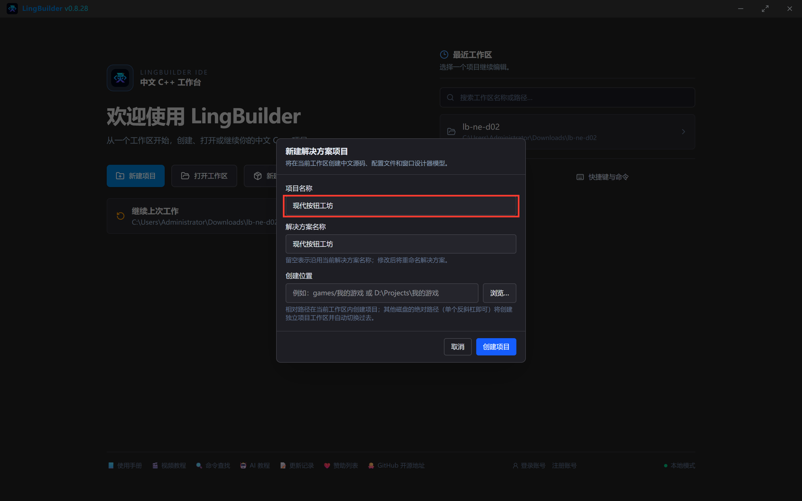

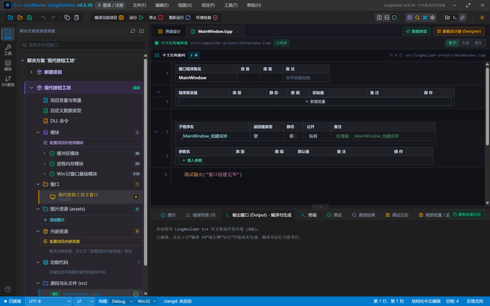

## 3. 启用 new_emoji 模块

和第 1 集一样：模块生态面板搜索「原生界面」，点「new_emoji 原生界面库」行的「启用」开关：

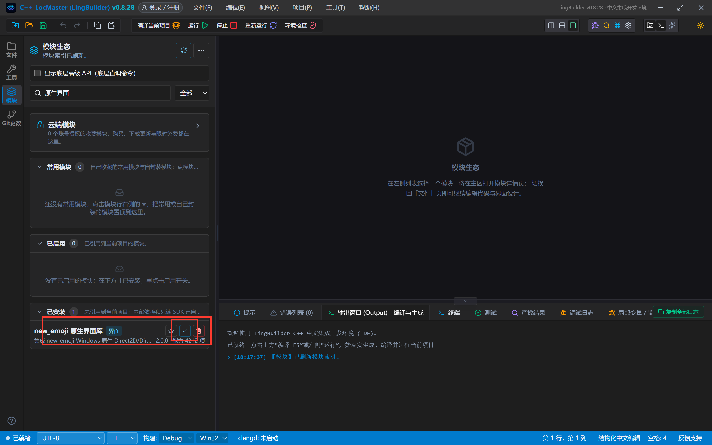

第一次使用会弹出登录框，填账号密码点「登录」，授权自动完成：

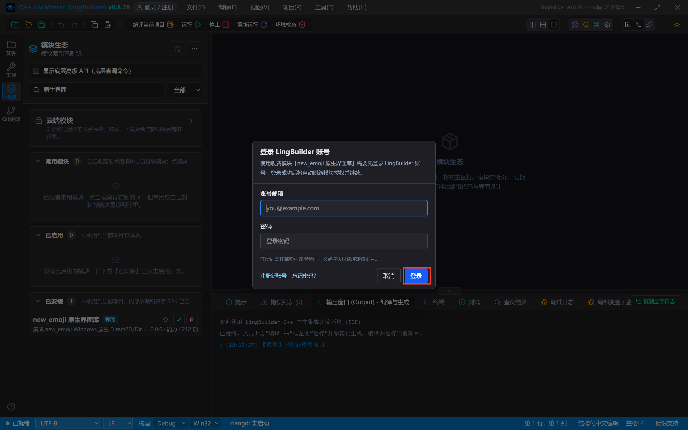

启用成功，「已启用」分组里能看到它：

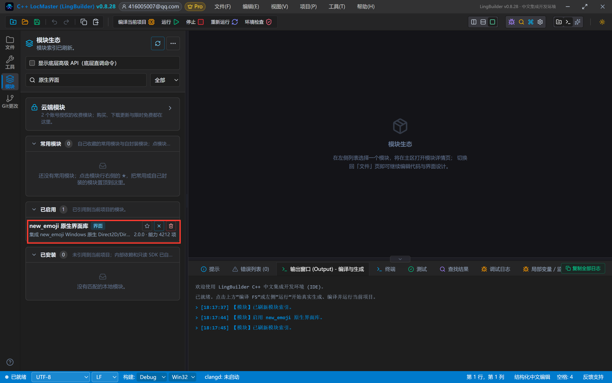

> 已经登录过的电脑，这一步通常直接启用，不会再弹登录框。

## 4. 切设计后端 + 认识工具箱

界面设计页签 → 画布空白处点一下选中窗口 → 属性面板「当前窗口 / 布局」→「设计后端」切换为「**new_emoji 模块**」：

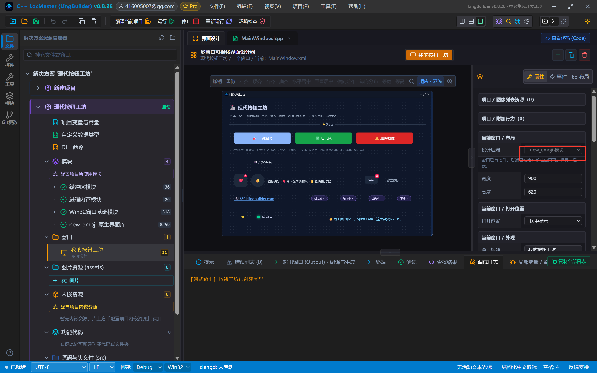

点左侧活动栏「控件」打开工具箱，「New_Emoji 控件」分组下就是全部 93 个组件。本集会用到其中 8 个：

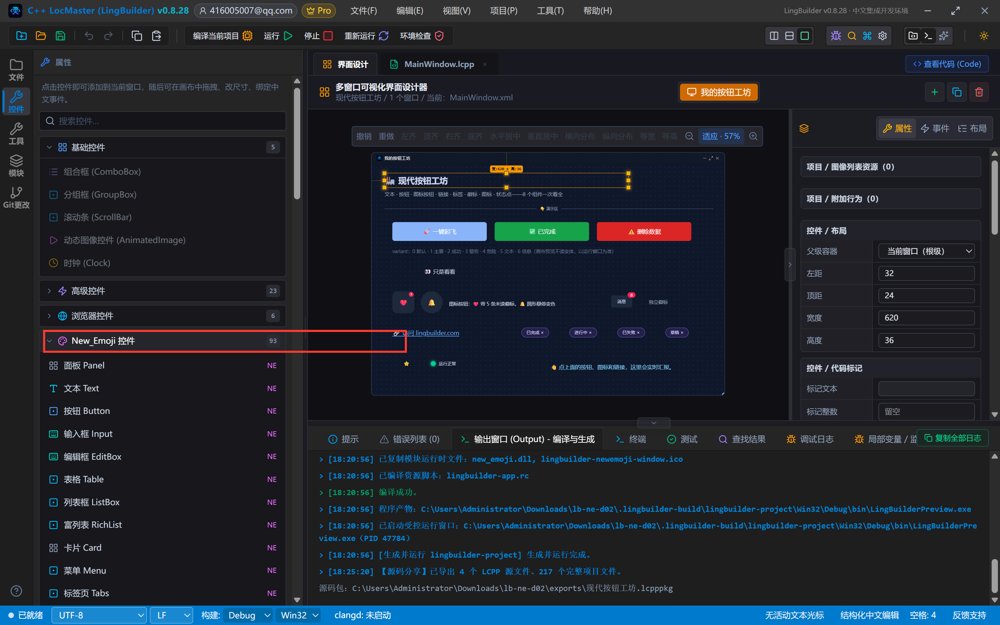

## 5. 设计界面

窗口 900×620，深色底。按下面的表格摆控件（坐标都是窗口绝对坐标，拖到大概位置再在属性面板精修即可）：

| 控件 | 名称 | 显示内容 | 左距 | 顶距 | 宽度 | 高度 | 关键属性 |
| --- | --- | --- | --- | --- | --- | --- | --- |
| 文本 Text | 标题文本 | 🏭 现代按钮工坊 | 32 | 24 | 620 | 36 | 字号 21，粗体 |
| 文本 Text | 副标题文本 | 文本 · 按钮 · 图标按钮 · 链接 · 标签 · 徽标 · 图标 · 状态点——8 个组件一次看全 | 32 | 66 | 700 | 24 | 字号 13，颜色 #94A3B8 |
| 分割线 Divider | 标题分割线 | 👇 演示区 | 32 | 100 | 836 | 28 | — |
| 按钮 Button | 主要按钮 | 🚀 一键起飞 | 52 | 148 | 240 | 48 | **变体=主要(1)**，字号 15 |
| 按钮 Button | 成功按钮 | ✅ 已完成 | 312 | 148 | 240 | 48 | **变体=成功(2)** |
| 按钮 Button | 危险按钮 | ⚠️ 删除数据 | 572 | 148 | 240 | 48 | **变体=危险(4)** |
| 文本 Text | 变体说明 | variant：0 默认 · 1 主要 · 2 成功 · 3 警告 · 4 危险 · 5 文本 · 6 信息（画布预览不读变体，以运行窗口为准） | 52 | 210 | 836 | 26 | 字号 12，颜色 #64748B |
| 按钮 Button | 弱化按钮 | 👀 只是看看 | 52 | 252 | 240 | 44 | **变体=文本(5)**，字号 14 |
| 图标按钮 IconButton | 收藏图标按钮 | （清空） | 52 | 324 | 56 | 56 | **图标=❤️**，提示=收藏，**徽标=5** 且徽标可见，圆角 12 |
| 图标按钮 IconButton | 铃铛图标按钮 | （清空） | 124 | 324 | 56 | 56 | **图标=🔔**，提示=通知，圆角 28（圆形） |
| 文本 Text | 图标按钮说明 | 图标按钮：❤️ 带 5 条未读徽标，🔔 圆形悬停变色 | 196 | 336 | 350 | 40 | 字号 12，自动换行 |
| 徽标 Badge | 独立徽标 | NEW | 580 | 328 | 110 | 44 | **独立显示=真**，类型=成功(1) |
| 文本 Text | 徽标说明 | 独立徽标 | 704 | 338 | 120 | 28 | 字号 12，颜色 #94A3B8 |
| 链接 Link | 社区链接 | 🔗 访问 lingbuilder.com | 52 | 412 | 300 | 36 | **链接地址**=https://lingbuilder.com，**自动打开=假**，类型=主要 |
| 标签 Tag | 标签完成 | 已完成 | 380 | 412 | 110 | 34 | 类型=成功(1) |
| 标签 Tag | 标签进行 | 进行中 | 502 | 412 | 110 | 34 | 类型=警告(2) |
| 标签 Tag | 标签失败 | 已失败 | 624 | 412 | 110 | 34 | 类型=错误(3) |
| 标签 Tag | 标签信息 | 草稿 | 746 | 412 | 100 | 34 | 类型=信息(0) |
| 图标 Icon | 星星图标 | ⭐ | 52 | 472 | 72 | 72 | **缩放=220** |
| 状态点 StatusDot | 服务状态点 | （清空） | 150 | 470 | 250 | 76 | 标签=服务状态，描述=运行中，状态=成功(1)，**呼吸动画=真** |
| 文本 Text | 状态文本 | 👋 点上面的按钮、图标和链接，这里会实时汇报。 | 452 | 462 | 416 | 110 | 字号 14，颜色 #7DD3FC，自动换行 |

最后给 7 个可点控件绑事件（属性面板「事件」页 → 点「被点击」→ 输入处理器名）。处理器名我们统一用「`_控件名_被单击`」，比如主要按钮就叫 `_主要按钮_被单击`：

| 控件 | 事件 | 处理器名 |
| --- | --- | --- |
| 窗口 | 创建完毕 | `_MainWindow_创建完毕` |
| 主要按钮 / 成功按钮 / 危险按钮 / 弱化按钮 | 被点击 | `_主要按钮_被单击` 等（同名规则） |
| 收藏图标按钮 / 铃铛图标按钮 | 被点击 | `_收藏图标按钮_被单击` / `_铃铛图标按钮_被单击` |
| 社区链接 | 被点击 | `_社区链接_被单击` |

摆完的画布：

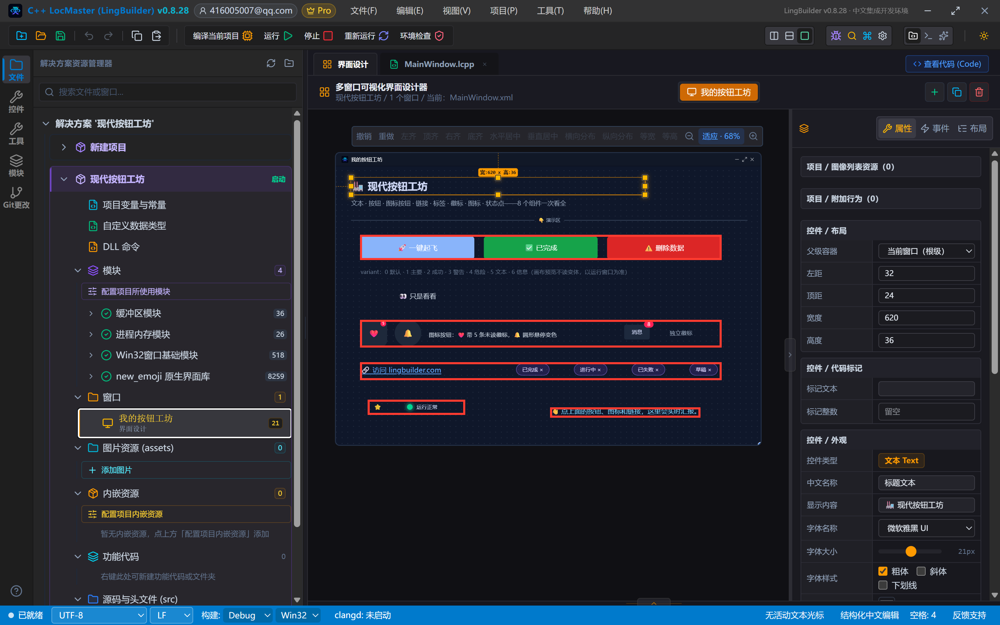

> **红线一**：画布上按钮的变体颜色**不一定**即时生效（画布预览不读 variant），运行窗口才是最终效果——别在画布上反复调色，先跑一次看看。
> **红线二**：链接的「自动打开」默认是假。改成真之后，用户一点链接就会用系统浏览器打开 `href`——演示程序请保持假，免得截图截一半弹出浏览器。

## 6. 全局变量：跨事件的计数器

「点击次数」要在多次点击之间累计，局部变量出了事件就消失，所以用**项目全局变量**：解决方案树点「项目变量与常量」，新增一行——变量名 `点击次数`，类型 `整数型`，初始值 `0`（也可以直接在 `项目全局变量.lcpp` 里写 `全局 整数型 点击次数 = 0`）。

## 7. 写代码

```lcpp
类 MainWindow
    事件 _MainWindow_创建完毕()
        控件_设置文本(状态文本, "👋 欢迎来到按钮工坊：点上面的按钮、图标和链接，这里会实时汇报。")
        调试输出("按钮工坊已创建完毕")
    结束

    事件 _主要按钮_被单击()
        点击次数 = 点击次数 + 1
        控件_设置文本(状态文本, "🚀 主要按钮被点了 " + 到文本(点击次数) + " 次。variant=1 主色按钮，同一个屏幕建议只放一个。")
    结束

    事件 _成功按钮_被单击()
        控件_设置文本(状态文本, "✅ 成功按钮被点击。variant=2 绿色，适合「完成 / 确认」类操作。")
    结束

    事件 _危险按钮_被单击()
        控件_设置文本(状态文本, "⚠️ 危险按钮被点击。variant=4 红色，适合「删除 / 清空」类操作，点之前请三思。")
    结束

    事件 _弱化按钮_被单击()
        控件_设置文本(状态文本, "👀 弱化按钮被点击。variant=5 文本样式，适合「取消 / 次要」操作。")
    结束

    事件 _收藏图标按钮_被单击()
        控件_设置文本(状态文本, "❤️ 收藏被点击。图标按钮右上角的「5」就是徽标（badge=5）。")
    结束

    事件 _铃铛图标按钮_被单击()
        控件_设置文本(状态文本, "🔔 铃铛被点击。给图标按钮配 tooltip，鼠标悬停会出提示。")
    结束

    事件 _社区链接_被单击()
        控件_设置文本(状态文本, "🔗 链接被点击。本演示 autoOpen=假，不真跳转；改成 真 就会用系统浏览器打开 href。")
    结束
结束类
```

两个要点：

- **数字不能直接和文字相加**，先用 `到文本(点击次数)` 转成文字再拼接，这是中文代码最常用的转换命令；
- 事件处理器名必须和设计器事件绑定里填的**一字不差**（包括开头的下划线），对不上就不会被触发，而且没有报错——这是新手最容易踩的坑。

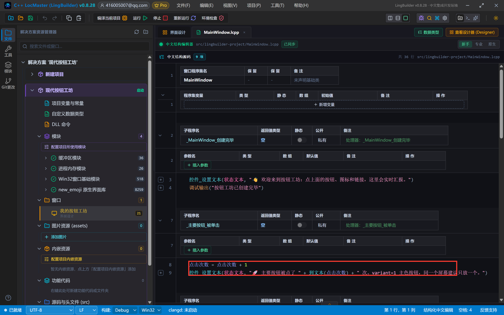

## 8. 编译前先看错误列表

点「编译当前项目」，底部「错误列表 (0)」+ 绿色对勾再继续：

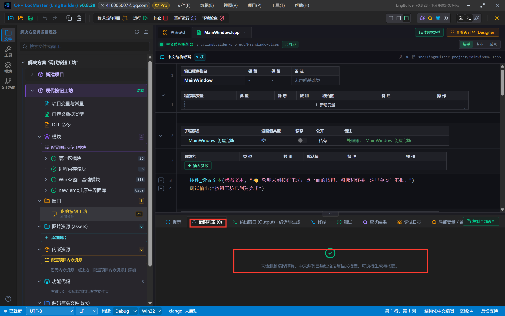

## 9. 运行！逐个点一遍

点「运行」，窗口出来了：

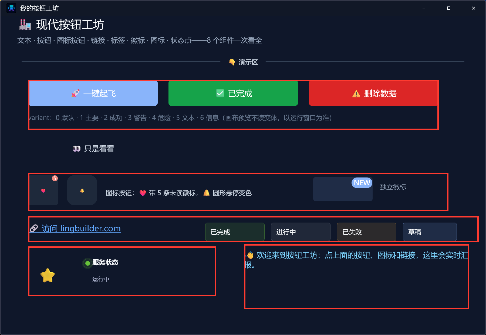

对照设计器检查：三颗变体按钮（蓝/绿/红）、文本样式的弱化按钮、❤️ 带未读徽标 5、圆形 🔔、NEW 独立徽标、下划线链接、四色标签、大星星 ⭐、带呼吸动画的绿色状态点，全部就位。

现在交互一下。把鼠标悬停在 🔔 上——出现「通知」提示，按钮边框亮起：

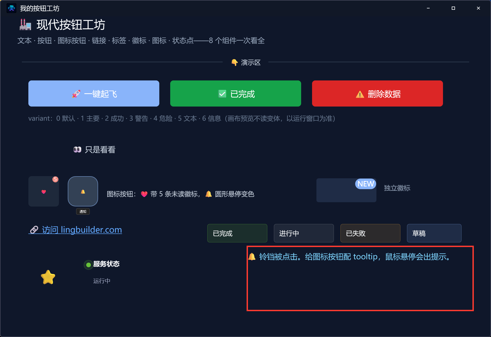

连点两下「🚀 一键起飞」，状态文本实时变成「主要按钮被点了 4 次」（我们前面已经点过 2 次，全局变量一直记着）：

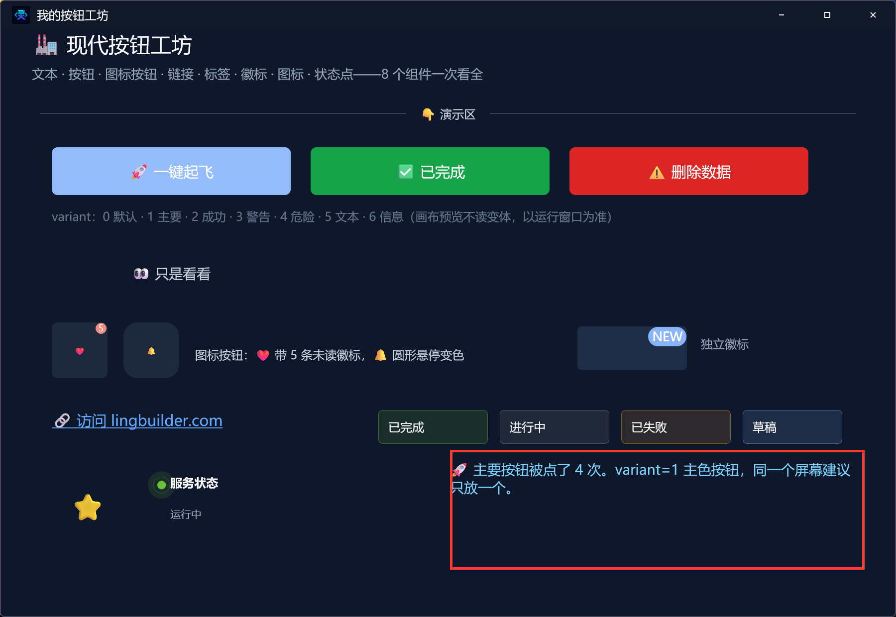

数字会一直累加，关掉窗口重开才清零——这就是全局变量和局部变量的区别。

## 10. 导出源码包

命令面板执行「项目：一键导出 LCPP 源码包」，把 `.lcpppkg` 发给朋友，双击导入就能得到整个项目。

## 本集源码包

- 网页版：[02-现代按钮工坊.lcpppkg](https://lingbuilder.com/demos)（示例源码区可下载）

## 下一集预告

03 集「输入类（一）」：输入框 Input、编辑框 EditBox、组合输入 InputGroup、自动完成 Autocomplete、数字输入框 InputNumber——做一个能提交、能校验的「现代输入练习册」。
