# NE 合集 05 · 下拉与级联：城市选择中心

> 《LingBuilder new_emoji 合集》第 5 集（选择类开篇）。一次学会 4 种「下拉选择」控件：**Select 选择器、SelectV2 虚拟选择器、Cascader 级联选择、TreeSelect 树选择**——做一个点开下拉、选中即汇报的「城市选择中心」。全程约 35 分钟。
>
> 前置要求：完成[第 01 集](/guide/tutorials/new-emoji-01)（启用模块、切设计后端、F5 全流程）。本集源码包见文末。

## 这一集你将学会

- **Select 选择器**：`options` 选项列表 + `selectedIndex` 默认选中
- **SelectV2 虚拟选择器**：海量选项只画看得见的几行（`visibleCount`）
- **Cascader 级联选择**：选项用 `/` 分层级，逐级下钻
- **TreeSelect 树选择**：`treeDataJson` 填 JSON 建层级树
- **选择变化（SelectionChanged）事件**：四个控件共用的「选好了」事件
- **控件_取选择项**：读选中索引（从 0 起）；**控件_取文本**：读级联选中路径

## 1. 命令与事件预告

| 命令 / 事件 | 作用 |
| --- | --- |
| `控件_取选择项(控件名)` | 读选择控件的当前索引（整数型，从 0 起，未选为 -1） |
| `控件_取文本(控件名)` | 读控件显示文本——Cascader 的选中路径就靠它 |
| `控件_设置文本(控件名, 文本)` | 写状态汇报 |
| `选择变化` 事件 | 四个控件共用：用户选完一项就触发，**不带参数** |

> 这一集不需要额外启用模块——全部命令都在 new_emoji 模块里。

## 2. 新建项目 + 启用模块 + 切后端

流程和第 1 集完全一样，项目名称填 **城市选择中心**：

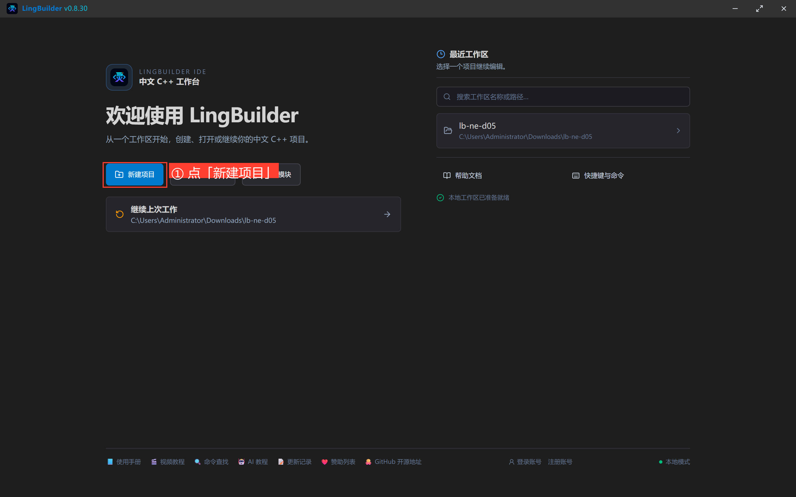

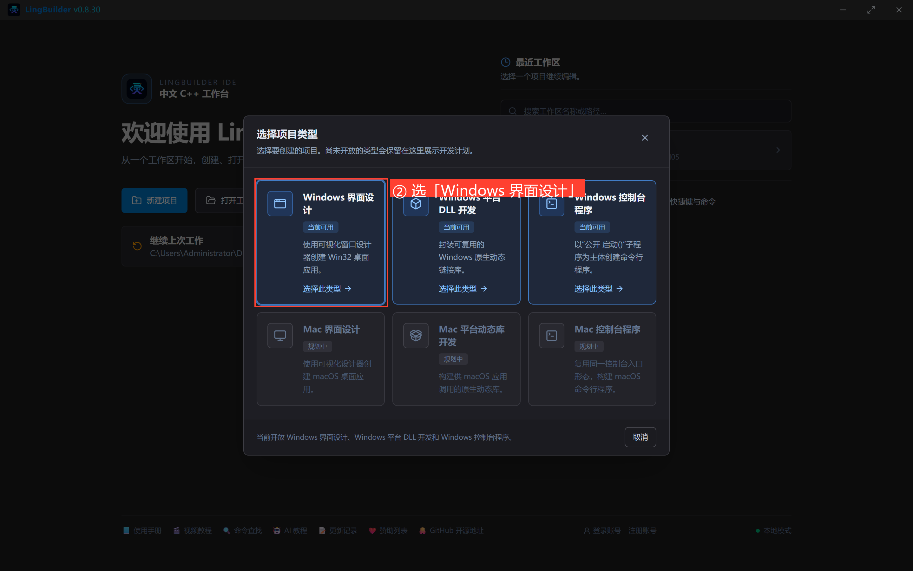

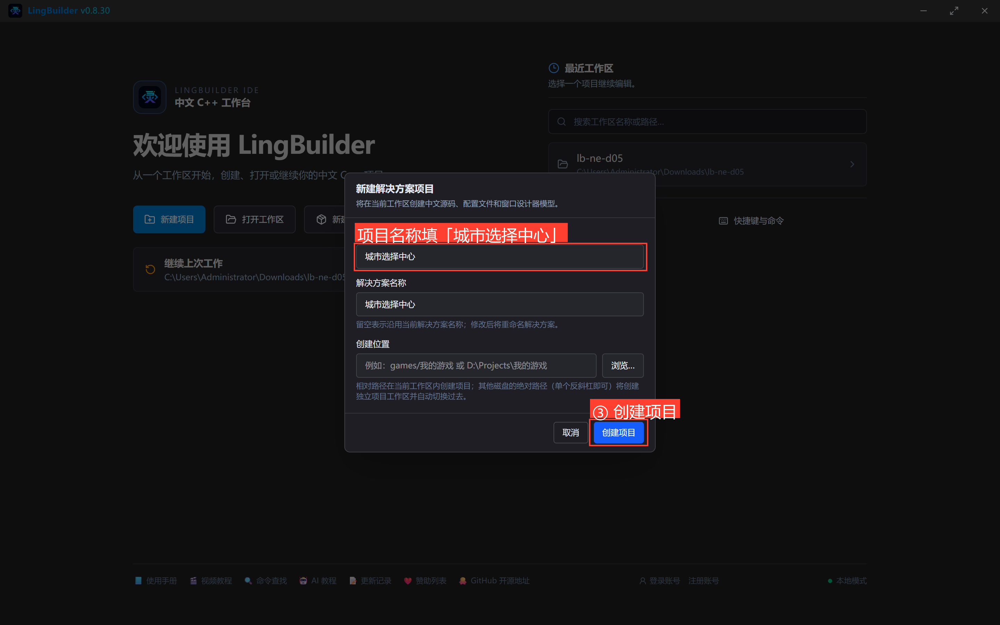

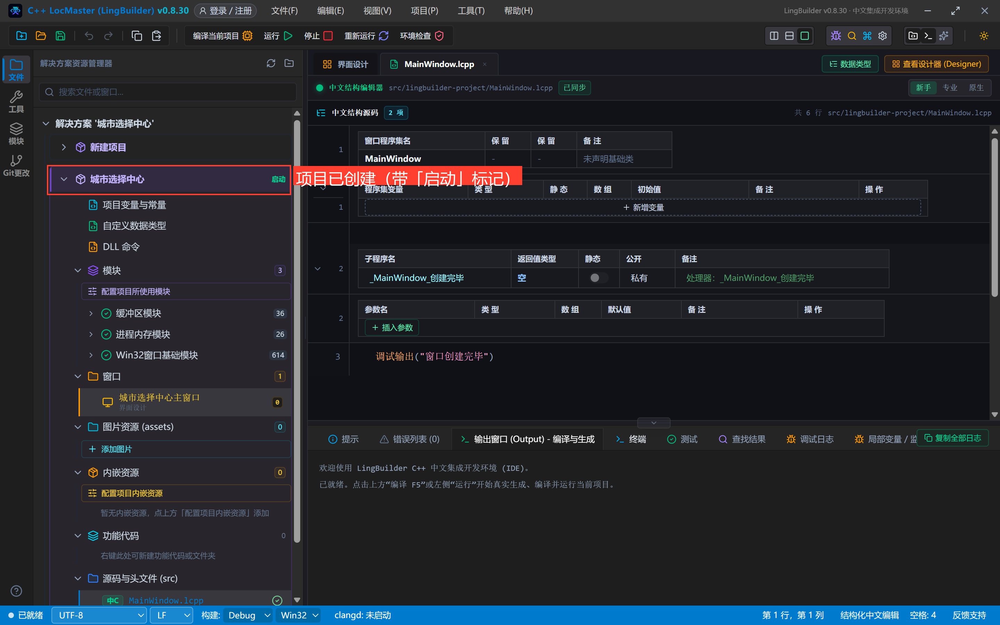

模块面板搜「原生界面」→ 在「已安装」里找到「new_emoji 原生界面库」，点启用（首次弹登录框，登录一次即可）：

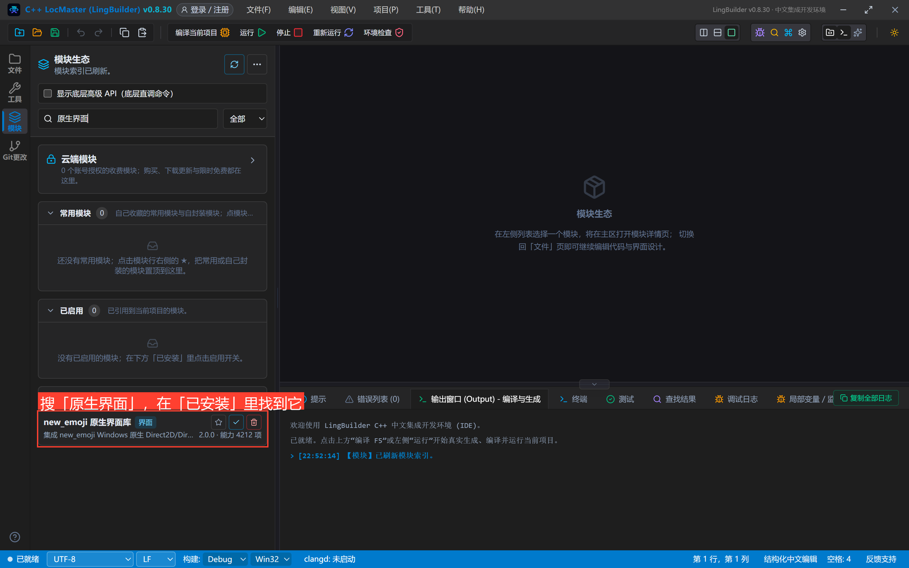

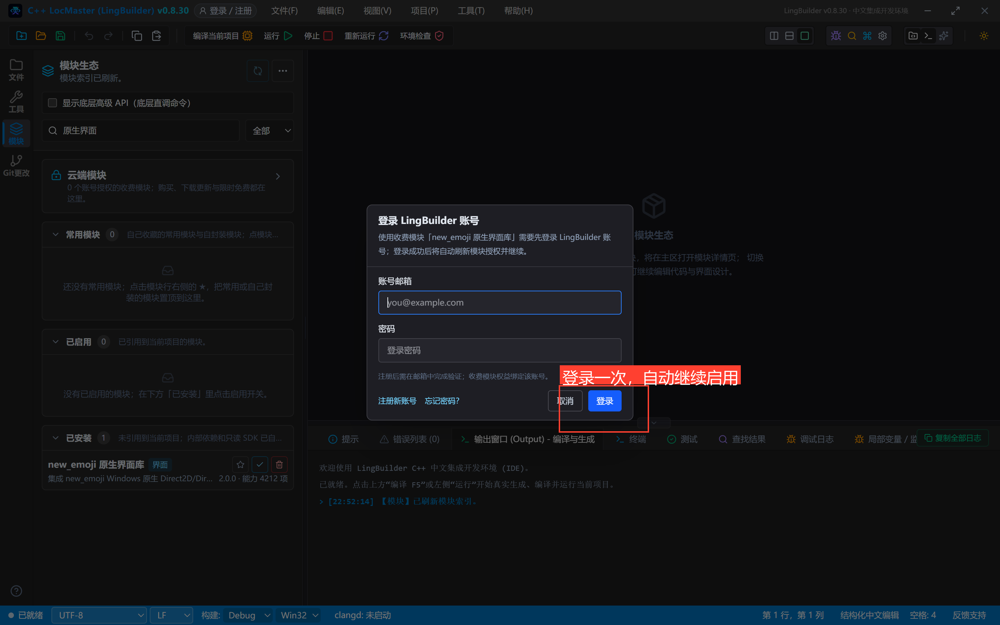

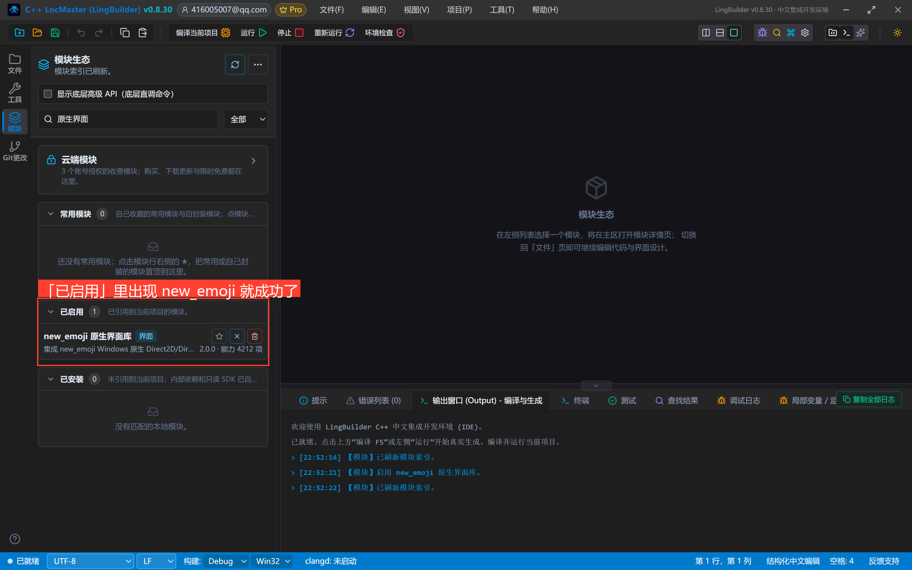

界面设计 → 画布点窗口空白处选中窗口 → 「设计后端」切为「new_emoji 模块」：

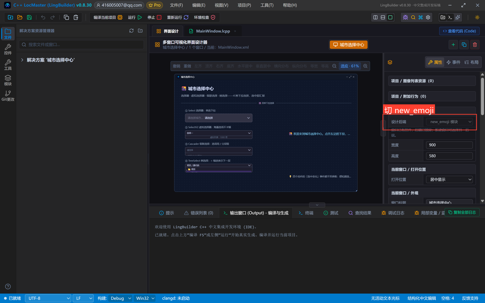

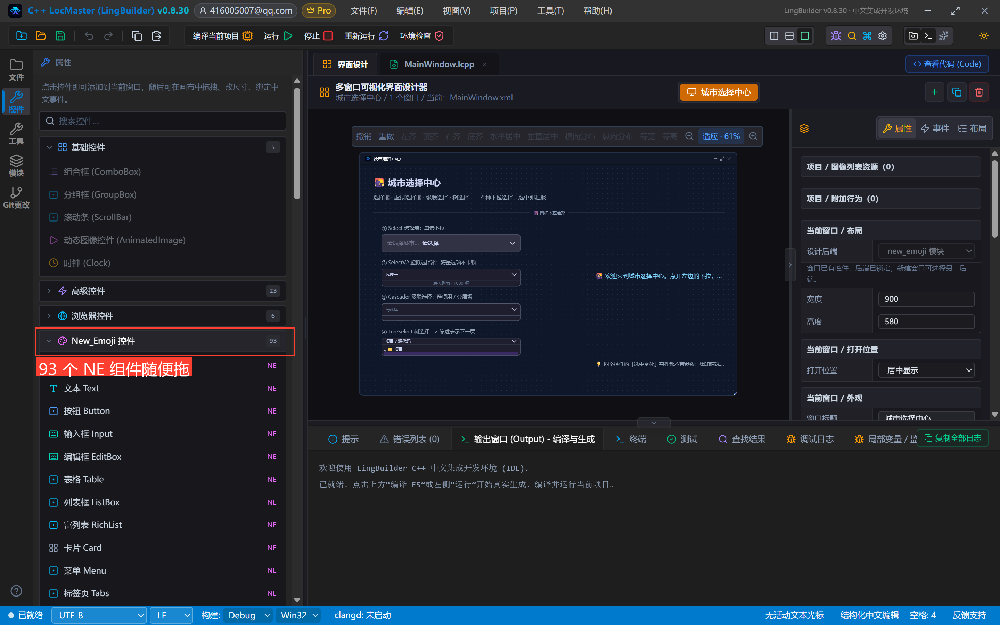

## 3. 设计界面

窗口 900×580。左边四个下拉、右边一块状态汇报屏：

| 控件 | 名称 | 显示内容 | 左距 | 顶距 | 宽度 | 高度 | 关键属性 |
| --- | --- | --- | --- | --- | --- | --- | --- |
| 文本 Text | 标题文本 | 🌇 城市选择中心 | 32 | 24 | 620 | 36 | 字号 21，粗体 |
| 文本 Text | 副标题文本 | 选择器 · 虚拟选择器 · 级联选择 · 树选择——4 种下拉选择，选中即汇报 | 32 | 66 | 780 | 24 | 字号 13，#94A3B8 |
| 分割线 Divider | 标题分割线 | 🌆 四种下拉选择 | 32 | 100 | 836 | 28 | — |
| 文本 Text | 选择器标签 | ① Select 选择器：单选下拉 | 52 | 140 | 300 | 22 | 字号 12，#94A3B8 |
| 选择器 Select | 城市选择 | （清空） | 52 | 166 | 330 | 42 | **options=杭州/上海/北京/成都/广州（带 emoji），selectedIndex=0** |
| 文本 Text | 虚拟标签 | ② SelectV2 虚拟选择器：海量选项不卡顿 | 52 | 222 | 340 | 22 | 字号 12，#94A3B8 |
| 虚拟选择器 SelectV2 | 虚拟城市 | （清空） | 52 | 248 | 330 | 42 | **options=16 个城市，visibleCount=6，selectedIndex=0** |
| 文本 Text | 级联标签 | ③ Cascader 级联选择：选项用 / 分层级 | 52 | 304 | 340 | 22 | 字号 12，#94A3B8 |
| 级联选择 Cascader | 省市选择 | 选择省市区… | 52 | 330 | 330 | 42 | **options=浙江/杭州/西湖 等 5 条，selected 留空** |
| 文本 Text | 树选标签 | ④ TreeSelect 树选择：> 缩进表示下一层 | 52 | 386 | 340 | 22 | 字号 12，#94A3B8 |
| 树选择 TreeSelect | 部门树 | （清空） | 52 | 412 | 330 | 42 | **treeDataJson 填一段 JSON（见下方红线）** |
| 文本 Text | 状态文本 | 🌇 欢迎来到城市选择中心。点开左边的下拉，选一个试试。 | 560 | 140 | 308 | 250 | 字号 14，#7DD3FC，自动换行 |
| 文本 Text | 红线说明 | 💡 四个控件的「选中变化」事件都不带参数…… | 560 | 410 | 308 | 130 | 字号 12，#94A3B8，自动换行 |

事件绑定：窗口「创建完毕」+ 四个选择控件的「**选择变化**」事件，处理器名统一 `_控件名_选择变化`。

摆完的画布：

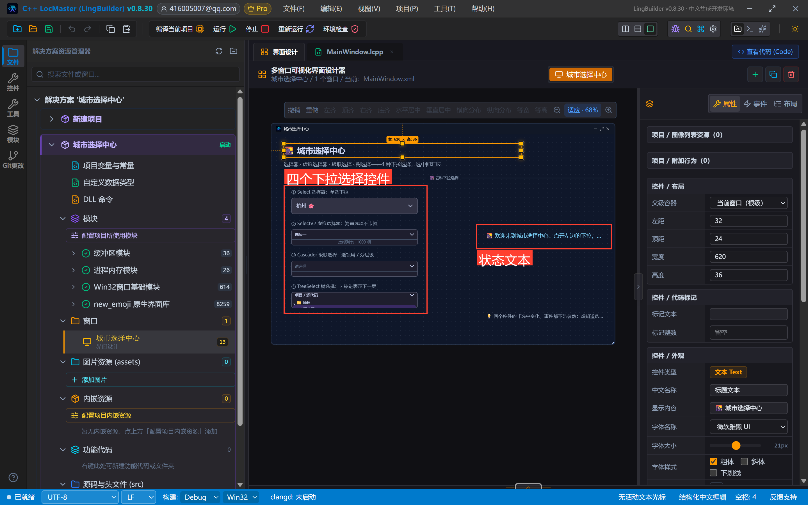

> **本集最重要的红线：TreeSelect 的选项要用 `treeDataJson` 属性填 JSON**，一层嵌套一层：
>
> ```json
> [{"key":"hq","label":"🏢 公司总部","children":[
>     {"key":"tech","label":"💻 技术部"},
>     {"key":"design","label":"🎨 设计部"},
>     {"key":"market","label":"📈 市场部"}]}]
> ```
>
> 子项写进 `children` 数组，运行时自动缩进成树。只填 `items` 属性的话，选项不会出现在弹层里——这是本集最大的坑。

**第二个红线**：有默认选中值的控件（本集的 Select/SelectV2/TreeSelect），「显示内容」要**清空**。NE 的下拉会把占位文本和选中值叠在一起画，不清空就会出现两行文字叠写的花屏效果。

**第三个红线**：Cascader 的「选中」是一条**路径**不是索引——`控件_取选择项` 读不到它（恒为 -1），要用 `控件_取文本` 读「浙江 / 杭州 / 西湖」这样的显示文本。

## 4. 写代码

```lcpp
类 MainWindow
    事件 _MainWindow_创建完毕()
        控件_设置文本(状态文本, "🌇 欢迎来到城市选择中心。点开左边的下拉，选一个试试。")
        调试输出("城市选择中心已创建完毕")
    结束

    事件 _城市选择_选择变化()
        局部 整数型 序号
        序号 = 控件_取选择项(城市选择)
        控件_设置文本(状态文本, "🏙️ Select 选中索引 " + 到文本(序号) + "（第 " + 到文本(序号 + 1) + " 个城市）。")
    结束

    事件 _虚拟城市_选择变化()
        局部 整数型 序号
        序号 = 控件_取选择项(虚拟城市)
        控件_设置文本(状态文本, "⚡ SelectV2 选中索引 " + 到文本(序号) + "——海量选项也只画看得见的几行。")
    结束

    事件 _省市选择_选择变化()
        控件_设置文本(状态文本, "🗂️ Cascader 当前选中：" + 控件_取文本(省市选择))
    结束

    事件 _部门树_选择变化()
        局部 整数型 序号
        序号 = 控件_取选择项(部门树)
        如果 (序号 = 1)
            控件_设置文本(状态文本, "💻 技术部：索引 1，招后端与客户端工程师。")
        否则如果 (序号 = 2)
            控件_设置文本(状态文本, "🎨 设计部：索引 2，招 UI / UX 设计师。")
        否则如果 (序号 = 3)
            控件_设置文本(状态文本, "📈 市场部：索引 3，招增长运营。")
        否则
            控件_设置文本(状态文本, "🏢 选中了第 " + 到文本(序号 + 1) + " 项。")
        如果结束
    结束
结束类
```

看点：`选择变化` 事件**不带参数**，想知道选了什么，处理器里自己 `控件_取选择项` 再读一次——「先变状态、再问状态」是 NE 事件的统一节奏。树选择的展开层级用「如果 / 否则如果」把索引翻译成业务含义，正是分支语句的练手场。

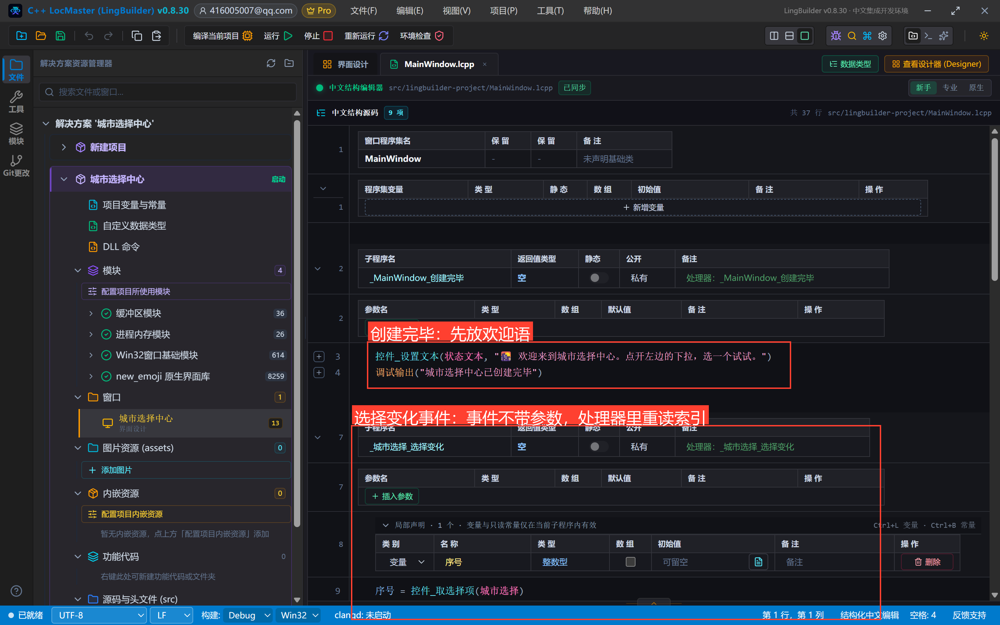

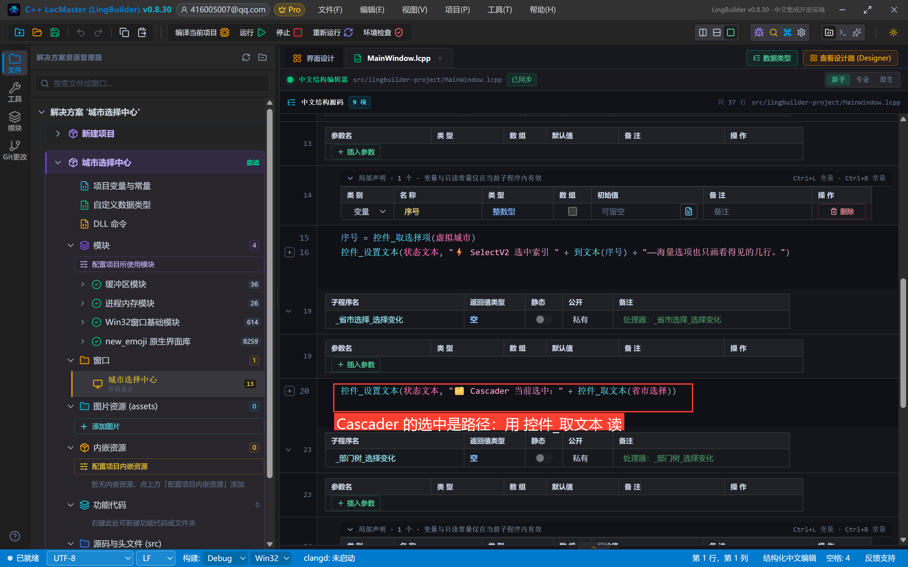

## 5. 编译前先看错误列表

点「编译当前项目」，然后先看底部错误列表——零报错再继续：

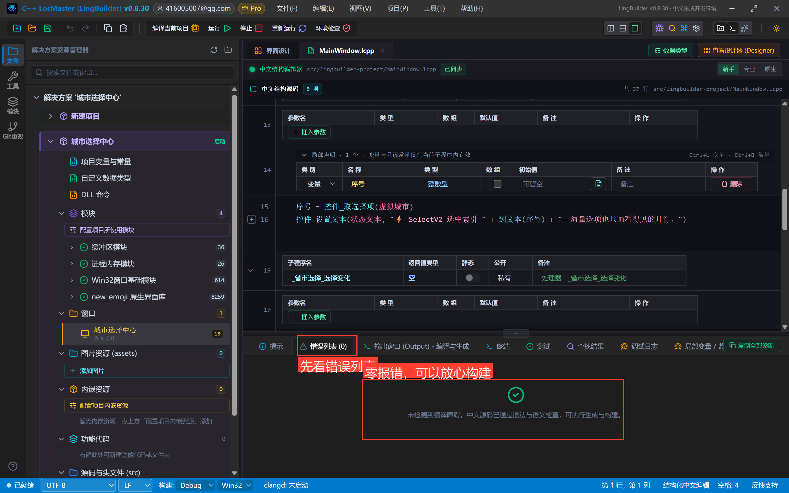

## 6. 运行！把四个下拉都点一遍

点「运行」。初始状态：Select 和 SelectV2 都停在第 0 项「杭州」，级联还空着，树停在「🏢 公司总部」：

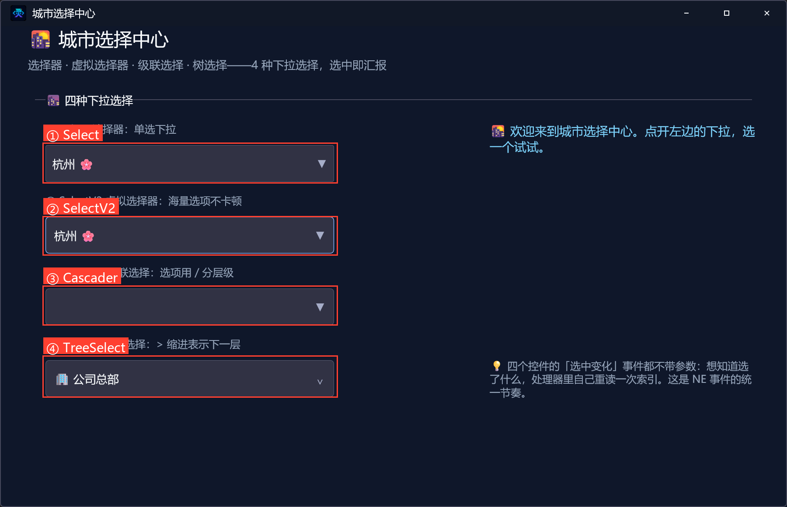

点开第一个下拉，5 个城市一字排开：

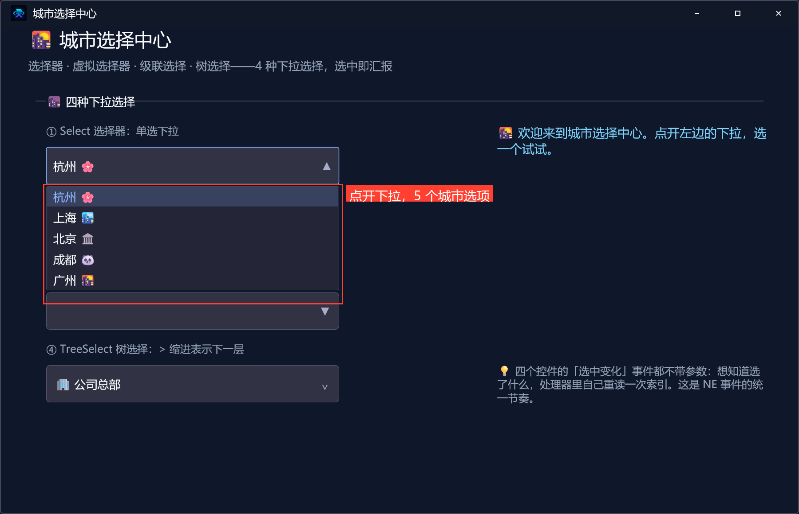

点「上海」——字段变成上海，状态屏立刻汇报「🏙️ Select 选中索引 1（第 2 个城市）」：

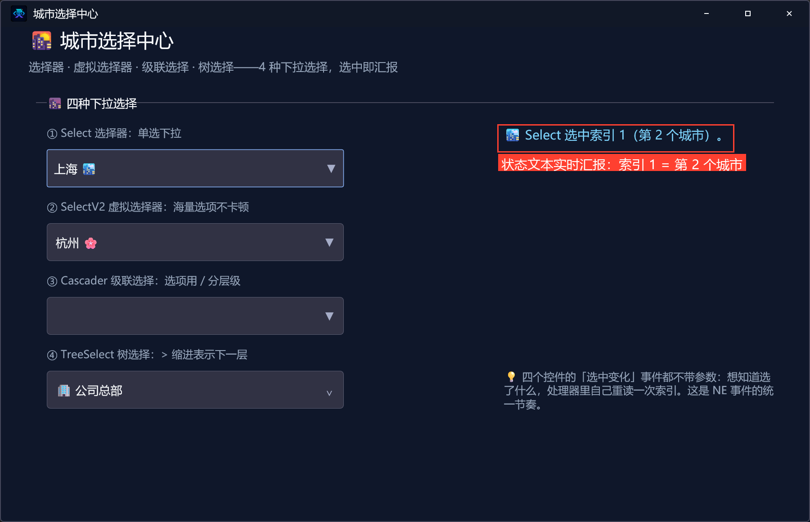

最后连做两件事：级联里逐级点 浙江 → 杭州 → 西湖（弹层分三列下钻），树里展开公司总部点「💻 技术部」：

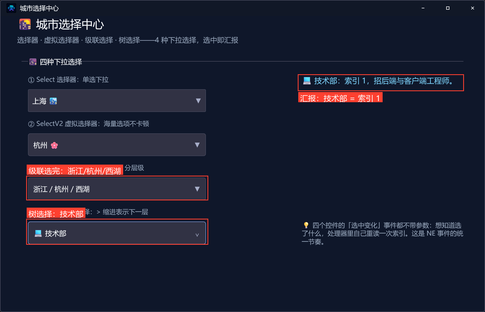

级联显示「浙江 / 杭州 / 西湖」，树显示「💻 技术部」，状态屏汇报「💻 技术部：索引 1，招后端与客户端工程师。」——4 种下拉、1 个事件、两条读取命令，全部打通。

## 7. 导出源码包

命令面板执行「项目：一键导出 LCPP 源码包」即可。

## 本集源码包

- 网页版：[05-城市选择中心.lcpppkg](https://lingbuilder.com/demos)（示例源码区可下载）

## 下一集预告

下一集继续选择类：「日期与时间」——DatePicker/TimePicker/DateTimePicker/TimeSelect/Calendar，五件套做一个预约时间登记台。
