# NE 合集 06 · 日期与时间：预约时间登记台

> 《LingBuilder new_emoji 合集》第 6 集（选择类第二集）。一次学会 5 种「日期时间」控件：**DatePicker 日期选择、TimePicker 时间选择、DateTimePicker 日期时间、TimeSelect 时间下拉、Calendar 日历**——做一个「预约时间登记台」。这一集还能学到 NE 弹层控件的事件触发节奏。全程约 35 分钟。
>
> 前置要求：完成[第 01 集](/guide/tutorials/new-emoji-01)（启用模块、切设计后端、F5 全流程）。本集源码包见文末。

## 这一集你将学会

- **DatePicker**：`year`/`month`/`selectedDay` 设初值，弹层选年月日
- **TimePicker**：`hour`/`minute` 设初值，弹层拨时分
- **DateTimePicker**：日期+时间一个弹层搞定
- **TimeSelect**：`minTime`/`maxTime`/`stepMinutes` 只给固定时段的下拉
- **Calendar**：常驻日历面板，`year`/`month`/`selectedDay` 高亮某天
- **选择变化（SelectionChanged）事件**：五个控件同名事件，但**触发时机有讲究**（本集最重要的红线）

## 1. 命令与事件预告

| 命令 / 事件 | 作用 |
| --- | --- |
| `控件_设置文本(控件名, 文本)` | 写状态播报 |
| `选择变化` 事件 | 五个控件共用：弹层控件在**点开弹层**瞬间触发，日历在**点中日期**时触发 |

> 本集只需要 new_emoji 模块，没有额外模块。

## 2. 新建项目 + 启用模块 + 切后端

流程和第 1 集完全一样，项目名称填 **预约时间登记台**：

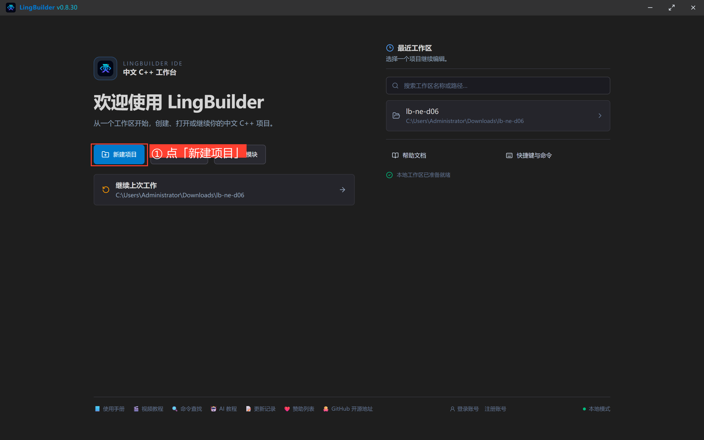

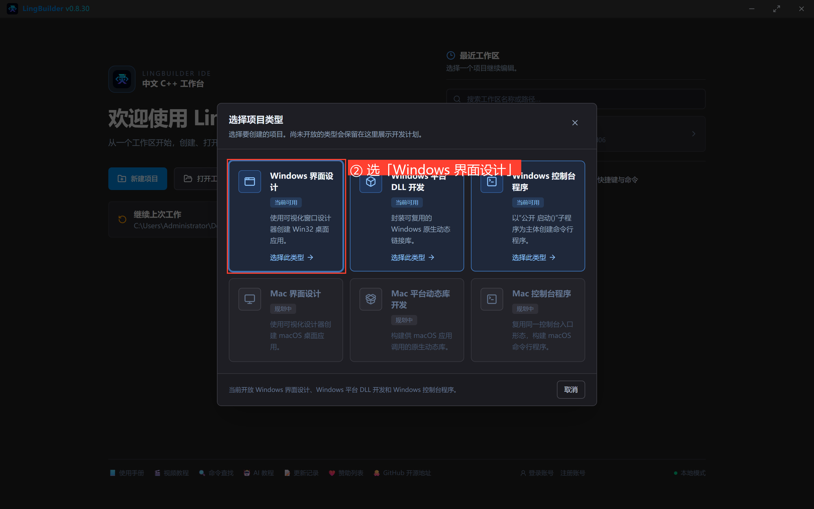

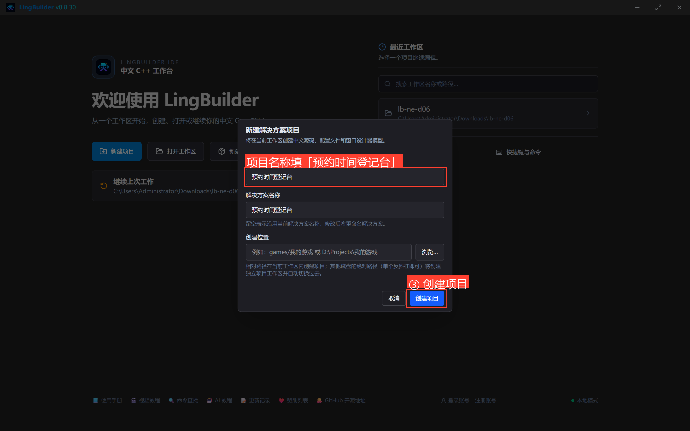

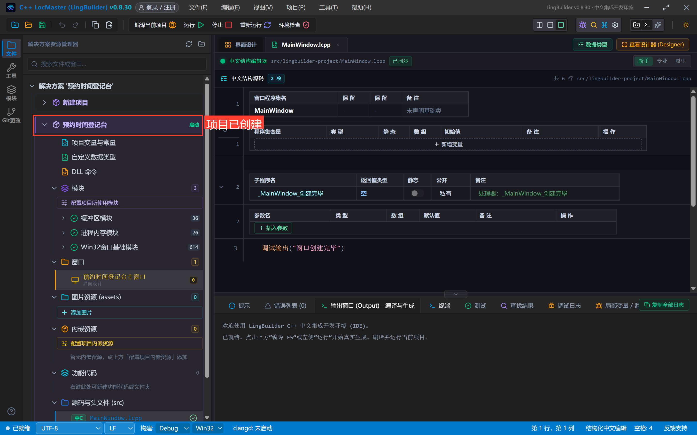

模块面板搜「原生界面」→ 启用「new_emoji 原生界面库」（首次弹登录框，登录一次即可）：

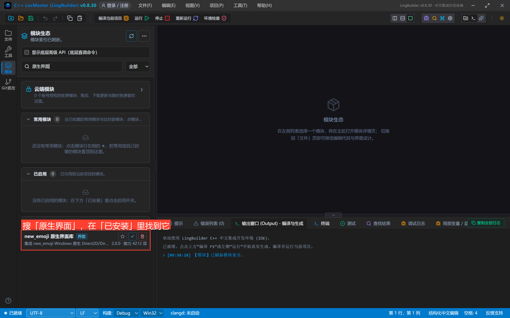

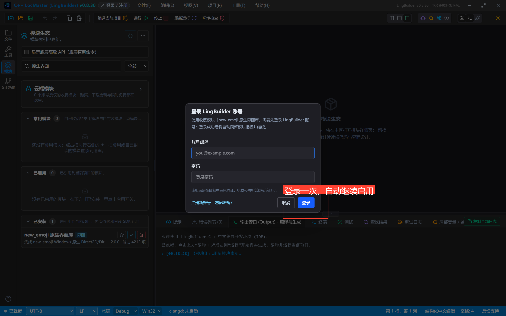

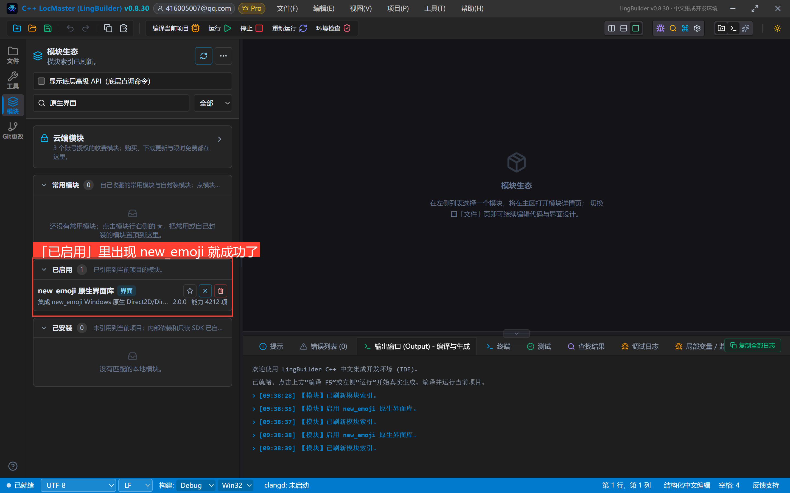

界面设计 → 选中窗口 → 「设计后端」切为「new_emoji 模块」：

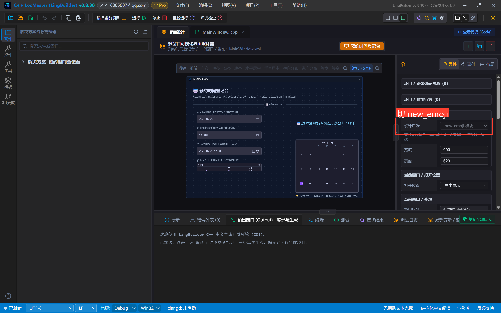

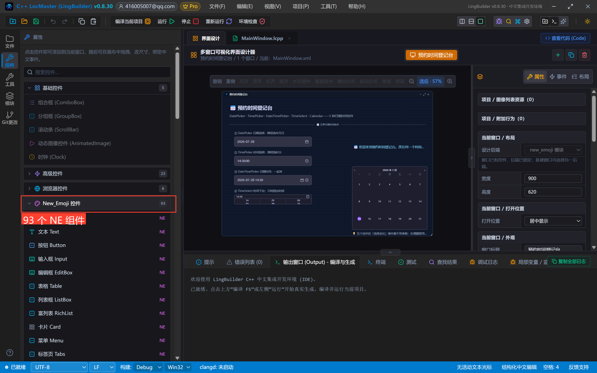

## 3. 设计界面

窗口 900×620。左边四个弹层控件，右边状态屏 + 一块常驻日历：

| 控件 | 名称 | 显示内容 | 左距 | 顶距 | 宽度 | 高度 | 关键属性 |
| --- | --- | --- | --- | --- | --- | --- | --- |
| 文本 Text | 标题文本 | 📅 预约时间登记台 | 32 | 24 | 620 | 36 | 字号 21，粗体 |
| 文本 Text | 副标题文本 | DatePicker · TimePicker · DateTimePicker · TimeSelect · Calendar——5 种日期时间控件 | 32 | 66 | 780 | 24 | 字号 13，#94A3B8 |
| 分割线 Divider | 标题分割线 | 🗓️ 五种日期时间控件 | 32 | 100 | 836 | 28 | — |
| 文本 Text | 日期标签 | ① DatePicker 日期选择：弹层选年月日 | 52 | 140 | 340 | 22 | 字号 12，#94A3B8 |
| 日期选择 DatePicker | 日期选择 | （清空） | 52 | 166 | 330 | 42 | **year=2026，month=10，selectedDay=15** |
| 文本 Text | 时间标签 | ② TimePicker 时间选择：弹层选时分 | 52 | 222 | 340 | 22 | 字号 12，#94A3B8 |
| 时间选择 TimePicker | 时间选择 | （清空） | 52 | 248 | 330 | 42 | hour=9，minute=30 |
| 文本 Text | 日期时间标签 | ③ DateTimePicker 日期时间：一起来 | 52 | 304 | 340 | 22 | 字号 12，#94A3B8 |
| 日期时间 DateTimePicker | 日期时间 | （清空） | 52 | 330 | 330 | 42 | **year=2026，month=10，day=20，hour=14，minute=30** |
| 文本 Text | 时段标签 | ④ TimeSelect 时间下拉：只给固定时段 | 52 | 386 | 340 | 22 | 字号 12，#94A3B8 |
| 时间下拉 TimeSelect | 时段选择 | （清空） | 52 | 412 | 330 | 42 | **minTime=480，maxTime=1080，stepMinutes=30**（08:00~18:00 每半小时一档） |
| 文本 Text | 状态文本 | 📅 欢迎来到预约时间登记台。改任何一个时间，这里都会记下来。 | 560 | 140 | 308 | 140 | 字号 14，#7DD3FC，自动换行 |
| 日历 Calendar | 日历 | （清空） | 554 | 292 | 320 | 270 | **year=2026，month=10，selectedDay=20** |
| 文本 Text | 红线说明 | 💡 弹层控件的事件在点开瞬间触发；日历点中才触发。 | 554 | 556 | 320 | 36 | 字号 12，#94A3B8，自动换行 |

事件绑定：五个控件各绑「**选择变化**」事件，处理器名统一 `_控件名_选择变化`。

摆完的画布：

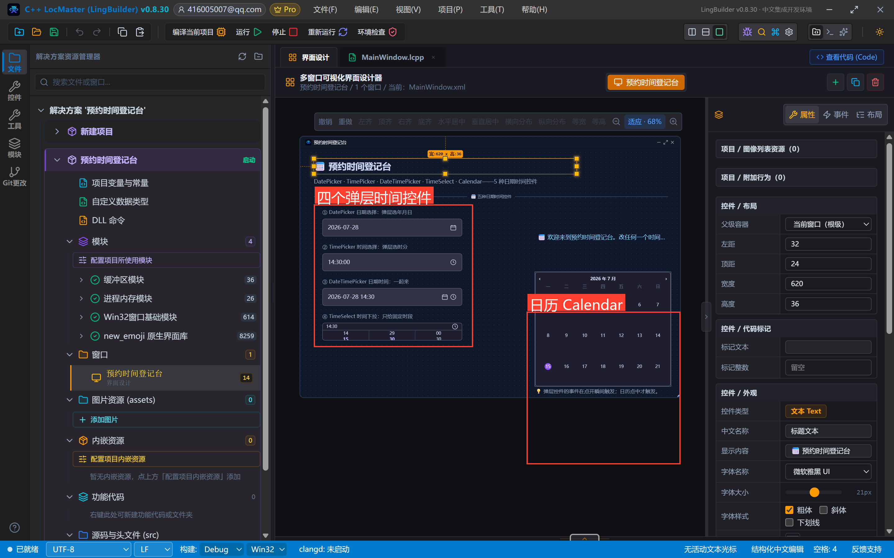

> **本集最重要的红线：弹层控件的「选择变化」在点开弹层那一刻就触发**（DatePicker/TimePicker/DateTimePicker/TimeSelect 都是），不是选中某项才触发；**日历 Calendar 是常驻面板，点中某个日期才触发**。所以处理器里适合做「播报」和「联动刷新」，别指望在这里读「刚选中的值」——选中的结果直接显示在控件自己的框里。
>
> **第二个红线**：有时间初值的控件，「显示内容」同样要**清空**，否则占位文本和值叠画（第 05 集讲过的坑，日期时间控件一样中招）。

## 4. 写代码

```lcpp
类 MainWindow
    事件 _MainWindow_创建完毕()
        控件_设置文本(状态文本, "📅 欢迎来到预约时间登记台。改任何一个时间，这里都会记下来。")
        调试输出("预约时间登记台已创建完毕")
    结束

    事件 _日期选择_选择变化()
        控件_设置文本(状态文本, "📅 日期弹层打开了——选中的日期显示在日期框里。")
    结束

    事件 _时间选择_选择变化()
        控件_设置文本(状态文本, "⏰ 时间弹层打开了——拨到想要的时分。")
    结束

    事件 _日期时间_选择变化()
        控件_设置文本(状态文本, "🕒 日期时间弹层打开了——一次定完日期和时分。")
    结束

    事件 _时段选择_选择变化()
        控件_设置文本(状态文本, "🕐 时段下拉打开了——列表里只有 08:00~18:00 的半点档。")
    结束

    事件 _日历_选择变化()
        控件_设置文本(状态文本, "🗓️ 日历：点中的日期已经高亮，右侧登记完成。")
    结束
结束类
```

看点：五个处理器是同一个节奏——一句 `控件_设置文本` 播报「发生了什么」。日期控件的选中值就在控件框里，界面自己会说话，处理器只负责旁白。

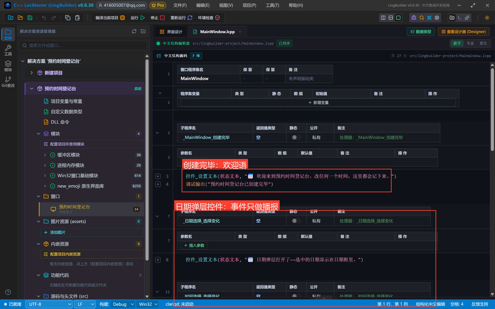

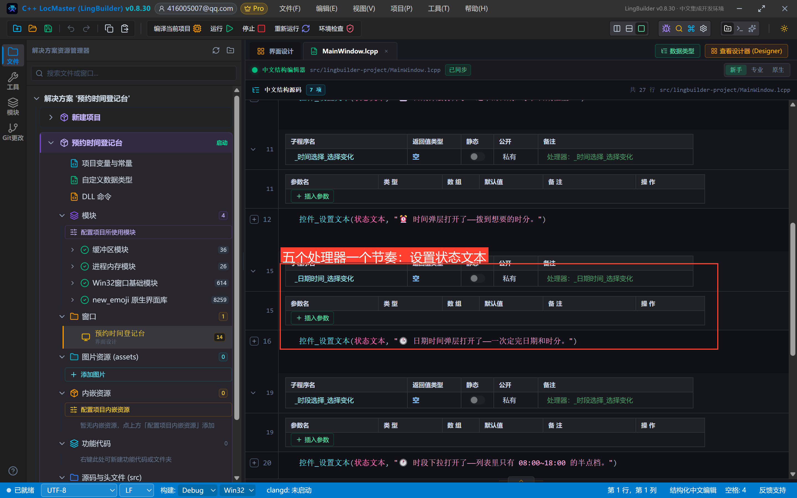

## 5. 编译前先看错误列表

点「编译当前项目」，先看底部错误列表——零报错再继续：

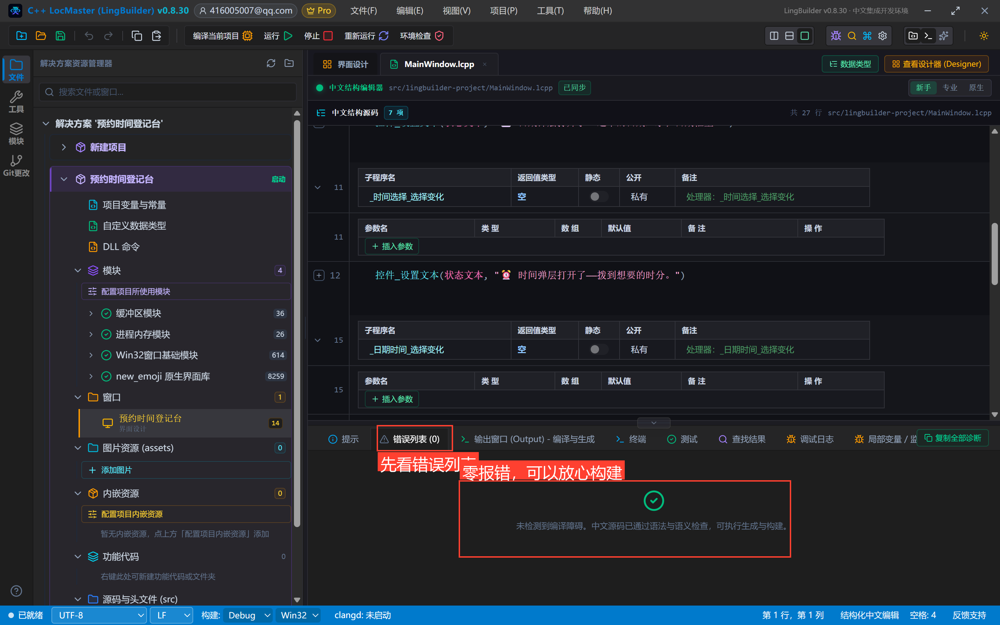

## 6. 运行！把五个控件都摸一遍

点「运行」。初始状态：日期 2026-10-15、时间 00:00、日期时间 2026-10-20 14:30、时段 09:30、日历停在 2026-10 并高亮 20 日：

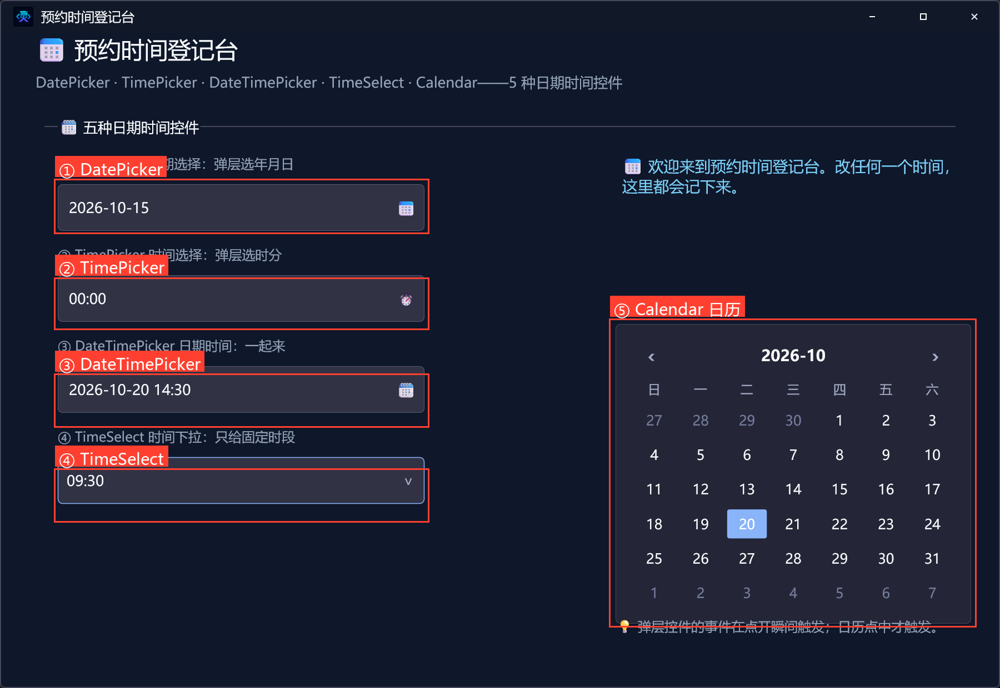

点开日期选择——整月日历弹层，底部还有「📍 今天」和「清空」两个快捷键：

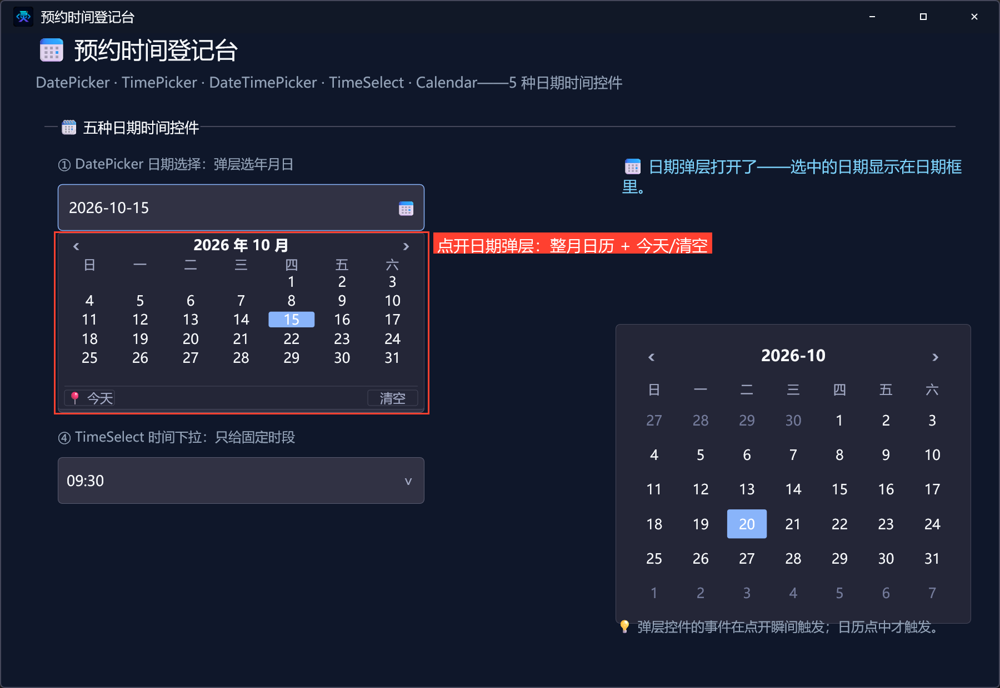

注意：状态屏此刻已经播报「日期弹层打开了」——这就是红线说的「点开瞬间触发」。点 22 号，弹层收起，日期框变成 **2026-10-22**：

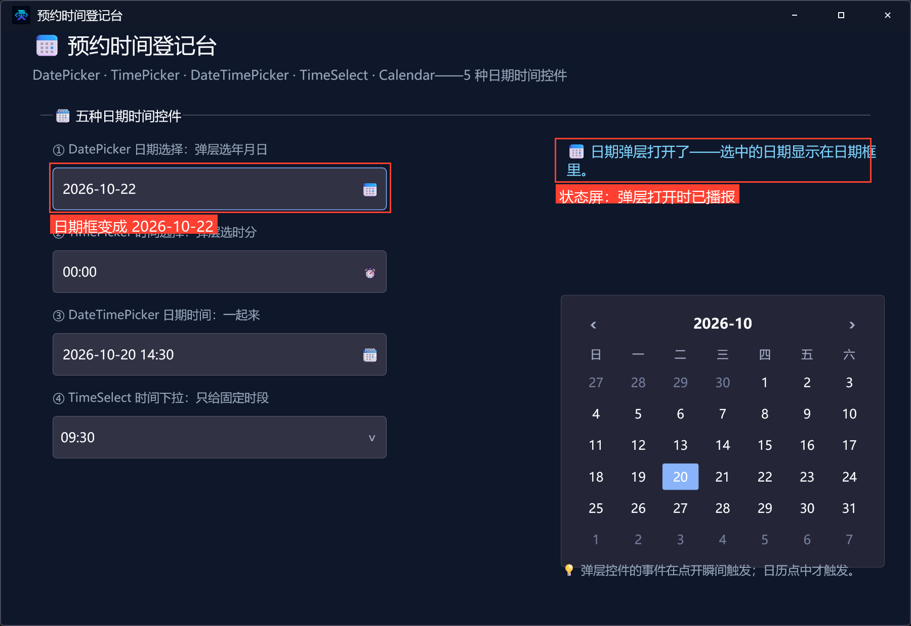

最后两连：点开时段下拉（里面只有 08:00~18:00 的半点档），再点日历的 **26**——日历高亮切到 26 日，状态屏播报日历事件（日历是点中才触发的）：

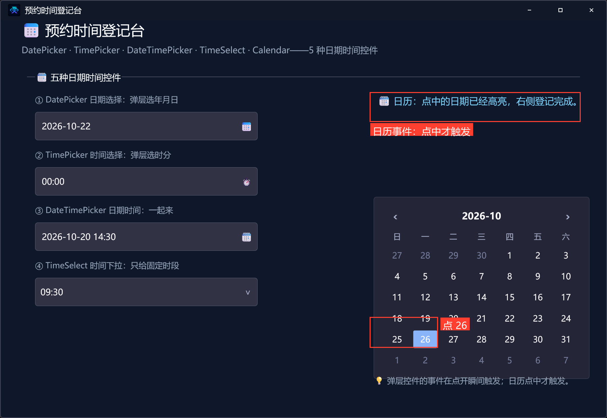

五种日期时间控件、一个事件、一套播报写法，全部打通。

## 7. 导出源码包

命令面板执行「项目：一键导出 LCPP 源码包」即可。

## 本集源码包

- 网页版：[06-预约时间登记台.lcpppkg](https://lingbuilder.com/demos)（示例源码区可下载）

## 下一集预告

选择类收官：「特殊输入」——InputTag 标签输入/Mentions 提及/Upload 上传/ColorPicker 颜色选择器。
