# NE 合集 09 · 菜单 Menu 与侧边栏 Aside：导航布局壳

> 《LingBuilder new_emoji 合集》第 9 集（导航篇第二集）。用 **Menu 多级菜单** + **Aside 侧边栏**搭一个「左导航 + 右内容」的现代布局壳。菜单命令事件**自带项目索引和完整层级路径**，是本集最大的亮点。全程约 35 分钟。
>
> 前置要求：完成[第 01 集](/guide/tutorials/new-emoji-01)（启用模块、切设计后端、F5 全流程）。本集源码包见文末。

## 这一集你将学会

- **Menu**：设计器 `menuItems` 记录表配顶层项；代码里用 `NE菜单_设置项目` 的文本协议（换行分隔、`>` 前缀建子菜单）换上完整多级菜单
- **菜单命令事件**：处理器直接收 `(整数型 项目索引, 文本型 菜单路径, 文本型 命令)`，路径自带「设计稿 / 海报组」式完整层级
- **Aside**：纯布局容器——占位、分区、配色，不参与点击事件
- **弹出打开属性**：设计器摆的菜单要把 `popupOpen` 设为真，否则运行时不绘制（本集最大的坑）

## 1. 命令与事件预告

| 命令 / 事件 | 作用 |
| --- | --- |
| `NE菜单_设置项目(控件名, 项目文本)` | 运行期整表换菜单项：换行分隔各项，**`>` 前缀表示上一项的子菜单** |
| `菜单命令` 事件（Menu） | **带三个参数**：项目索引、菜单路径（含层级）、命令 |
| `控件_设置文本(控件名, 文本)` | 写状态播报 |

> 本集只需要 new_emoji 模块。

## 2. 新建项目 + 启用模块 + 切后端

流程和第 1 集完全一样，项目名称填 **导航布局壳**：

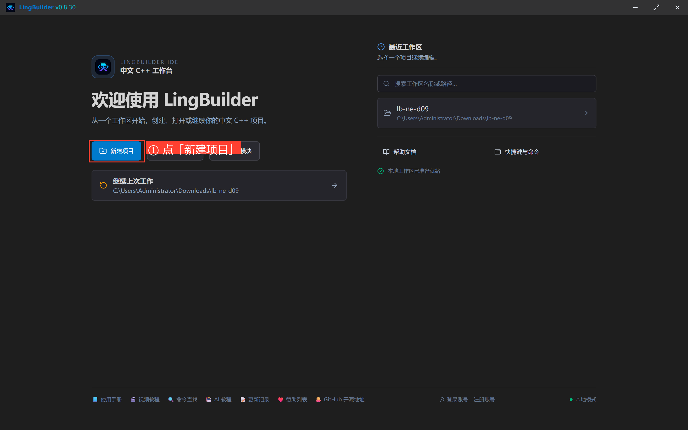

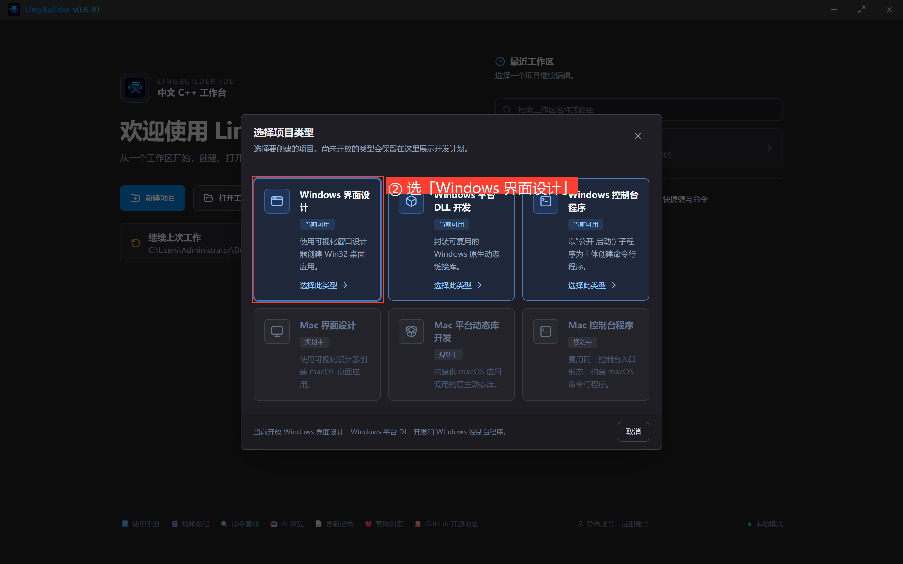

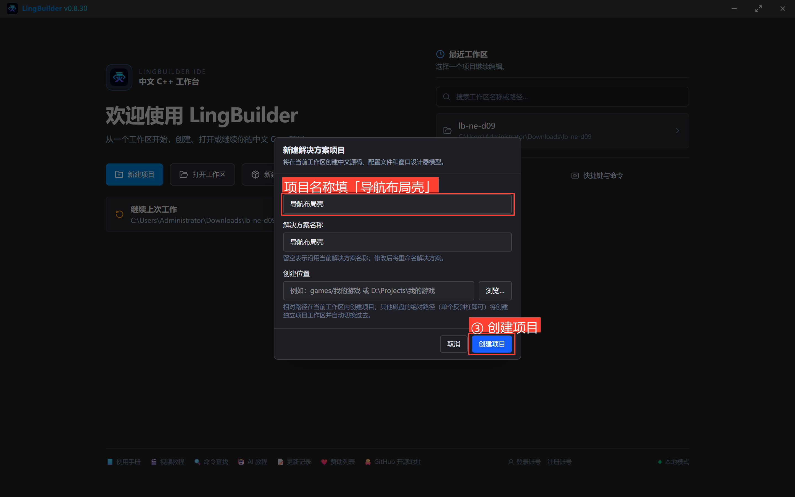

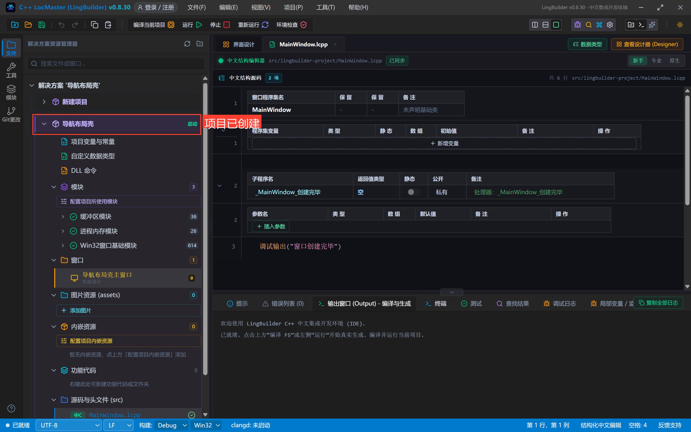

模块面板搜「原生界面」→ 启用「new_emoji 原生界面库」（首次弹登录框，登录一次即可）：

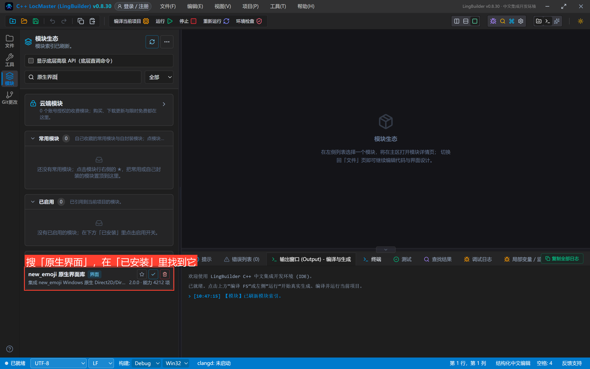

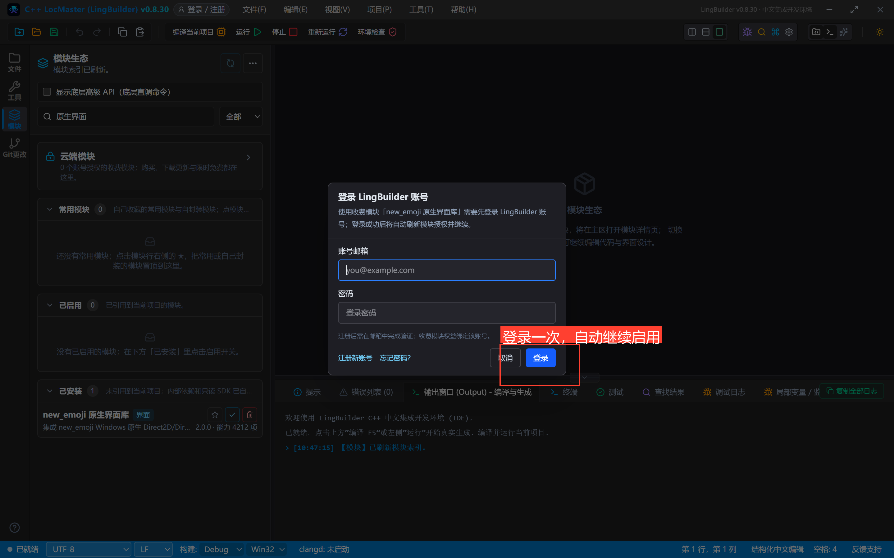

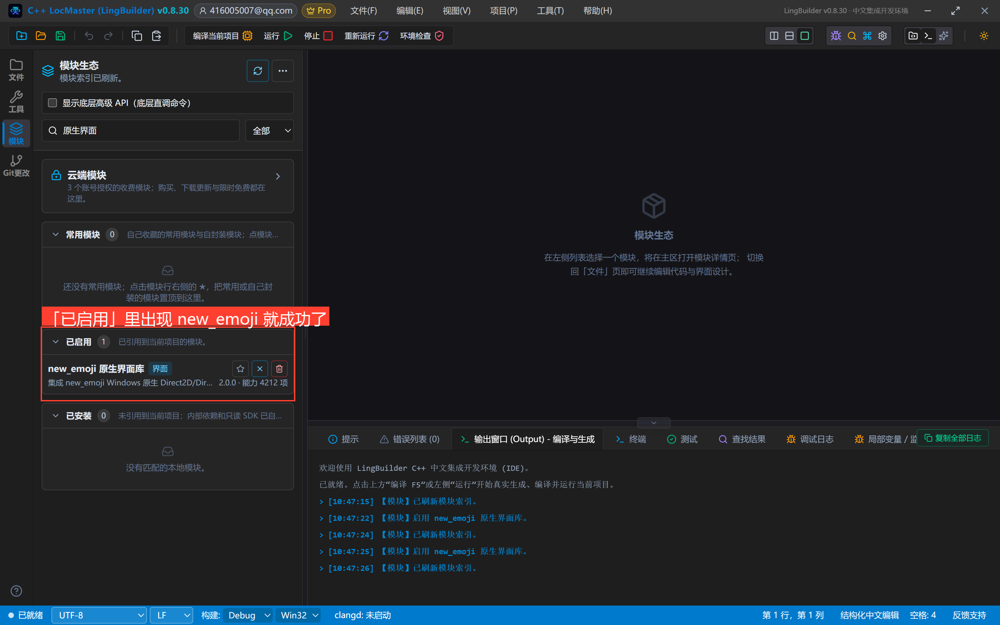

界面设计 → 选中窗口 → 「设计后端」切为「new_emoji 模块」：

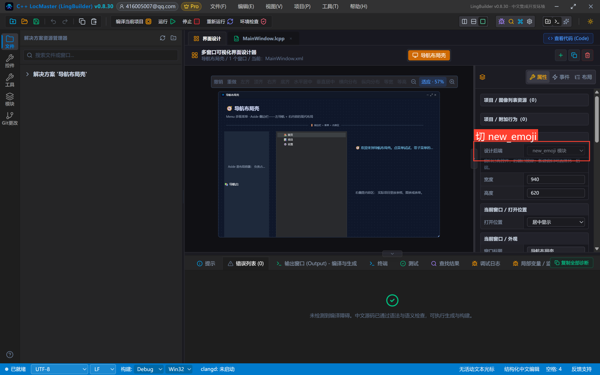

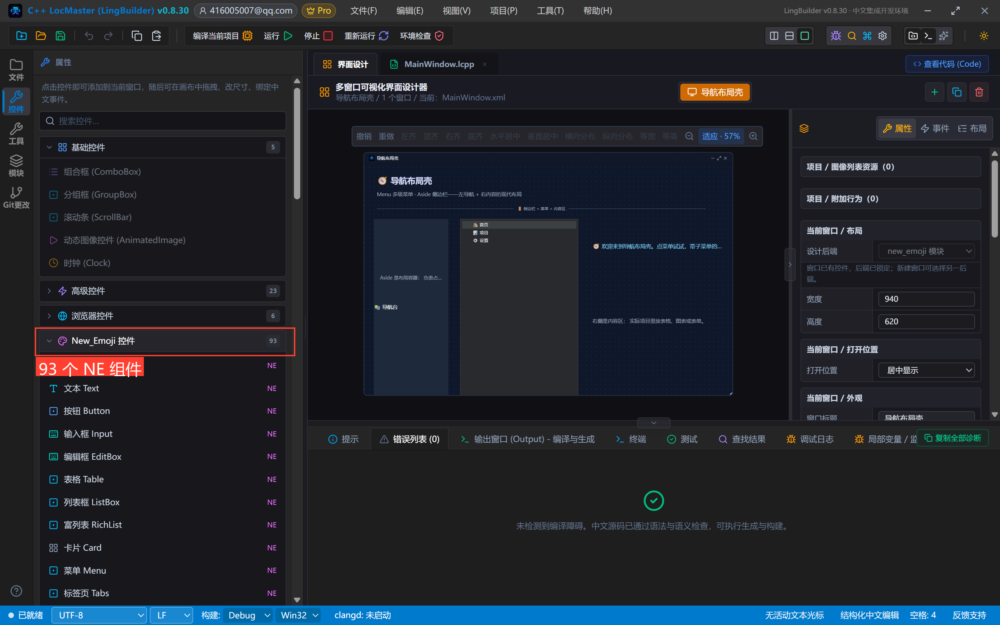

## 3. 设计界面

窗口 940×620。左 Aside、中 Menu、右内容区：

| 控件 | 名称 | 显示内容 | 左距 | 顶距 | 宽度 | 高度 | 关键属性 |
| --- | --- | --- | --- | --- | --- | --- | --- |
| 文本 Text | 标题文本 | 🧭 导航布局壳 | 32 | 24 | 620 | 36 | 字号 21，粗体 |
| 文本 Text | 副标题文本 | Menu 多级菜单 · Aside 侧边栏——左导航 + 右内容的现代布局 | 32 | 66 | 780 | 24 | 字号 13，#94A3B8 |
| 分割线 Divider | 标题分割线 | 🚪 侧边栏 + 菜单 + 内容区 | 32 | 100 | 836 | 28 | — |
| 侧边栏 Aside | 导航侧边栏 | （清空） | 24 | 140 | 190 | 450 | **title=📚 导航台；backgroundColor=#FF1E293B** |
| 文本 Text | 侧栏说明 | Aside 是布局容器：负责占位与分区，不参与点击事件。 | 40 | 220 | 160 | 140 | 字号 12，#94A3B8，自动换行 |
| 菜单 Menu | 主导航 | （清空） | 244 | 140 | 300 | 450 | **menuItems 三条顶层项（首页/项目/设置，各带命令）；六个菜单配色属性显式给值；popupOpen=真** |
| 文本 Text | 状态文本 | 🧭 欢迎来到导航布局壳。点菜单试试，带子菜单的那项能展开。 | 580 | 140 | 330 | 140 | 字号 14，#7DD3FC，自动换行 |
| 文本 Text | 内容文本 | 右侧是内容区：实际项目里放表格、图表或表单。 | 580 | 300 | 330 | 200 | 字号 13，#94A3B8，自动换行 |

事件绑定：主导航绑「**菜单命令**」。

摆完的画布：

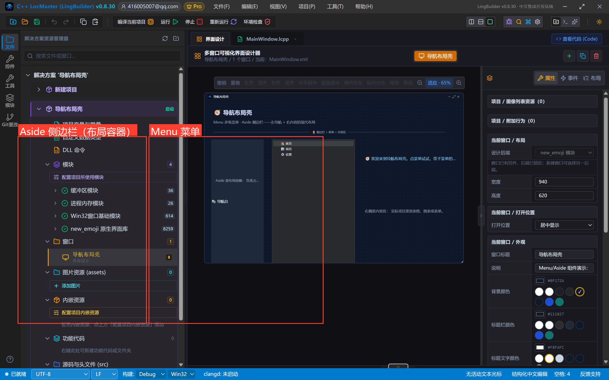

> **本集最重要的红线：设计器里摆的 Menu 必须把「弹出打开」（popupOpen）设为真**——引擎把「未打开」的菜单当弹层处理，弹层不绘制，整个菜单就隐形了。配套地，六个菜单配色属性（背景/文字/活动文字/悬停背景/边框/禁用文字）也要显式给值，留空会画成全透明。
>
> **第二个红线**：子菜单用 `NE菜单_设置项目` 的文本协议在代码里配——**换行分隔各项，某项写 `>` 开头就挂到它的上一项下面**。设计器的 menuItems 记录表配顶层项即可（记录表的 submenu 字段要再摆一个菜单控件，本集不展开）。

## 4. 写代码

```lcpp
类 MainWindow
    事件 _MainWindow_创建完毕()
        控件_设置文本(状态文本, "🧭 欢迎来到导航布局壳。点菜单试试，带子菜单的那项能展开。")
        NE菜单_设置项目(主导航, "🏠 首页\n📊 项目\n🎨 设计稿\n>🖼️ 海报组\n>📱 小程序组\n⚙️ 设置")
        调试输出("导航布局壳已创建完毕")
    结束

    事件 _主导航_菜单命令(整数型 项目索引, 文本型 菜单路径, 文本型 命令)
        控件_设置文本(状态文本, "🧭 选中第 " + 到文本(项目索引 + 1) + " 项：" + 菜单路径)
    结束
结束类
```

看点：`NE菜单_设置项目` 的项目文本里，「🎨 设计稿」后面跟着 `>🖼️ 海报组` 和 `>📱 小程序组`——两项都挂到设计稿下面变成子菜单。菜单命令事件的 `菜单路径` 参数把层级路径直接送进处理器（「🎨 设计稿 / 🖼️ 海报组」），连拼都不用拼。

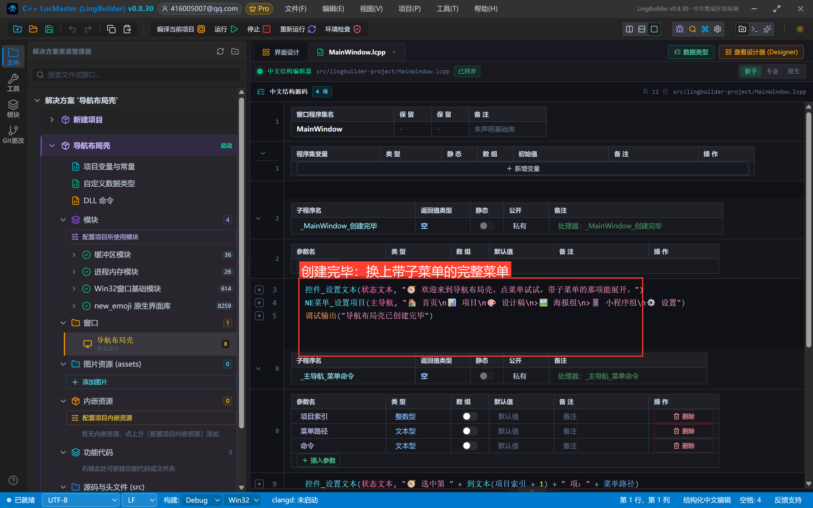

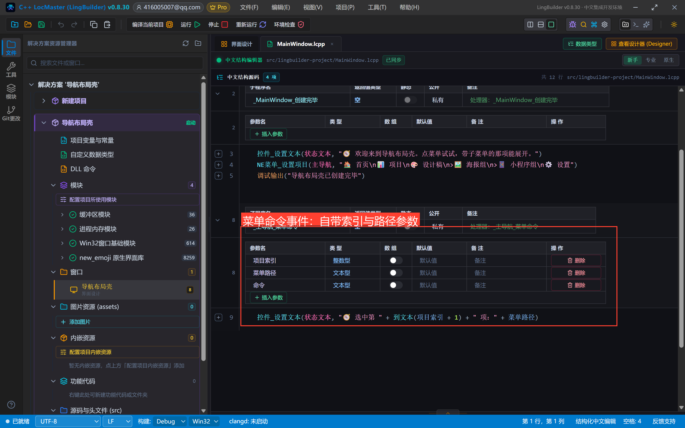

## 5. 编译前先看错误列表

点「编译当前项目」，先看底部错误列表——零报错再继续：

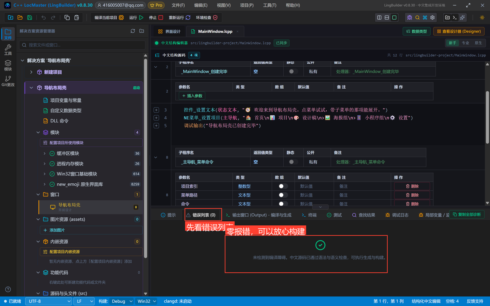

## 6. 运行！点菜单、进子菜单

点「运行」。左侧 Aside 站位，中间菜单整表换成六项，设计稿的子菜单自动展开：

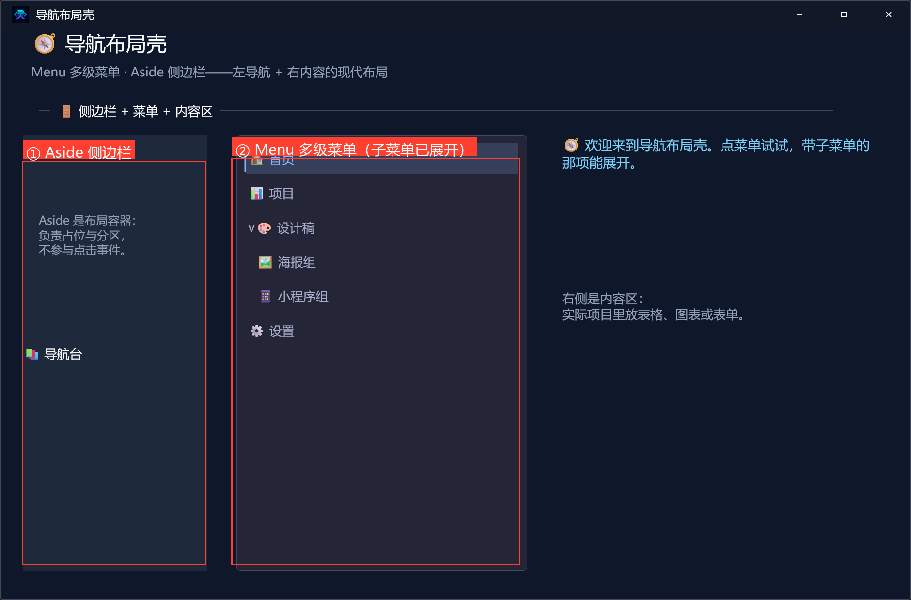

点「项目」——高亮切换，状态屏报「🧭 选中第 2 项：📊 项目」：

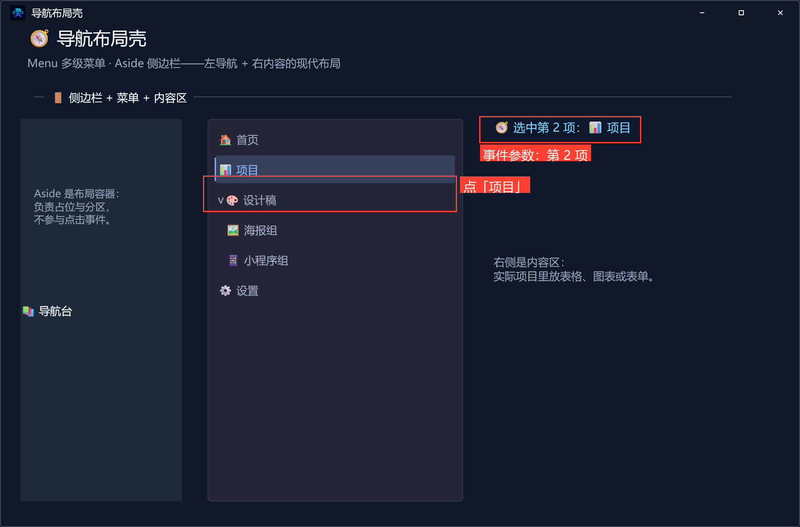

进子菜单点「海报组」——状态屏直接拿到完整层级路径「🧭 选中第 4 项：🎨 设计稿 / 🖼️ 海报组」：

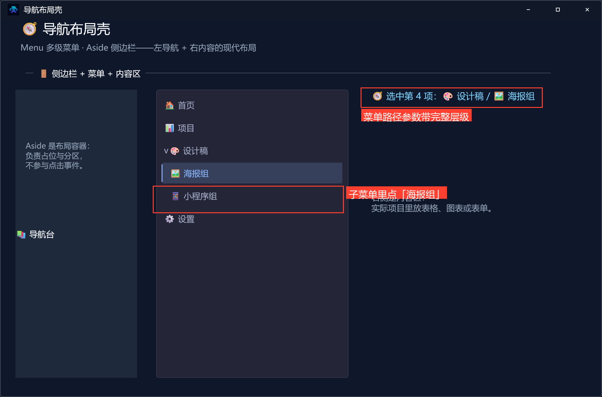

一个事件、两个参数、一次完整层级导航。

## 7. 导出源码包

命令面板执行「项目：一键导出 LCPP 源码包」即可。

## 本集源码包

- 网页版：[09-导航布局壳.lcpppkg](https://lingbuilder.com/demos)（示例源码区可下载）

## 下一集预告

导航篇收官：「页面导航件」——Breadcrumb/Anchor/Steps/Pagination/Backtop/Affix 六件套。
