# NE 合集 10 · 页面导航件：六连排

> 《LingBuilder new_emoji 合集》第 10 集（导航篇收官）。一次认识六个「页面导航小件」：**Breadcrumb 面包屑、Steps 步骤条、Pagination 分页、Anchor 锚点**四件可点，**Backtop 回到顶部、Affix 固钉**两件站岗。全程约 35 分钟。
>
> 前置要求：完成[第 01 集](/guide/tutorials/new-emoji-01)（启用模块、切设计后端、F5 全流程）。本集源码包见文末。

## 这一集你将学会

- **Breadcrumb**：`items` 层级路径 + `currentIndex` 当前段
- **Steps**：`items` 流程节点 + `activeIndex` 当前步
- **Pagination**：`total`/`pageSize`/`currentPage`，事件里能直接读到页码
- **Anchor**：`items` 目录项 + `activeIndex` 高亮
- **Backtop**：`threshold` 阈值——滚动超过才出现；无滚动的窗口给 0 让它常显
- **Affix**：`title` + `body` 钉住一块内容，纯展示

先看一眼本集成品——面包屑、页签、返回顶部等导航件各就各位：

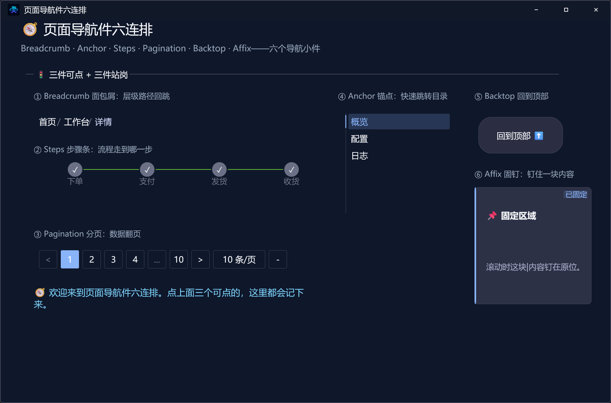

## 1. 命令与事件预告

| 命令 / 事件 | 作用 |
| --- | --- |
| `控件_取选择项(控件名)` | 读 Pagination 当前页码——六件里唯一「能读到值」的读取通道 |
| `数值变化` 事件（Pagination） | 翻页时触发 |
| `选择变化` 事件（Breadcrumb/Steps/Anchor） | 点击时触发，不带参数——播报即可 |
| （无事件） | Backtop/Affix：状态展示件 |

> 本集只需要 new_emoji 模块。

## 2. 新建项目 + 启用模块 + 切后端

流程和第 1 集完全一样，项目名称填 **页面导航件六连排**：

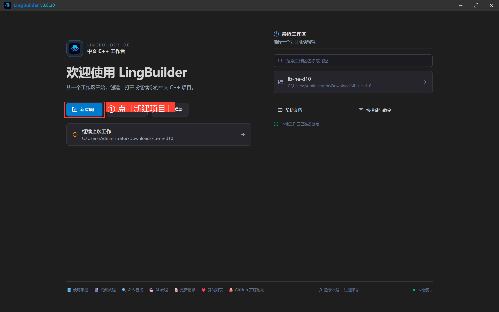

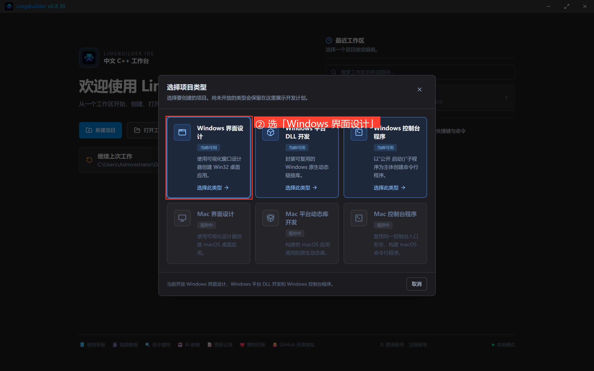

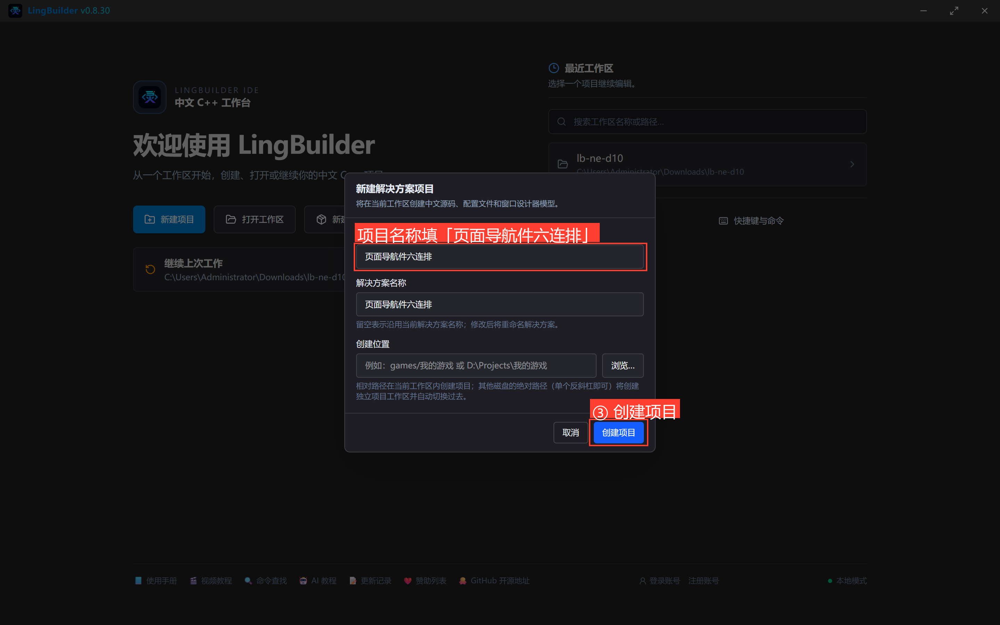

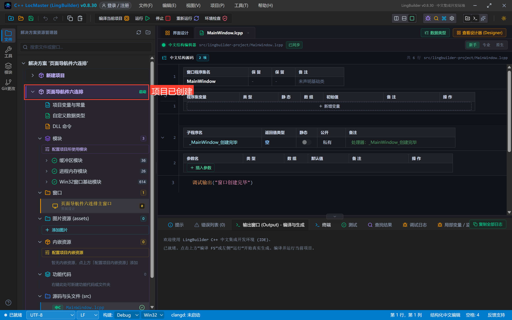

模块面板搜「原生界面」→ 启用「new_emoji 原生界面库」（首次弹登录框，登录一次即可）：

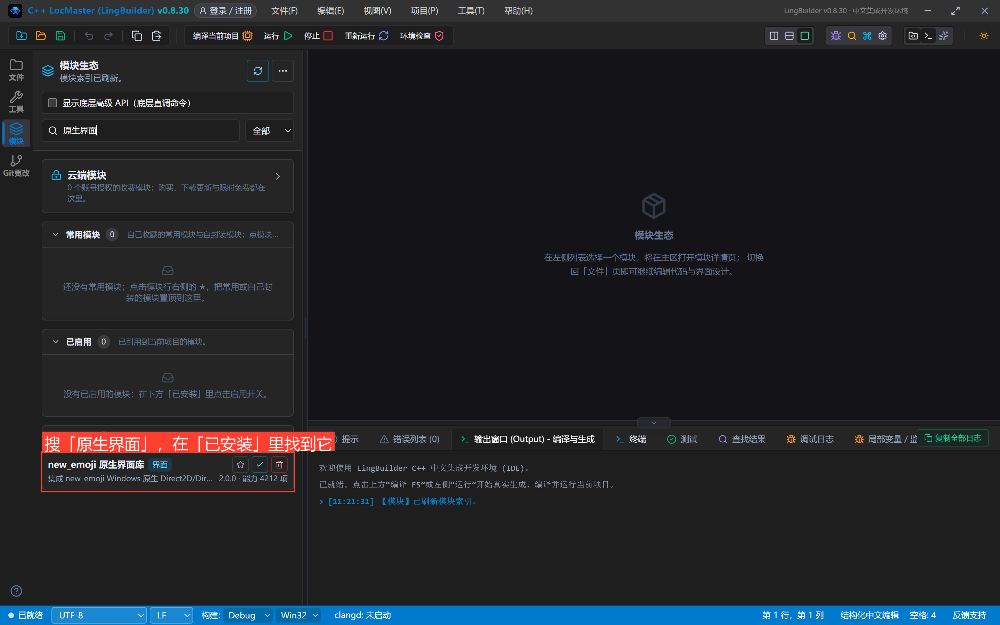

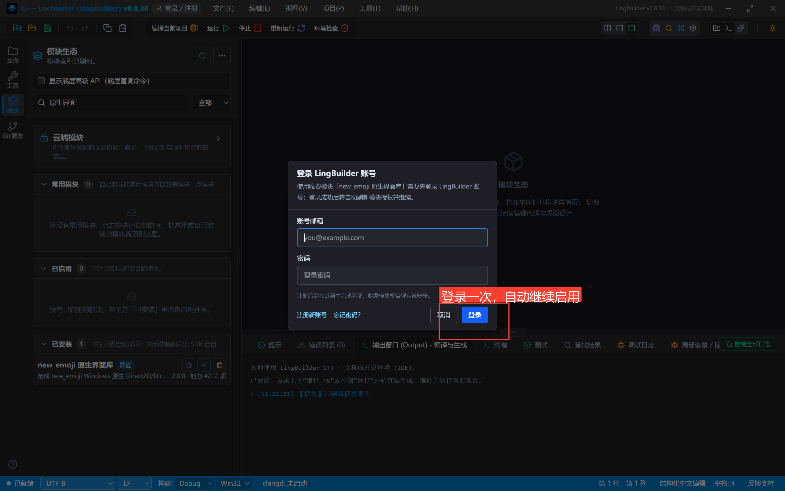

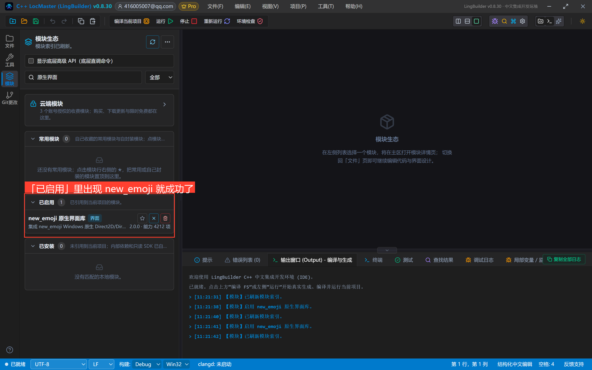

界面设计 → 选中窗口 → 「设计后端」切为「new_emoji 模块」：

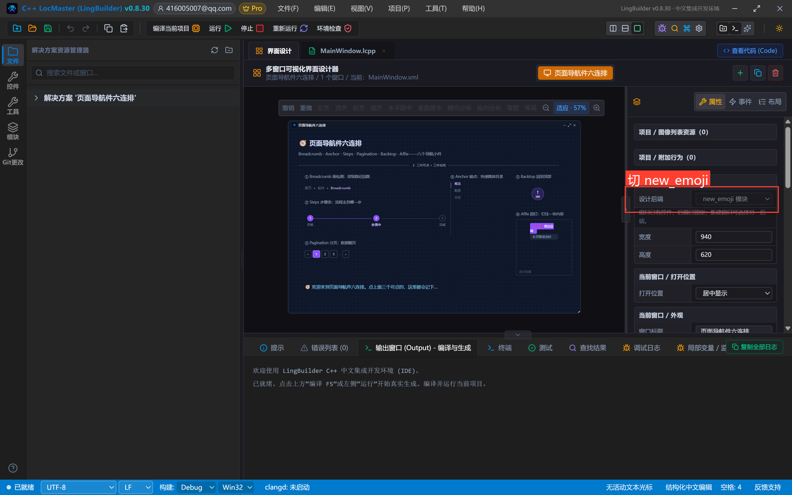

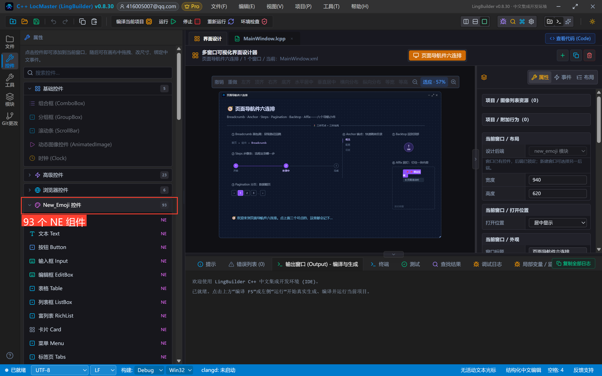

## 3. 设计界面

窗口 940×620。左列三件可点，右列三件站岗：

| 控件 | 名称 | 显示内容 | 左距 | 顶距 | 宽度 | 高度 | 关键属性 |
| --- | --- | --- | --- | --- | --- | --- | --- |
| 文本 Text | 标题文本 | 🧭 页面导航件六连排 | 32 | 24 | 620 | 36 | 字号 21，粗体 |
| 文本 Text | 副标题文本 | Breadcrumb · Anchor · Steps · Pagination · Backtop · Affix——六个导航小件 | 32 | 66 | 780 | 24 | 字号 13，#94A3B8 |
| 分割线 Divider | 标题分割线 | 🚦 三件可点 + 三件站岗 | 32 | 100 | 836 | 28 | — |
| 文本 Text | 面包屑标签 | ① Breadcrumb 面包屑：层级路径回跳 | 52 | 140 | 380 | 22 | 字号 12，#94A3B8 |
| 面包屑 Breadcrumb | 面包屑 | （清空） | 52 | 166 | 420 | 42 | **items=首页/工作台/详情；currentIndex=2** |
| 文本 Text | 步骤标签 | ② Steps 步骤条：流程走到哪一步 | 52 | 222 | 380 | 22 | 字号 12，#94A3B8 |
| 步骤条 Steps | 步骤条 | （清空） | 52 | 248 | 460 | 90 | **items=下单/支付/发货/收货；activeIndex=1** |
| 文本 Text | 分页标签 | ③ Pagination 分页：数据翻页 | 52 | 352 | 380 | 22 | 字号 12，#94A3B8 |
| 分页 Pagination | 分页 | （清空） | 52 | 378 | 420 | 42 | **total=100；pageSize=10；currentPage=1** |
| 文本 Text | 锚点标签 | ④ Anchor 锚点：快速跳转目录 | 520 | 140 | 300 | 22 | 字号 12，#94A3B8 |
| 锚点 Anchor | 锚点 | （清空） | 520 | 166 | 180 | 170 | **items=概览/配置/日志；activeIndex=0** |
| 文本 Text | 固顶标签 | ⑤ Backtop 回到顶部 | 730 | 140 | 180 | 22 | 字号 12，#94A3B8 |
| 回到顶部 Backtop | 回到顶部 | 回到顶部 ⬆️ | 736 | 180 | 130 | 56 | **threshold=0（无滚动容器也能常显）** |
| 文本 Text | 固钉标签 | ⑥ Affix 固钉：钉住一块内容 | 730 | 260 | 180 | 22 | 字号 12，#94A3B8 |
| 固钉 Affix | 固钉 | （清空） | 730 | 288 | 180 | 180 | **title=📌 固定区域；body 三行文案** |
| 文本 Text | 状态文本 | 🧭 欢迎来到页面导航件六连排。点上面三个可点的，这里都会记下来。 | 52 | 440 | 440 | 130 | 字号 14，#7DD3FC，自动换行 |

事件绑定：面包屑/步骤条/锚点绑「**选择变化**」、分页绑「**数值变化**」。

摆完的画布：

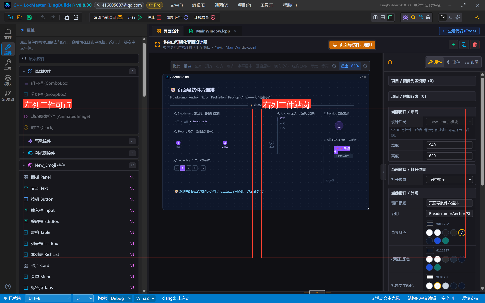

> **本集最重要的红线：Backtop 的 `threshold` 默认 200**——滚动位置没超过阈值它就不出现。普通窗口没有滚动容器，演示外观时把 `threshold` 设为 0。
>
> **第二个红线**：六件里只有 Pagination 能用 `控件_取选择项` 读到当前页码；面包屑/步骤条/锚点的 `选择变化` 事件不带参数也读不到值——高亮在哪，控件自己显示，处理器只播报。

## 4. 写代码

```lcpp
类 MainWindow
    事件 _MainWindow_创建完毕()
        控件_设置文本(状态文本, "🧭 欢迎来到页面导航件六连排。点上面三个可点的，这里都会记下来。")
        调试输出("页面导航件六连排已创建完毕")
    结束

    事件 _面包屑_选择变化()
        控件_设置文本(状态文本, "🍞 面包屑点了一下——看高亮停在哪一段。")
    结束

    事件 _步骤条_选择变化()
        控件_设置文本(状态文本, "🪜 步骤条点了一下——流程节点跟着走。")
    结束

    事件 _分页_数值变化()
        控件_设置文本(状态文本, "📄 翻到第 " + 到文本(控件_取选择项(分页)) + " 页。")
    结束

    事件 _锚点_选择变化()
        控件_设置文本(状态文本, "⚓ 锚点点了一下——目录高亮跟着切。")
    结束
结束类
```

看点：`控件_取选择项` 的支持列表里恰好有 Pagination——所以分页处理器能直接报「翻到第 3 页」，其余三件用播报。同一个命令在不同控件上的能力边界，正是这一集要建立的「命令 × 控件」对照感。

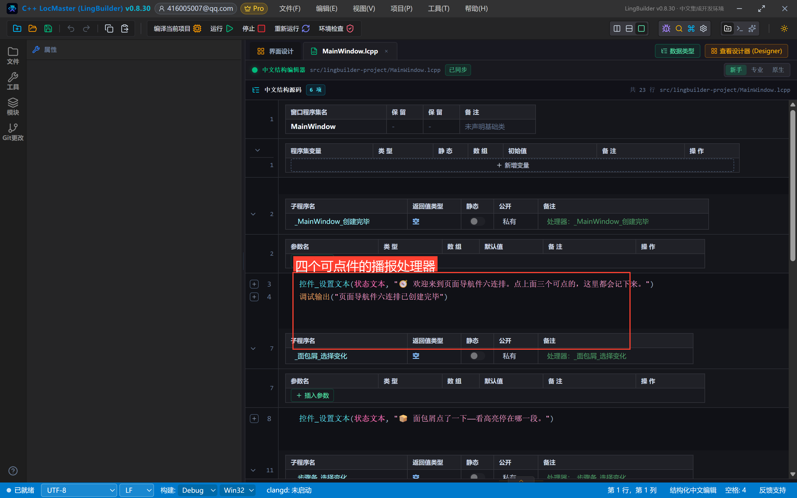

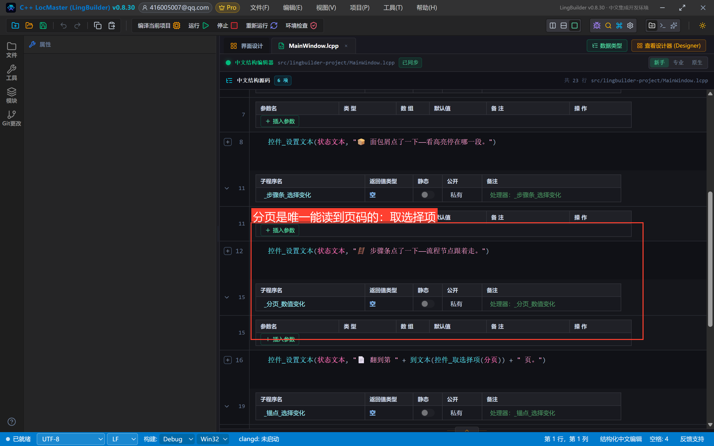

## 5. 编译前先看错误列表

点「编译当前项目」，先看底部错误列表——零报错再继续：

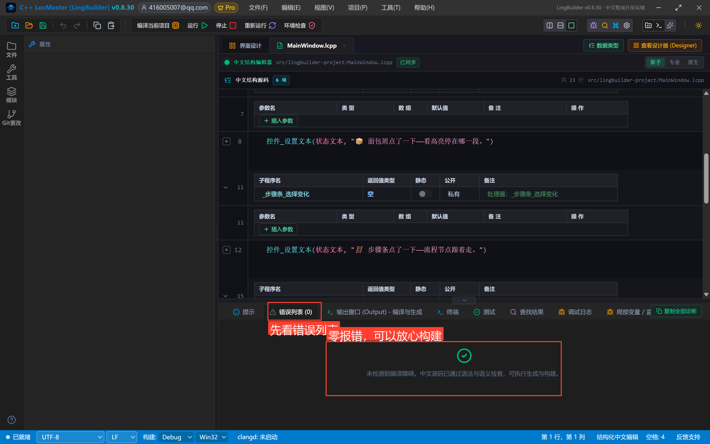

## 6. 运行！三个可点的挨个点

点「运行」。六件套一屏排开：

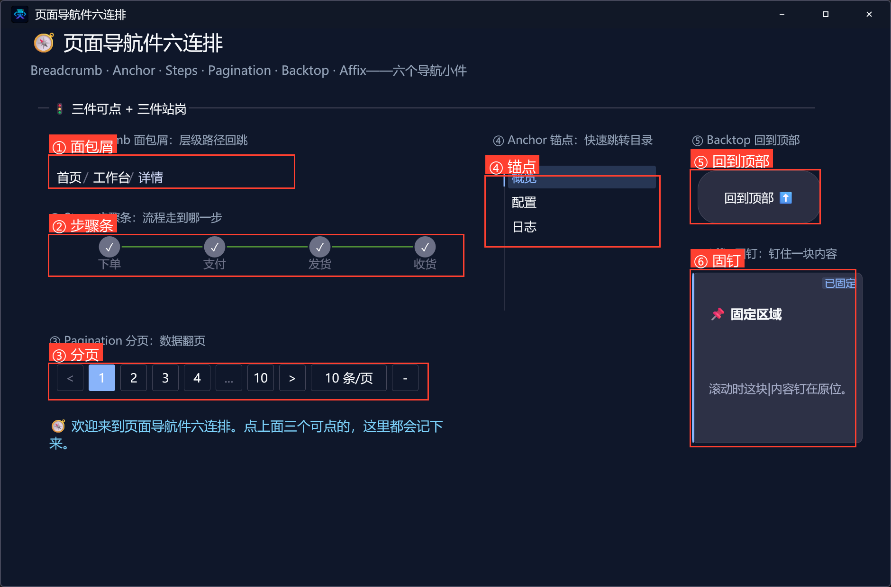

点面包屑的「工作台」段——高亮切换，状态屏播报：

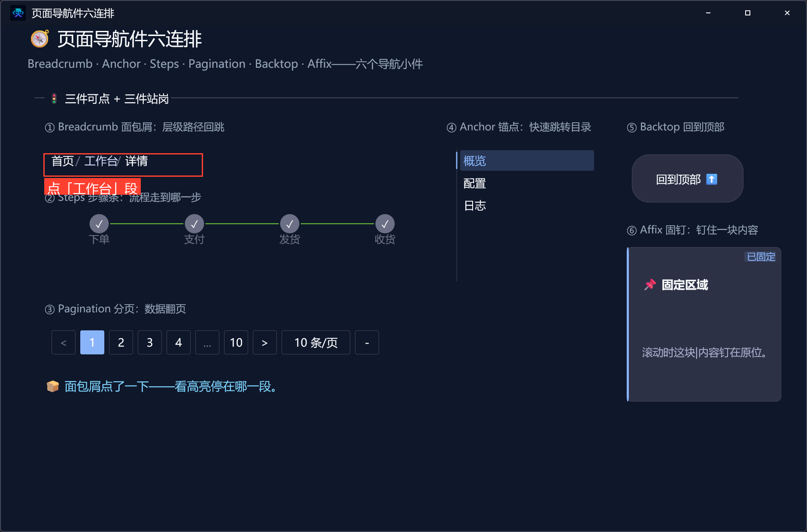

点分页的「3」——页码高亮跳到 3，状态屏直接报「📄 翻到第 3 页。」：

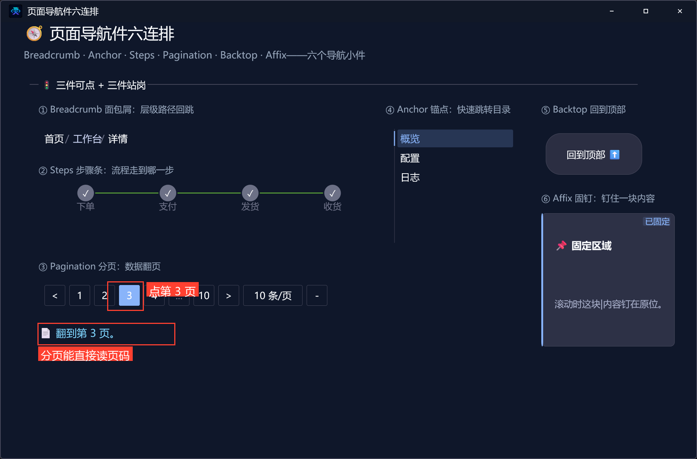

最后两连：点步骤条的「发货」节点，再点锚点的「配置」目录项——两个高亮各就各位：

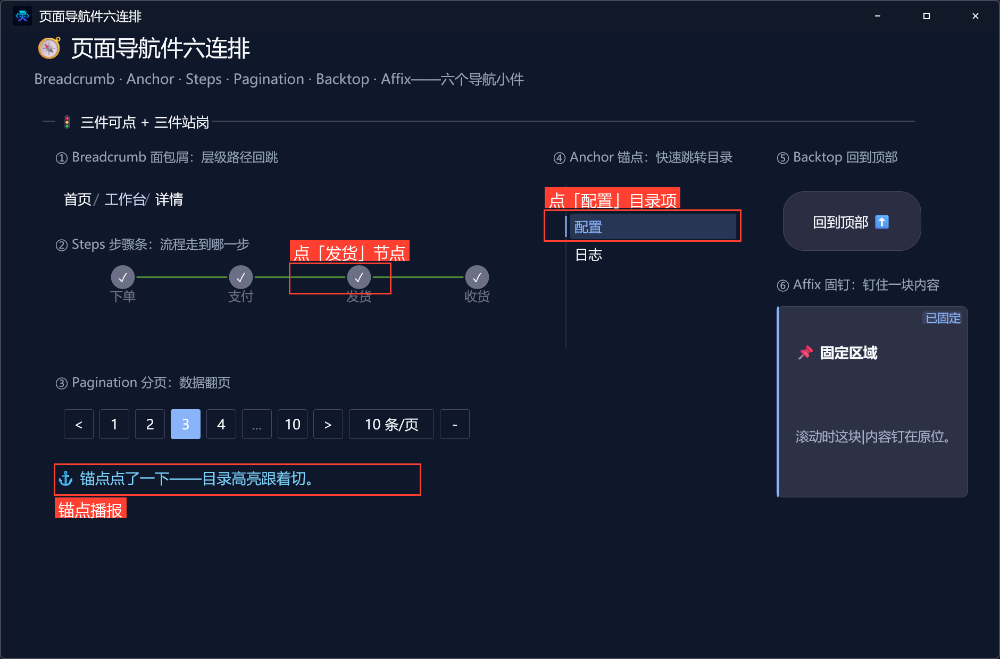

三件可点、三件站岗，一个读取命令的能力边界，一次理清。

## 7. 导出源码包

命令面板执行「项目：一键导出 LCPP 源码包」即可。

## 本集源码包

- 网页版：[10-页面导航件六连排.lcpppkg](https://lingbuilder.com/demos)（示例源码区可下载）

## 下一集预告

数据展示篇开篇：「列表三件套」——ListBox/RichList/Descriptions。
