# NE 合集 11 · 列表三件套：清单、卡片、详情

> 《LingBuilder new_emoji 合集》第 11 集（数据展示篇开篇）。一次认识三种「把一堆数据摆出来」的组件：**ListBox 列表框、RichList 富列表、Descriptions 描述列表**。它们分别对应「一行一条的清单」「带按钮的卡片流」「键值对详情表」，是全项目里最常用的一组。全程约 40 分钟。
>
> 前置要求：完成[第 01 集](/guide/tutorials/new-emoji-01)（启用模块、切设计后端、F5 全流程）。本集源码包见文末。

## 这一集你将学会

- **ListBox**：`items` 一行一条纯文本、`zebra` 斑马纹；运行期用 `控件_添加项目` / `控件_清空项目` 改内容，用 `控件_取选择项` 读当前选中第几条
- **RichList**：`templateJson` 定义「一行长什么样」，`itemsJson` 定义「这一行的数据」，两边靠 `field` 字段名对接；行内可以放按钮
- **Descriptions**：`items` 写「标签⇥值」的键值对，`columns` 控制几列
- 三个组件的**事件参数形态完全不同**——ListBox 给整数索引，RichList 给一整段原生 JSON 文本，Descriptions 没有数据事件

先看一眼本集成品——列表框、富列表、传输框三件套同框：

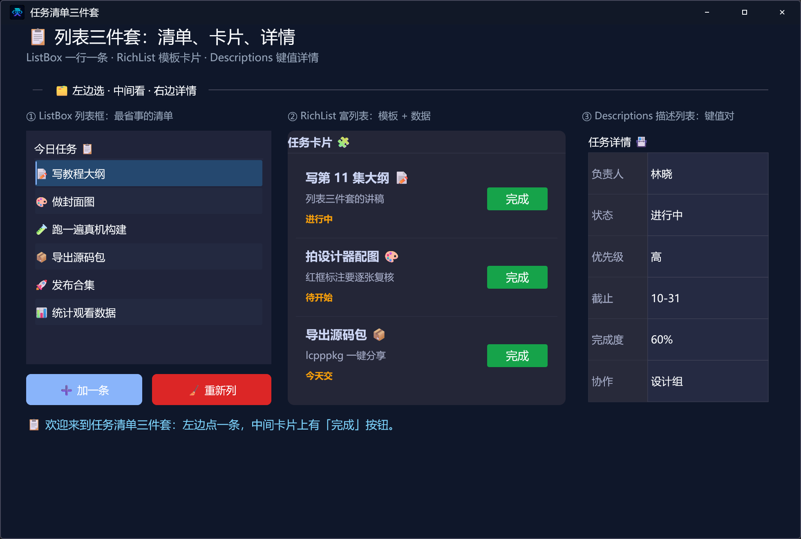

## 1. 命令与事件预告

| 命令 / 事件 | 作用 |
| --- | --- |
| `控件_添加项目(列表框, 文本)` | 往 ListBox 末尾追加一行（运行期写数据，不用回设计器） |
| `控件_清空项目(列表框)` | 清空 ListBox 全部行 |
| `控件_取选择项(列表框)` | 读回当前选中行的索引，从 0 开始 |
| `项目点击` 事件（ListBox） | 点某一行时触发，带 `项目索引` |
| `按钮点击` 事件（RichList） | 点行内按钮时触发，参数是**原生 JSON 文本** |
| `选择变化` 事件（RichList） | 选中行变化时触发，参数是选中 key 的 JSON 数组 |
| （无数据事件） | Descriptions：纯展示件 |

> 本集只需要 new_emoji 模块。

## 2. 新建项目 + 启用模块 + 切后端

流程和第 1 集完全一样，项目名称填 **任务清单三件套**：

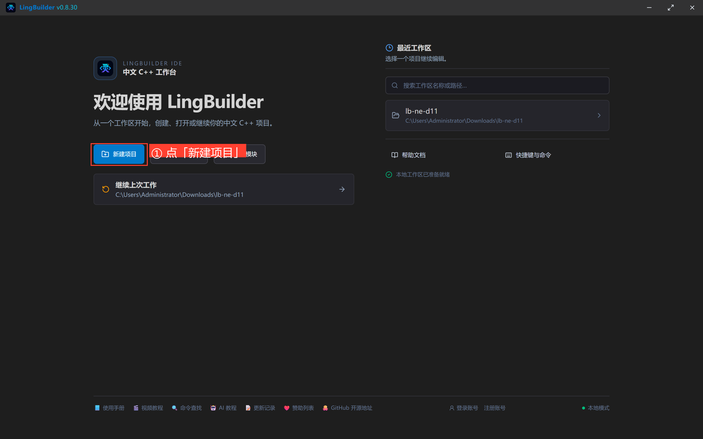

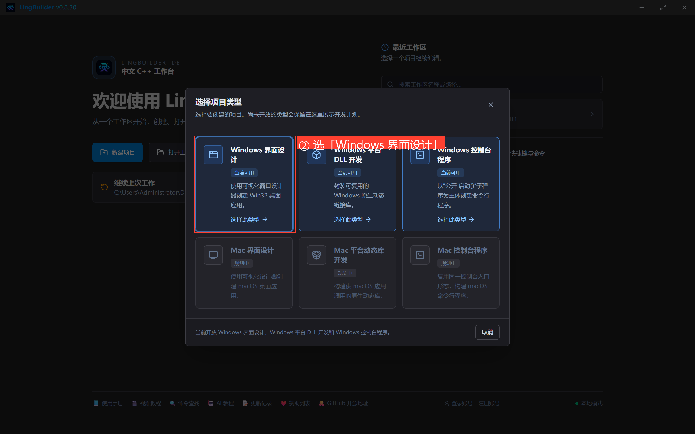

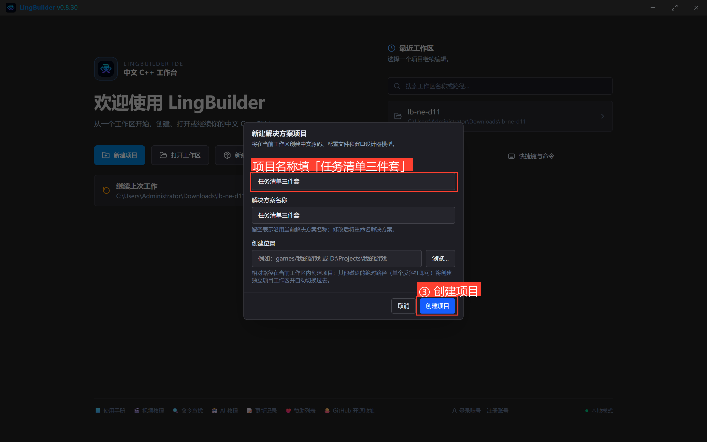

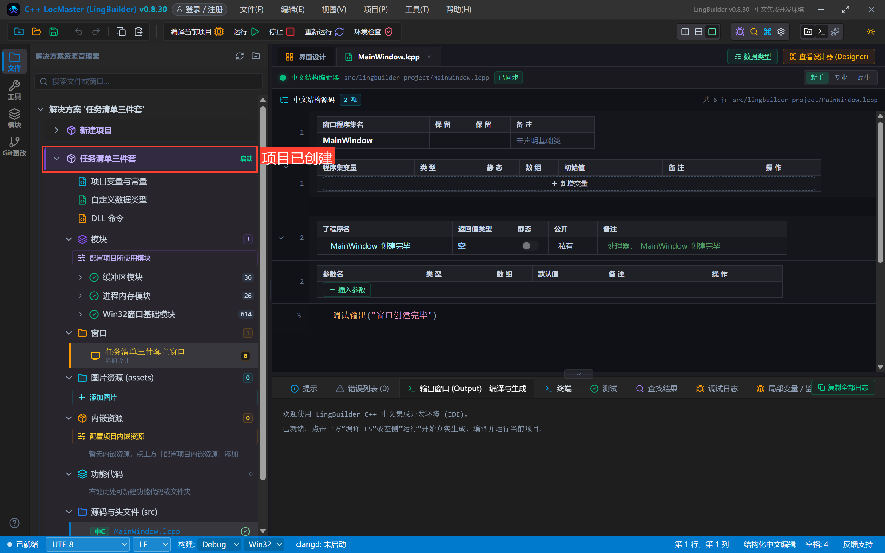

模块面板搜「原生界面」→ 启用「new_emoji 原生界面库」（首次弹登录框，登录一次即可）：

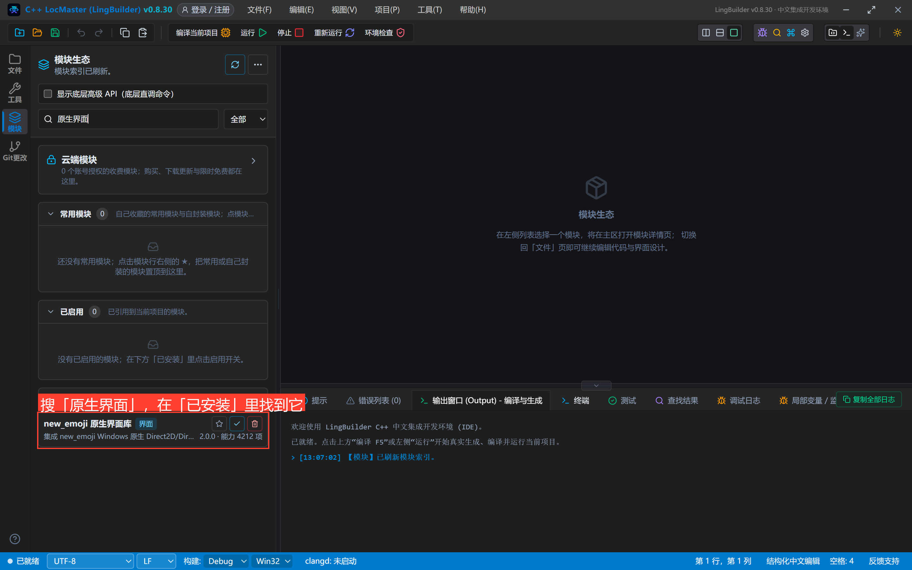

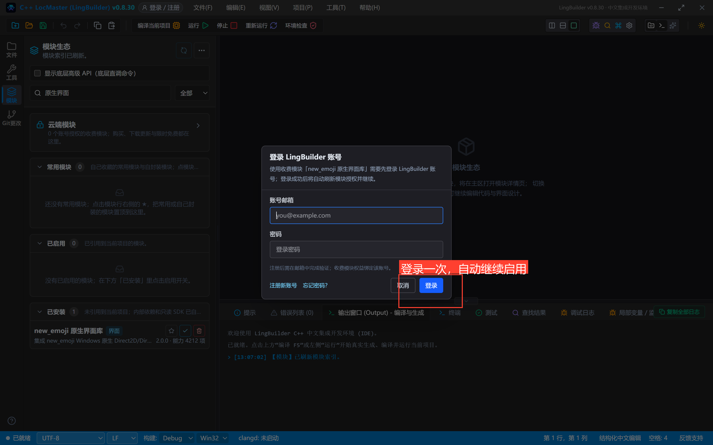

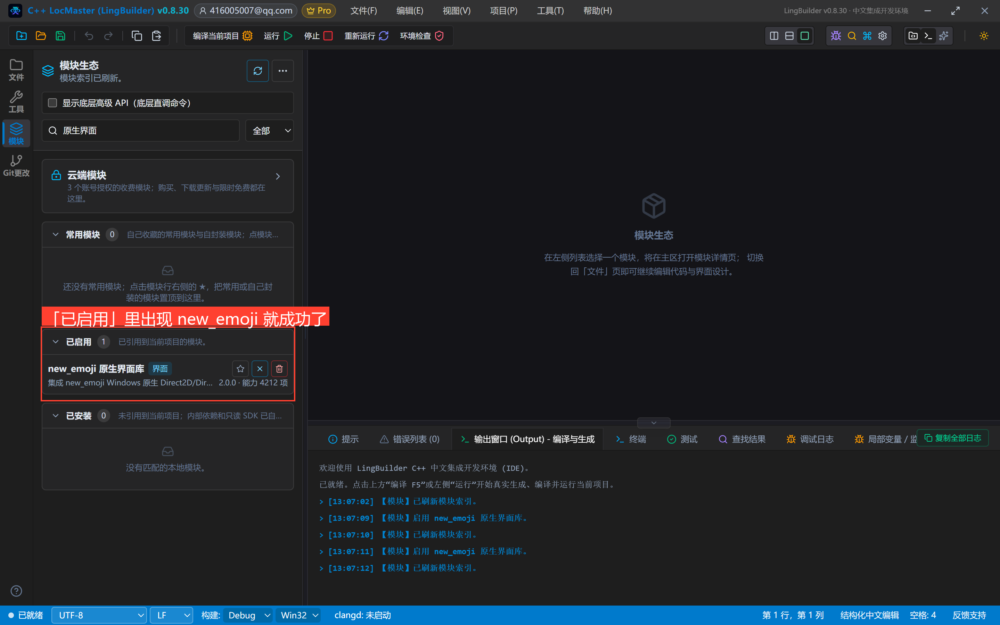

界面设计 → 选中窗口 → 确认「设计后端」是 **new_emoji 模块**（窗口一旦摆了 NE 控件就锁定了）：

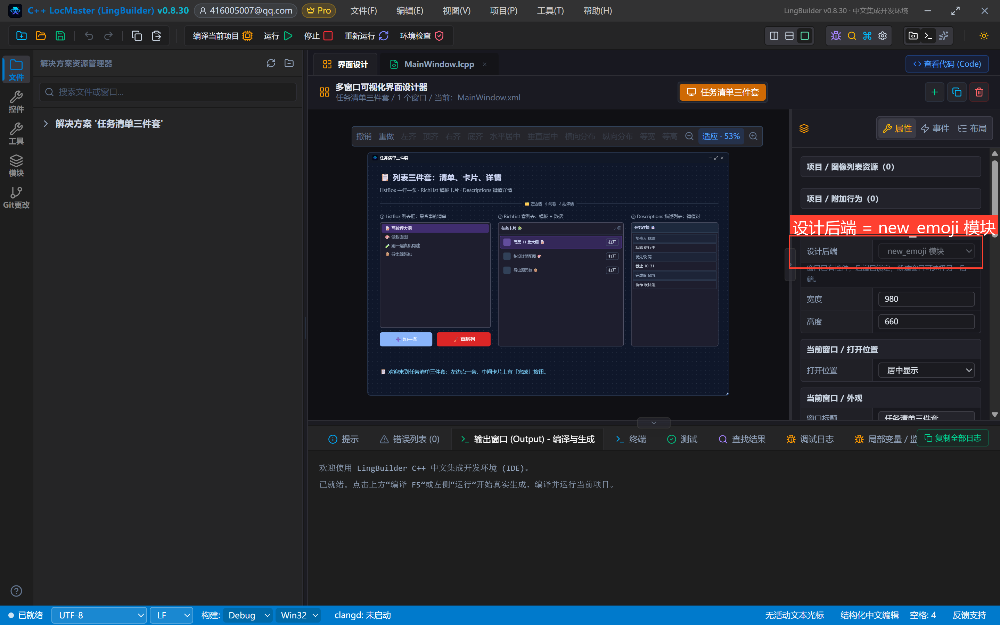

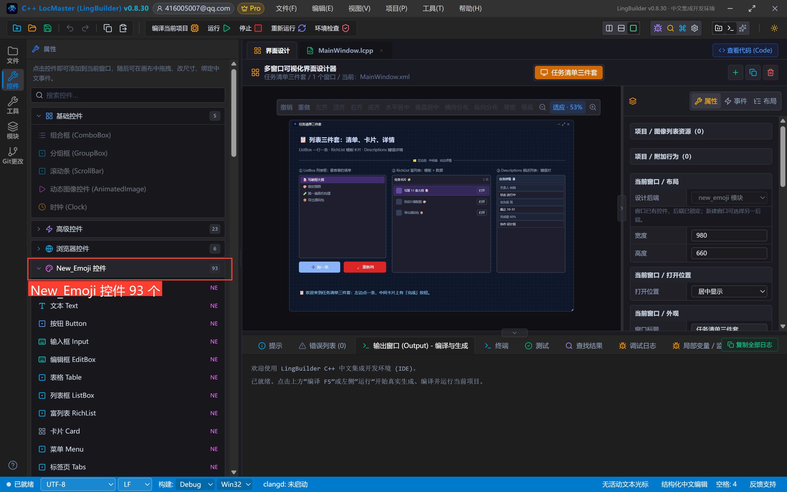

## 3. 设计界面

窗口 980×660，三列并排：左清单、中卡片、右详情。

| 控件 | 名称 | 显示内容 | 左距 | 顶距 | 宽度 | 高度 | 关键属性 |
| --- | --- | --- | --- | --- | --- | --- | --- |
| 文本 Text | 标题文本 | 📋 列表三件套：清单、卡片、详情 | 32 | 20 | 700 | 36 | 字号 21，粗体 |
| 文本 Text | 副标题文本 | ListBox 一行一条 · RichList 模板卡片 · Descriptions 键值详情 | 32 | 62 | 820 | 24 | 字号 13，#94A3B8 |
| 分割线 Divider | 标题分割线 | 🗂️ 左边选 · 中间看 · 右边详情 | 32 | 96 | 916 | 28 | — |
| 文本 Text | 列表标签 | ① ListBox 列表框：最省事的清单 | 32 | 134 | 300 | 22 | 字号 12，#94A3B8 |
| 列表框 ListBox | 任务列表 | 今日任务 📋 | 32 | 160 | 300 | 286 | **items 六行；zebra=真；selectedIndex=0** |
| 按钮 Button | 追加按钮 | ➕ 加一条 | 32 | 458 | 142 | 38 | variant=1 |
| 按钮 Button | 清空按钮 | 🧹 重新列 | 186 | 458 | 146 | 38 | variant=4 |
| 文本 Text | 富列表标签 | ② RichList 富列表：模板 + 数据 | 352 | 134 | 340 | 22 | 字号 12，#94A3B8 |
| 富列表 RichList | 任务卡片 | 任务卡片 🧩 | 352 | 160 | 340 | 336 | **templateJson + itemsJson 三条** |
| 文本 Text | 详情标签 | ③ Descriptions 描述列表：键值对 | 712 | 134 | 236 | 22 | 字号 12，#94A3B8 |
| 描述列表 Descriptions | 任务详情 | 任务详情 📇 | 712 | 160 | 236 | 336 | **items 六行「标签⇥值」；columns=1** |
| 文本 Text | 状态文本 | 📋 欢迎来到任务清单三件套：左边点一条，中间卡片上有「完成」按钮。 | 32 | 510 | 916 | 110 | 字号 14，#7DD3FC，自动换行 |

ListBox 的六行 `items`：`📝 写教程大纲`、`🎨 做封面图`、`🧪 跑一遍真机构建`、`📦 导出源码包`、`🚀 发布合集`、`📊 统计观看数据`。

事件绑定：任务列表绑「**项目点击**」、追加/清空按钮各绑「**被单击**」、任务卡片绑「**按钮点击**」和「**选择变化**」。

摆完的画布（选中标题文本时右侧能看到它的宽高，改任何属性都在这里）：

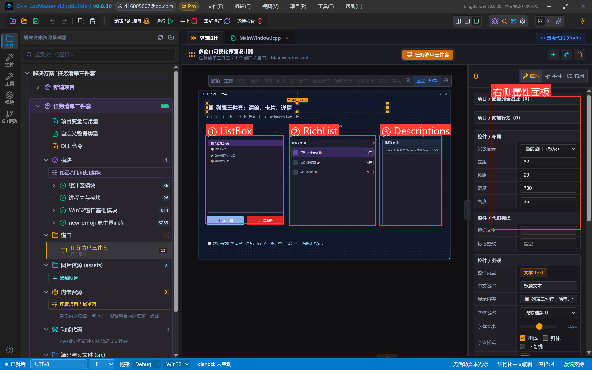

### 3.1 RichList：模板和数据是两段 JSON

RichList 不像 ListBox 那样「一行文本就完事」，它要你先说清楚**一行长什么样**，再喂数据。

模板 `templateJson`（一行 96 高，四个节点）：

```json
{"template":{"rowHeight":96,"nodes":[
  {"id":"t","type":"text","x":12,"y":10,"w":208,"h":24,"field":"title","role":"primary","size":15,"weight":600,"ellipsis":true},
  {"id":"d","type":"text","x":12,"y":38,"w":208,"h":20,"field":"desc","role":"secondary","size":12,"ellipsis":true},
  {"id":"g","type":"text","x":12,"y":64,"w":150,"h":18,"field":"tag","role":"warning","size":11,"weight":600},
  {"id":"done","type":"button","x":234,"y":34,"w":74,"h":28,"text":"完成","actionId":"done","variant":2}
]}}
```

数据 `itemsJson`（三条，`key` 必填，`data` 里的键名对上模板的 `field`）：

```json
{"items":[
  {"key":"card-1","data":{"title":"写第 11 集大纲 📝","desc":"列表三件套的讲稿","tag":"进行中"}},
  {"key":"card-2","data":{"title":"拍设计器配图 🎨","desc":"红框标注要逐张复核","tag":"待开始"}},
  {"key":"card-3","data":{"title":"导出源码包 📦","desc":"lcpppkg 一键分享","tag":"今天交"}}
]}
```

节点只认六种类型：`text` / `icon` / `image` / `countdown` / `badge` / `button`，`id`、`type`、`x`、`y`、`w`、`h` 六个键**一个都不能少**，少一个整条模板作废（不报错，只是什么都不画）。文字颜色用 `role`（`primary`/`secondary`/`muted`/`accent`/`info`/`success`/`warning`/`danger`）——它跟着主题走，换肤时自动跟着变，不要在这里写死十六进制颜色。

### 3.2 本集最大的坑：Descriptions 的描述项要「换行分行」

描述列表的每一项是「标签 + 制表符 + 值」，**行与行之间必须是换行**，不是竖线、也不是列表里的多个元素。

如果你在属性面板里把六条分开写成六行（看起来更自然），生成器会用 `|` 把它们拼成一行下发，而运行期解析只按换行分行——结果六条挤成一团，界面上出现「高|截止 负责 林晓|状态」这种互相叠字的效果（本集第一版就踩了这个坑，改完才是文末源码包里的样子）。

> 正确写法：把整段描述项作为**一条**文本填进 `items`，行与行用换行分隔：
>
> ```
> 负责人	林晓
> 状态	进行中
> 优先级	高
> 截止	10-31
> 完成度	60%
> 协作	设计组
> ```

另外，设计器画布的预览只按 `=` 号拆标签，所以**画布上看到的描述列表和运行窗口不一样**——一切以运行窗口为准（这条在 new_emoji 里是通用红线，按钮的 `variant` 也一样）。

## 4. 写代码

```lcpp
类 MainWindow
    事件 _MainWindow_创建完毕()
        控件_设置文本(状态文本, "📋 欢迎来到任务清单三件套：左边点一条，中间卡片上有「完成」按钮。")
        调试输出("任务清单三件套已创建完毕")
    结束

    事件 _任务列表_项目点击(整数型 项目索引, 整数型 起始位置, 整数型 结束位置)
        控件_设置文本(状态文本, "📋 你点了第 " + 到文本(项目索引 + 1) + " 条，取选择项读回 " + 到文本(控件_取选择项(任务列表)) + "。")
    结束

    事件 _追加按钮_被单击()
        任务计数 = 任务计数 + 1
        控件_添加项目(任务列表, "🆕 追加任务 " + 到文本(任务计数))
        控件_设置文本(状态文本, "➕ 清单末尾多了一条——列表内容可以在运行期直接追加。")
    结束

    事件 _清空按钮_被单击()
        控件_清空项目(任务列表)
        控件_添加项目(任务列表, "📝 写教程大纲")
        控件_添加项目(任务列表, "🎨 做封面图")
        控件_添加项目(任务列表, "🚀 发布合集")
        控件_设置文本(状态文本, "🧹 先清空、再逐条加回来，清单就是全新的三条。")
    结束

    事件 _任务卡片_按钮点击(文本型 事件数据)
        控件_设置文本(状态文本, "✅ 卡片按钮事件（原生 JSON）：" + 事件数据)
    结束

    事件 _任务卡片_选择变化(文本型 选中键列表)
        控件_设置文本(状态文本, "🧩 当前选中卡片的 key：" + 选中键列表)
    结束
结束类
```

三个看点：

1. **`任务计数` 是项目全局变量**，落在 `项目全局变量.lcpp` 里：`全局 整数型 任务计数 = 0`。事件处理器之间要共享状态就用它，不要指望局部变量跨事件存活。
2. **处理器参数必须写类型**（`整数型 项目索引`、`文本型 事件数据`）。只写名字不写类型，构建会以「事件契约不匹配」阻断。
3. **RichList 的事件参数是一整段 JSON 文本**，不是拆好的字段。想拿里面的 `itemKey`，就把它交给 JSON 模块的取值命令去解析——本集为了讲清形态，直接原样显示出来。

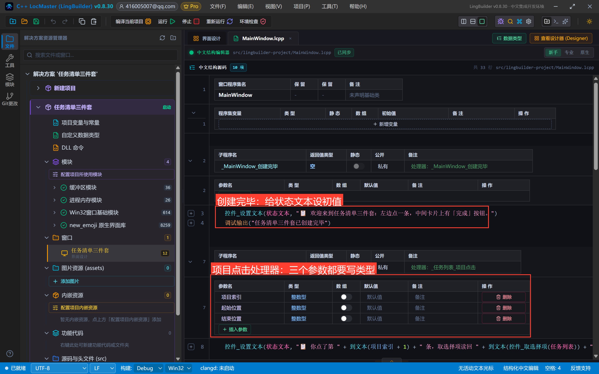

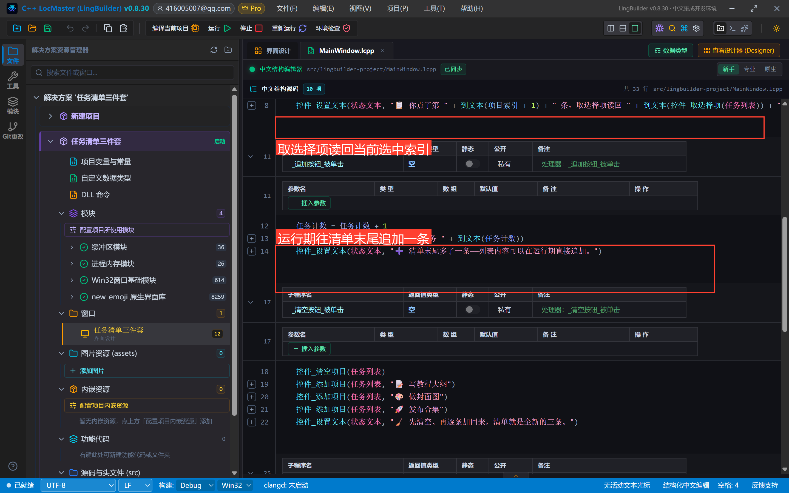

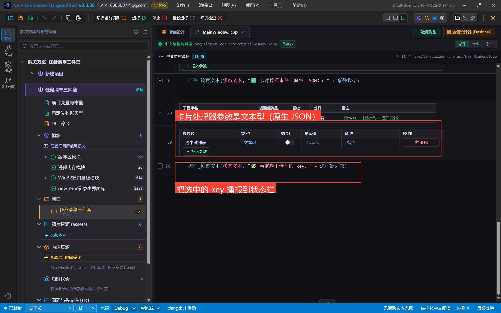

## 5. 编译前先看错误列表

点「编译当前项目」，先看底部错误列表——零报错再继续：

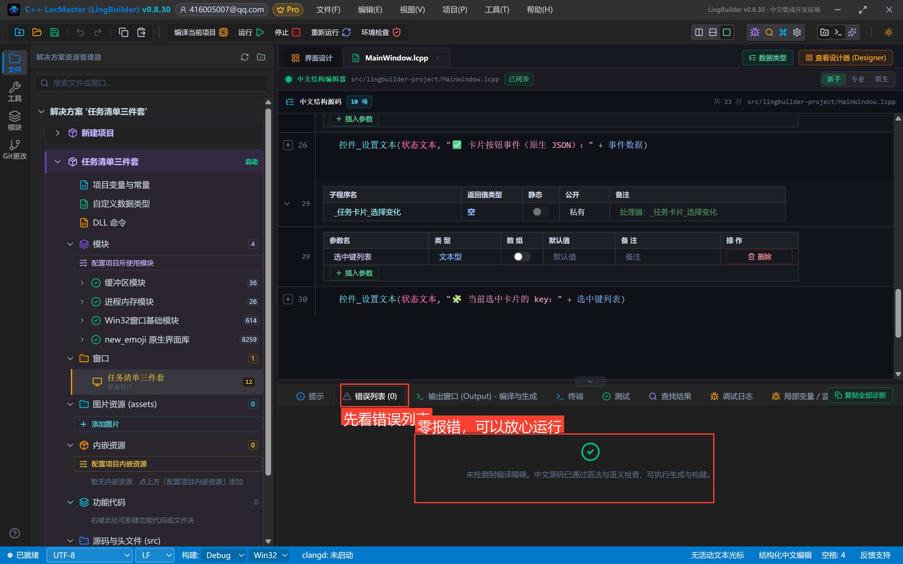

## 6. 运行！三块面板各点各的

点「运行」。清单、卡片、详情三块并排：

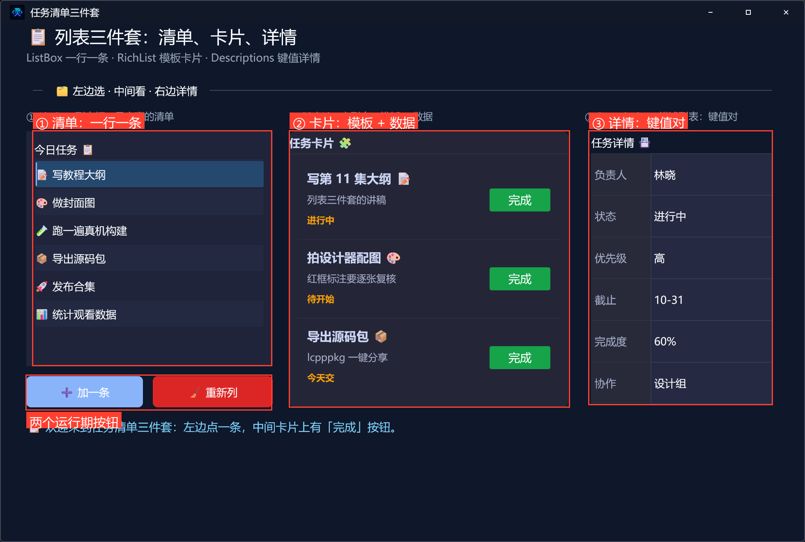

**① 点清单第二行**——`项目点击` 事件把索引报出来，`控件_取选择项` 同步读回同一个数：

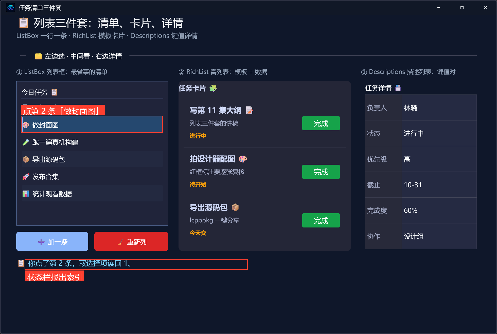

**② 点「➕ 加一条」**——清单末尾立刻多一行「🆕 追加任务 1」，这是运行期写进去的，设计器模型一个字都没改：

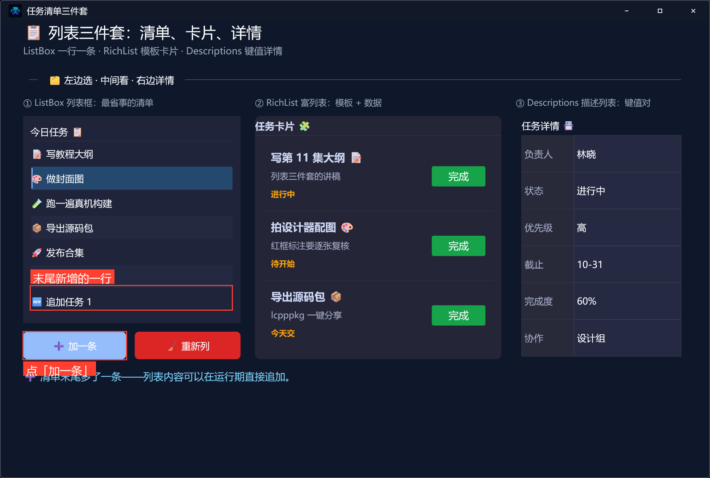

**③ 点卡片上的「完成」**——状态栏直接吐出原生 JSON：`{"event":"button_click","itemKey":"card-2","itemIndex":1,"nodeId":"done","actionId":"done","x":568,"y":354}`。注意行也同时被选中了（点行内按钮会先触发 `选择变化` 再触发 `按钮点击`）：

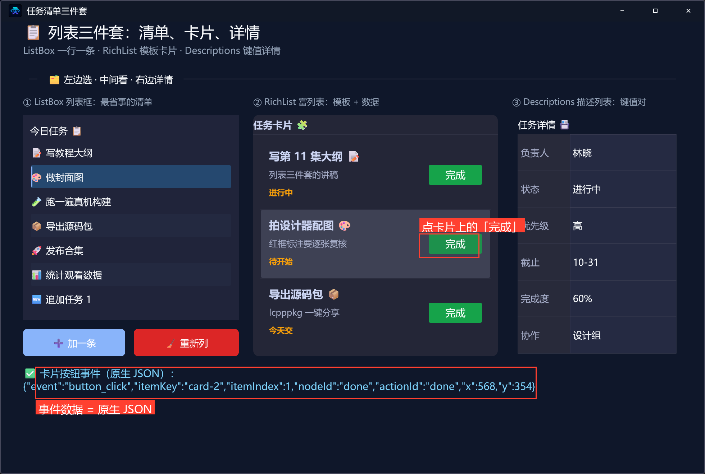

**④ 点「🧹 重新列」**——`控件_清空项目` + 三条 `控件_添加项目`，清单换成全新的三条：

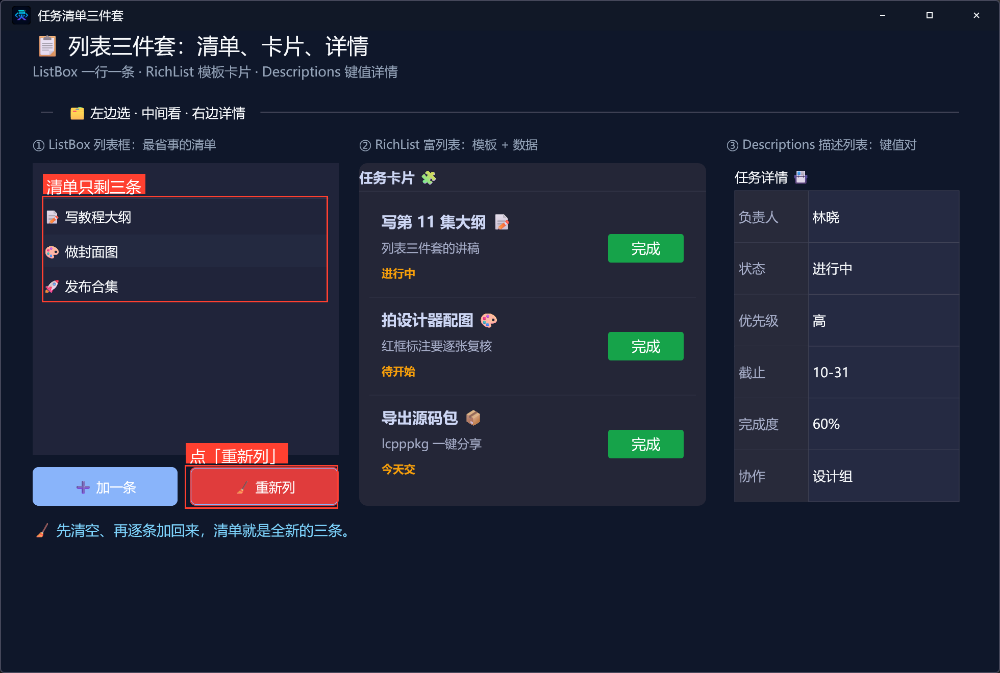

## 7. 导出源码包

命令面板执行「项目：一键导出 LCPP 源码包」即可。

## 本集源码包

- 网页版：[11-任务清单三件套.lcpppkg](https://lingbuilder.com/demos)（示例源码区可下载）

## 下一集预告

表格 Table 开篇：列定义与行数据——`tableColumnsEx` / `tableRowsEx` 的 kv 协议，以及为什么表格的列宽要按显示列数算。
