# NE 合集 12 · 表格 Table（一）：列定义与行数据

> 《LingBuilder new_emoji 合集》第 12 集。表格是最容易「看着会了、一填就崩」的组件，所以拆成两集：**本集只管把列和行摆对**，下一集再讲单元格点击、编辑、悬停这些交互。全程约 40 分钟。
>
> 前置要求：完成[第 01 集](/guide/tutorials/new-emoji-01)（启用模块、切设计后端、F5 全流程）；建议先看[第 11 集](/guide/tutorials/new-emoji-11)认识「设计器摆初值 + 运行期改数据」这条主线。本集源码包见文末。

## 这一集你将学会

- 用**表格编辑器**给 Table 定义列：`ID`（代码标识）、`标题`、`类型`、`宽度`、`对齐`
- 用表格编辑器填行数据，理解「列的 `key` ↔ 单元格的 `c0/c1/…`」是怎么对上的
- 看懂列/行最终下发的 **kv 协议**（`title=… key=… width=… align=…`，制表符分字段、换行分记录）
- 运行期四个动作：`NE表格_添加行`、`NE表格_插入行`、`NE表格_设置行数据`、`NE表格_取单元格值`

先看一眼本集成品——数据表格的列、行、选中、排序全套就位：

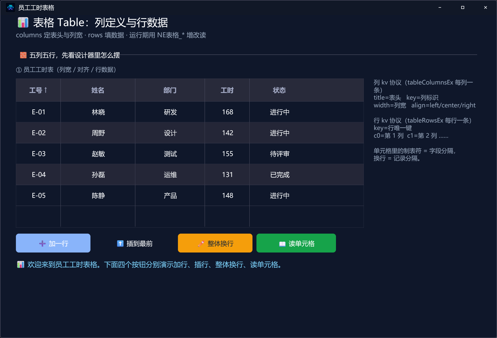

## 1. 命令与事件预告

| 命令 | 作用 |
| --- | --- |
| `NE表格_添加行(表格, 行数据)` | 末尾追加一行，返回新行索引（失败 -1） |
| `NE表格_插入行(表格, 行号, 行数据)` | 插到指定位置，返回插入后的行索引 |
| `NE表格_设置行数据(表格, 行数据)` | **整体替换**全部行数据（不是改一行！） |
| `NE表格_取单元格值(表格, 行号, 列号)` | 读一个单元格的文本，行列都从 0 开始 |

> 本集只需要 new_emoji 模块。单元格点击/编辑/悬停类事件留给第 13 集。

## 2. 新建项目 + 启用模块 + 切后端

流程和第 1 集完全一样，项目名称填 **员工工时表格**：

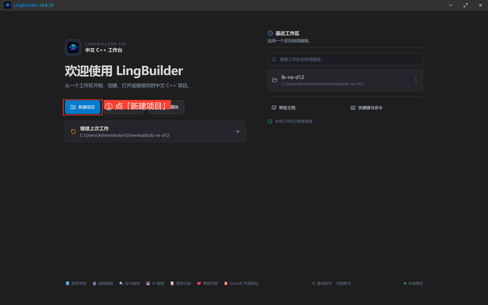

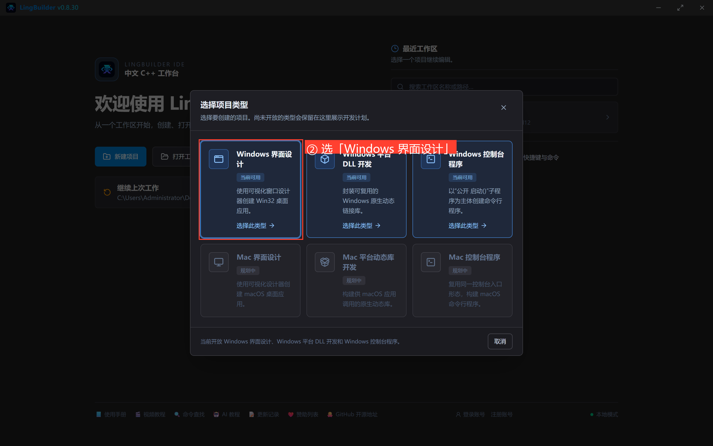

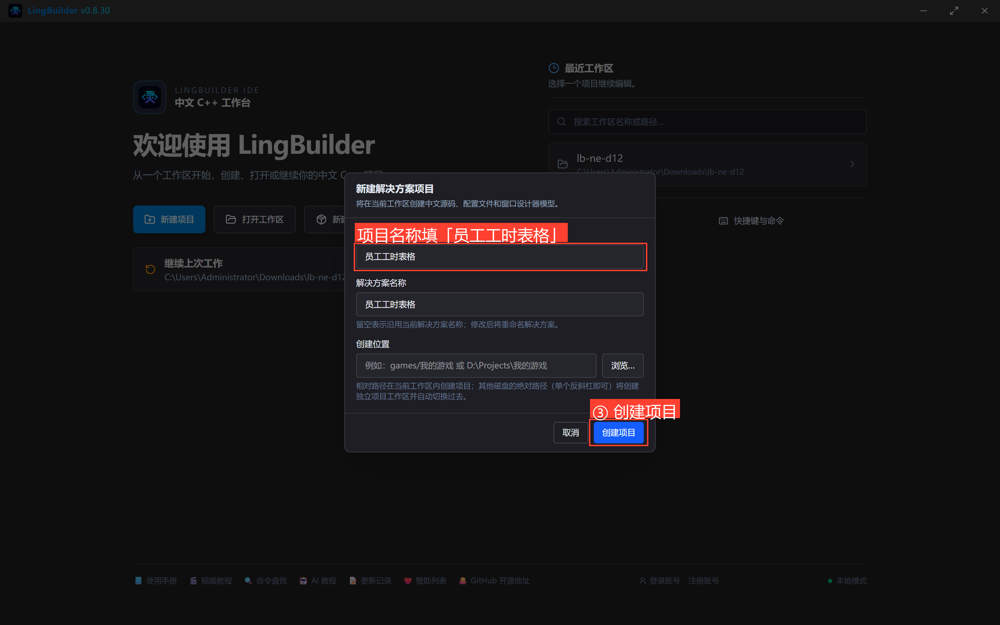

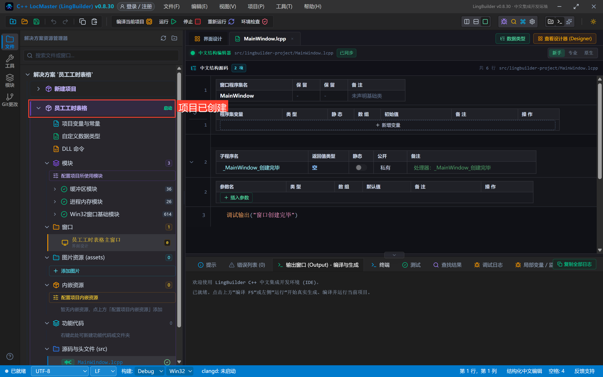

模块面板搜「原生界面」→ 启用「new_emoji 原生界面库」（首次弹登录框，登录一次即可）：

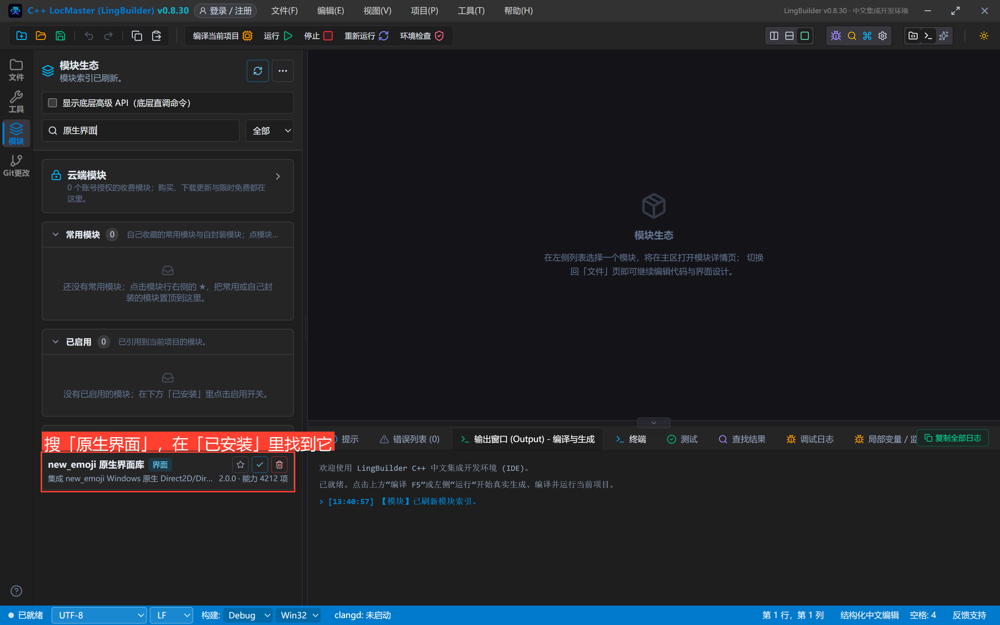

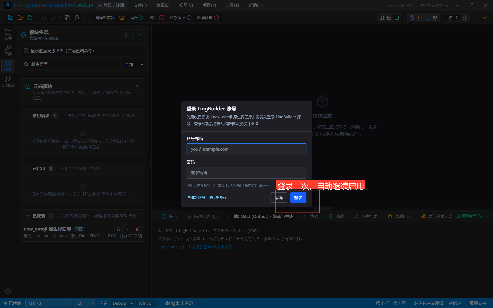

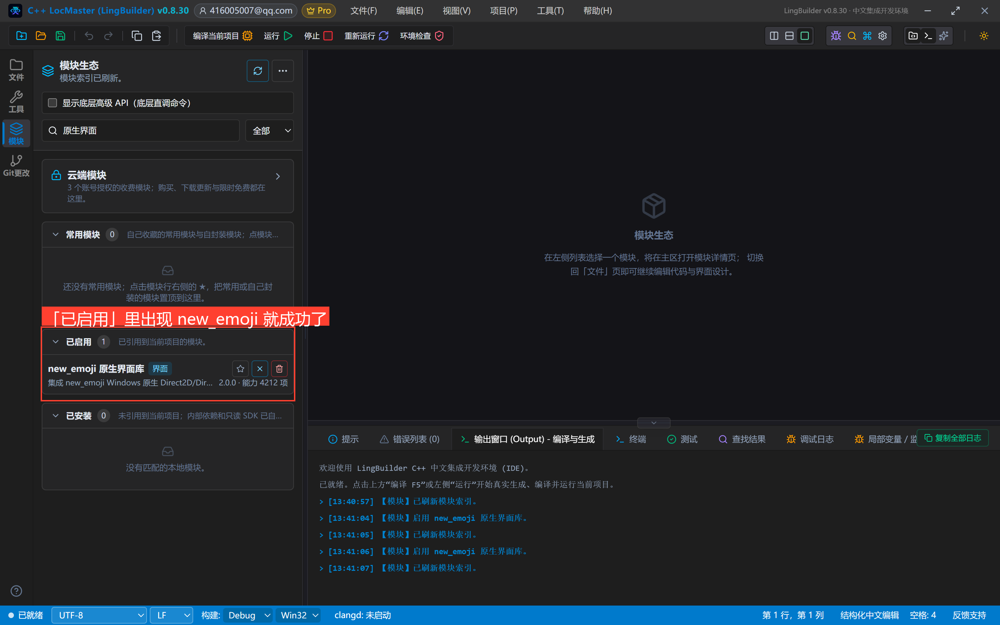

界面设计 → 选中窗口 → 确认「设计后端」是 **new_emoji 模块**：

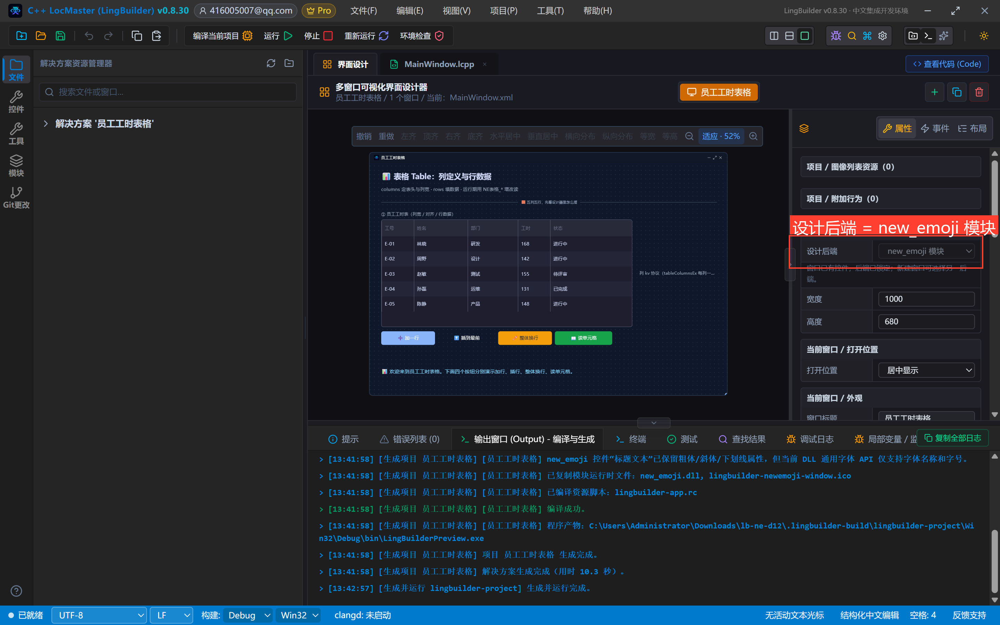

工具箱里展开「New_Emoji 控件」，把 **表格 Table** 拖到画布上：

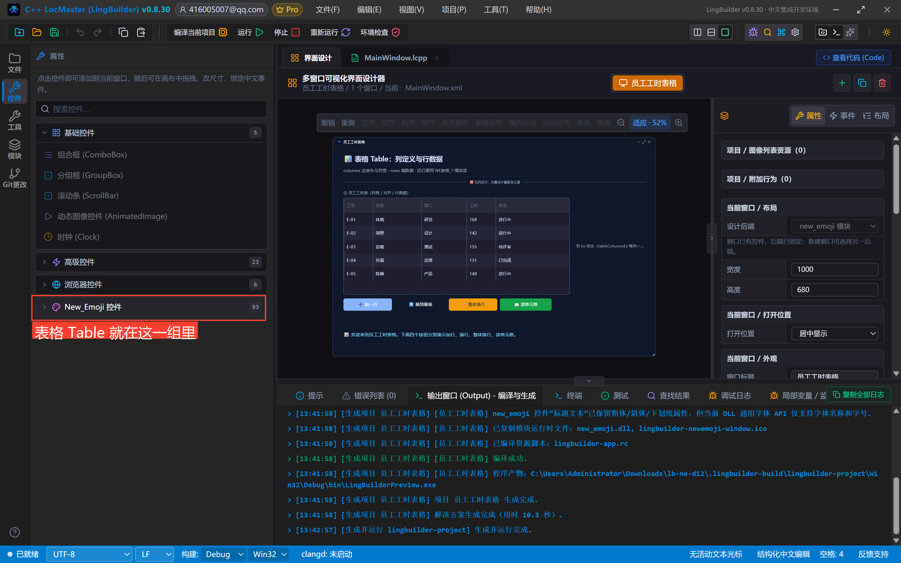

## 3. 定义列与行：用表格编辑器，不要手写协议

新拖入的表格是空的。选中它，右侧属性面板里找到 **「表格数据」** 这一行——它不是一个文本框，而是一个 **「编辑列与行」** 按钮。点进去：

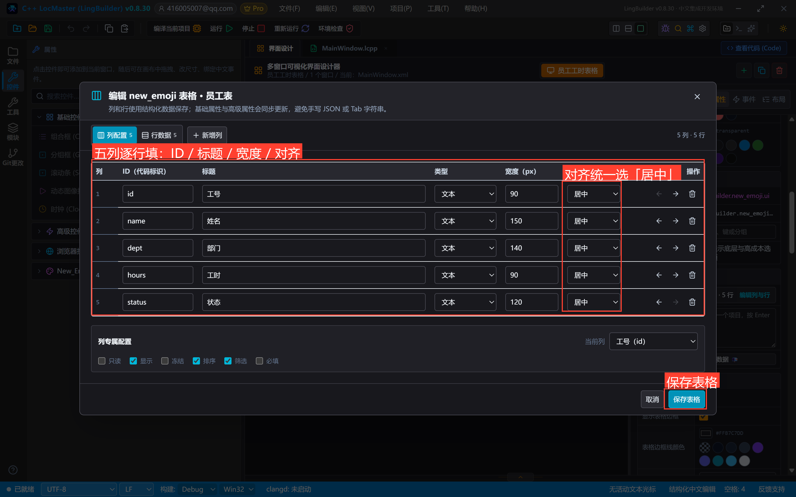

这个对话框就是本集的主战场。它有两个页签：**列配置** 和 **行数据**。列配置里每行一列，五栏要填：

| 栏 | 含义 | 本例 |
| --- | --- | --- |
| `ID（代码标识）` | 列的稳定英文名，运行期按它定位 | `id` / `name` / `dept` / `hours` / `status` |
| `标题` | 表头显示的文字 | 工号 / 姓名 / 部门 / 工时 / 状态 |
| `类型` | 单元格类型（文本/整数/开关/进度条/按钮组…） | 全部「文本」 |
| `宽度（px）` | 列宽 | 90 / 150 / 140 / 90 / 120 |
| `对齐` | 左 / 居中 / 右 | **全部选「居中」**，整表更整齐 |

下面还有「列专属配置」：只读、显示、冻结、排序、筛选、必填——本集先不动，保持默认。

切到 **行数据** 页签，按列顺序填五格一行，共五行：

| 工号 | 姓名 | 部门 | 工时 | 状态 |
| --- | --- | --- | --- | --- |
| E-01 | 林晓 | 研发 | 168 | 进行中 |
| E-02 | 周野 | 设计 | 142 | 进行中 |
| E-03 | 赵敏 | 测试 | 155 | 待评审 |
| E-04 | 孙磊 | 运维 | 131 | 已完成 |
| E-05 | 陈静 | 产品 | 148 | 进行中 |

点「保存表格」，画布立刻出现一张带斑马纹的五行表：

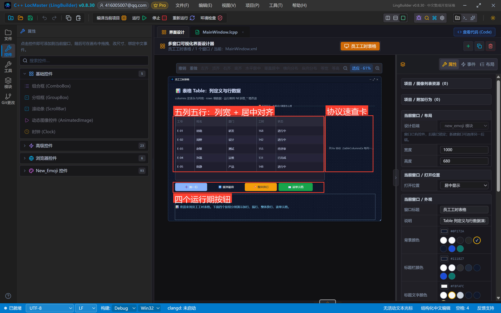

### 3.1 表格外壳属性

| 控件 | 名称 | 左距 | 顶距 | 宽度 | 高度 | 关键属性 |
| --- | --- | --- | --- | --- | --- | --- |
| 表格 Table | 员工表 | 32 | 158 | 700 | 300 | striped=真、bordered=真、rowHeight=42、headerHeight=46、selectionMode=1（单选一行）、emptyText=暂无数据 📭 |

页面其余部分：标题文本、副标题文本、分割线、三个说明文本、四个按钮、一个状态文本。四个按钮的位置分别是 (32,470)、(190,470)、(358,470)、(516,470)，宽高 150×38 / 160×38，`variant` 依次 1（主色）、5（弱化）、3（警告）、2（成功）。

> **红线：列宽是按显示宽度给的像素值，五列合计 590 要小于表格宽度 700**，否则末列会被挤出可视区（表格自带横向滚动，但新手会以为「列没配上」）。缩放不是 100% 时表格命令内部有 DPI 换算，看到的列宽和这里填的数值会等比变化，属正常。

### 3.2 保存之后到底生成了什么（看得懂就行，不用手写）

表格编辑器把列和行存成结构化数据，生成 C++ 时翻译成 new_emoji 的 **kv 协议文本**：

```
列：title=工号	key=id	width=90	align=center
    title=姓名	key=name	width=150	align=center
    ……（每列一行，字段之间用制表符）
行：key=r1	c0=E-01	c1=林晓	c2=研发	c3=168	c4=进行中
    key=r2	c0=E-02	……（每行一条记录，记录之间用换行）
```

记住三件事就够：**制表符分字段、换行分记录、单元格用 `c0/c1/c2…` 按列序号写**。这也是第 4 节代码里那些字符串的写法。

## 4. 写代码

```lcpp
类 MainWindow
    事件 _MainWindow_创建完毕()
        控件_设置文本(状态文本, "📊 欢迎来到员工工时表格。下面四个按钮分别演示加行、插行、整体换行、读单元格。")
        调试输出("员工工时表格已创建完毕")
    结束

    事件 _加一行按钮_被单击()
        行计数 = 行计数 + 1
        NE表格_添加行(员工表, "key=r-new-" + 到文本(行计数) + "\tc0=E-09\tc1=新同事\tc2=运营\tc3=42\tc4=新加入")
        控件_设置文本(状态文本, "➕ 追加了一行「新同事」，行键是 r-new-" + 到文本(行计数) + "。")
    结束

    事件 _插到最前按钮_被单击()
        NE表格_插入行(员工表, 0, "key=r-top\tc0=E-00\tc1=面试官\tc2=人事部\tc3=8\tc4=今天面")
        控件_设置文本(状态文本, "⬆️ 在第 0 行插入「面试官」，原来的行整体往下挪一位。")
    结束

    事件 _改末行按钮_被单击()
        NE表格_设置行数据(员工表, "key=a1\tc0=E-11\tc1=赵敏\tc2=测试\tc3=77\tc4=替换后\nkey=a2\tc0=E-12\tc1=孙磊\tc2=运维\tc3=131\tc4=替换后")
        控件_设置文本(状态文本, "✏️ 设置行数据是整体替换：表格现在只剩协议里那两行。")
    结束

    事件 _读单元格按钮_被单击()
        控件_设置文本(状态文本, "📖 第 1 行第 2 列（姓名）读出来是：" + NE表格_取单元格值(员工表, 0, 1))
    结束
结束类
```

四个看点：

1. **字符串里的 `\t` 就是制表符**。`.lcpp` 支持 `\t`、`\n` 转义，生成器会先解释再转成 C++ 的 `\t`，所以协议分隔符可以直接写在源码里。
2. **行键（`key=`）必须唯一**。本例把 `行计数` 拼进行键，连点「➕ 加一行」才会一行一行往下加；如果每次都写 `key=r-new`，第二行会被当成重复键处理。`行计数` 是项目全局变量，声明在 `项目全局变量.lcpp`：`全局 整数型 行计数 = 0`。
3. **`NE表格_设置行数据` 是整体替换**，不是「设置某一行」。想改单行请用 `NE表格_插入行` 配合删除，或下一集要讲的单元格级命令。
4. **`NE表格_取单元格值` 的行列都从 0 开始**，返回文本型，可以直接拼进 `控件_设置文本`。

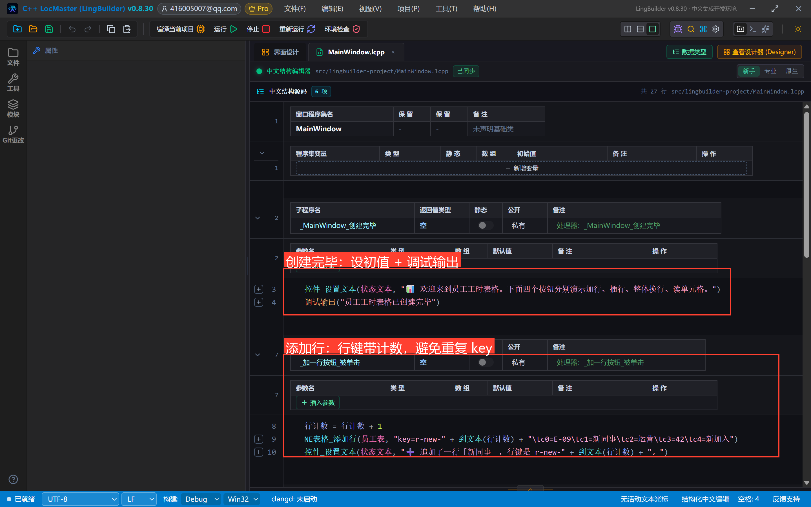

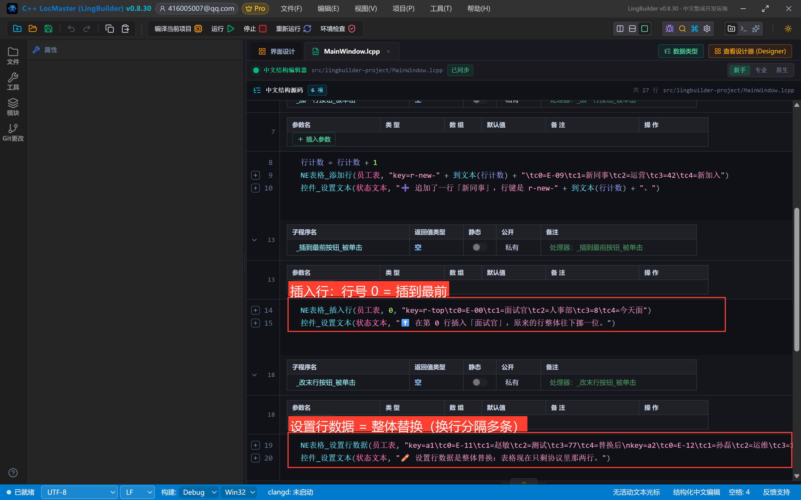

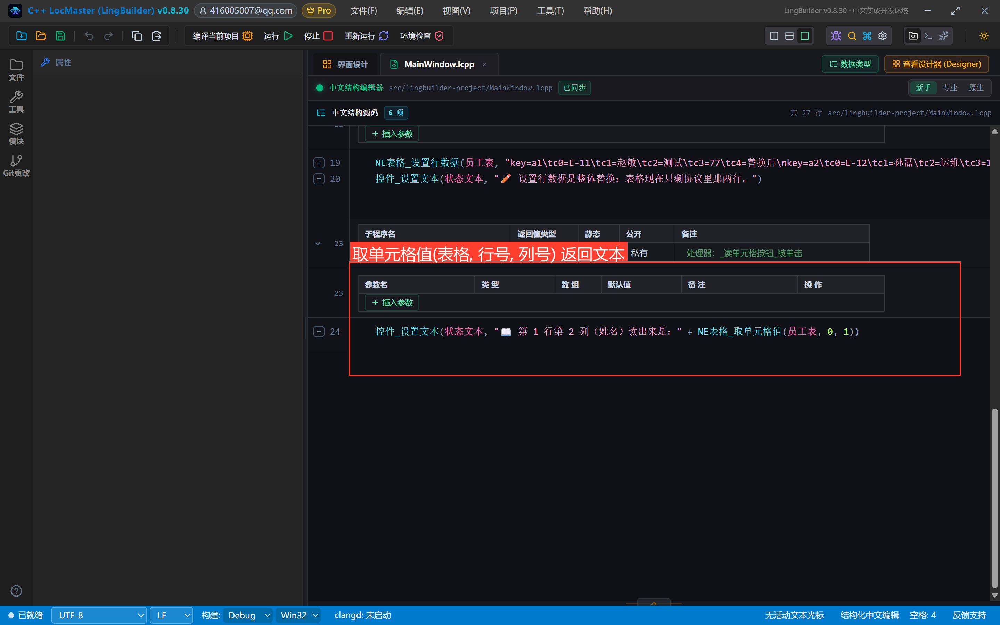

## 5. 编译前先看错误列表

点「编译当前项目」，先看底部错误列表——零报错再继续：

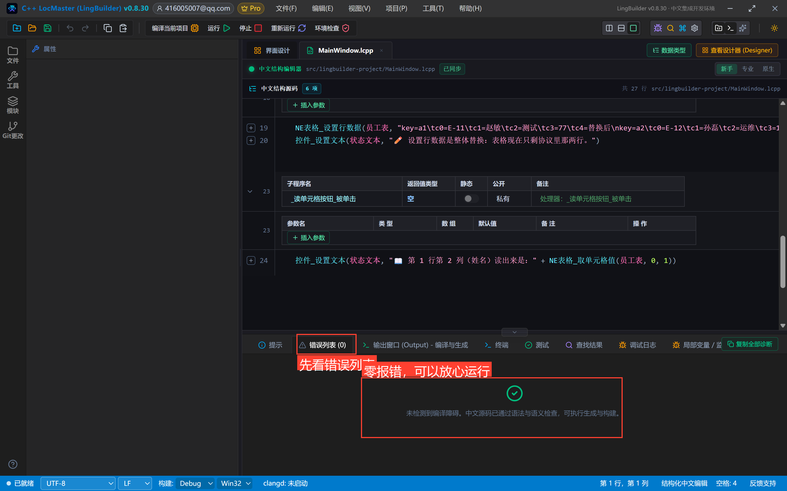

## 6. 运行！四个按钮挨个点

点「运行」。五列五行、全部居中、带斑马纹的表格：

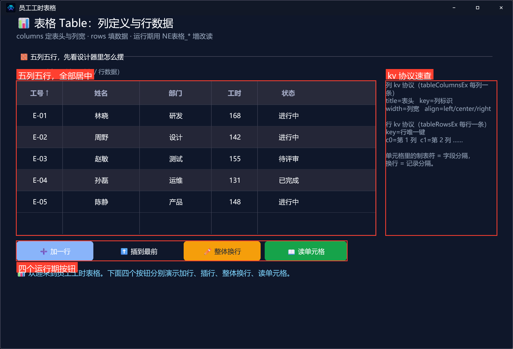

**① 点「➕ 加一行」**——末尾出现「E-09 新同事」，状态栏报出行键 `r-new-1`：

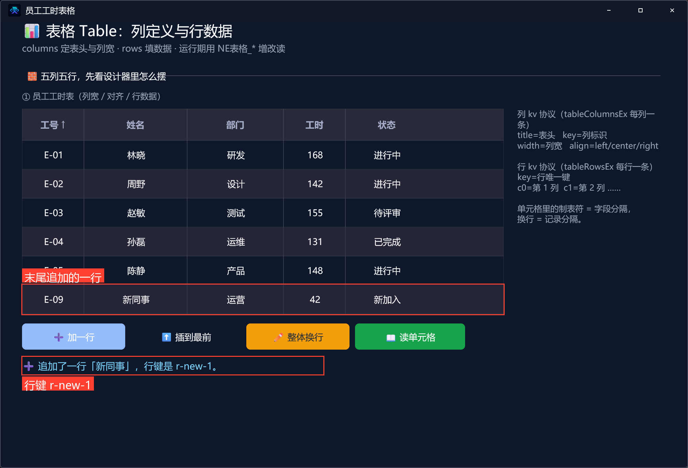

**② 点「⬆️ 插到最前」**——「E-00 面试官」出现在第 0 行，原来的五行整体往下挪（表格高度装不下时会自动出滚动条）：

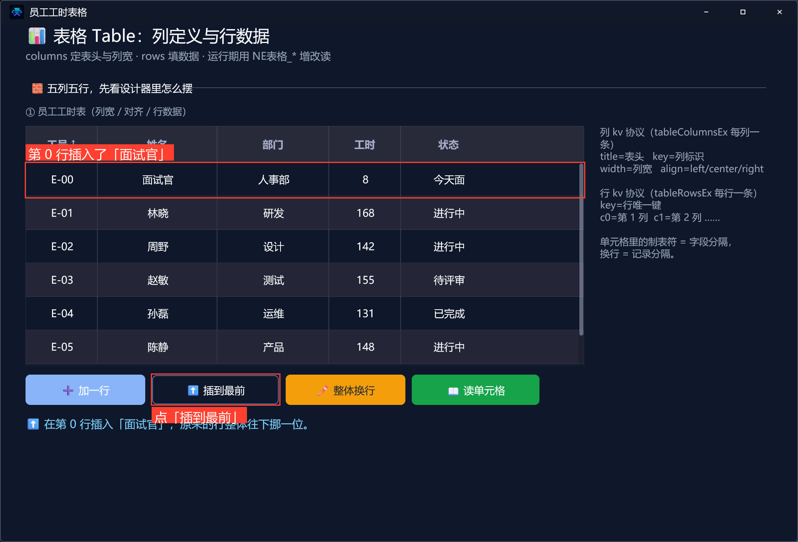

**③ 点「📖 读单元格」**——`NE表格_取单元格值(员工表, 0, 1)` 读第 0 行第 1 列，正好是刚插进去的「面试官」：

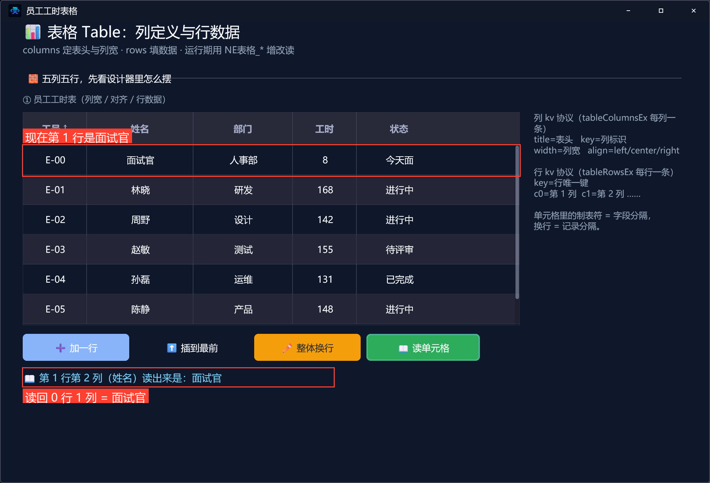

**④ 点「✏️ 整体换行」**——`NE表格_设置行数据` 把整张表换成协议里的那两行，五行的历史数据全部消失：

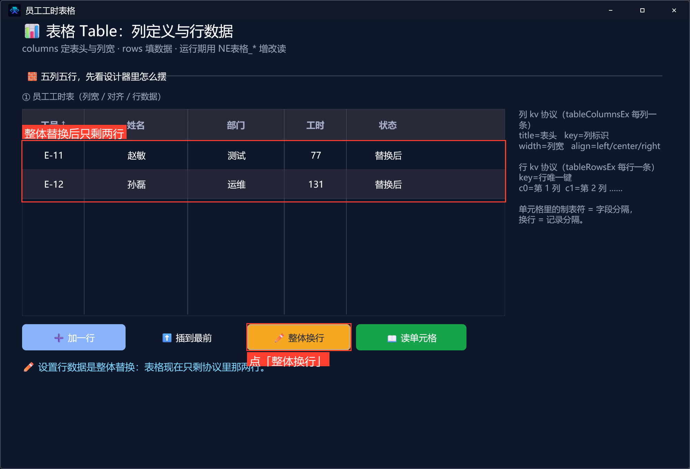

到这里，「列怎么定义、行怎么填、运行期怎么增删改读」就通了。

## 7. 导出源码包

命令面板执行「项目：一键导出 LCPP 源码包」即可。

## 本集源码包

- 网页版：[12-员工工时表格.lcpppkg](https://lingbuilder.com/demos)（示例源码区可下载）

## 下一集预告

表格 Table（二）：单元格交互与 `CellClicked`——点一格读出「第几行第几列」、双击编辑回收、悬停行/悬停列高亮，以及「操作」列怎么做成可点按钮。
