# NE 合集 13 · 表格 Table（二）：单元格交互

> 《LingBuilder new_emoji 合集》第 13 集。上一集把表格「摆出来了」，这一集让它「能被点、能被改、能被记住」：**单元格点击（CellClicked）、双击编辑回收（CellEdit）、悬停行与悬停列高亮**。全程约 40 分钟。
>
> 前置要求：完成[第 12 集](/guide/tutorials/new-emoji-12)（列定义与行数据）。本集直接沿用那一套列协议，只加交互。本集源码包见文末。

## 这一集你将学会

- 绑 **单元格点击** 事件，拿到 `行号` 和 `列号`（都从 0 开始），再用 `NE表格_取单元格值` 读出这一格写了什么
- 用 **列的「只读」勾选** 控制哪些列允许双击编辑，并在 **单元格编辑** 事件里按 `动作` 判断开始 / 提交 / 取消
- 用 `NE表格_设置悬停行颜色` / `NE表格_设置悬停列` 让鼠标划过时整行或某一列高亮，并把「操作」列变成手型光标
- 用 **项目全局变量** 在两个事件之间传值（点击记住行列 → 另一个按钮回读）

先看一眼本集成品——表格的悬停、编辑、汇总行高级玩法：

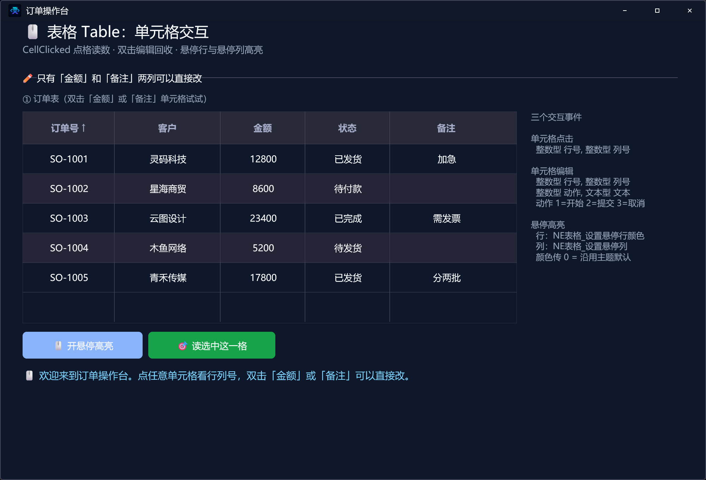

## 1. 命令与事件预告

| 命令 / 事件 | 作用 |
| --- | --- |
| `单元格点击` 事件 | 参数 `整数型 行号, 整数型 列号`，点表格里任意一格触发 |
| `单元格编辑` 事件 | 参数 `整数型 行号, 整数型 列号, 整数型 动作, 文本型 文本`；动作 1=开始 2=提交 3=取消 |
| `NE表格_取单元格值(表格, 行号, 列号)` | 读一个单元格的文本 |
| `NE表格_设置悬停行颜色(表格, 是否启用, 背景色, 文字色)` | 整行跟随鼠标高亮（DLL 原生跟踪，含滚动） |
| `NE表格_设置悬停列(表格, 列号, 是否启用, 背景色, 文字色, 光标形状)` | 某一数据列的单元格高亮 + 光标形状 |

> 本集只需要 new_emoji 模块。

## 2. 新建项目 + 启用模块 + 切后端

流程和第 1 集一样，项目名称填 **订单操作台**：

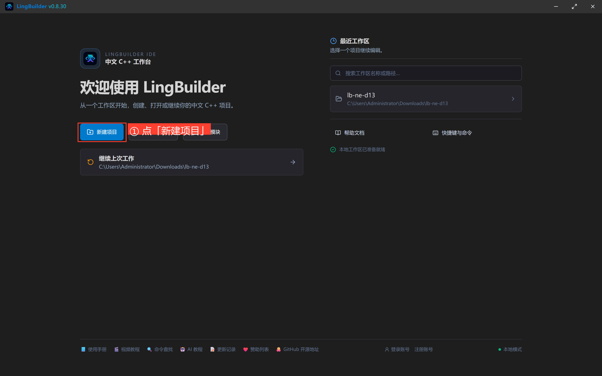

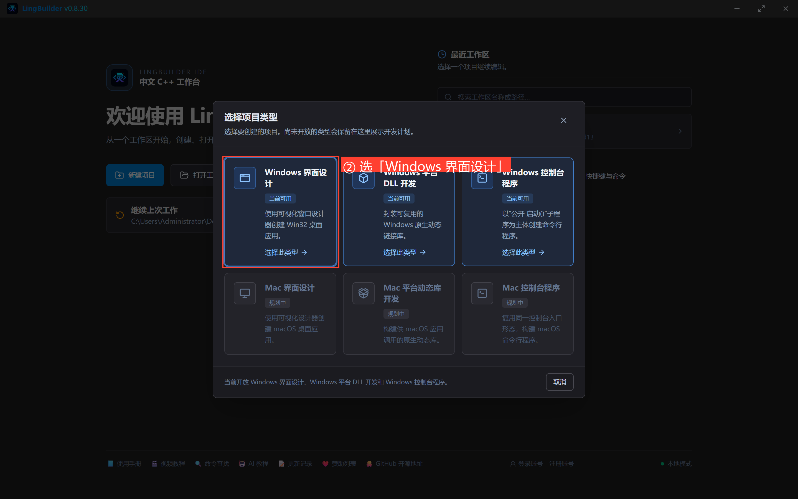

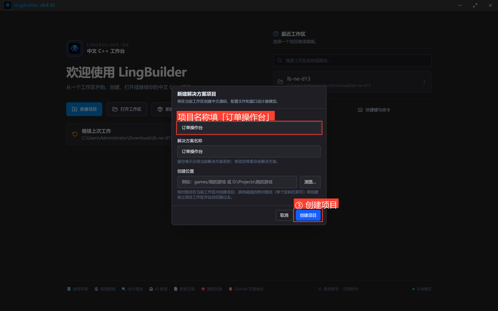

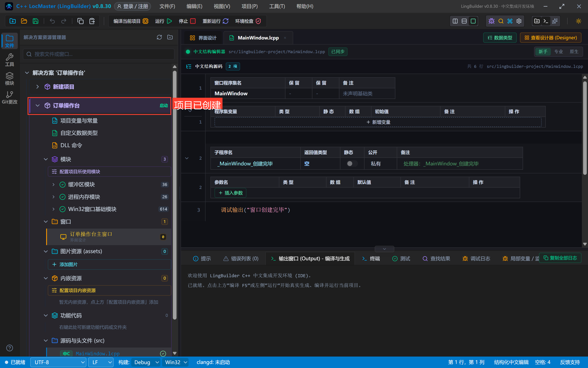

模块面板搜「原生界面」→ 启用「new_emoji 原生界面库」（首次弹登录框，登录一次即可）：

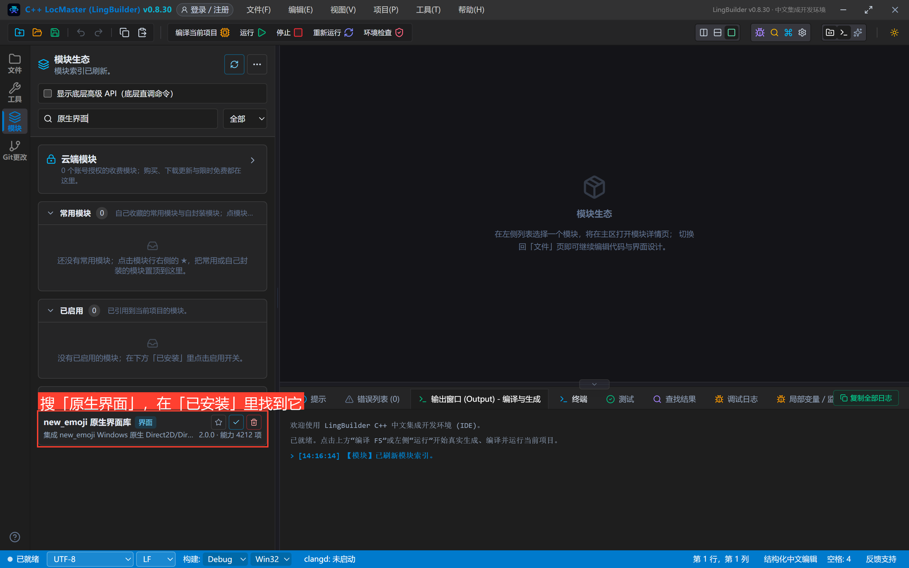

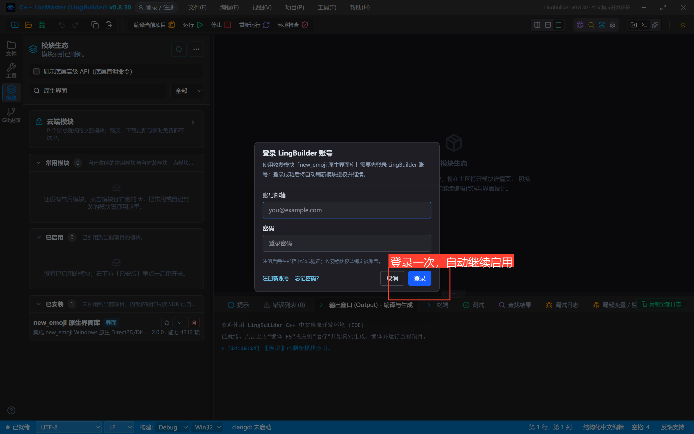

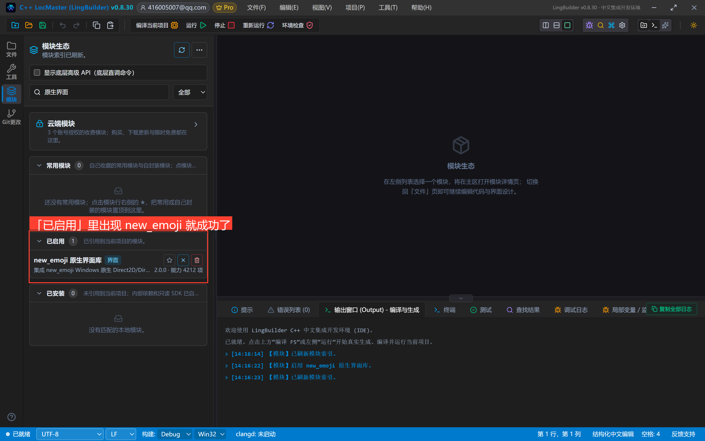

界面设计 → 选中窗口 → 确认「设计后端」是 **new_emoji 模块**：

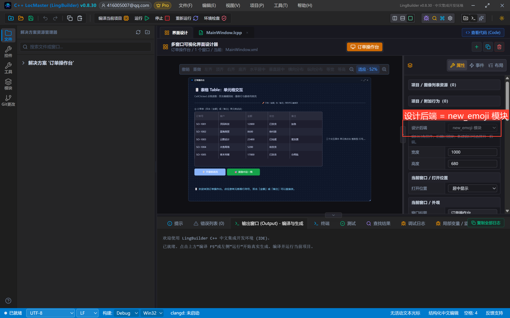

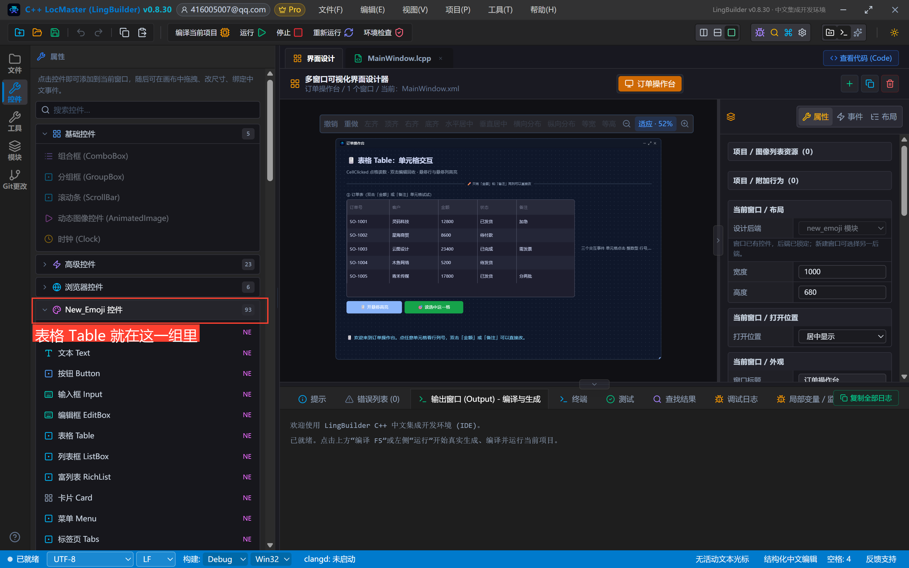

## 3. 设计界面

拖一个 **表格 Table**，命名 `订单表`，位置 (32,158) 大小 700×300。然后打开属性面板里的 **「表格数据」→「编辑列与行」**。

### 3.1 列：这次要勾「只读」

| ID | 标题 | 宽度 | 对齐 | 只读 |
| --- | --- | --- | --- | --- |
| `id` | 订单号 | 130 | 居中 | **勾上** |
| `customer` | 客户 | 150 | 居中 | **勾上** |
| `amount` | 金额 | 120 | 居中 | 不勾 |
| `status` | 状态 | 120 | 居中 | **勾上** |
| `note` | 备注 | 160 | 居中 | 不勾 |

再回到属性面板，把表格自身的 **「允许双击编辑文字单元格」** 勾上。

> **这两步要一起做**：总开关不开，勾了只读也编辑不了；总开关开了但没勾只读，五列全都能改。**「只读」列 = 不允许双击编辑**，生成器会把它翻译成 `EU_SetTableColumnDoubleClickEdit(列序号, 0)`。

### 3.2 行数据

| 订单号 | 客户 | 金额 | 状态 | 备注 |
| --- | --- | --- | --- | --- |
| SO-1001 | 灵码科技 | 12800 | 已发货 | 加急 |
| SO-1002 | 星海商贸 | 8600 | 待付款 | |
| SO-1003 | 云图设计 | 23400 | 已完成 | 需发票 |
| SO-1004 | 木鱼网络 | 5200 | 待发货 | |
| SO-1005 | 青禾传媒 | 17800 | 已发货 | 分两批 |

### 3.3 其余控件与事件绑定

| 控件 | 名称 | 左距 | 顶距 | 宽度 | 高度 | 说明 |
| --- | --- | --- | --- | --- | --- | --- |
| 文本 Text | 标题文本 | 32 | 20 | 700 | 36 | 🖱️ 表格 Table：单元格交互 |
| 文本 Text | 副标题文本 | 32 | 62 | 880 | 24 | CellClicked 点格读数 · 双击编辑回收 · 悬停行与悬停列高亮 |
| 分割线 Divider | 标题分割线 | 32 | 96 | 936 | 28 | ✏️ 只有「金额」和「备注」两列可以直接改 |
| 文本 Text | 表格标签 | 32 | 132 | 500 | 22 | ① 订单表（双击「金额」或「备注」单元格试试） |
| 按钮 Button | 悬停高亮按钮 | 32 | 470 | 170 | 38 | 🖱️ 开悬停高亮，variant=1 |
| 按钮 Button | 读选中格按钮 | 210 | 470 | 180 | 38 | 🎯 读选中这一格，variant=2 |
| 文本 Text | 交互说明 | 752 | 158 | 216 | 300 | 三个事件的参数速查卡 |
| 文本 Text | 状态文本 | 32 | 522 | 936 | 120 | 字号 14，#7DD3FC，自动换行 |

事件绑定：订单表绑 **单元格点击** → `_订单表_单元格点击`、**单元格编辑** → `_订单表_单元格编辑`；两个按钮各绑 **被单击**。

摆完的画布：

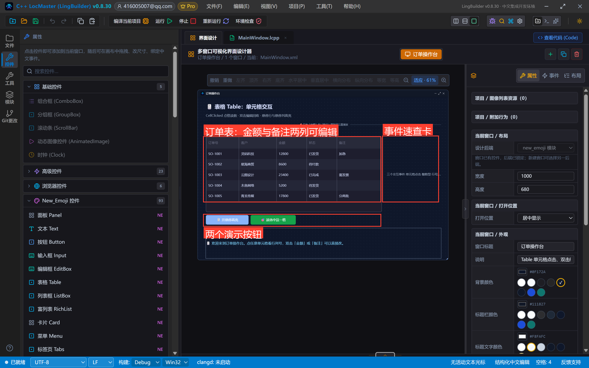

## 4. 写代码

```lcpp
类 MainWindow
    事件 _MainWindow_创建完毕()
        控件_设置文本(状态文本, "🖱️ 欢迎来到订单操作台。点任意单元格看行列号，双击「金额」或「备注」可以直接改。")
        调试输出("订单操作台已创建完毕")
    结束

    事件 _订单表_单元格点击(整数型 行号, 整数型 列号)
        选中行号 = 行号
        选中列号 = 列号
        控件_设置文本(状态文本, "🖱️ 点了第 " + 到文本(行号 + 1) + " 行第 " + 到文本(列号 + 1) + " 列，格子里是：" + NE表格_取单元格值(订单表, 行号, 列号))
    结束

    事件 _订单表_单元格编辑(整数型 行号, 整数型 列号, 整数型 动作, 文本型 文本)
        如果 (动作 == 2)
            控件_设置文本(状态文本, "✏️ 提交成功：第 " + 到文本(行号 + 1) + " 行第 " + 到文本(列号 + 1) + " 列现在是 " + 文本)
        如果结束
    结束

    事件 _悬停高亮按钮_被单击()
        NE表格_设置悬停行颜色(订单表, 真, 0, 0)
        NE表格_设置悬停列(订单表, 4, 真, 0, 0, 1)
        控件_设置文本(状态文本, "🖱️ 悬停行高亮已开；第 5 列（备注）还会跟着变手型光标。")
    结束

    事件 _读选中格按钮_被单击()
        控件_设置文本(状态文本, "🎯 上一次点的是第 " + 到文本(选中行号 + 1) + " 行第 " + 到文本(选中列号 + 1) + " 列：" + NE表格_取单元格值(订单表, 选中行号, 选中列号))
    结束
结束类
```

四个看点：

1. **行列号从 0 开始，报给人看要 +1**。事件给的 `行号`/`列号` 是 0 基，界面文案里统一 `+ 1`，否则新手会以为数错了。
2. **`选中行号` / `选中列号` 是项目全局变量**，声明在 `项目全局变量.lcpp`：
   ```
   全局 整数型 选中行号 = 0
   全局 整数型 选中列号 = 0
   ```
   这是「一个事件记住、另一个事件使用」的标准做法——处理器自己的局部变量出函数就没了。
3. **`单元格编辑` 的 `动作` 一定要判**。1=进入编辑、2=提交、3=取消。只在 2 的时候读 `文本`，否则取消也会当成改值。
4. **悬停颜色传 `0` 表示沿用主题默认**，不用先算 `0xAARRGGBB`。要自定义再传具体色值（注意「白色」要写 `0xFFFEFEFE`，`0xFFFFFFFF` 按整数是 -1，会被当成缺省跳过）。最后一个参数 `1` 是手型光标（-1 不改、0 箭头、1 手型、2 文本、3 十字、4 禁止）。

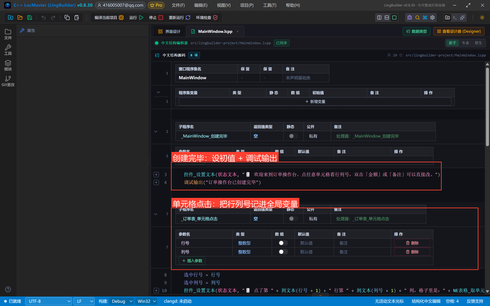

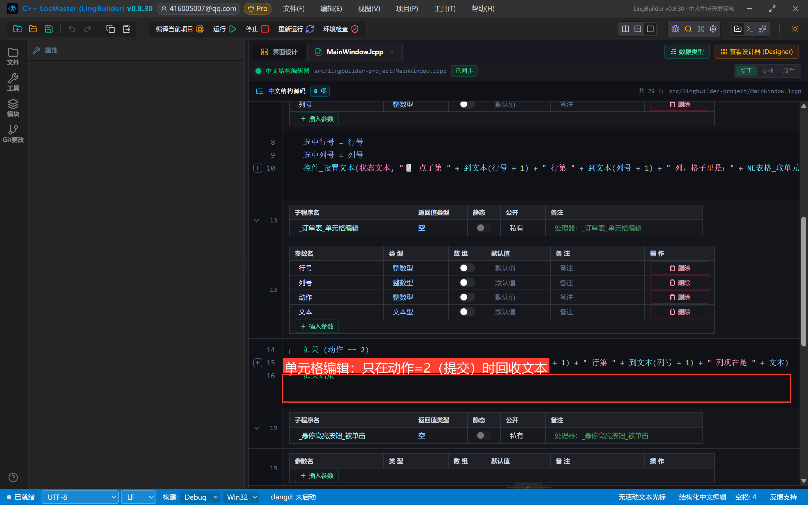

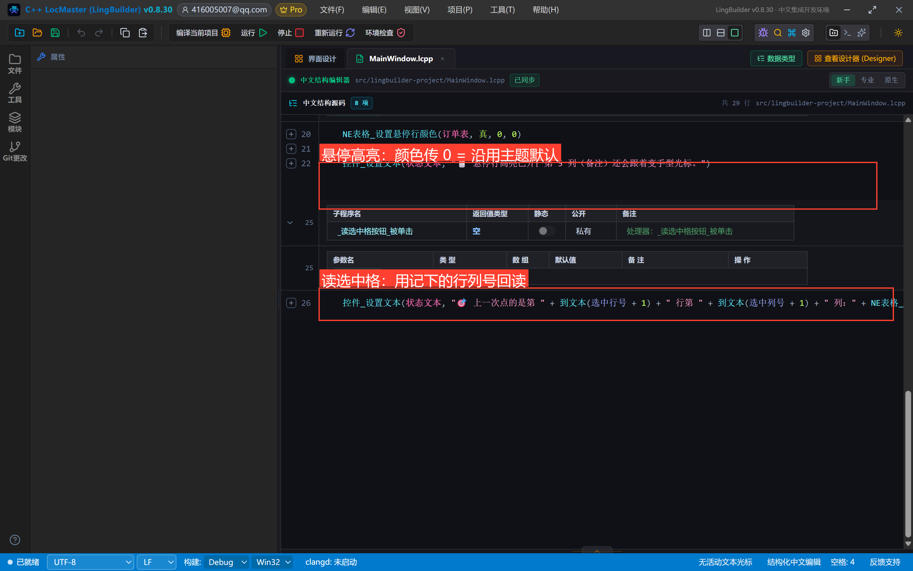

## 5. 编译前先看错误列表

点「编译当前项目」，先看底部错误列表——零报错再继续：

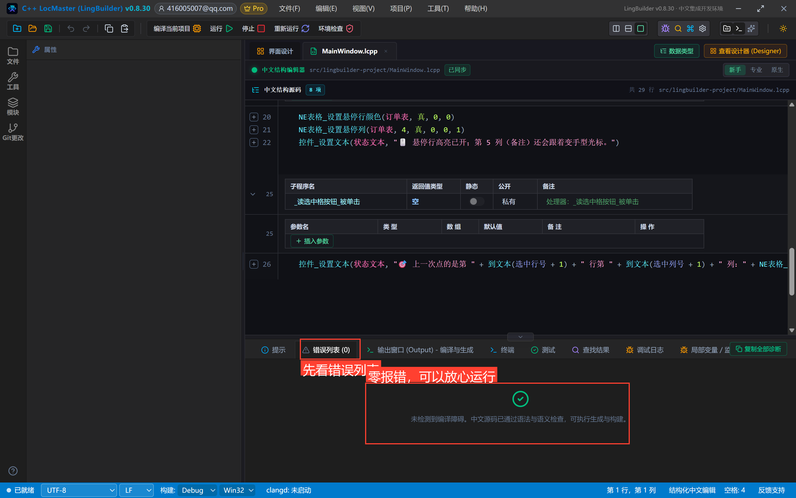

## 6. 运行！点、改、悬停

点「运行」。五列五行，金额和备注两列等着被改：

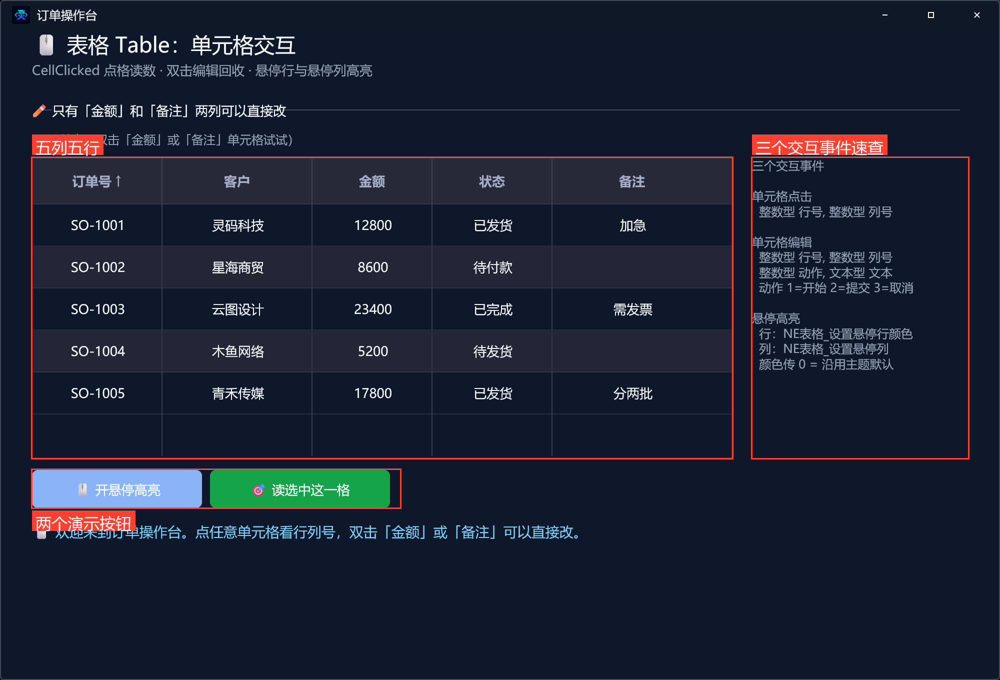

**① 点第 2 行的「待付款」格**——`单元格点击` 报出行列号，并把这一格的文本读出来：

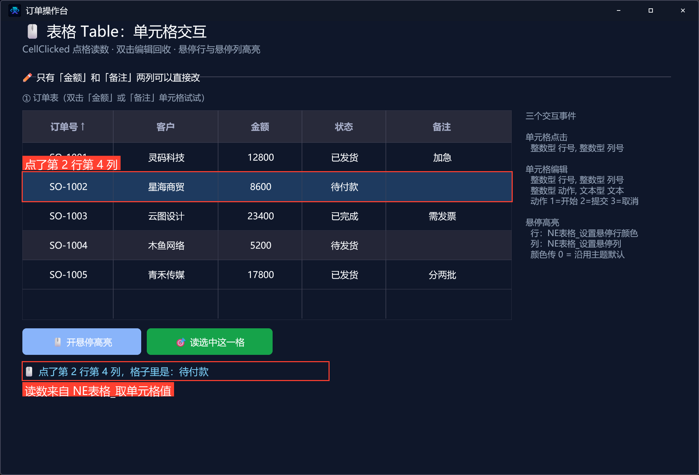

**② 双击「金额」格**——出现输入框，改成 `99999` 按回车，`单元格编辑` 的 `动作=2` 分支被触发，状态栏确认提交：

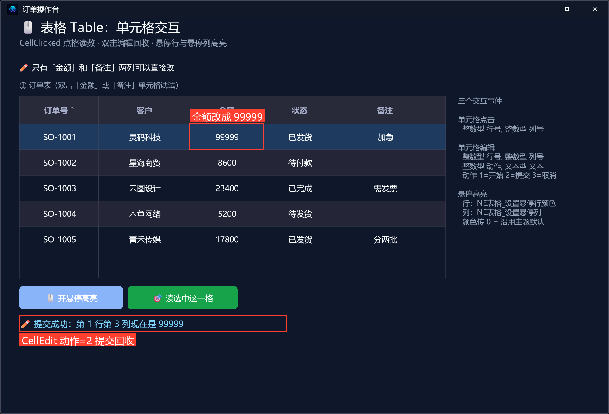

**③ 点「🖱️ 开悬停高亮」，然后把鼠标停在某一行上**——整行变色；移到第 5 列（备注）时该单元格额外高亮并出现手型光标：

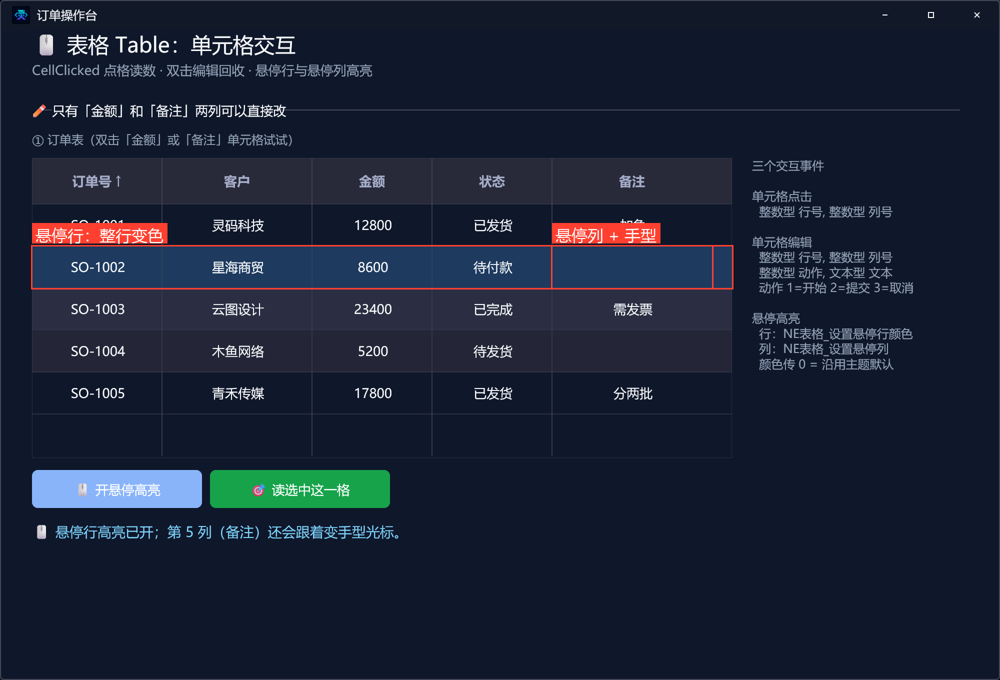

**④ 点「🎯 读选中这一格」**——它读的是第 ② 步之前记住的那一格，证明全局变量真的跨事件传到了：

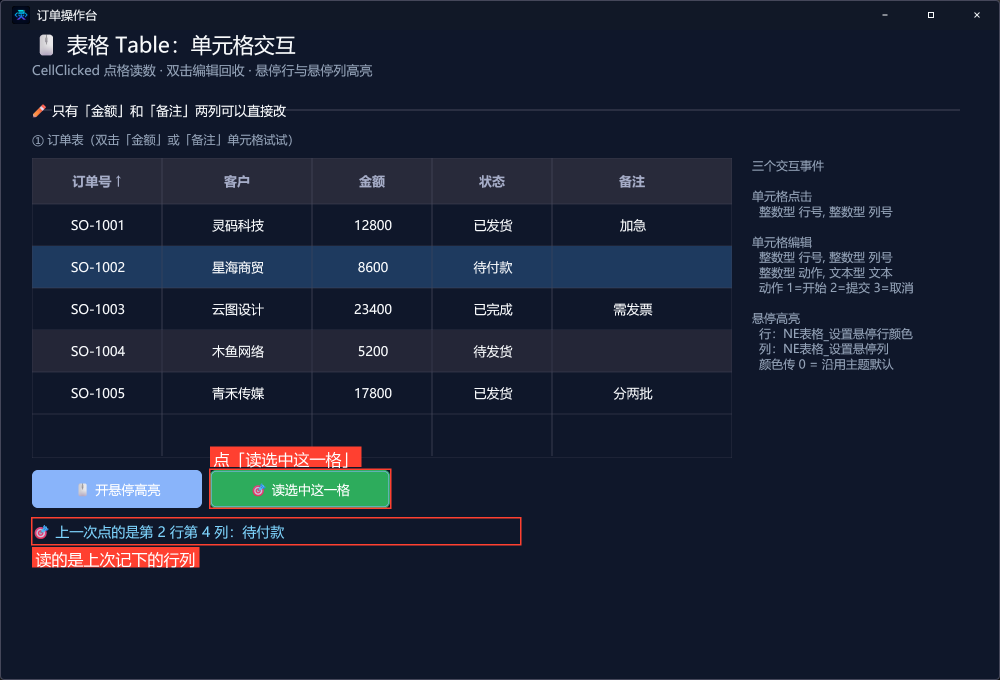

到这里，表格的「点、改、悬停」三条交互链路就通了。

## 7. 导出源码包

命令面板执行「项目：一键导出 LCPP 源码包」即可。

## 本集源码包

- 网页版：[13-订单操作台.lcpppkg](https://lingbuilder.com/demos)（示例源码区可下载）

## 下一集预告

树 Tree 与折叠面板 Collapse——层级数据怎么给（`treeDataJson`）、节点选择事件怎么接，以及折叠面板的「手风琴」模式。
