# NE 合集 14 · 树 Tree 与折叠面板 Collapse

> 《LingBuilder new_emoji 合集》第 14 集。这一集解决两类「内容比一维列表深一层」的界面：**Tree 树**（目录、分类、组织架构）和 **Collapse 折叠面板**（设置分组、FAQ、手风琴）。两个组件的难点都不在外观，而在**数据怎么给**。全程约 35 分钟。
>
> 前置要求：完成[第 01 集](/guide/tutorials/new-emoji-01)；建议先看[第 11 集](/guide/tutorials/new-emoji-11)（列表三件套），本集沿用「设计器摆数据 + 运行期只播报」的路子。本集源码包见文末。

## 这一集你将学会

- **Tree**：用 `items` 一行一节点写层级（`标签⇥层级⇥展开⇥勾选`），或用 `treeDataJson` 写 `children` 嵌套
- **Tree**：`选择变化` 事件**不带参数**，选中第几个要靠 `控件_取选择项(资源树)` 去读
- **Collapse**：`items` 一行一组，`标题⇥内容`；`accordion=真` 就是手风琴（同时只开一组）
- 两个组件的属性面板都有专门的**结构化编辑器**，不用自己数制表符

先看一眼本集成品——树形结构与折叠面板把层级内容管得明明白白：

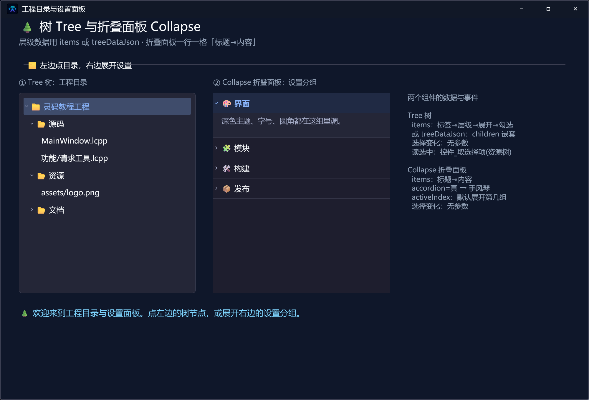

## 1. 命令与事件预告

| 命令 / 事件 | 作用 |
| --- | --- |
| `选择变化` 事件（Tree） | 点节点时触发，**没有参数** |
| `控件_取选择项(资源树)` | 读回当前选中的节点索引（从 0 开始，按扁平顺序数） |
| `选择变化` 事件（Collapse） | 展开/收起某组时触发，**没有参数** |
| `控件_设置可见(控件, 真/假)` | 想按树节点切换右侧内容时，用它显隐面板 |

> 本集只需要 new_emoji 模块。Tree 还有 `节点事件` / `懒加载` / `拖拽完成` 等事件，属于进阶，本集不展开。

## 2. 新建项目 + 启用模块 + 切后端

流程和第 1 集一样，项目名称填 **工程目录与设置面板**：

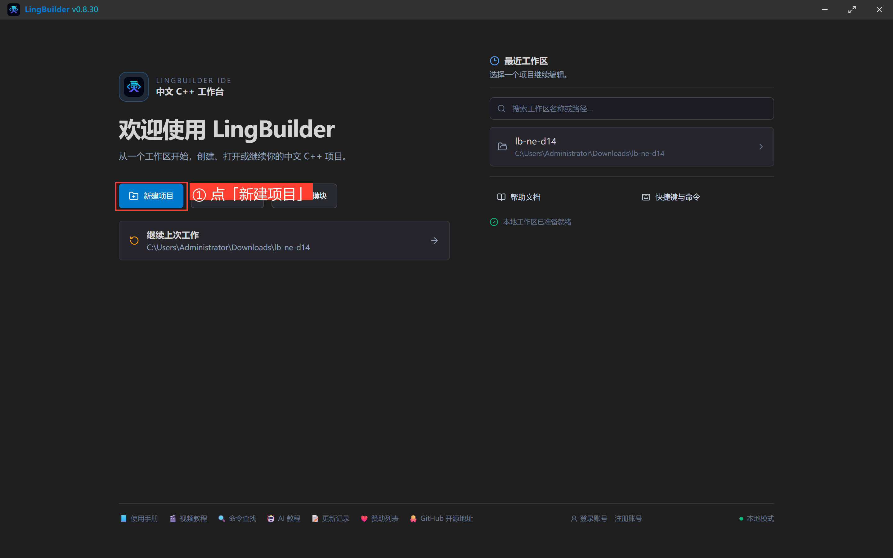

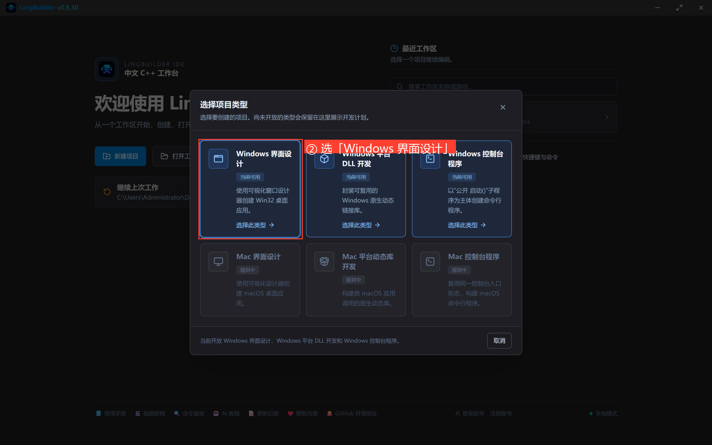

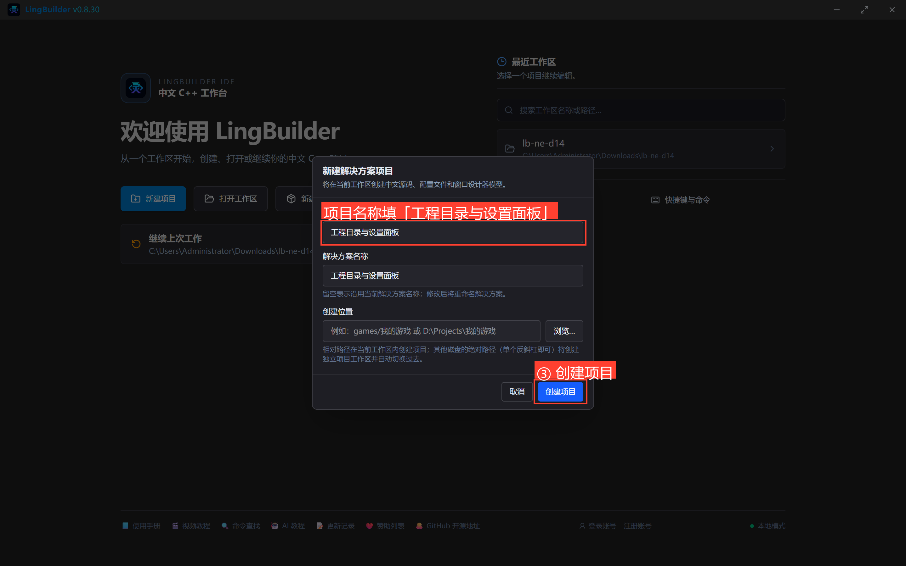

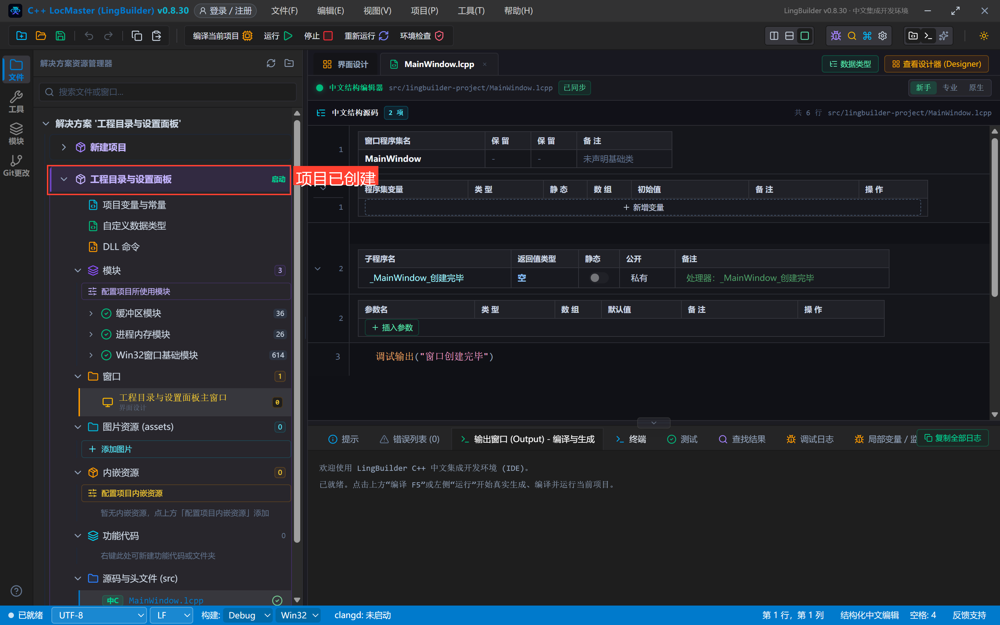

模块面板搜「原生界面」→ 启用「new_emoji 原生界面库」（首次弹登录框，登录一次即可）：

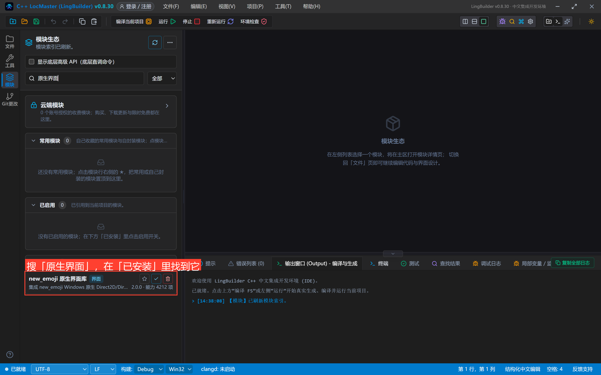

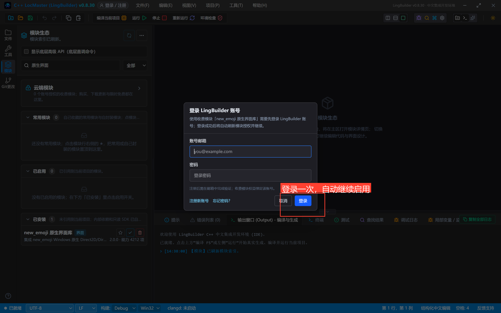

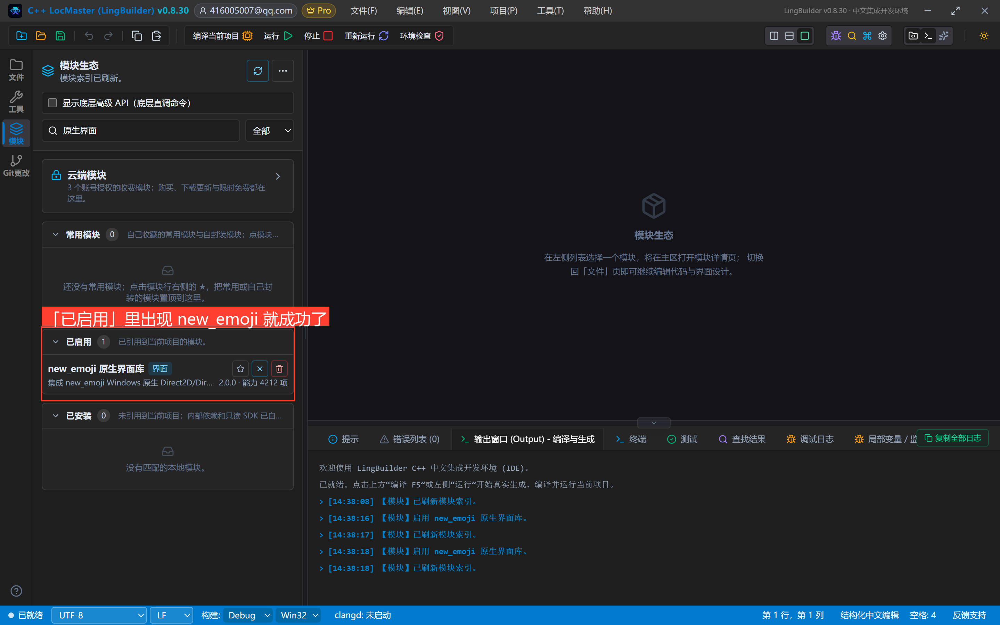

界面设计 → 选中窗口 → 确认「设计后端」是 **new_emoji 模块**：

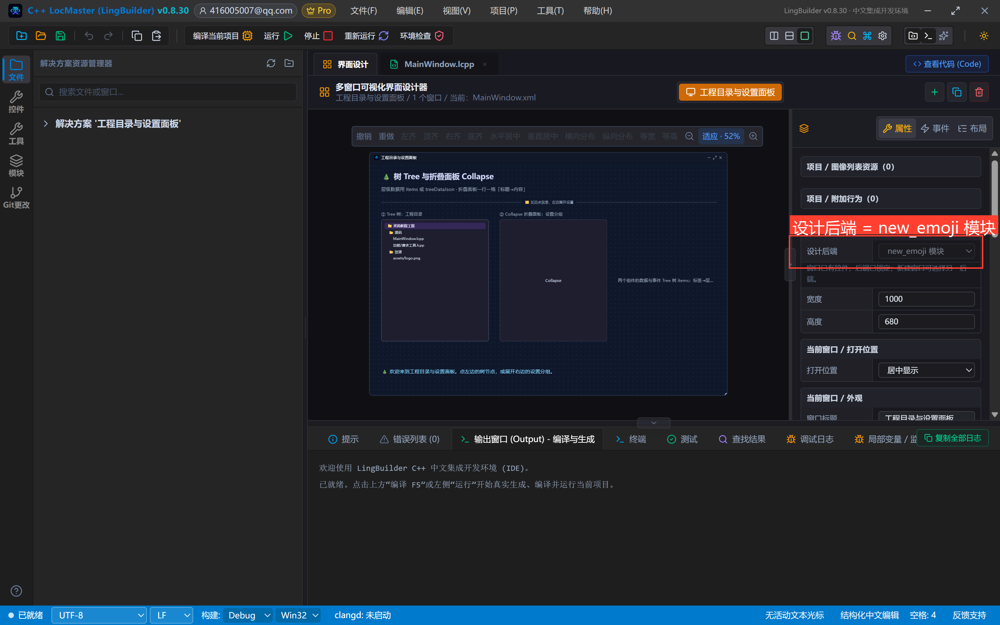

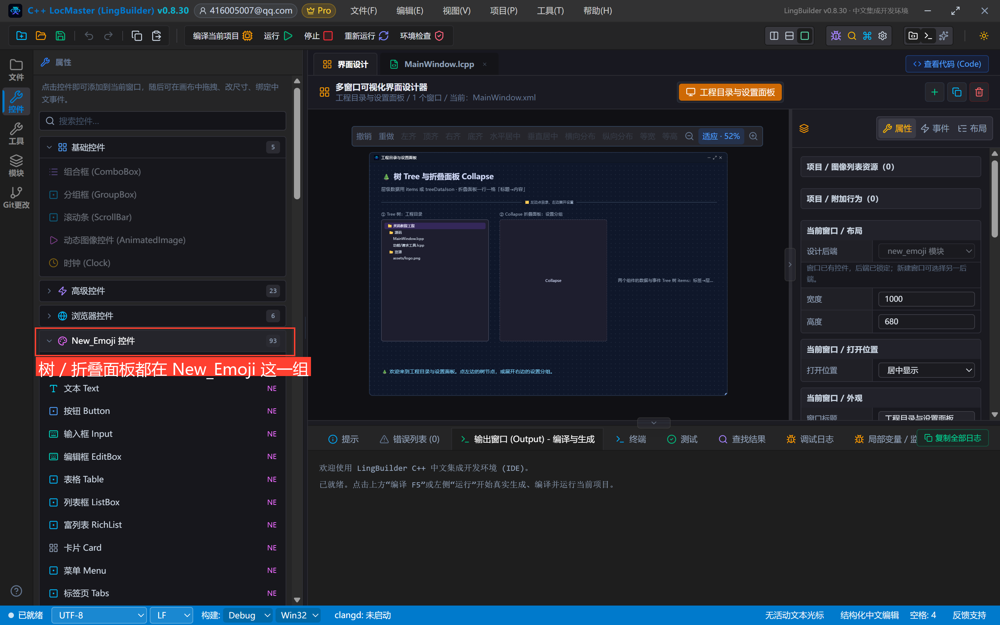

## 3. 设计界面

窗口 1000×680，左边一棵树、右边一组折叠面板、最右一张速查卡。

| 控件 | 名称 | 左距 | 顶距 | 宽度 | 高度 | 关键属性 |
| --- | --- | --- | --- | --- | --- | --- |
| 文本 Text | 标题文本 | 32 | 20 | 700 | 36 | 🌲 树 Tree 与折叠面板 Collapse，字号 21 粗体 |
| 文本 Text | 副标题文本 | 32 | 62 | 880 | 24 | 字号 13，#94A3B8 |
| 分割线 Divider | 标题分割线 | 32 | 96 | 936 | 28 | 🗂️ 左边点目录，右边展开设置 |
| 树 Tree | 资源树 | 32 | 158 | 300 | 340 | **items 八个节点；selectedIndex=0** |
| 折叠面板 Collapse | 设置面板 | 362 | 158 | 300 | 340 | **items 四组；accordion=真；activeIndex=0** |
| 文本 Text | 数据与事件说明 | 692 | 158 | 276 | 340 | 速查卡，字号 12，#94A3B8，自动换行 |
| 文本 Text | 状态文本 | 32 | 522 | 936 | 120 | 字号 14，#7DD3FC，自动换行 |

事件绑定：资源树绑 **选择变化** → `_资源树_选择变化`、设置面板绑 **选择变化** → `_设置面板_选择变化`。

摆完的画布：

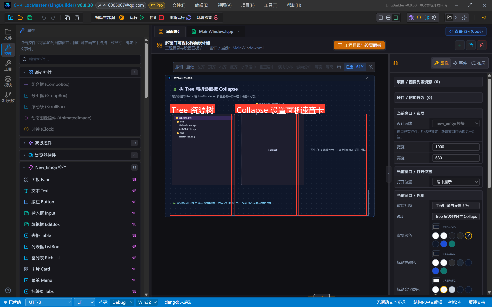

### 3.1 Tree 的两种给数据方式

选中树控件，右侧属性面板的「树节点」可以一行一条直接写，也可以点结构化编辑器画层级。两种方式最终落到模型里是同一套东西：

**方式一：`items` 一行一节点**，字段用制表符分隔，顺序是 `标签 ⇥ 层级 ⇥ 展开 ⇥ 勾选`，层级从 0 开始：

```
📁 灵码教程工程	0	1	0
📂 源码	1	1	0
MainWindow.lcpp	2	0	0
功能/请求工具.lcpp	2	0	0
📂 资源	1	1	0
assets/logo.png	2	0	0
📂 文档	1	0	0
README.md	2	0	0
```

注意「📂 文档」那行第 3 个字段是 `0`——它就是运行时**默认收起**的那个节点，本集演示展开它。

**方式二：`treeDataJson`**，写 `children` 嵌套的 JSON 数组：

```json
[{"key":"n0","label":"📁 灵码教程工程","expanded":true,"children":[
  {"key":"n1","label":"📂 源码","expanded":true,"children":[
    {"key":"n2","label":"MainWindow.lcpp","expanded":false},
    {"key":"n3","label":"功能/请求工具.lcpp","expanded":false}]},
  {"key":"n4","label":"📂 资源","expanded":true,"children":[
    {"key":"n5","label":"assets/logo.png","expanded":false}]},
  {"key":"n6","label":"📂 文档","expanded":false,"children":[
    {"key":"n7","label":"README.md","expanded":false}]}]}]
```

> **本集的做法：两份都给，内容保持一致。** IDE 的树形编辑器保存时会**同时**写入 `items` 和 `treeDataJson`（前者给运行时的扁平协议，后者给需要 `key` 的展开/勾选状态），本集模型照此填写。手工搭模型时如果只改其中一份，很容易出现「画布上对、运行窗口不对」，改完务必按 F5 到运行窗口确认。

### 3.2 Collapse 的 items 是「标题⇥内容」

```
🎨 界面	深色主题、字号、圆角都在这组里调。
🧩 模块	勾选要随项目启用的模块，含第三方 .lbmod。
🛠 构建	编译器、架构（Win32 / x64）与输出目录。
📦 发布	安装包、图标与版本号，一键导出 NSIS。
```

一行一组，制表符前是标题、后面是内容。`accordion=真` 打开手风琴；`activeIndex=0` 表示默认展开第一组。

## 4. 写代码

```lcpp
类 MainWindow
    事件 _MainWindow_创建完毕()
        控件_设置文本(状态文本, "🌲 欢迎来到工程目录与设置面板。点左边的树节点，或展开右边的设置分组。")
        调试输出("工程目录与设置面板已创建完毕")
    结束

    事件 _资源树_选择变化()
        控件_设置文本(状态文本, "🌲 选中了第 " + 到文本(控件_取选择项(资源树) + 1) + " 个节点——树只报索引，节点文字要自己按索引去模型里对。")
    结束

    事件 _设置面板_选择变化()
        控件_设置文本(状态文本, "⚙️ 折叠面板换了展开项——手风琴模式下，同时只有一组是开着的。")
    结束
结束类
```

三个看点：

1. **两个 `选择变化` 处理器都是空参数**。这是 new_emoji 树和折叠面板的契约——事件只说「变了」，不说「变成什么」。想知道选中第几个，就在处理器里调 `控件_取选择项(资源树)`。
2. **索引按扁平顺序数，从 0 开始**。上面八行数据里 `MainWindow.lcpp` 是第 3 个（索引 2），所以点它报「第 3 个节点」。
3. **想按树节点切换右侧内容**，标准做法是：`控件_取选择项` 拿索引 → `如果 (索引 == 0) 控件_设置可见(面板A, 真) ...` 这样分发，而不是去读节点文字。

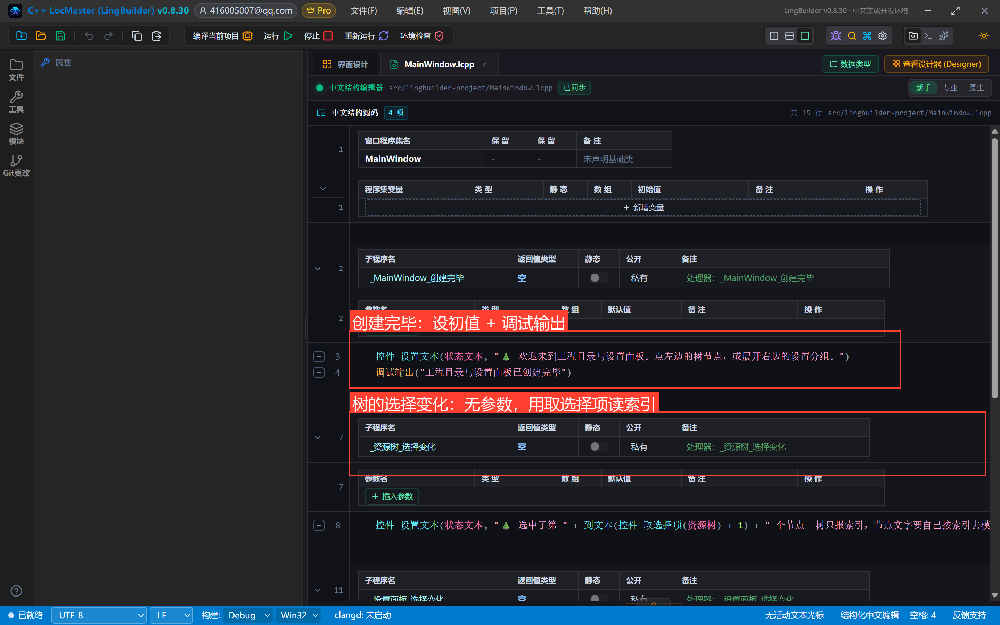

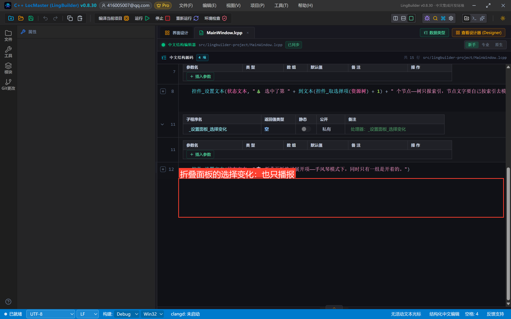

## 5. 编译前先看错误列表

点「编译当前项目」，先看底部错误列表——零报错再继续：

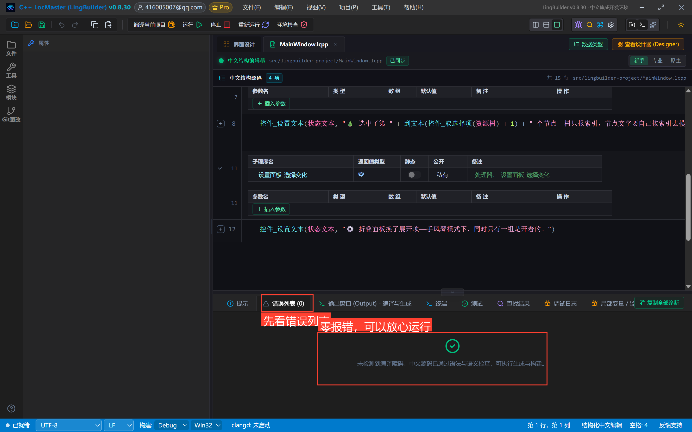

## 6. 运行！点树、展开文件夹、切分组

点「运行」。左边目录树默认展开到第二层，右边「界面」组是开着的：

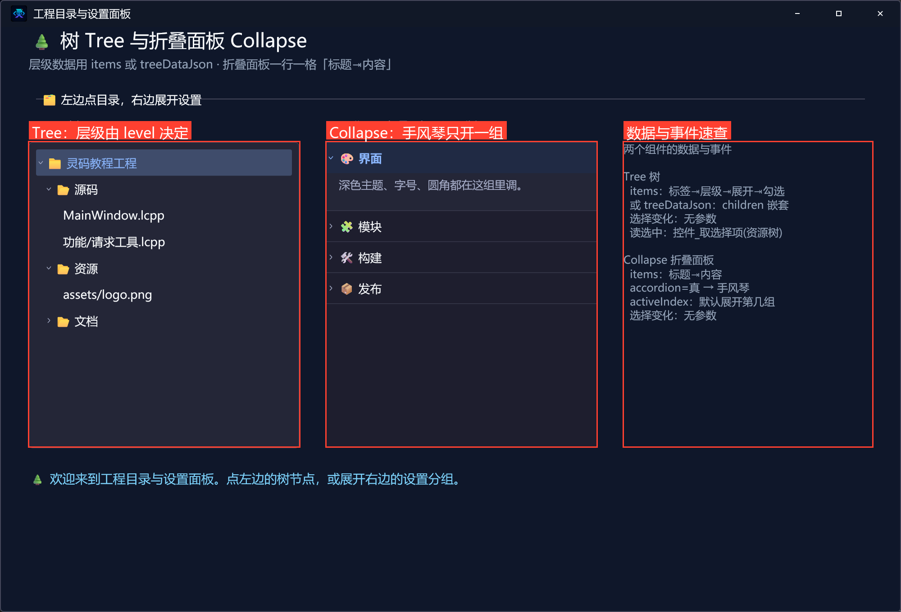

**① 点「MainWindow.lcpp」这个叶子节点**——状态栏报出它是第 3 个节点：

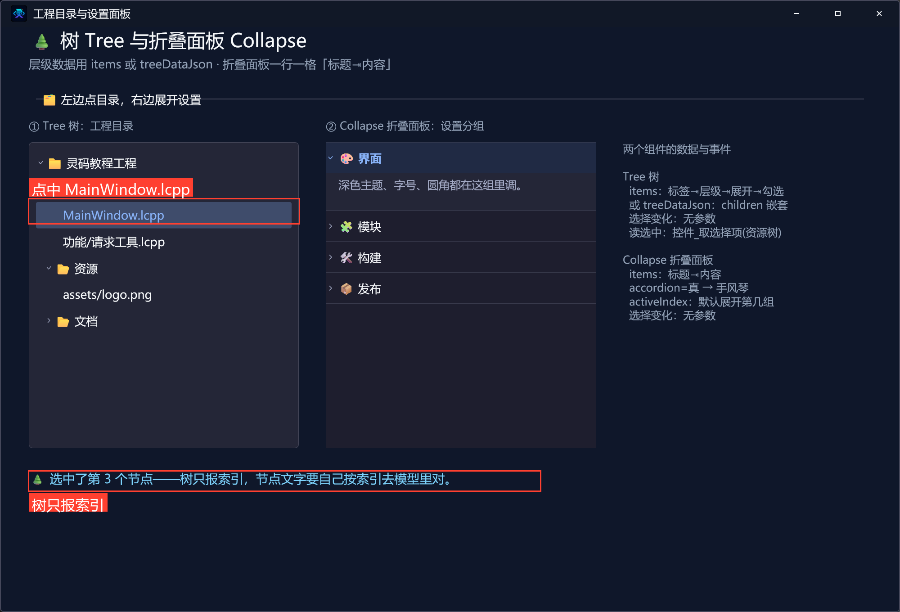

**② 点默认收起的「📂 文档」**——一次点击同时完成「选中」和「展开」，`README.md` 冒了出来，状态栏报第 7 个节点：

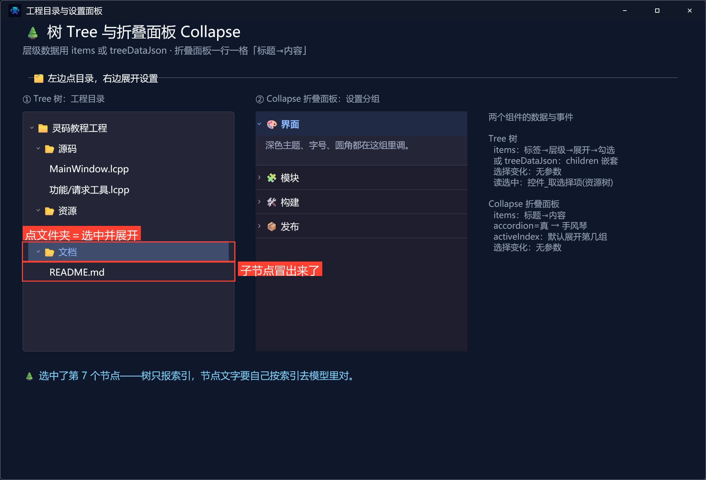

**③ 点折叠面板的「🛠 构建」标题**——构建组展开，同时「🎨 界面」组自动收起，这就是 `accordion=真` 的手风琴行为：

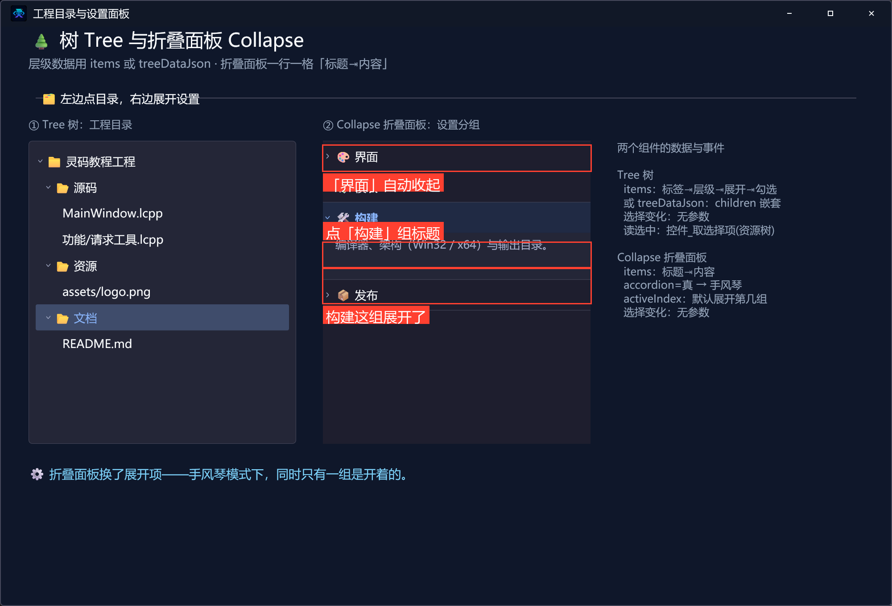

## 7. 导出源码包

命令面板执行「项目：一键导出 LCPP 源码包」即可。

## 本集源码包

- 网页版：[14-工程目录与设置面板.lcpppkg](https://lingbuilder.com/demos)（示例源码区可下载）

## 下一集预告

统计与进度六件套：Statistic 统计数值 / Trend 趋势 / KpiCard 卡片 / Progress 进度条 / RingProgress 环形进度 / BulletProgress 子弹图——仪表盘页面的地基。
