# NE 合集 16 · 图表（一）：折线图与柱状图

> 《LingBuilder new_emoji 合集》第 16 集。图表拆两集讲，本集是 **LineChart 折线图**（看趋势）和 **BarChart 柱状图**（看对比）。这两个组件的入门门槛不在好不好看，而在**数据怎么喂**和**能不能运行期改**——答案会让你意外。全程约 35 分钟。
>
> 前置要求：完成[第 01 集](/guide/tutorials/new-emoji-01)；建议先看[第 15 集](/guide/tutorials/new-emoji-15)（统计与进度），本集延续「展示件」这条线。本集源码包见文末。

## 这一集你将学会

- **LineChart**：`points` 一行一个数据点（标签 + 制表符 + 数值），`showArea` 面积填充、`showTooltip` 悬停提示、`showAxis` 坐标轴、`chartStyle` 样式
- **BarChart**：`bars` 同样一行一条，`orientation` 控制水平/垂直，`showValues` 显示数值
- 一个必须知道的引擎行为：**垂直柱状图的数值只在鼠标悬停到某根柱子时才显示那一根**，水平方向才每根都显示
- 图表**只有鼠标和焦点事件**：`鼠标按下` 给你的是像素坐标，不是「第几个点/第几根柱子」

先看一眼本集成品——折线图与柱状图把数据画出来：

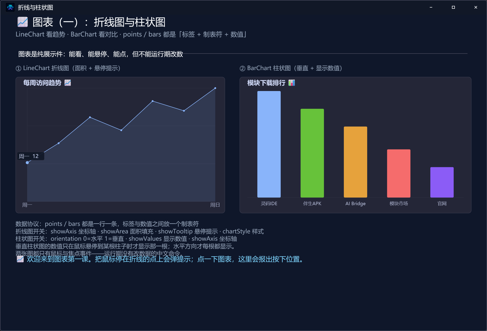

## 1. 命令与事件预告

| 命令 / 事件 | 作用 |
| --- | --- |
| `鼠标按下` 事件 | 参数 `整数型 横坐标, 整数型 纵坐标, 整数型 鼠标按钮`，坐标相对控件内容区 |
| （无数据事件） | 折线图/柱状图都没有「选中某点」事件，靠 `鼠标移动` 自己算 |
| （无改数命令） | 两个图都没有运行期改数据的中文命令，数据只能在设计器里给 |

> 本集只需要 new_emoji 模块。

## 2. 新建项目 + 启用模块 + 切后端

流程和第 1 集一样，项目名称填 **折线与柱状图**：

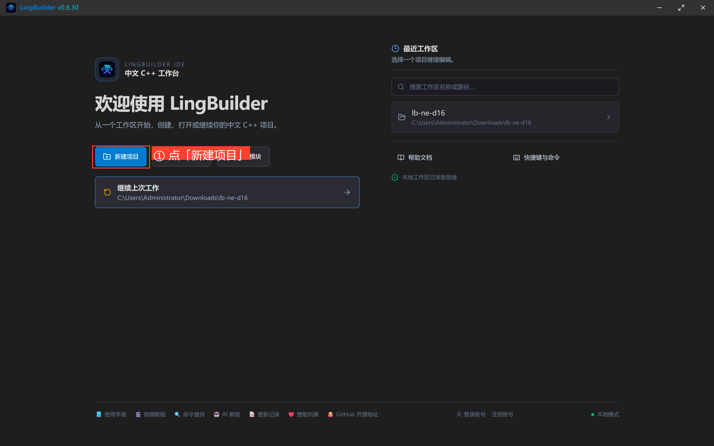

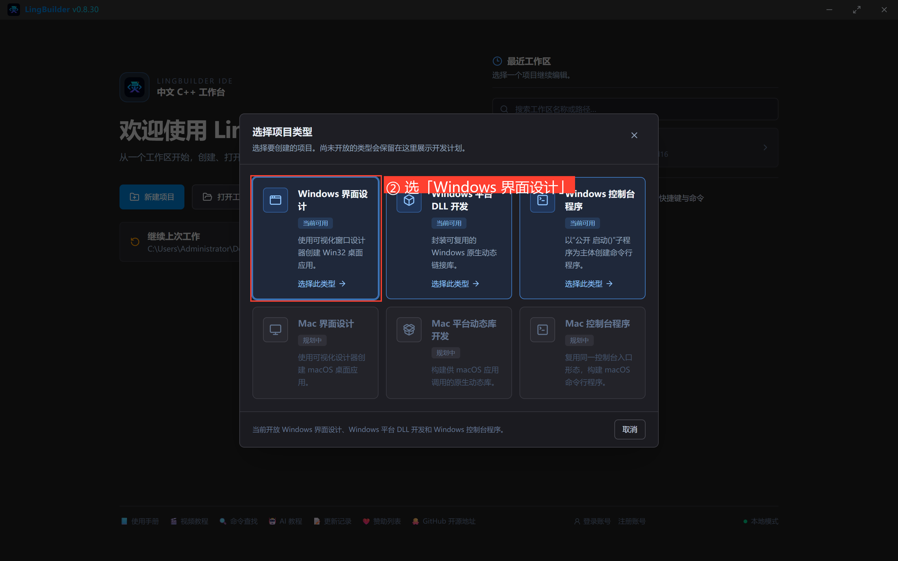

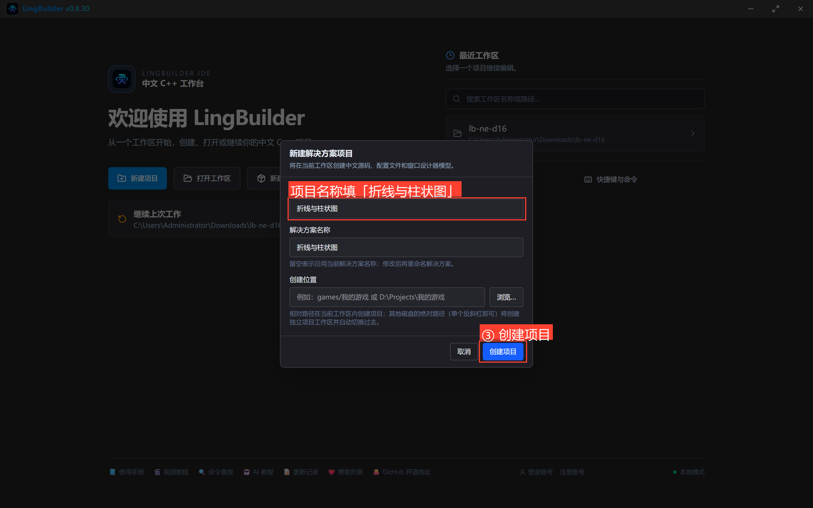

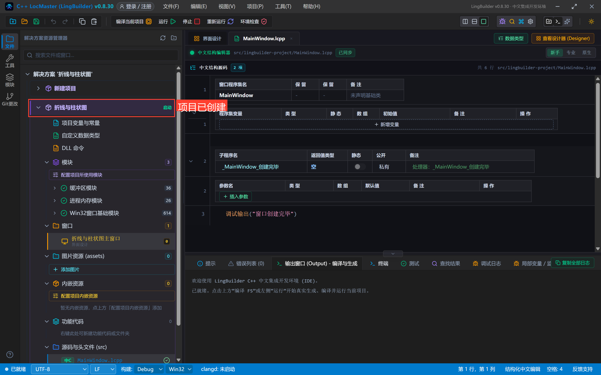

模块面板搜「原生界面」→ 启用「new_emoji 原生界面库」（首次弹登录框，登录一次即可）：

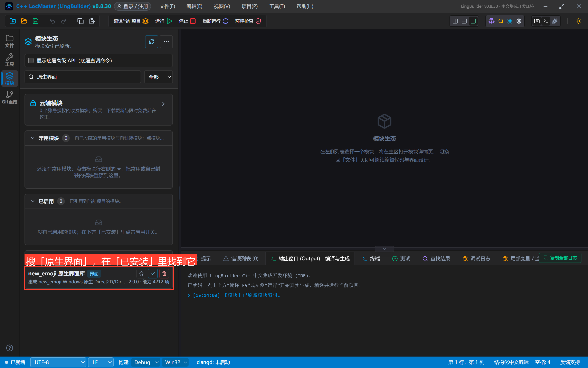

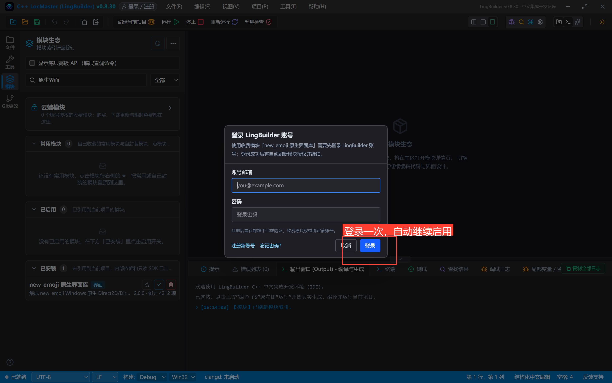

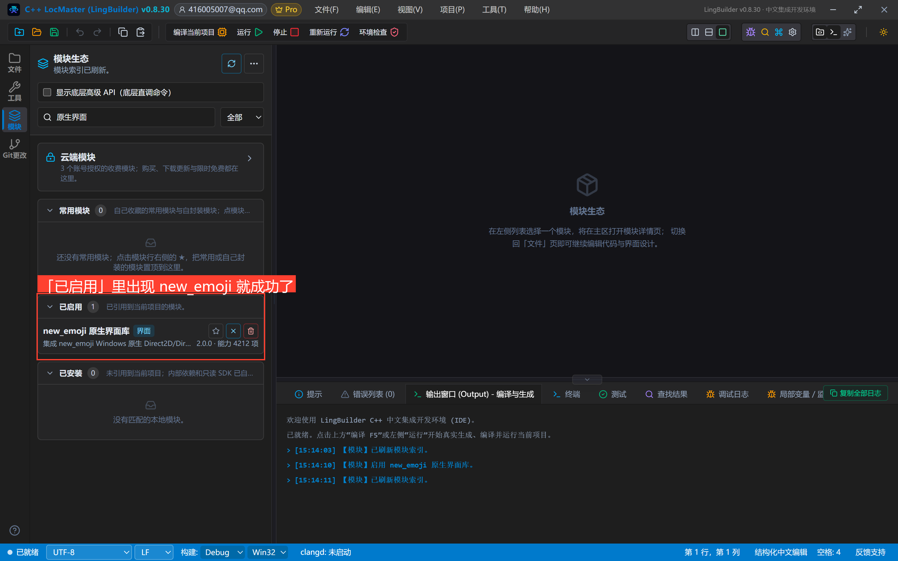

界面设计 → 选中窗口 → 确认「设计后端」是 **new_emoji 模块**：

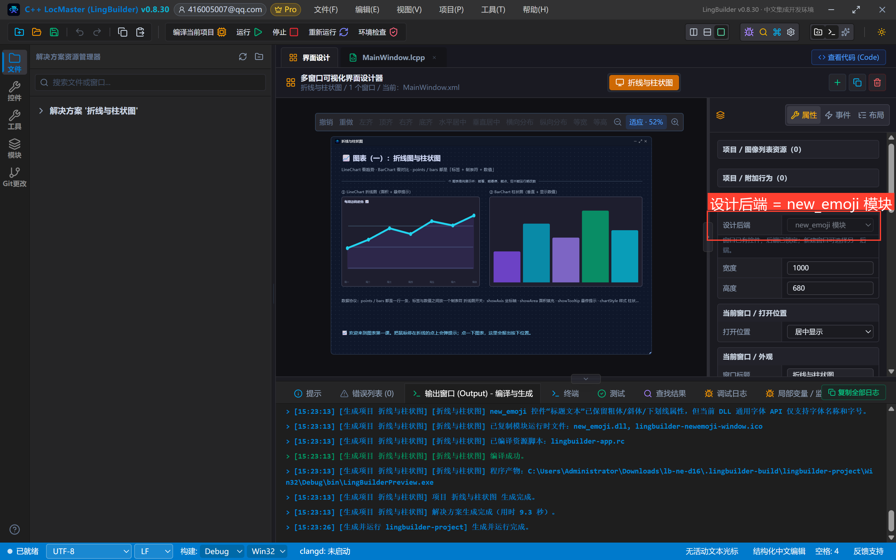

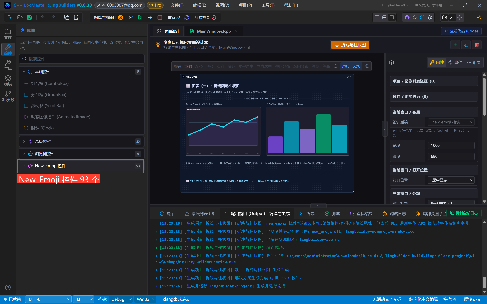

## 3. 设计界面

窗口 1000×680，两张图左右并排，下面一张协议速查条。

| 控件 | 名称 | 左距 | 顶距 | 宽度 | 高度 | 关键属性 |
| --- | --- | --- | --- | --- | --- | --- |
| 文本 Text | 标题文本 | 32 | 20 | 700 | 36 | 📈 图表（一）：折线图与柱状图，字号 21 粗体 |
| 文本 Text | 副标题文本 | 32 | 62 | 880 | 24 | 字号 13，#94A3B8 |
| 分割线 Divider | 标题分割线 | 32 | 96 | 936 | 28 | 🖱 图表是纯展示件：能看、能悬停、能点，但不能运行期改数 |
| 文本 Text | 折线标签 | 32 | 132 | 430 | 22 | ① LineChart 折线图（面积 + 悬停提示） |
| 折线图 LineChart | 访问趋势 | 32 | 158 | 430 | 280 | **points 七条；showArea=真；showTooltip=真；showAxis=真** |
| 文本 Text | 柱状标签 | 492 | 132 | 476 | 22 | ② BarChart 柱状图（垂直 + 显示数值） |
| 柱状图 BarChart | 销售排行 | 492 | 158 | 476 | 280 | **bars 五条；orientation=1（垂直）；showValues=真；showAxis=真** |
| 文本 Text | 数据协议说明 | 32 | 452 | 936 | 60 | 字号 12，#94A3B8，自动换行 |
| 文本 Text | 状态文本 | 32 | 522 | 936 | 120 | 字号 14，#7DD3FC，自动换行 |

### 3.1 数据格式：一行一条，标签和数值之间放一个制表符

折线图的 `points`（七个点）：

```
周一	12
周二	18
周三	26
周四	22
周五	31
周六	28
周日	35
```

柱状图的 `bars`（五根柱子）：

```
灵码IDE	42
伴生APK	35
AI Bridge	28
模块市场	19
官网	12
```

在属性面板里，这两项都是「字符串列表」：**一行填一条**，标签敲完按一次 Tab 再敲数值。生成器会把它们拼成 new_emoji 的行协议下发给 `EU_CreateLineChart` / `EU_CreateBarChart`。

> **红线：别用空格代替制表符。** 分隔符只认制表符，写成空格会被当成「标签里带了一串空格、数值为空」，图就画成贴底的一条线。

### 3.2 样式开关

| 属性 | 属于 | 作用 |
| --- | --- | --- |
| `showAxis` | 两者 | 画不画坐标轴与首末标签 |
| `showArea` | 折线 | 折线下方填色块 |
| `showTooltip` | 折线 | 鼠标停在点上时弹「标签 数值」 |
| `chartStyle` | 折线 | 线条样式编号，0 是默认 |
| `orientation` | 柱状 | `0=水平`、`1=垂直` |
| `showValues` | 柱状 | 显示数值（**垂直时只显悬停那根**） |
| `selectedIndex` | 两者 | 设计期预选中第几项 |

摆完的画布：

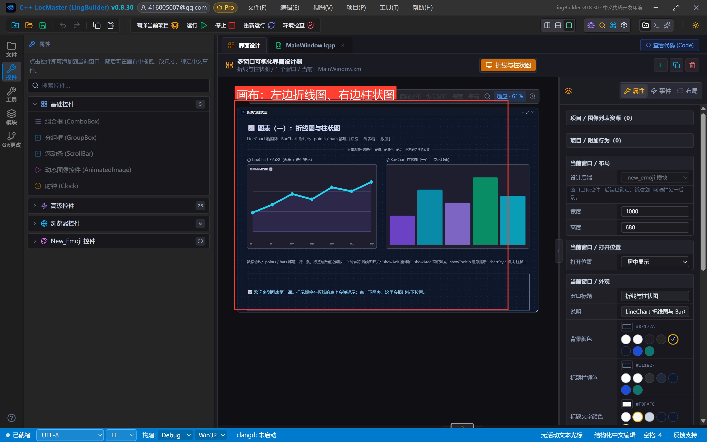

## 4. 写代码

```lcpp
类 MainWindow
    事件 _MainWindow_创建完毕()
        控件_设置文本(状态文本, "📈 欢迎来到图表第一课。把鼠标停在折线的点上会弹提示；点一下图表，这里会报出按下位置。")
        调试输出("折线与柱状图演示已创建完毕")
    结束

    事件 _访问趋势_鼠标按下(整数型 横坐标, 整数型 纵坐标, 整数型 鼠标按钮)
        控件_设置文本(状态文本, "📈 折线图：按下位置 x=" + 到文本(横坐标) + " y=" + 到文本(纵坐标) + "，按钮 " + 到文本(鼠标按钮) + "。图表只报坐标，不报第几个点。")
    结束

    事件 _销售排行_鼠标按下(整数型 横坐标, 整数型 纵坐标, 整数型 鼠标按钮)
        控件_设置文本(状态文本, "📊 柱状图：按下位置 x=" + 到文本(横坐标) + " y=" + 到文本(纵坐标) + "。想按柱子取值，只能回设计器对着 bars 列表看。")
    结束
结束类
```

两个看点：

1. **处理器参数必须带类型**（`整数型 横坐标` 等），这是 new_emoji 所有控件的统一要求，不带类型会被「事件契约不匹配」阻断构建。
2. **`鼠标按下` 的坐标是相对控件内容区的**，不是窗口坐标。想换算成「第几根柱子」得自己按柱子数均分宽度——本集不推荐这么做，因为**柱状图内部还有左右内边距和标签列**，均分算出来的索引会偏。要精确取某根柱子的值，请回设计器看数据，或改用表格组件承载同一份数据。

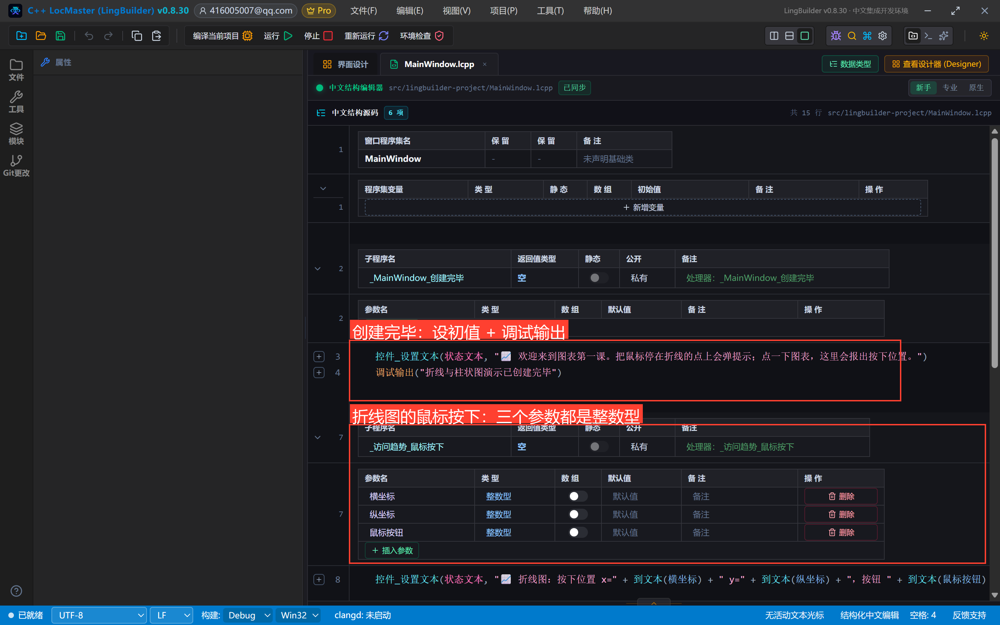

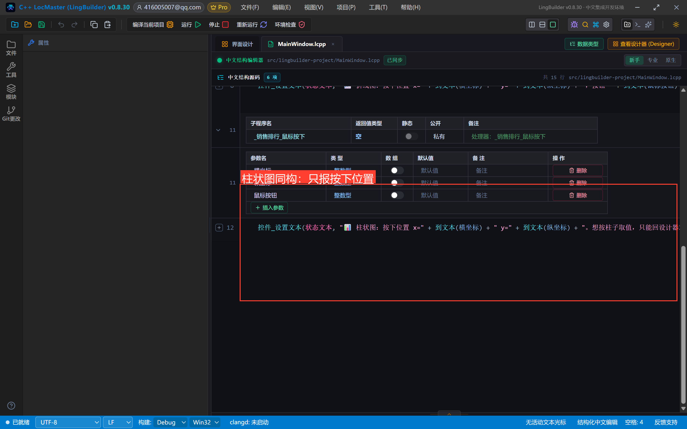

## 5. 编译前先看错误列表

点「编译当前项目」，先看底部错误列表——零报错再继续：

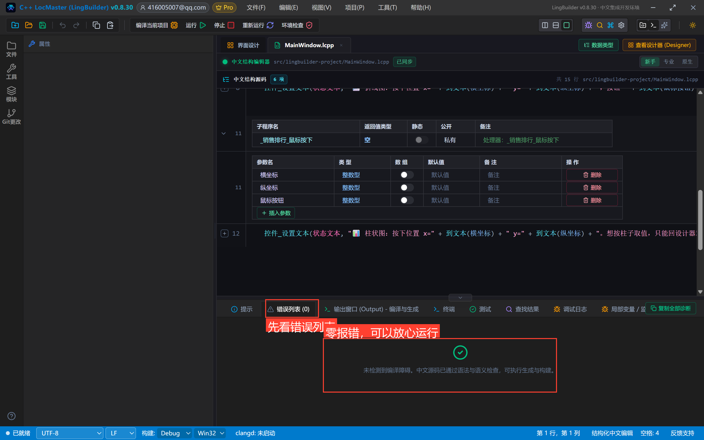

## 6. 运行！悬停、点击各试一次

点「运行」。左边折线带面积填充、第一个点上还挂着提示气泡；右边五根彩色柱子：

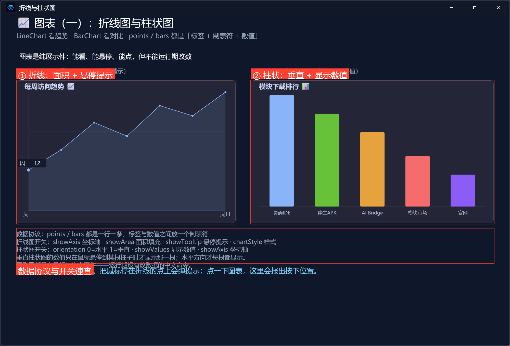

**① 把鼠标停在第二根柱子上**——只有被悬停的那根在顶部显示数值「35」，其余四根不显示。这就是 `orientation=1`（垂直）时 `showValues` 的真实行为：

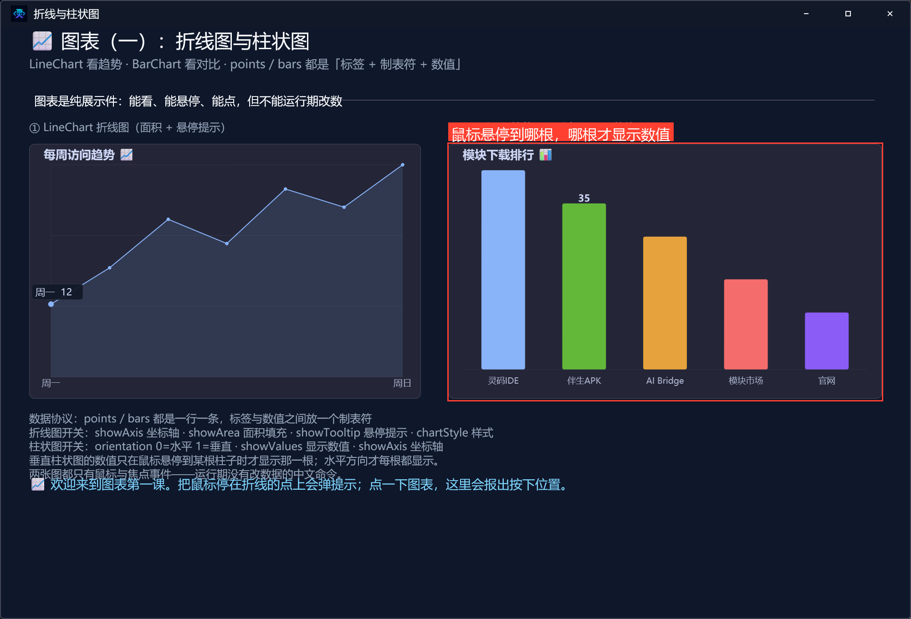

**② 点一下折线图的第三个点**——提示气泡停在「周三 26」，状态栏报出按下坐标，但**不会**告诉你点的是第几个点：

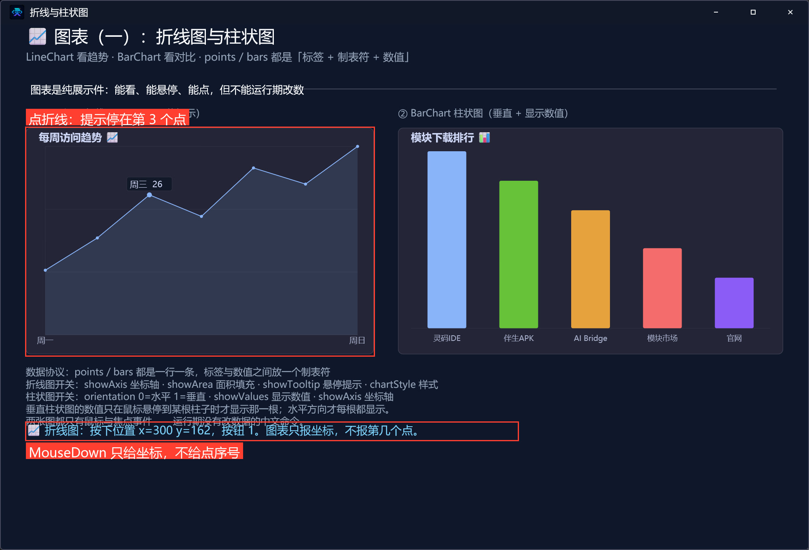

**③ 点一下柱状图**——同样只报坐标。想按柱子取数，只能回设计器对着 `bars` 列表看：

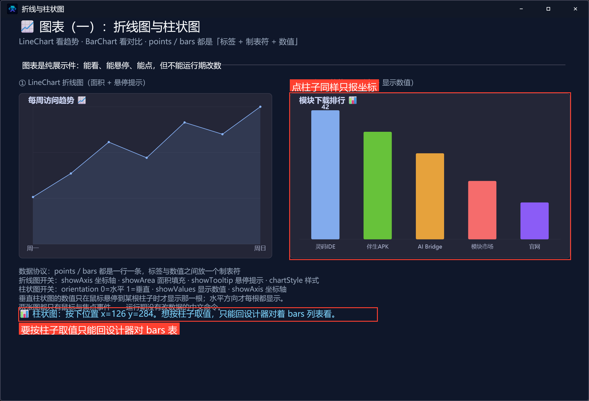

## 7. 导出源码包

命令面板执行「项目：一键导出 LCPP 源码包」即可。

## 本集源码包

- 网页版：[16-折线与柱状图.lcpppkg](https://lingbuilder.com/demos)（示例源码区可下载）

## 下一集预告

图表（二）：DonutChart 环形图与 Gauge 仪表盘——占比读数与「带刻度的表盘」怎么配。
