# NE 合集 18 · 消息与通知：程序怎么开口说话

> 《LingBuilder new_emoji 合集》第 18 集。前 17 集的界面都是「安静的」，这一集让程序开口：**Alert 页内警告条**（常驻在页面里）、**消息框 / 确认框 / 提问框**（挡住操作的对话框）、**NE_显示通知**（右上角滑出的轻反馈）和**加载遮罩**（干活时锁住整个窗口）。这一集还有一个隐藏主角——`延迟调用`：弹出的遮罩 3 秒后自动消失，靠的就是它。全程约 40 分钟。
>
> 前置要求：完成[第 01 集](/guide/tutorials/new-emoji-01)。本集源码包见文末。

## 这一集你将学会

- **Alert**：`alertType` 四种类型（信息/成功/警告/错误）、`closable` 关闭按钮，右上 × 会触发专属的「关闭」事件
- **消息框 / 确认框 / 提问框**：`&处理器` 回调怎么写、结果值怎么读、提问框怎么拿回用户敲的文本
- **NE_显示通知**：摆放（0 右下、1 右上、2 左下、3 左上）、自动收起时长
- **NE_显示加载遮罩 + NE_关闭加载遮罩**：全屏锁输入；返回的「加载编号」是关闭的凭证
- **延迟调用**：一次性定时器，等待期间界面不冻结，到期在界面线程触发 `&处理器`

先看一眼本集成品——消息条、通知、弹窗，程序开口说话的三种方式：

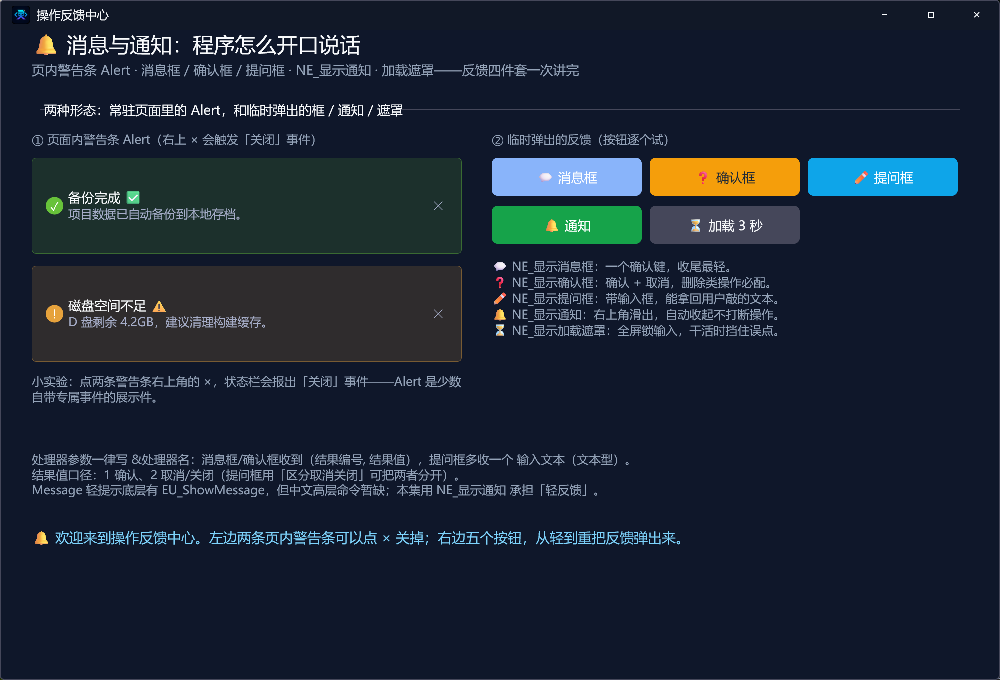

## 1. 命令与事件预告

| 命令 / 事件 | 作用 |
| --- | --- |
| `NE_显示消息框(当前窗口, 标题, 文本, 确认文本, &处理器)` | 单确认键对话框 |
| `NE_显示确认框(当前窗口, 标题, 文本, 确认文本, 取消文本, &处理器)` | 确认 + 取消 |
| `NE_显示提问框(当前窗口, 标题, 文本, 占位文本, 初始值, 校验模式, 错误提示, 确认文本, 取消文本, 框类型, 居中, 富文本, 区分取消关闭, &处理器)` | 带输入框 |
| `NE_显示通知(当前窗口, 标题, 正文, 通知类型, 可关闭, 时长毫秒, 摆放, 偏移, 富文本, 宽, 高)` | 滑出式通知，时长 0 = 不自动关 |
| `NE_显示加载遮罩(当前窗口, 0, 文本, 全屏, 锁输入, 背景色, 圈颜色, 文本颜色, 样式)` | 返回加载编号 |
| `NE_关闭加载遮罩(当前窗口, 加载编号)` | 按编号关闭遮罩 |
| `延迟调用(等待毫秒, &处理器)` | 一次性延迟调用（new_emoji 后端同样可用） |
| Alert `关闭` 事件 | 无参数处理器，点 × 触发 |

> 本集只需要 new_emoji 模块。

## 2. 新建项目 + 启用模块 + 切后端

流程和第 1 集一样，项目名称填 **操作反馈中心**：

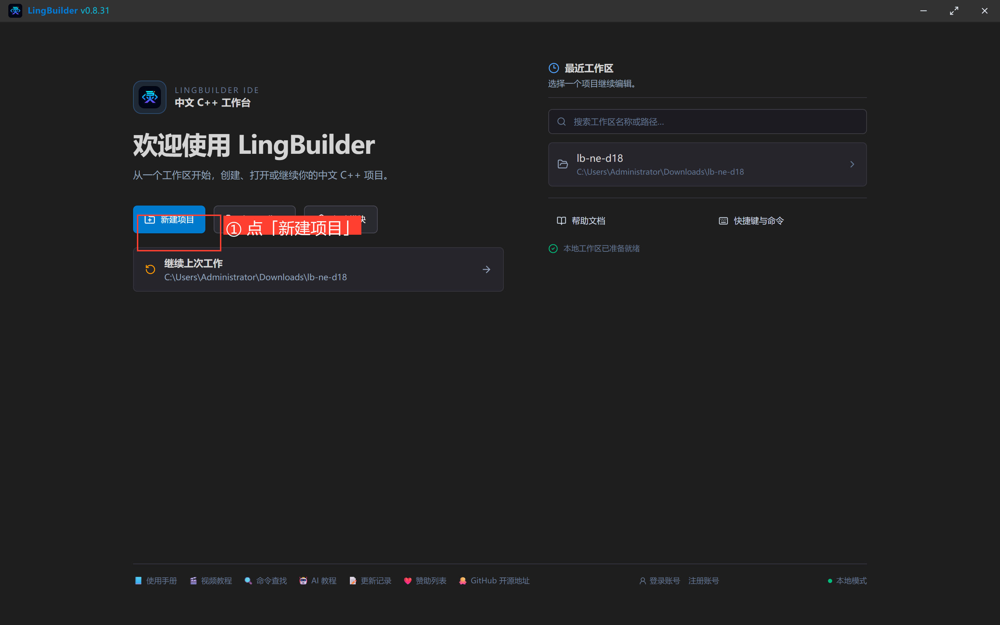

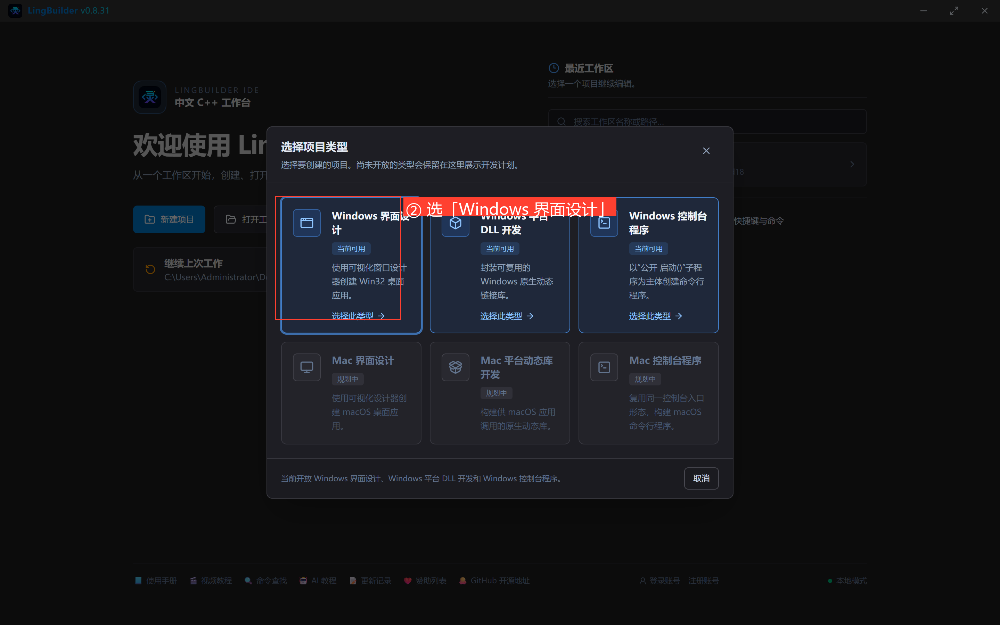

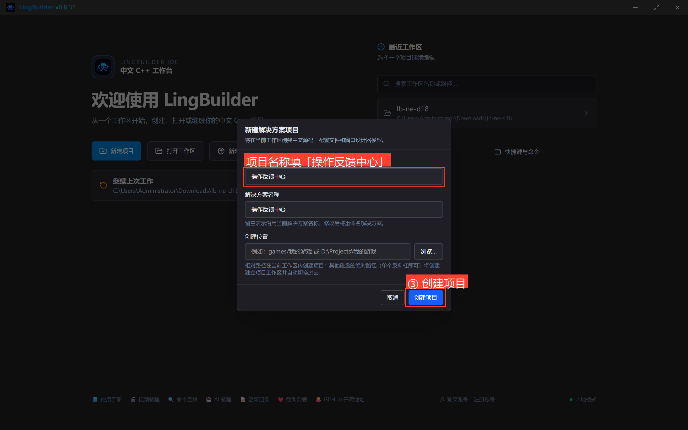

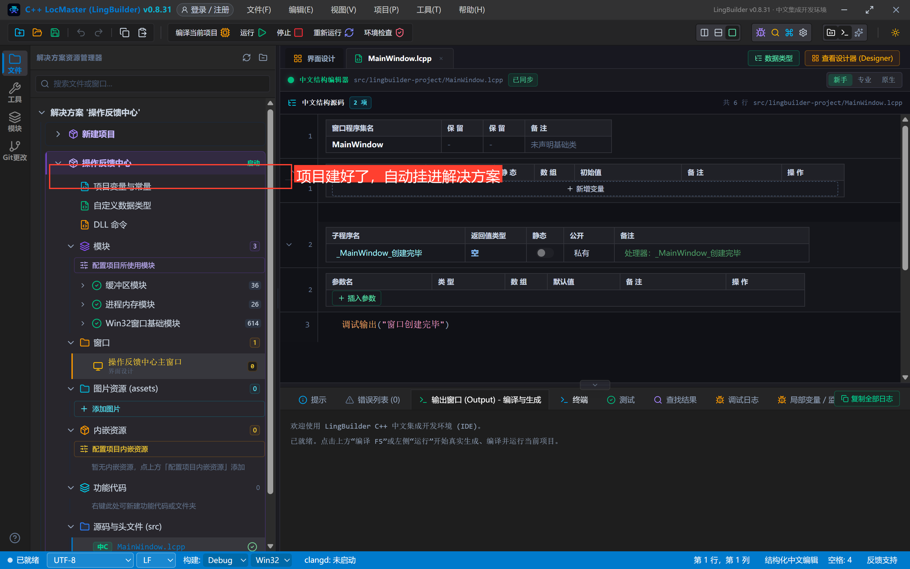

模块面板搜「原生界面」→ 启用「new_emoji 原生界面库」（首次弹登录框，登录一次即可）：

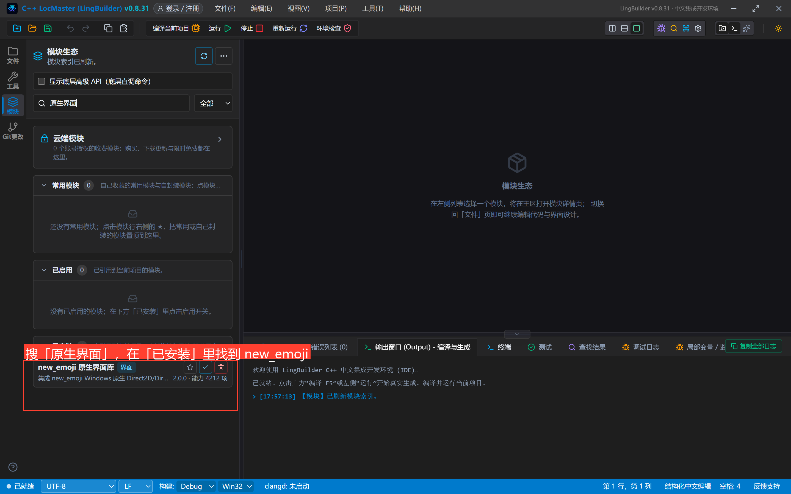

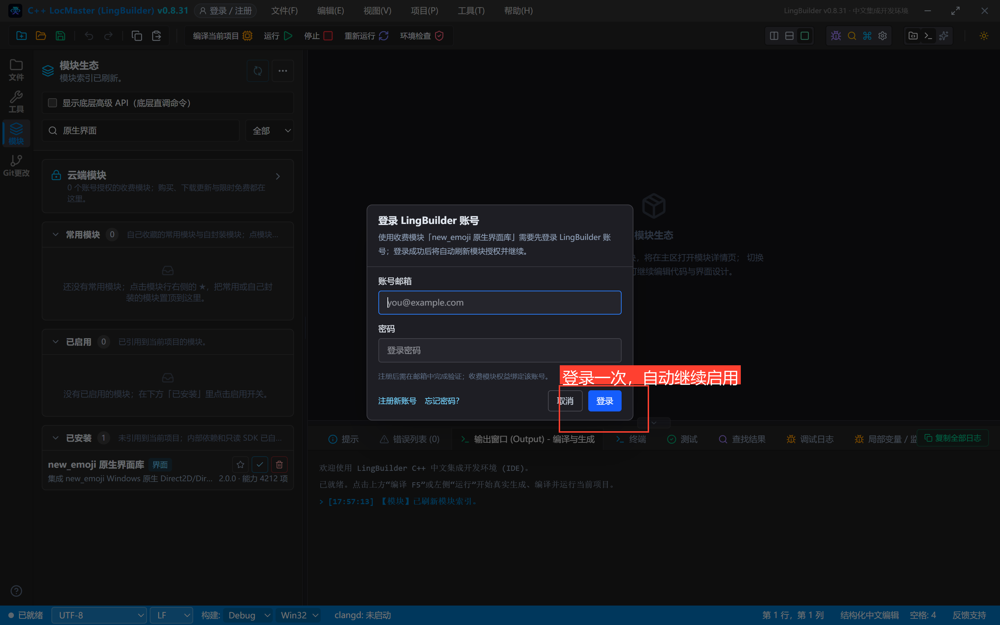

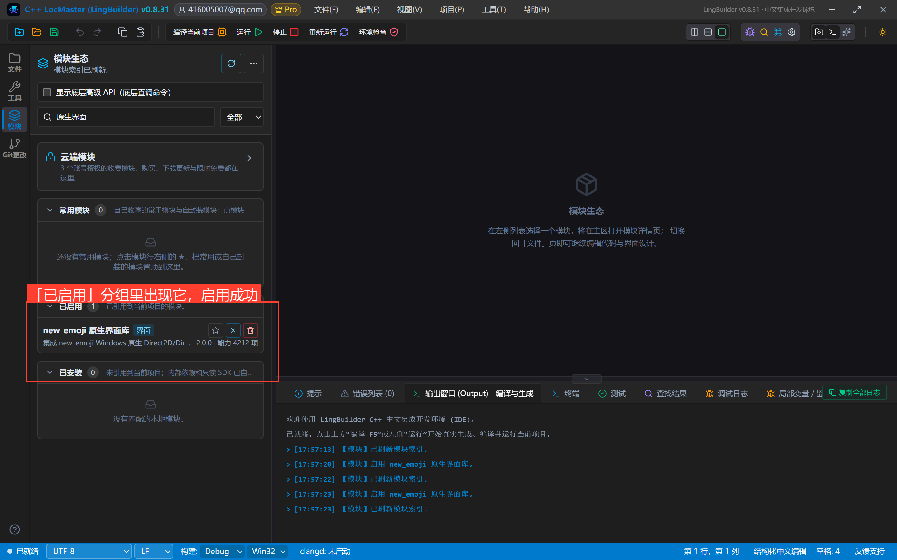

界面设计 → 选中窗口 → 确认「设计后端」是 **new_emoji 模块**：

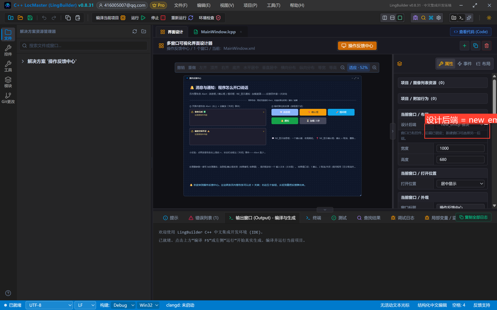

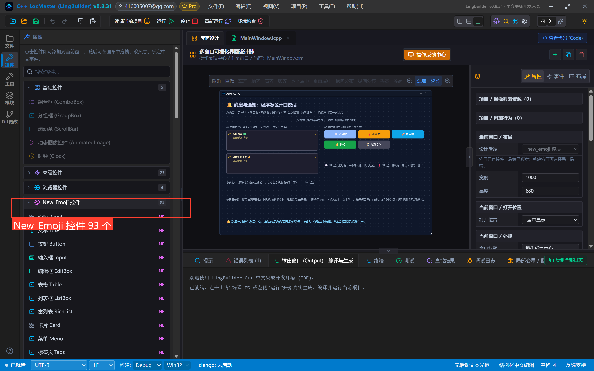

## 3. 设计界面

窗口 1000×680，左边两条页内警告条，右边五个触发按钮。

| 控件 | 名称 | 左距 | 顶距 | 宽度 | 高度 | 关键属性 |
| --- | --- | --- | --- | --- | --- | --- |
| 文本 Text | 标题文本 | 32 | 20 | 700 | 36 | 🔔 消息与通知：程序怎么开口说话，字号 21 粗体 |
| 文本 Text | 副标题文本 | 32 | 62 | 900 | 24 | 字号 13，#94A3B8 |
| 分割线 Divider | 标题分割线 | 32 | 96 | 936 | 28 | 两种形态：常驻页面里的 Alert，和临时弹出的框 / 通知 / 遮罩 |
| 文本 Text | 警告条标签 | 32 | 132 | 430 | 22 | ① 页面内警告条 Alert（右上 × 会触发「关闭」事件） |
| 警告提示 Alert | 成功警告 | 32 | 158 | 430 | 96 | **title=备份完成 ✅；desc 一行；alertType=1（成功）；closable=真**，绑定「关闭」事件 |
| 警告提示 Alert | 警告条 | 32 | 266 | 430 | 96 | **title=磁盘空间不足 ⚠️；alertType=2（警告）；closable=真**，绑定「关闭」事件 |
| 文本 Text | 警告条小实验 | 32 | 374 | 430 | 60 | 字号 12，#94A3B8，自动换行 |
| 文本 Text | 弹层标签 | 492 | 132 | 476 | 22 | ② 临时弹出的反馈（按钮逐个试） |
| 按钮 Button | 消息框按钮 | 492 | 158 | 150 | 38 | 💬 消息框，样式=主要(1) |
| 按钮 Button | 确认框按钮 | 650 | 158 | 150 | 38 | ❓ 确认框，样式=警告(3) |
| 按钮 Button | 提问框按钮 | 808 | 158 | 150 | 38 | ✏️ 提问框，样式=信息(6) |
| 按钮 Button | 通知按钮 | 492 | 206 | 150 | 38 | 🔔 通知，样式=成功(2) |
| 按钮 Button | 加载按钮 | 650 | 206 | 150 | 38 | ⏳ 加载 3 秒，样式=默认(0) |
| 文本 Text | 按钮速查 | 492 | 258 | 476 | 130 | 五条命令一句话速查，字号 12，自动换行 |
| 文本 Text | 红线速查 | 32 | 452 | 936 | 64 | 字号 12，#94A3B8，自动换行 |
| 文本 Text | 状态文本 | 32 | 528 | 936 | 116 | 字号 14，#7DD3FC，自动换行 |

摆完的画布：

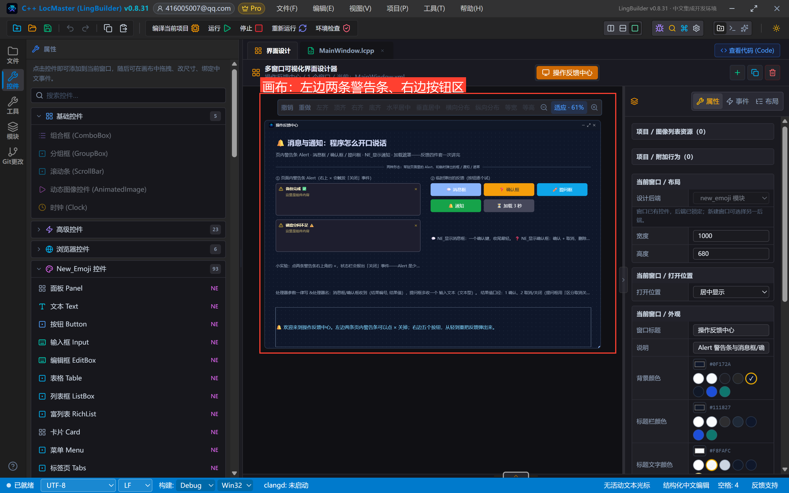

### 3.1 结果值口径（回调怎么读）

弹层关闭时处理器被调用，**结果值的口径要背下来**：

- `NE_显示消息框`：**1** = 点确认键，**2** = 点 × 关闭；
- `NE_显示确认框`：**1** = 确认，**2** = 取消或点 × 关闭；
- `NE_显示提问框`：处理器多收一个 **输入文本（文本型）**；动作 **1** = 确认（创建），**2** = 取消/关闭。传「区分取消关闭=真」时 × 才单独报 3。

> **红线：处理器参数必须写 `&处理器名` 引用**（`&确认框结果`），不能加引号；处理器是普通子程序，参数类型必须带全（`整数型 结果编号` 等），缺类型会被「事件契约不匹配」阻断构建。

### 3.2 加载遮罩的「编号」是关闭凭证

`NE_显示加载遮罩` 返回一个整数编号，`NE_关闭加载遮罩` 必须传**同一个编号**才能关掉它。遮罩弹出期间输入被锁，所以「3 秒后自动关」要靠 `延迟调用` 在界面线程回来执行——这正是第 17 集仪表盘没能做到的「延时动作」在 new_emoji 后端的正解。

## 4. 写代码

```lcpp
类 MainWindow
    事件 _MainWindow_创建完毕()
        控件_设置文本(状态文本, "🔔 欢迎来到操作反馈中心。左边两条页内警告条可以点 × 关掉；右边五个按钮，从轻到重把反馈弹出来。")
        调试输出("操作反馈中心已创建完毕")
    结束

    事件 _成功警告_关闭()
        控件_设置文本(状态文本, "✅ 绿色警告条被关掉了：Alert 的「关闭」事件触发。页内警告条适合常驻提示，重新运行程序即可找回。")
    结束

    事件 _警告条_关闭()
        控件_设置文本(状态文本, "⚠️ 黄色警告条也被关掉了。两条都关掉后页面清爽了——这就是可关闭警告条的日常用法。")
    结束

    事件 _消息框按钮_被单击()
        NE_显示消息框(当前窗口, "备份完成", "项目数据已经写入本地存档，共 3 个文件。", "知道了", &消息框结果)
    结束

    事件 _消息框结果(整数型 结果编号, 整数型 结果值)
        控件_设置文本(状态文本, "💬 消息框关了：结果值 " + 到文本(结果值) + "（1 确认，2 点 × 关闭）。")
    结束

    事件 _确认框按钮_被单击()
        NE_显示确认框(当前窗口, "清空回收站", "确定要永久删除 12 个文件吗？此操作不可撤销。", "全部删除", "先不了", &确认框结果)
    结束

    事件 _确认框结果(整数型 结果编号, 整数型 结果值)
        如果 (结果值 == 1)
            控件_设置文本(状态文本, "🗑️ 你点了「全部删除」：结果值 1。真程序里这里接删除逻辑。")
        否则
            控件_设置文本(状态文本, "🙏 你打消了念头：结果值 " + 到文本(结果值) + "（2 = 取消或点 × 关闭）。")
        如果结束
    结束

    事件 _提问框按钮_被单击()
        NE_显示提问框(当前窗口, "新建分组", "给新分组起个名字：", "例如：工作资料", "未命名分组", "", "", "创建", "取消", 0, 真, 假, 假, &提问框结果)
    结束

    事件 _提问框结果(整数型 结果编号, 整数型 动作, 文本型 输入文本)
        控件_设置文本(状态文本, "✏️ 提问框返回：动作 " + 到文本(动作) + "，输入文本「" + 输入文本 + "」。校验模式传空文本就是不校验。")
    结束

    事件 _通知按钮_被单击()
        NE_显示通知(当前窗口, "构建成功 🎉", "折线与柱状图.exe 已生成，用时 8.2 秒。", 1, 真, 4500, 1, 20, 假, 0, 0)
        控件_设置文本(状态文本, "🔔 右上角弹出一条成功通知：4.5 秒后自动收起，也可以点它的 ×。摆放 1 = 右上。")
    结束

    事件 _加载按钮_被单击()
        加载编号 = NE_显示加载遮罩(当前窗口, 0, "正在导出安装包…", 真, 真, 0, 0, 0, 0)
        控件_设置文本(状态文本, "⏳ 全屏加载遮罩已弹出（编号 " + 到文本(加载编号) + "），输入被锁 3 秒，期间界面点不动。")
        延迟调用(3000, &加载完成)
    结束

    事件 _加载完成()
        NE_关闭加载遮罩(当前窗口, 加载编号)
        控件_设置文本(状态文本, "🔓 3 秒到，遮罩已按编号关闭、输入解锁。显示返回编号，关闭就传同一个编号。")
    结束
结束类
```

三个看点：

1. **弹层命令的第一个参数传 `当前窗口`**——它是 IDE 内置的窗口引用，不需要自己取句柄。
2. **提问框的处理器是三参**（结果编号, 动作, 输入文本），第三参是 `文本型`——引擎会把用户敲的文本转好交给它；「校验模式」传空文本就是不校验，想强制非空再填规则。
3. **`加载编号` 是项目全局变量**（在「项目全局变量」里声明 `全局 整数型 加载编号 = 0`）——弹出时赋值、延迟回调里用它关闭，跨事件传值只能走全局变量。

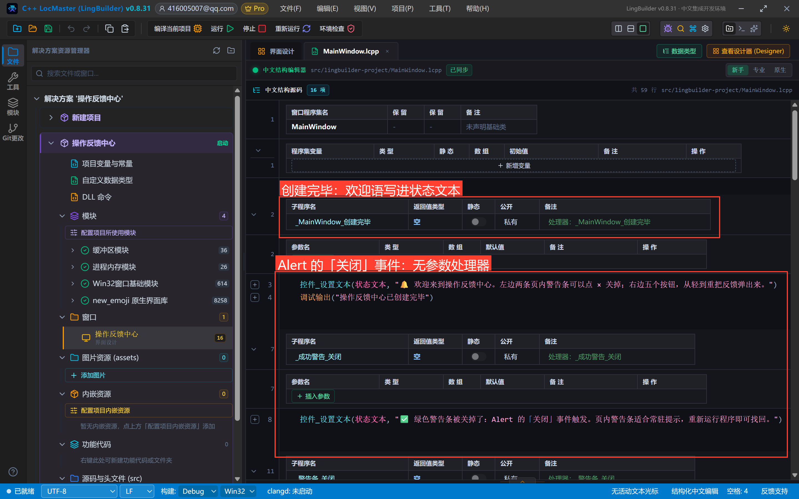

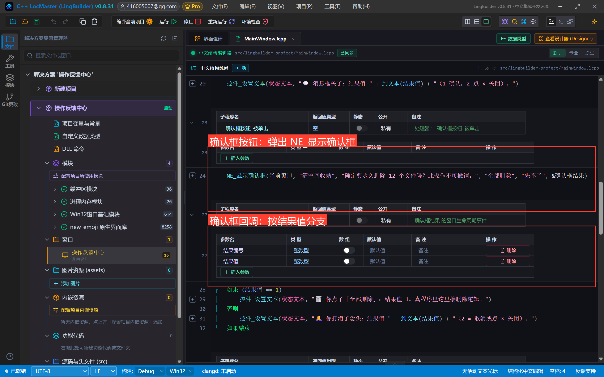

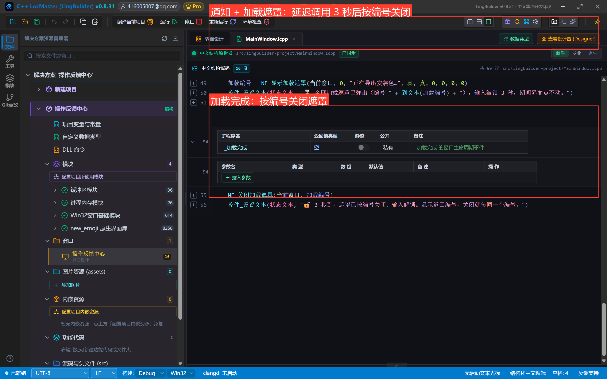

## 5. 编译前先看错误列表

点「编译当前项目」，先看底部错误列表——零报错再继续：

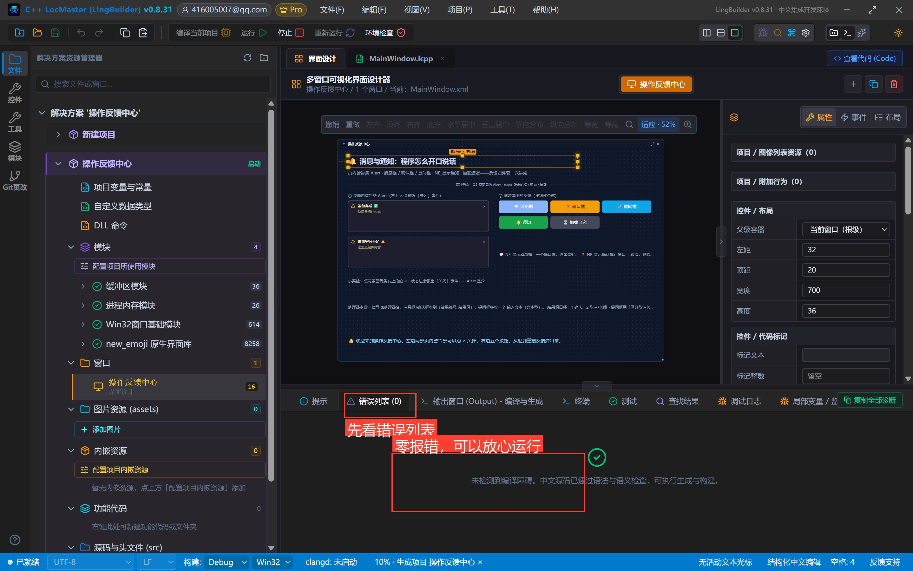

## 6. 运行！七种反馈逐个试

点「运行」。左边两条页内警告条（图标与文字垂直居中），右边五个彩色按钮：

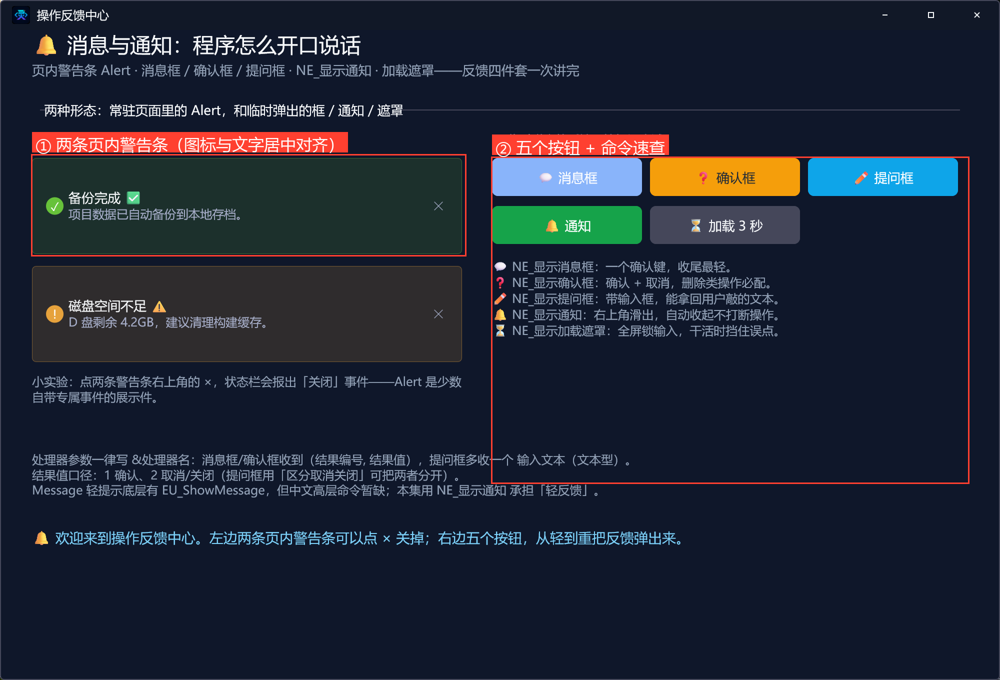

**① 点绿色警告条的 ×**——警告条消失，状态栏报出「关闭」事件。Alert 是少数自带专属事件的展示件：

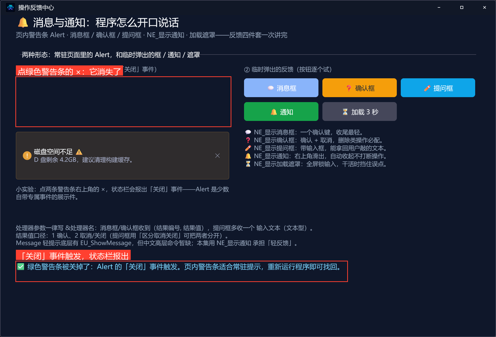

**② 点「💬 消息框」**——弹出「备份完成」对话框，一个「知道了」键，右上 × 也能关：

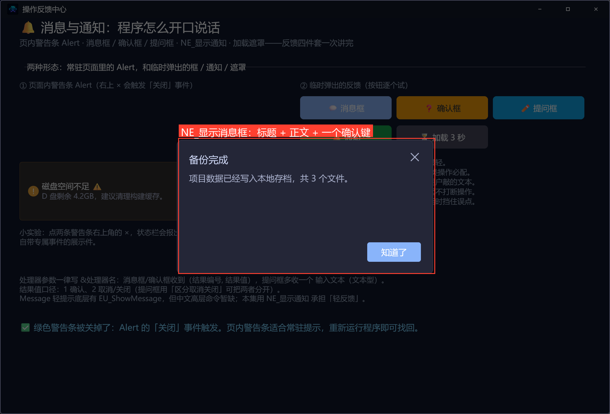

**③ 点「❓ 确认框」**——删除类操作的标准配置：确认 + 取消。点「全部删除」后状态栏报「结果值 1」，真程序里就在这个回调里接删除逻辑：

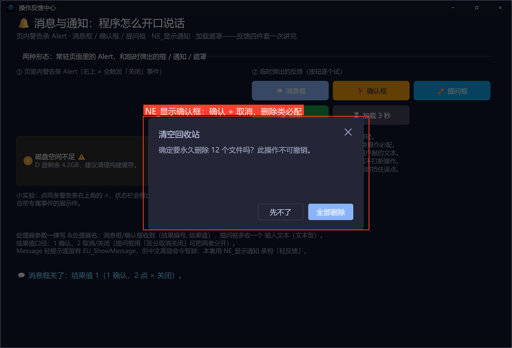

**④ 点「✏️ 提问框」**——带输入框的对话框，初始值「未命名分组」已经填好；点「创建」，回调把**用户敲的文本**原样交回来：

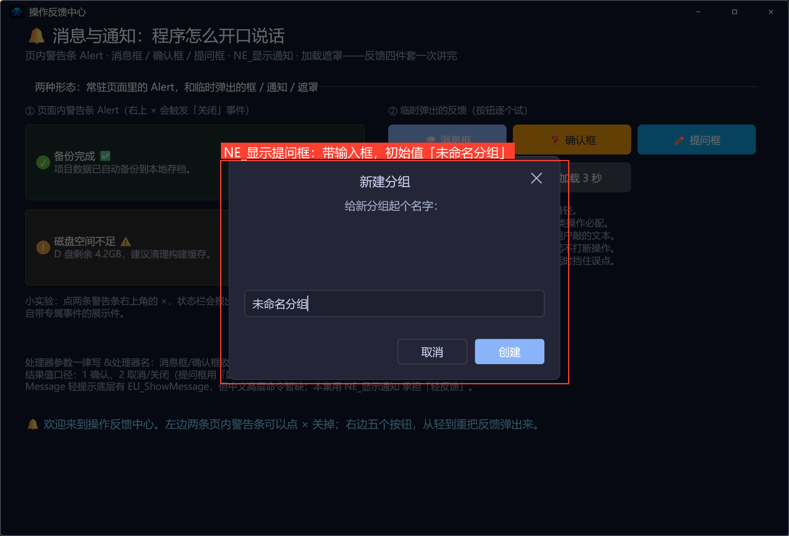

**⑤ 点「🔔 通知」**——右上角滑出一条成功通知，4.5 秒自动收起（时长参数控制），不打断手头操作：

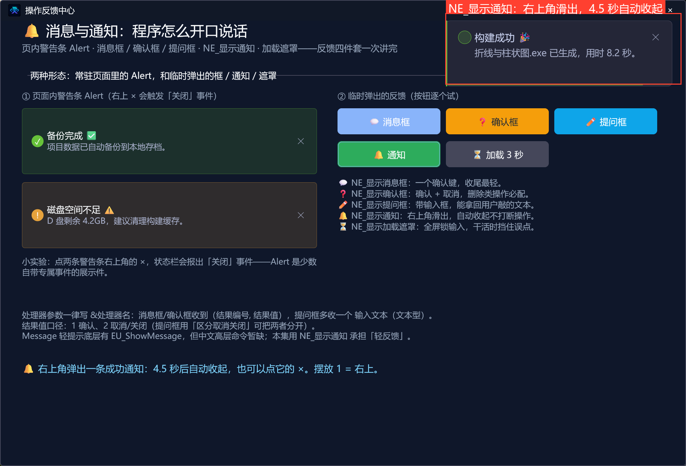

**⑥ 点「⏳ 加载 3 秒」**——全屏遮罩弹出，加载圈 + 提示文本，期间点任何按钮都没反应（输入被锁）：

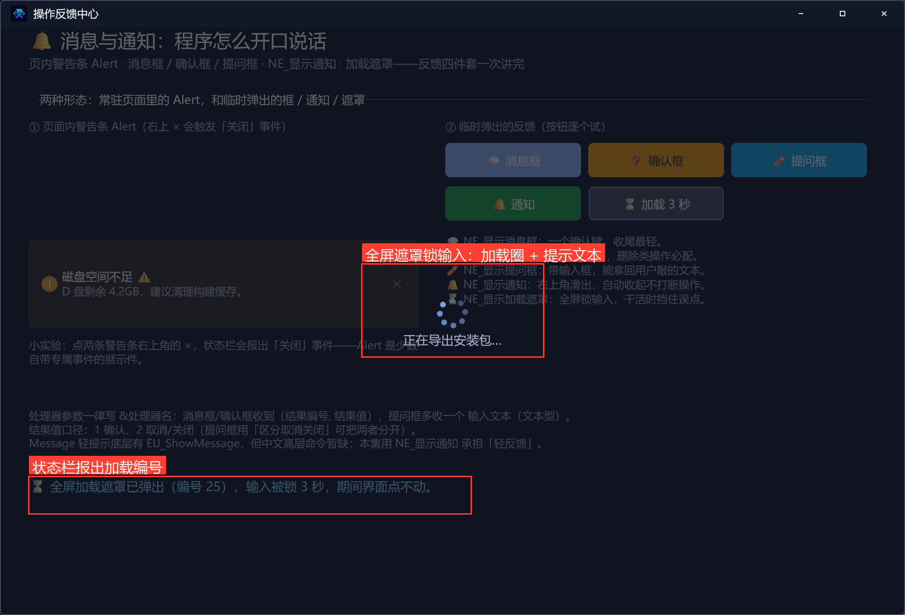

**⑦ 3 秒到**——`延迟调用` 回到界面线程，遮罩按编号关闭、输入解锁。这就是「干活时挡住误点、干完自动放行」的完整闭环：

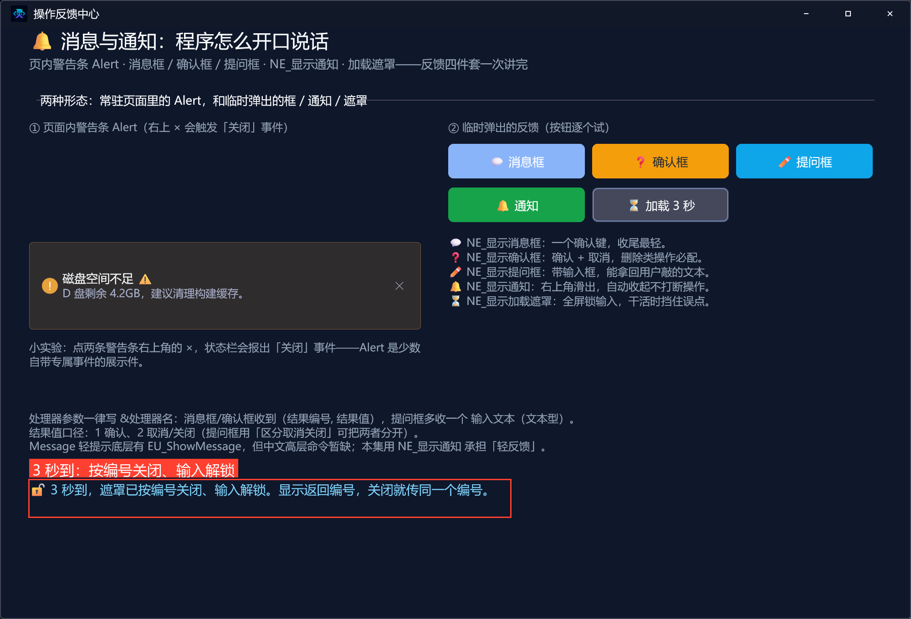

## 7. 导出源码包

命令面板执行「项目：一键导出 LCPP 源码包」即可。

## 本集源码包

- 网页版：[18-操作反馈中心.lcpppkg](https://lingbuilder.com/demos)（示例源码区可下载）

## 下一集预告

弹层家族：Dialog 对话框、Drawer 抽屉、Popover 气泡、Popconfirm 气泡确认、Tooltip 文字提示——挂在控件旁边的浮层怎么摆。
