# NE 合集 19 · 弹层家族：Dialog · Drawer · 气泡 · Tooltip

> 《LingBuilder new_emoji 合集》第 19 集。反馈篇的第二集：上集的 Message / MessageBox 是「程序开口说话」，这一集是「程序给你递面板」——**Dialog 弹窗**、**Drawer 抽屉**，加上自带触发按钮的**气泡三件套**（Popover / Popconfirm / Tooltip）。全程约 35 分钟。
>
> 前置要求：完成[第 01 集](/guide/tutorials/new-emoji-01)；建议先看[第 18 集](/guide/tutorials/new-emoji-18)（消息与通知），本集延续「反馈类」这条线。本集源码包见文末。

## 这一集你将学会

- **Dialog / Drawer**：设计器里摆一块「弹层占位」，运行期用一条命令开合——`NE弹窗_设置打开` / `NE抽屉_设置打开`
- **气泡三件套**：Popover（卡片气泡）、Popconfirm（确认气泡）、Tooltip（悬停提示）**自带触发按钮**，`label` 就是按钮文本，代码一行都不用写
- **开合命令的三个参数**：首参写 `当前窗口`、第二参写裸控件名、第三参 1 开 0 关
- **Popconfirm 的结果口径**：引擎把 确认=1 / 取消=0 传给底层回调，IDE 侧是「结果变化」事件
- 五个必须知道的实测行为：正文换行协议、首参传 0 静默无效、`placement=0` 弹在**左侧**、气泡**点空白不关闭**、弹层默认 open 别乱开

先看一眼本集成品——气泡、弹出确认、抽屉、对话框整一家子：

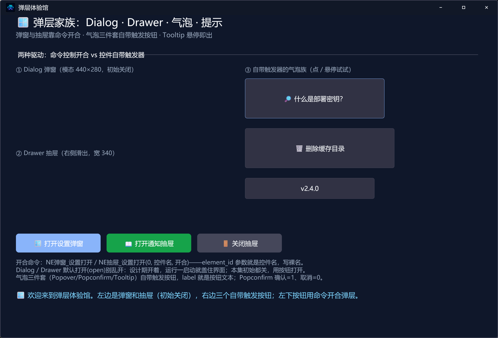

## 1. 命令与事件预告

| 命令 / 事件 | 作用 |
| --- | --- |
| `NE弹窗_设置打开(当前窗口, 设置弹窗, 1)` | 打开弹窗；第三参改 0 收回 |
| `NE抽屉_设置打开(当前窗口, 设置抽屉, 1)` | 打开抽屉；第三参改 0 收回 |
| `Closed` 事件（Dialog/Drawer） | 弹层被关掉时触发；**不传原因**，只知道关了 |
| `ValueChanged` 事件（Popover） | 气泡卡片开合回调：开=1 / 关=0 |
| `ValueChanged` 事件（Popconfirm） | 确认气泡结果回调：**确认=1 / 取消=0** |
| （Tooltip 无事件） | 纯悬停提示，没有回调 |

> 本集只需要 new_emoji 模块。

## 2. 新建项目 + 启用模块 + 切后端

流程和第 1 集一样，项目名称填 **弹层体验馆**：

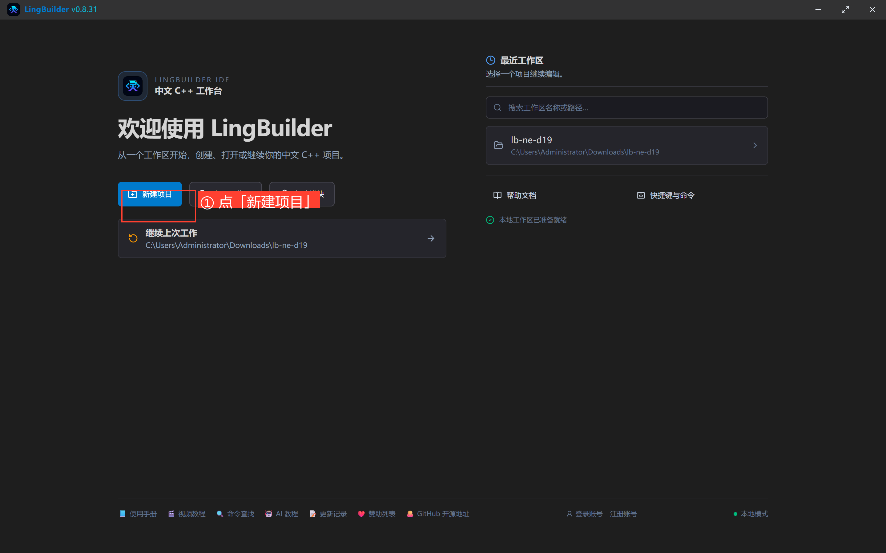

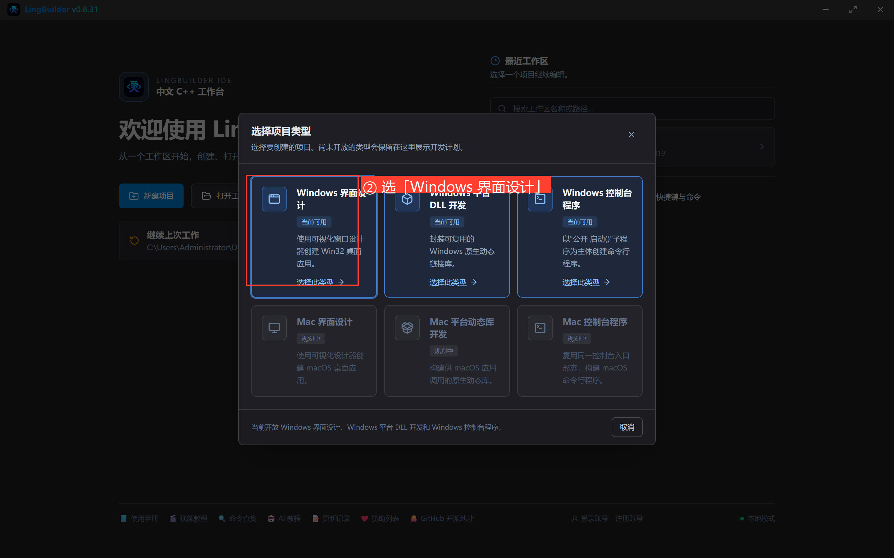

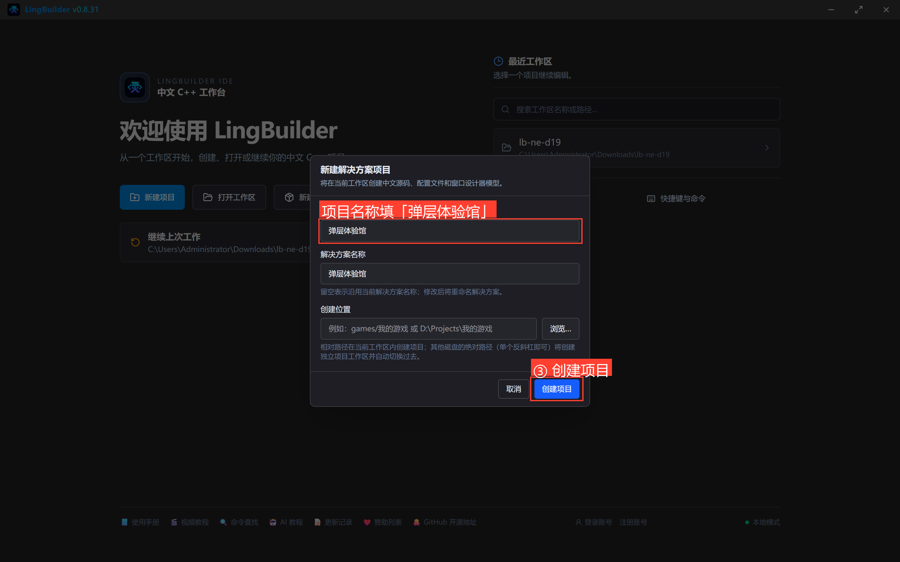

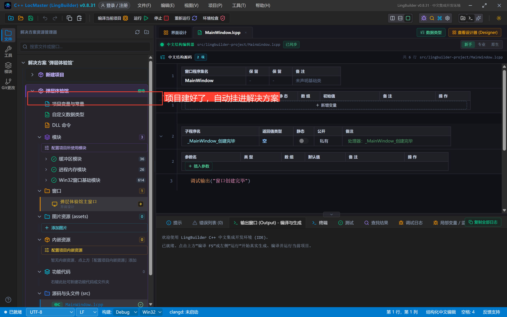

模块面板搜「原生界面」→ 启用「new_emoji 原生界面库」：

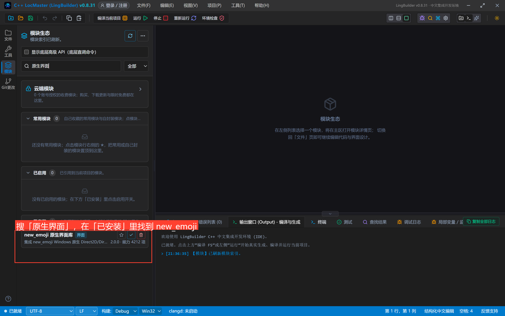

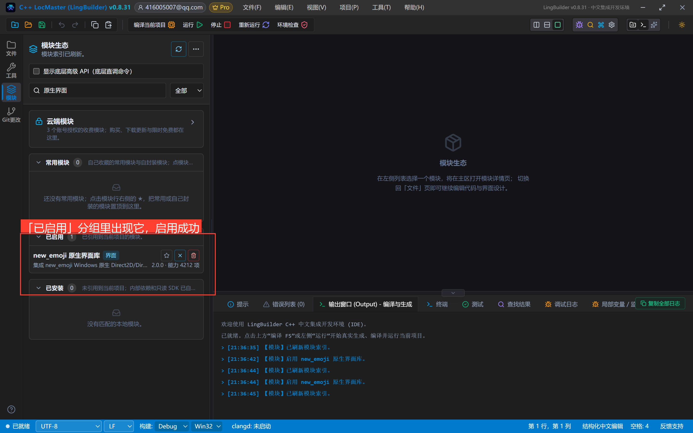

界面设计 → 选中窗口 → 确认「设计后端」是 **new_emoji 模块**：

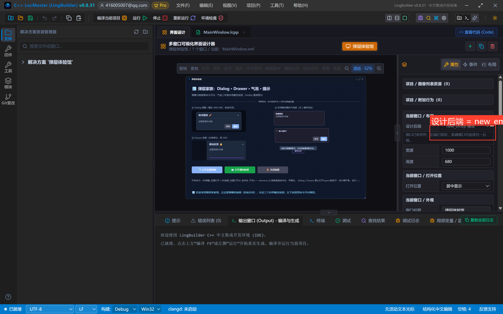

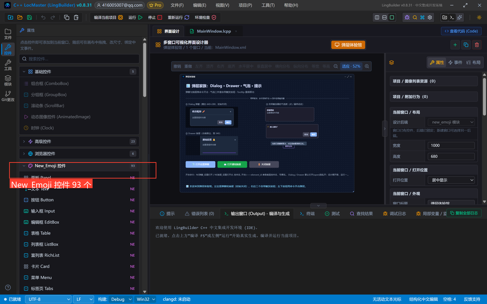

## 3. 设计界面

窗口 1000×680，左列是弹窗 + 抽屉的「弹层占位」，右列是三个气泡触发按钮，下面一排开合按钮和速查条。

| 控件 | 名称 | 左距 | 顶距 | 宽度 | 高度 | 关键属性 |
| --- | --- | --- | --- | --- | --- | --- |
| 文本 Text | 标题文本 | 32 | 20 | 700 | 36 | 🪟 弹层家族：Dialog · Drawer · 气泡 · 提示，字号 21 粗体 |
| 文本 Text | 副标题文本 | 32 | 62 | 900 | 24 | 字号 13，#94A3B8 |
| 分割线 Divider | 标题分割线 | 32 | 96 | 936 | 28 | 两种驱动：命令控制开合 vs 控件自带触发器 |
| 文本 Text | 弹窗标签 | 32 | 132 | 430 | 22 | ① Dialog 弹窗（模态 440×280，初始关闭），字号 12 |
| 弹窗 Dialog | 设置弹窗 | 32 | 158 | 300 | 120 | **title=修改昵称 ✏️；body 一条字符串内 \n；open=假；modal=真；closable=真；draggable=真；dialogWidth=440；dialogHeight=280**；事件 Closed |
| 文本 Text | 抽屉标签 | 32 | 300 | 430 | 22 | ② Drawer 抽屉（右侧滑出，宽 340），字号 12 |
| 抽屉 Drawer | 设置抽屉 | 32 | 326 | 300 | 110 | **title=通知设置 🔔；body 一条字符串内 \n；placement=1（右侧）；open=假；closable=真；size=340**；事件 Closed |
| 文本 Text | 气泡标签 | 492 | 132 | 476 | 22 | ③ 自带触发器的气泡族（点 / 悬停试试），字号 12 |
| 气泡卡片 Popover | 帮助气泡 | 492 | 158 | 280 | 80 | **label=🔎 什么是部署密钥？；title=部署密钥；content 一条字符串内 \n；placement=0；open=假；popupWidth=300；popupHeight=150**；事件 ValueChanged |
| 气泡确认 Popconfirm | 删除确认 | 492 | 258 | 300 | 80 | **label=🗑️ 删除缓存目录；title=确认删除？；content；confirm=清空；cancel=再想想；placement=0；open=假**；事件 ValueChanged |
| 悬停提示 Tooltip | 版本提示 | 492 | 358 | 260 | 42 | **label=v2.4.0；content=当前已是最新版本…；placement=0；open=假；showDelay=120** |
| 按钮 Button | 弹窗按钮 | 32 | 470 | 170 | 38 | 🪟 打开设置弹窗，样式=主要(1) |
| 按钮 Button | 抽屉按钮 | 214 | 470 | 170 | 38 | 📖 打开通知抽屉，样式=成功(2) |
| 按钮 Button | 关抽屉按钮 | 396 | 470 | 170 | 38 | 🚪 关闭抽屉，样式=默认(0) |
| 文本 Text | 数据协议说明 | 32 | 520 | 936 | 56 | 字号 12，#94A3B8，自动换行 |
| 文本 Text | 状态文本 | 32 | 584 | 936 | 60 | 字号 14，#7DD3FC，自动换行 |

### 3.1 数据协议红线：正文是一条字符串，换行用 `\n`

Dialog / Drawer 的 `body`、气泡三件套的 `content` 都是**正文型 stringList**。推荐写法是**一条字符串、行与行之间嵌 `\n`**：

```
在这里修改你的昵称。\n改完点右上角 × 关闭。
```

（发射器也支持把多条字符串按行拼接——在属性行里写成多行同样有效。但本教程统一用「单条 + \n」，和 12、13 集表格的 `|` 协议区分开：**正文用 \n，列表项用 |**。）

### 3.2 弹层是「占位控件」：设计器里那块卡片运行期看不见

Dialog / Drawer 在设计器里显示为一块占位卡，**运行窗口里它不占位置**——只有命令把它打开后才出现。所以弹窗/抽屉在窗口里的左距顶距**不是它弹出后的位置**（弹窗自动居中，抽屉贴边滑出），摆哪儿都行，摆一起好管理。

> **红线：`open` 默认开着别乱开。** 设计期开着方便预览，但运行一启动弹层就盖住界面。本集初始全部 `open=假`，用按钮打开。

### 3.3 气泡三件套：控件即按钮

Popover / Popconfirm / Tooltip **自带触发按钮**，`label` 属性就是按钮上的字——不需要再配一个 Button，也没有「打开气泡」的中文命令，点了触发按钮引擎自动弹。`placement` 是弹出方位，本集三个都填 0，**实测弹在触发按钮的左侧**（不是上方）。

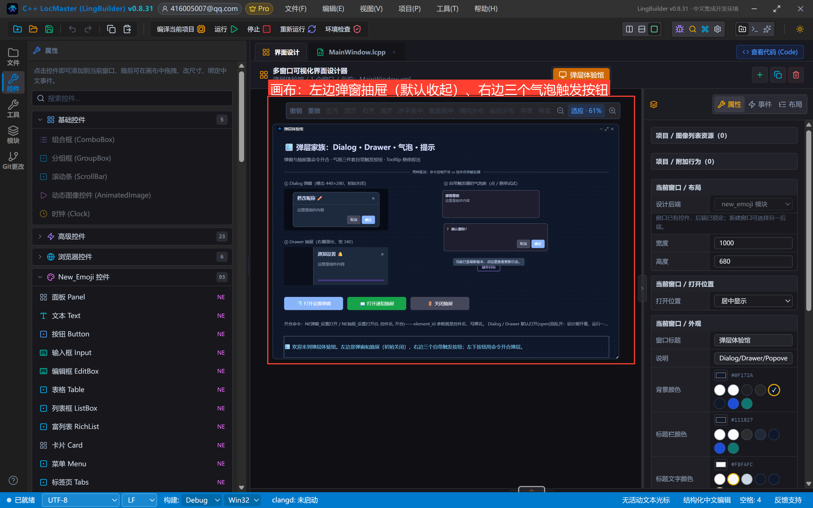

## 4. 写代码

```lcpp
类 MainWindow
    事件 _MainWindow_创建完毕()
        控件_设置文本(状态文本, "🪟 欢迎来到弹层体验馆。左边是弹窗和抽屉（初始关闭），右边三个自带触发按钮；左下按钮用命令开合弹层。")
        调试输出("弹层体验馆已创建完毕")
    结束

    事件 _弹窗按钮_被单击()
        NE弹窗_设置打开(当前窗口, 设置弹窗, 1)
        控件_设置文本(状态文本, "🪟 NE弹窗_设置打开(设置弹窗, 1)：模态弹窗弹出，右上 × 或点遮罩可关。")
    结束

    事件 _抽屉按钮_被单击()
        NE抽屉_设置打开(当前窗口, 设置抽屉, 1)
        控件_设置文本(状态文本, "📖 NE抽屉_设置打开(设置抽屉, 1)：抽屉从右侧滑出，宽 340。")
    结束

    事件 _关抽屉按钮_被单击()
        NE抽屉_设置打开(当前窗口, 设置抽屉, 0)
        控件_设置文本(状态文本, "🚪 NE抽屉_设置打开(设置抽屉, 0)：抽屉收回右侧。")
    结束

    事件 _设置弹窗_关闭()
        控件_设置文本(状态文本, "❎ 弹窗的「关闭」事件触发——Closed 回调不传原因，只知道关了。")
    结束

    事件 _设置抽屉_关闭()
        控件_设置文本(状态文本, "❎ 抽屉的「关闭」事件触发。")
    结束

    事件 _删除确认_结果变化()
        控件_设置文本(状态文本, "⚠️ 气泡确认的「结果变化」回调触发（引擎把 确认=1 / 取消=0 传给底层回调）。")
    结束

    事件 _帮助气泡_动作回调()
        控件_设置文本(状态文本, "💡 气泡卡片的「动作回调」触发（开=1 / 关=0）。")
    结束
结束类
```

三个看点：

1. **开合命令首参必须写 `当前窗口`**——它指定弹层挂在哪个窗口上。**传 0 会静默无效**（不报错、也不弹），网上旧示例里写 0 的写法别照抄。
2. **第二参写裸控件名**（`设置弹窗`，不带引号）——它引用的是设计器里的控件，不是字符串。
3. **气泡两个回调共用 `ValueChanged` 事件名**，但语义不同：Popover 回报开合（1/0），Popconfirm 回报选择结果（确认=1 / 取消=0）。

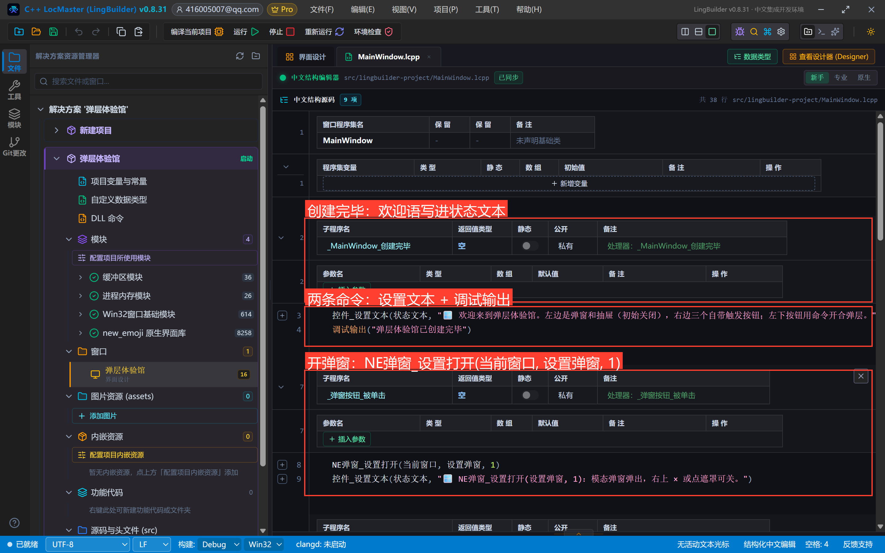

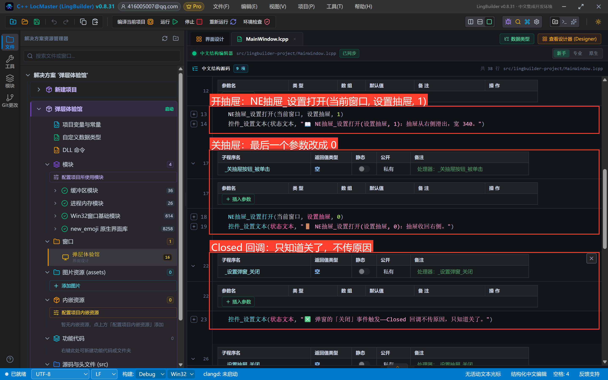

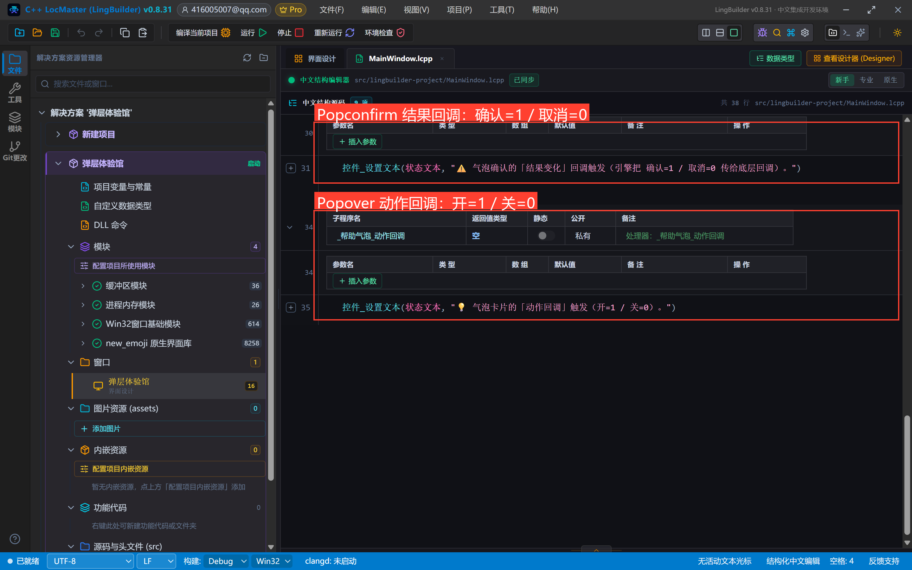

## 5. 编译前先看错误列表

点「编译当前项目」，先看底部错误列表——零报错再继续：

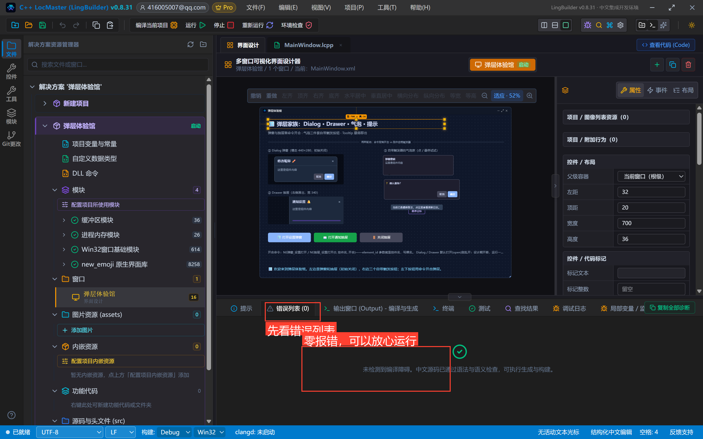

## 6. 运行！五种弹层各试一次

点「运行」。左边两块弹层占位（运行期不显示），右边三个气泡触发按钮，下面一排开合按钮：

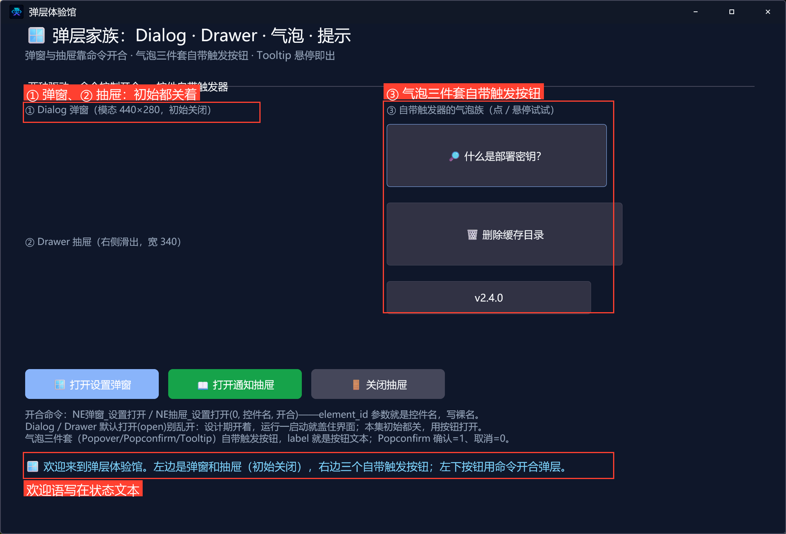

**① 点「🪟 打开设置弹窗」**——模态弹窗居中弹出，**盖住右侧三张卡片**，四周遮罩变暗。右上 × 或点遮罩都能关：

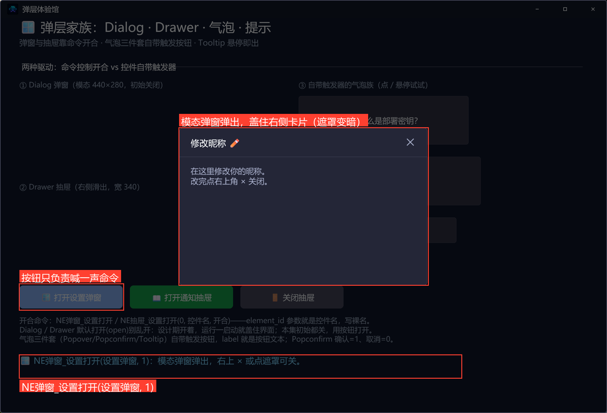

**② 点弹窗右上 ×**——弹窗收回，`Closed` 回调触发。注意状态栏的说明：这个回调**不传关闭原因**，只知道「关了」：

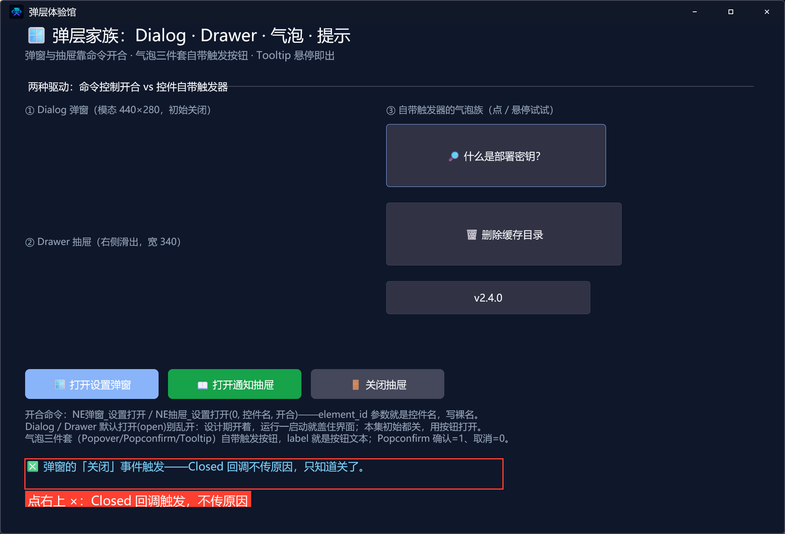

**③ 点「📖 打开通知抽屉」**——抽屉从右侧滑出（宽 340），正文两行照设计器里 `\n` 的位置换行：

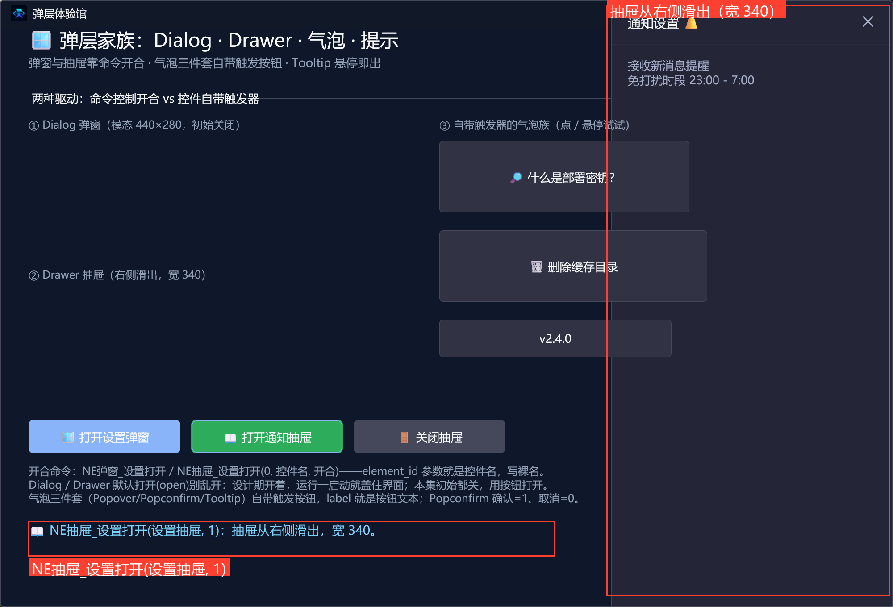

**④ 点「🚪 关闭抽屉」**——同一条命令，第三个参数从 1 改成 0，抽屉收回右侧：

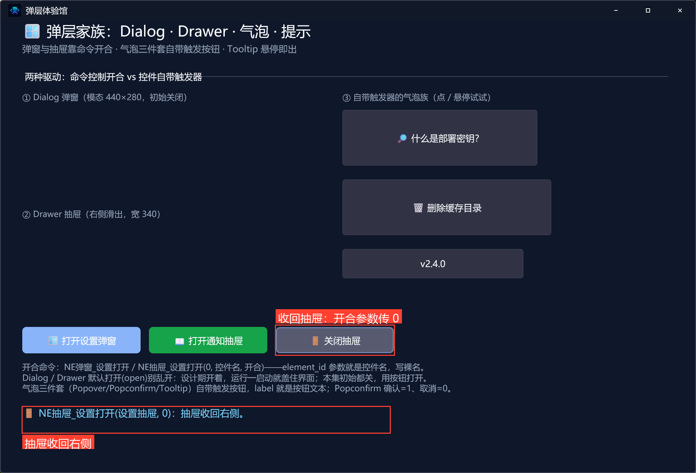

**⑤ 点「🔎 什么是部署密钥？」**——气泡卡片弹出：**弹在触发按钮的左侧**，标题 + 三行正文（`\n` 换行生效）。状态栏显示 `ValueChanged` 回调回报开=1：

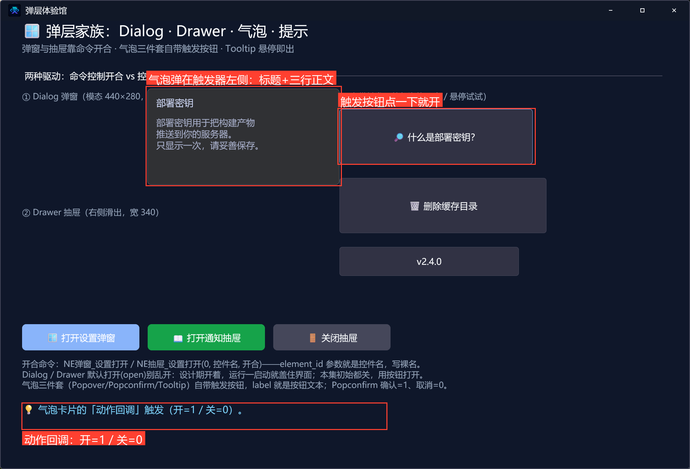

**⑥ 点「🗑️ 删除缓存目录」**——确认气泡弹出：⚠️ 图标 + 两行正文 + 「清空 / 再想想」两个按钮（按钮文字就是 `confirm` / `cancel` 属性）：

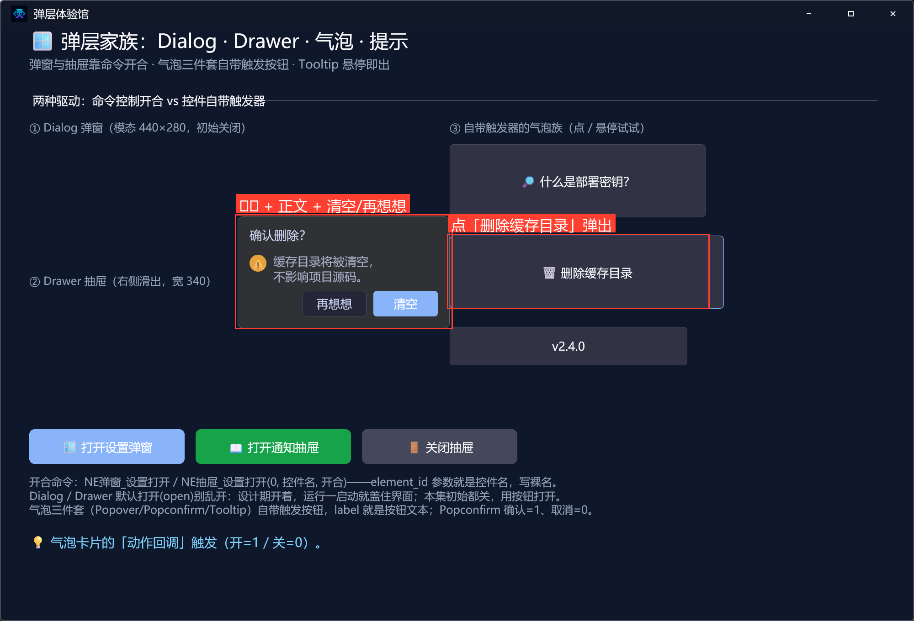

**⑦ 点「清空」**——气泡自动收回，状态栏报「结果变化」回调触发。引擎把**确认=1 / 取消=0**传给底层回调；点「再想想」走的是同一个回调、结果为 0：

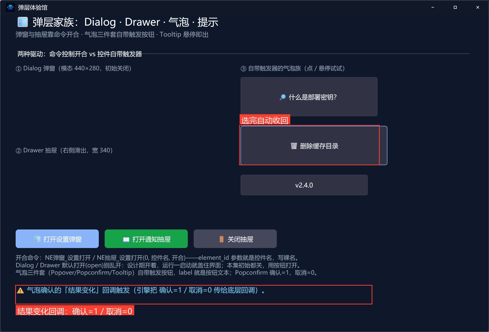

**⑧ 鼠标悬停在 v2.4.0 上**——Tooltip 延时 120 毫秒后弹出，同样在触发按钮左侧；鼠标移开自动消失，全程无回调：

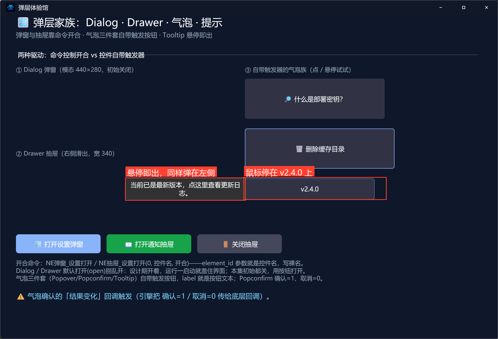

> **实测红线：气泡三件套点空白不会关闭。** 和网页的习惯不同，弹出的气泡点旁边空白**不收**，要再点一次触发按钮才收回（Tooltip 除外——它本来就是悬停即散）。给用户演示时记得提一句。

## 7. 导出源码包

命令面板执行「项目：一键导出 LCPP 源码包」即可。

## 本集源码包

- 网页版：[19-弹层体验馆.lcpppkg](https://lingbuilder.com/demos)（示例源码区可下载）

## 下一集预告

加载与状态：Loading 加载、Skeleton 骨架屏、Empty 空状态、Result 结果页、InfiniteScroll 滚动加载——数据没到/出错/到底了，界面怎么体面地等着。
