# NE 合集 20 · 加载与状态：Loading · Skeleton · Empty · Result · InfiniteScroll

> 《LingBuilder new_emoji 合集》第 20 集。反馈篇的第三集，也是「高级篇」的第一集：程序不只有「会说话」「会递面板」，还得会**等**——数据没来转圈圈、列表先竖骨架、空数据给提示、做完给结果、长列表滚到底自动续。五个状态件一次配齐。全程约 35 分钟。
>
> 前置要求：完成[第 01 集](/guide/tutorials/new-emoji-01)；建议先看[第 19 集](/guide/tutorials/new-emoji-19)（弹层家族），本集延续「反馈类」这条线并开始用项目全局变量。本集源码包见文末。

## 这一集你将学会

- **Loading**：控件内嵌加载圈，`NE加载_设置活动` 一条命令停/开，`progress` 显式设置才显示进度
- **Skeleton**：`NE骨架屏_设置行列表` 改行数、`NE骨架屏_设置动画` 停/开 shimmer 动画
- **Empty**：`actionText` 动作按钮的回调怎么接（`NE空状态_设置动作回调`）、点了几次怎么数（`NE空状态_取动作点击`）
- **Result**：`NE结果页_设置类型` 换 1=成功 / 2=警告 / 3=错误 三种颜色图标，`NE结果页_设置副标题` 换文案
- **InfiniteScroll**：滚到底自动触发加载回调，`NE无限滚动_追加列表项` 追加数据**保留滚动位置**，`NE无限滚动_设置状态` 清 loading / 标记没有更多
- **回调签名红线**：处理器参数个数必须与命令登记一致（空状态 1 个整数、无限滚动 4 个整数），编译前就会被拦下

先看一眼本集成品——加载中、骨架屏、空状态、结果页、无限滚动五件套：

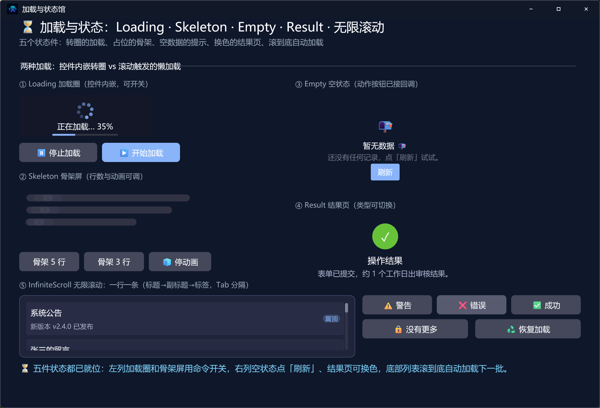

## 1. 命令与事件预告

| 命令 / 事件 | 作用 |
| --- | --- |
| `NE加载_设置活动(当前窗口, 加载器, 1)` | 加载圈开；第三参改 0 停 |
| `NE骨架屏_设置行列表(当前窗口, 骨架屏, 5)` | 骨架条改 5 行 |
| `NE骨架屏_设置动画(当前窗口, 骨架屏, 0)` | 停 shimmer 动画；1 恢复 |
| `NE空状态_设置动作回调(当前窗口, 空状态, &处理器)` | 接「刷新」动作按钮回调（1 个整数参数） |
| `NE空状态_取动作点击(当前窗口, 空状态)` | 读动作按钮被点次数 |
| `NE结果页_设置类型(当前窗口, 结果页, 2)` | 0=信息(蓝) 1=成功(绿) 2=警告(黄) 3=错误(红) |
| `NE结果页_设置副标题(结果页, "文本")` | 换副标题文案 |
| `NE无限滚动_设置加载回调(当前窗口, 无限滚动, &处理器)` | 滚到底触发（4 个整数参数：编号/已有条数/滚动位置/最大滚动） |
| `NE无限滚动_追加列表项(无限滚动, 文本)` | 列表尾部追加（保留滚动位置），一行一条 `标题⇥副标题⇥标签` |
| `NE无限滚动_设置状态(当前窗口, 无限滚动, 0, 0, 0)` | loading / no_more / disabled 三个开关 |
| `延迟调用(30, &处理器)` | 30 毫秒后在界面线程调用无参处理器（win32 基础模块） |

> 本集只需要 new_emoji 模块（延迟调用来自默认启用的 Win32 窗口基础模块）。

## 2. 新建项目 + 启用模块 + 切后端

流程和第 1 集一样，项目名称填 **加载与状态馆**：

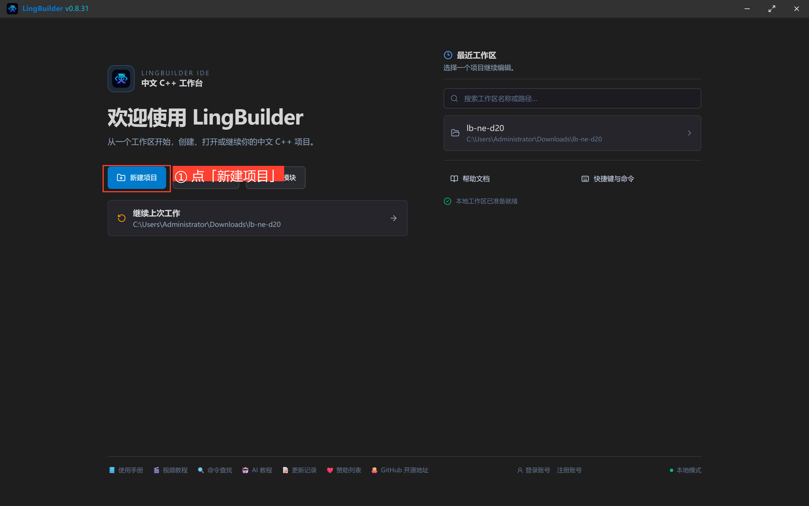

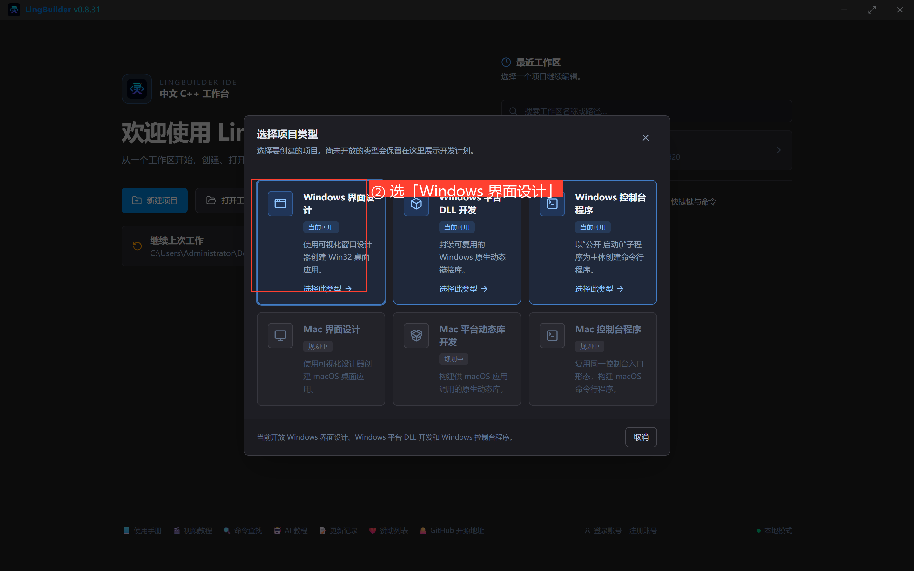

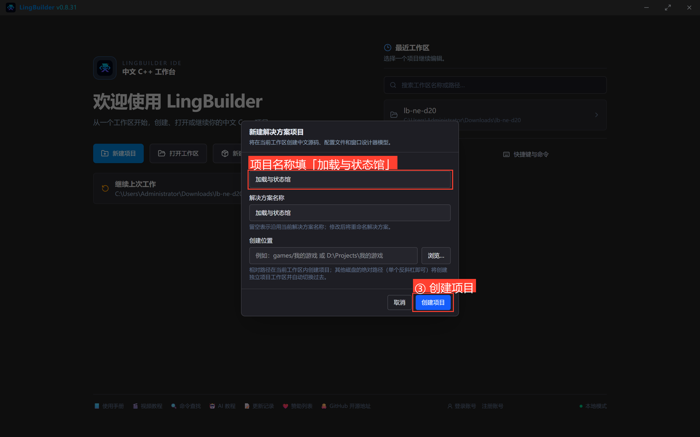

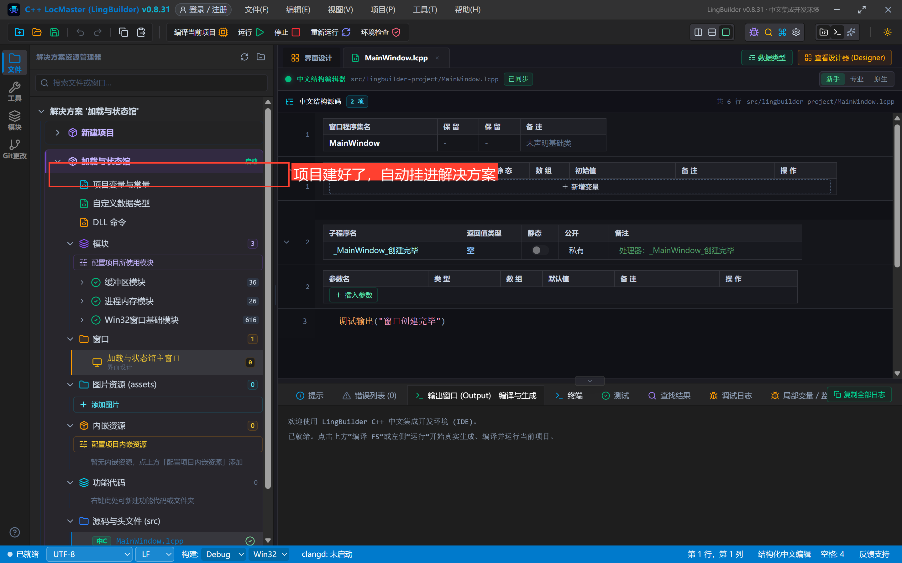

模块面板搜「原生界面」→ 启用「new_emoji 原生界面库」：

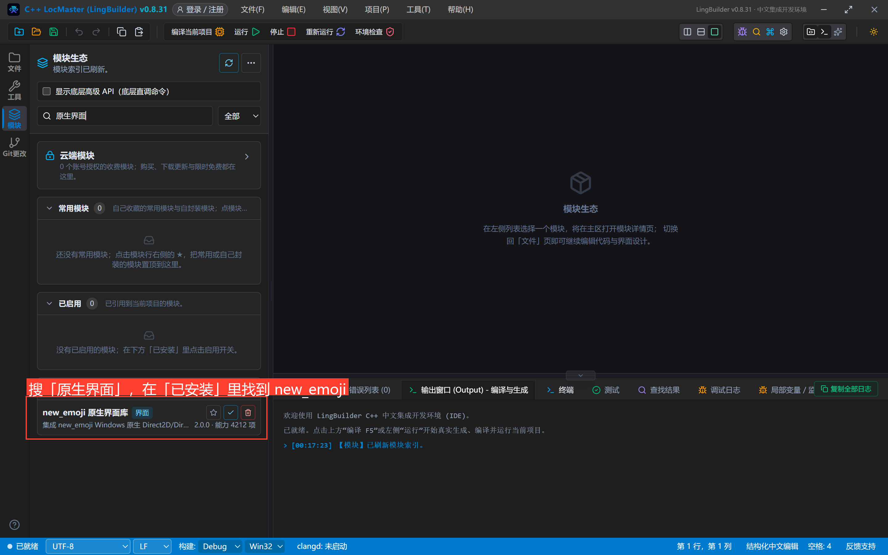

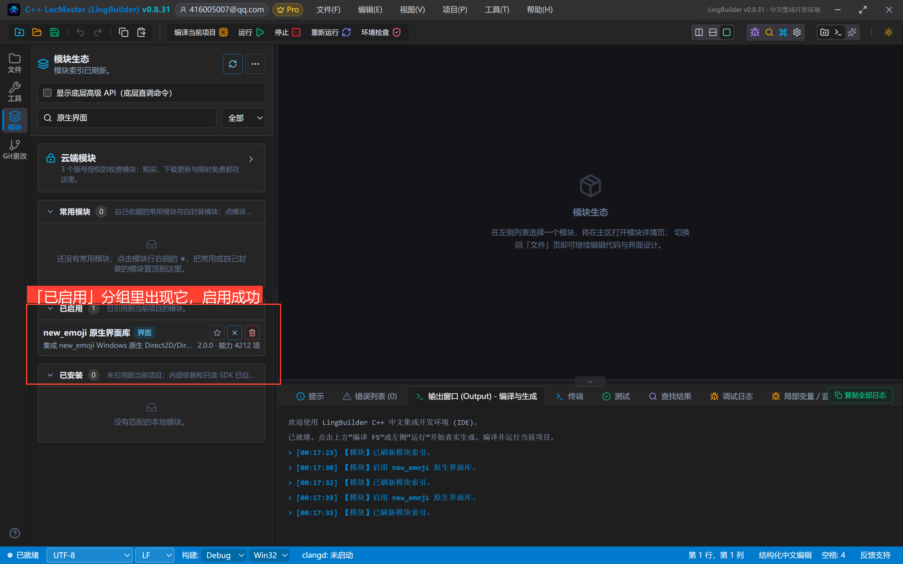

界面设计 → 选中窗口 → 确认「设计后端」是 **new_emoji 模块**：

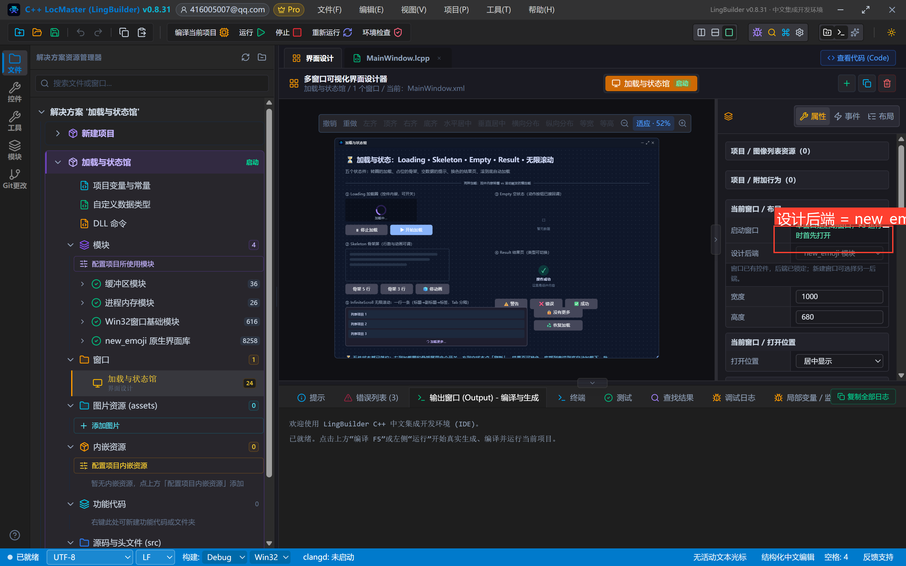

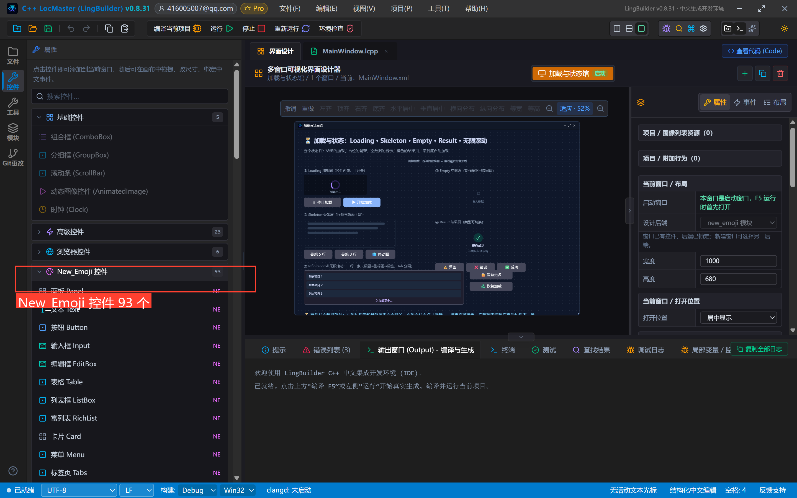

## 3. 设计界面

窗口 1000×680：左列 ① 加载圈 + ② 骨架屏，右列 ③ 空状态 + ④ 结果页，底部 ⑤ 无限滚动，右下五个状态按钮。

| 控件 | 名称 | 左距 | 顶距 | 宽度 | 高度 | 关键属性 |
| --- | --- | --- | --- | --- | --- | --- |
| 文本 Text | 标题文本 | 32 | 20 | 700 | 36 | ⏳ 加载与状态：Loading · Skeleton · Empty · Result · 无限滚动，字号 21 粗体 |
| 文本 Text | 副标题文本 | 32 | 62 | 900 | 24 | 字号 13，#94A3B8 |
| 分割线 Divider | 标题分割线 | 32 | 96 | 936 | 28 | 两种加载：控件内嵌转圈 vs 滚动触发的懒加载 |
| 文本 Text | 加载标签 | 32 | 132 | 430 | 22 | ① Loading 加载圈（控件内嵌，可开关），字号 12 |
| 加载 Loading | 加载器 | 32 | 158 | 220 | 70 | **text=正在加载…；active=真；progress=35** |
| 按钮 Button | 停止加载 | 32 | 238 | 130 | 32 | ⏸ 停止加载，样式=默认(0) |
| 按钮 Button | 开始加载 | 170 | 238 | 130 | 32 | ▶ 开始加载，样式=主要(1) |
| 文本 Text | 骨架标签 | 32 | 286 | 430 | 22 | ② Skeleton 骨架屏（行数与动画可调），字号 12 |
| 骨架屏 Skeleton | 骨架屏 | 32 | 312 | 320 | 100 | **rows=3；animated=真；loading=真；showAvatar=假** |
| 按钮 Button | 骨架五行 | 32 | 420 | 100 | 32 | 骨架 5 行 |
| 按钮 Button | 骨架三行 | 140 | 420 | 100 | 32 | 骨架 3 行 |
| 按钮 Button | 停动画 | 248 | 420 | 104 | 32 | 🧊 停动画 |
| 文本 Text | 空态标签 | 492 | 132 | 476 | 22 | ③ Empty 空状态（动作按钮已接回调），字号 12 |
| 空状态 Empty | 空状态 | 492 | 158 | 300 | 168 | **title=暂无数据 📭；desc 一条字符串；icon=📭；actionText=刷新** |
| 文本 Text | 结果标签 | 492 | 334 | 476 | 22 | ④ Result 结果页（类型可切换），字号 12 |
| 结果页 Result | 结果页 | 492 | 360 | 300 | 120 | **title=操作结果；subtitle 一条字符串；resultType=1** |
| 按钮 Button | 警告结果 | 604 | 492 | 116 | 32 | ⚠️ 警告 |
| 按钮 Button | 错误结果 | 728 | 492 | 116 | 32 | ❌ 错误 |
| 按钮 Button | 成功结果 | 852 | 492 | 116 | 32 | ✅ 成功 |
| 文本 Text | 滚动标签 | 32 | 466 | 560 | 22 | ⑤ InfiniteScroll 无限滚动：一行一条（标题⇥副标题⇥标签，Tab 分隔），字号 12 |
| 无限滚动 InfiniteScroll | 无限滚动 | 32 | 492 | 560 | 104 | **items 六条**（每条 `标题⇥副标题⇥标签`） |
| 按钮 Button | 没有更多 | 604 | 532 | 176 | 32 | 🔒 没有更多 |
| 按钮 Button | 恢复加载 | 792 | 532 | 176 | 32 | ♻️ 恢复加载 |
| 文本 Text | 状态文本 | 32 | 604 | 936 | 44 | 字号 14，#7DD3FC，自动换行 |

### 3.1 数据协议红线：`items` 一行一条，字段用 Tab 分隔

无限滚动的 `items` 每行一条记录，行内用 **Tab** 分三列：`标题⇥副标题⇥标签`（后两列可留空）。行与行换行。代码里追加时也遵守同一协议——`\t` 出副标题、`\n` 出下一行。

### 3.2 布局红线：Result 的标题起名要中性

**运行期没有「改结果页标题」的命令**——`设置类型` 只换图标和颜色，`设置副标题` 只换副标题，标题从头到尾不动。所以标题别写成「提交成功 ✅」，否则切成红色错误后文不对题；本集用中性的「操作结果」。

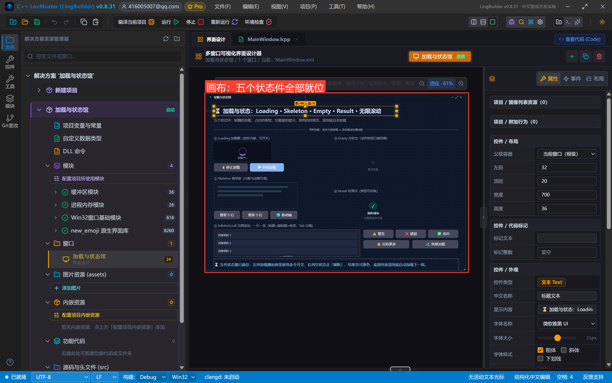

## 4. 写代码

跨事件要用的计数器放**项目全局变量**（`项目全局变量.lcpp`）：

```lcpp
全局 整数型 加载批号 = 0
```

主代码（`MainWindow.lcpp`）：

```lcpp
类 MainWindow
    事件 _MainWindow_创建完毕()
        NE空状态_设置动作回调(当前窗口, 空状态, &空状态_刷新被点)
        NE无限滚动_设置加载回调(当前窗口, 无限滚动, &无限滚动_滚动到底)
        控件_设置文本(状态文本, "⏳ 五件状态都已就位：左列加载圈和骨架屏用命令开关，右列空状态点「刷新」、结果页可换色，底部列表滚到底自动加载下一批。")
        调试输出("加载与状态馆已创建完毕")
    结束

    事件 _停止加载_被单击()
        NE加载_设置活动(当前窗口, 加载器, 0)
        控件_设置文本(状态文本, "⏸ NE加载_设置活动(加载器, 0)：加载圈停了。")
    结束

    事件 _开始加载_被单击()
        NE加载_设置活动(当前窗口, 加载器, 1)
        控件_设置文本(状态文本, "▶ NE加载_设置活动(加载器, 1)：加载圈转起来了。")
    结束

    事件 _骨架五行_被单击()
        NE骨架屏_设置行列表(当前窗口, 骨架屏, 5)
        控件_设置文本(状态文本, "🦴 NE骨架屏_设置行列表(骨架屏, 5)：骨架条变成 5 行。")
    结束

    事件 _骨架三行_被单击()
        NE骨架屏_设置行列表(当前窗口, 骨架屏, 3)
        控件_设置文本(状态文本, "🦴 NE骨架屏_设置行列表(骨架屏, 3)：骨架条回到 3 行。")
    结束

    事件 _停动画_被单击()
        NE骨架屏_设置动画(当前窗口, 骨架屏, 0)
        控件_设置文本(状态文本, "🧊 NE骨架屏_设置动画(骨架屏, 0)：动画停了，骨架条静止。")
    结束

    事件 _空状态_刷新被点(整数型 控件编号)
        控件_设置文本(状态文本, "🔄 空状态的「刷新」被点了 " + 到文本(NE空状态_取动作点击(当前窗口, 空状态)) + " 次——回调由 NE空状态_设置动作回调 接上（回调带 1 个整数参数）。")
    结束

    事件 _警告按钮_被单击()
        NE结果页_设置类型(当前窗口, 结果页, 2)
        NE结果页_设置副标题(结果页, "余额不足，请先充值后再试。")
        控件_设置文本(状态文本, "⚠️ NE结果页_设置类型(结果页, 2)：黄色感叹号，副标题也换成了对应文案。")
    结束

    事件 _错误按钮_被单击()
        NE结果页_设置类型(当前窗口, 结果页, 3)
        NE结果页_设置副标题(结果页, "提交失败，请检查网络后重试。")
        控件_设置文本(状态文本, "❌ NE结果页_设置类型(结果页, 3)：红色叉号。")
    结束

    事件 _成功按钮_被单击()
        NE结果页_设置类型(当前窗口, 结果页, 1)
        NE结果页_设置副标题(结果页, "表单已提交，约 1 个工作日出审核结果。")
        控件_设置文本(状态文本, "✅ NE结果页_设置类型(结果页, 1)：回到绿色对勾。")
    结束

    事件 _无限滚动_滚动到底(整数型 控件编号, 整数型 已有条数, 整数型 滚动位置, 整数型 最大滚动)
        延迟调用(30, &追加下一批动态)
    结束

    事件 _追加下一批动态()
        加载批号 = 加载批号 + 1
        NE无限滚动_追加列表项(无限滚动, "动态消息 " + 到文本(加载批号) + "-1\t这是第 " + 到文本(加载批号) + " 批自动加载的动态\t新\n动态消息 " + 到文本(加载批号) + "-2\t副标题里可以放摘要\t\n动态消息 " + 到文本(加载批号) + "-3\tTab 分出第三列小标签\t热")
        NE无限滚动_设置状态(当前窗口, 无限滚动, 0, 0, 0)
        控件_设置文本(状态文本, "♻️ 加载回调触发：第 " + 到文本(加载批号) + " 批 3 条已追加（追加列表项保留滚动位置）。设置状态把 loading 清零，滚到底还能继续加载。")
    结束

    事件 _没有更多_被单击()
        NE无限滚动_设置状态(当前窗口, 无限滚动, 0, 1, 0)
        控件_设置文本(状态文本, "🔒 NE无限滚动_设置状态(..., 0, 1, 0)：no_more=1，列表底部显示「没有更多」，不再触发加载。")
    结束

    事件 _恢复加载_被单击()
        NE无限滚动_设置状态(当前窗口, 无限滚动, 0, 0, 0)
        控件_设置文本(状态文本, "♻️ no_more 清零：再滚到底又能加载了。")
    结束
结束类
```

四个看点：

1. **回调处理器参数个数必须与命令登记一致**：空状态动作回调带 1 个整数参数，无限滚动加载回调带 4 个——写多写少，编译前的签名检查直接拦截，错误列表会告诉你差在哪。
2. **加载回调里不要直接追加列表**：回调是引擎在滚动处理中途调用的，当场改列表有重入风险。本集用 `延迟调用(30, &追加下一批动态)` 转一手——30 毫秒后在界面线程单独执行，稳。
3. **追加完必须清 loading**：引擎触发回调时自己把 loading 置真，不清零就不再触发。`NE无限滚动_设置状态(当前窗口, 无限滚动, 0, 0, 0)` 三个参数依次是 loading / no_more / disabled。
4. **`\t` 和 `\n` 在字符串里可用**：追加文本用 `\t` 分列、`\n` 分行，和设计器 items 属性同一协议。

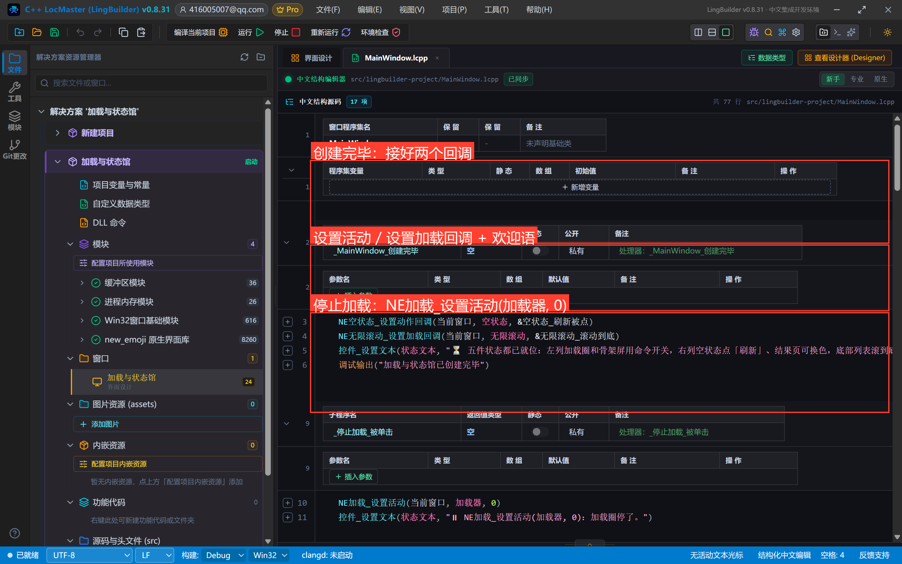

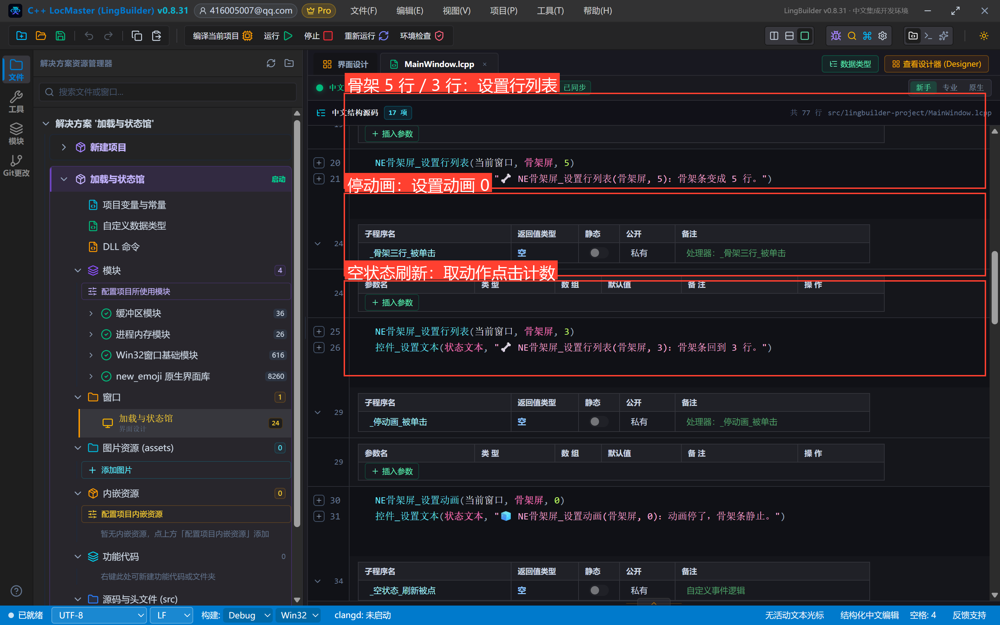

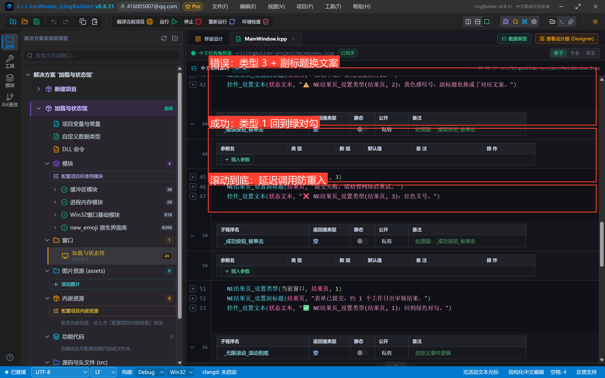

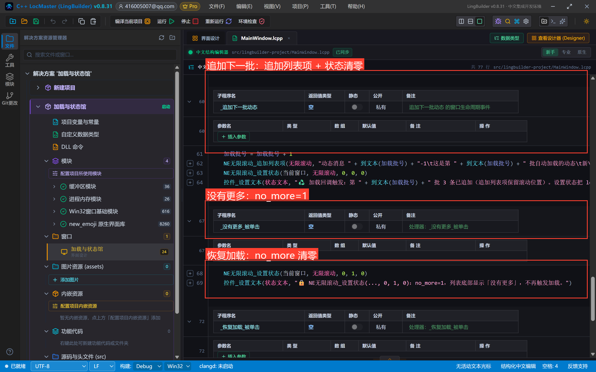

## 5. 编译前先看错误列表

点「编译当前项目」，先看底部错误列表——零报错再继续：

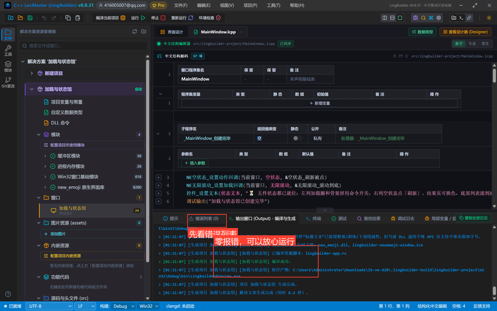

## 6. 运行！五件状态各试一次

点「运行」。加载圈转着（35% 进度），骨架条闪着，右列空状态和绿对勾结果页就位，底部列表候着：

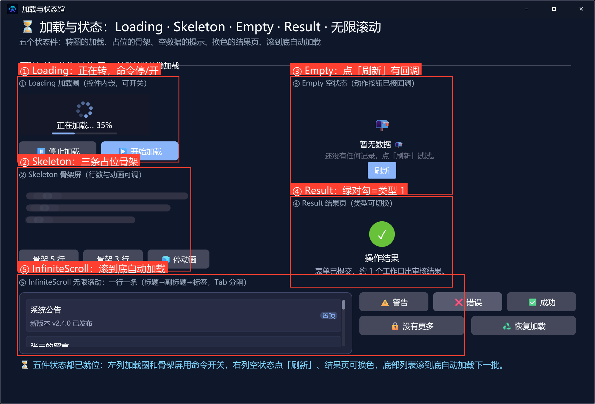

**① 点「⏸ 停止加载」**——加载圈停了（命令只改活动状态，文字和进度保留）：

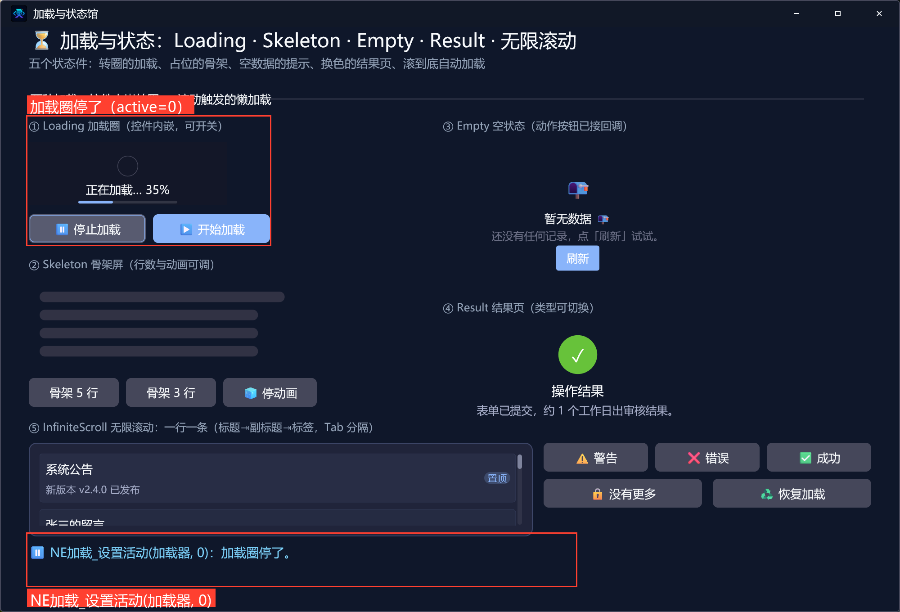

**② 点「▶ 开始加载」**——同一条命令，第三参改 1，圈转回来了：

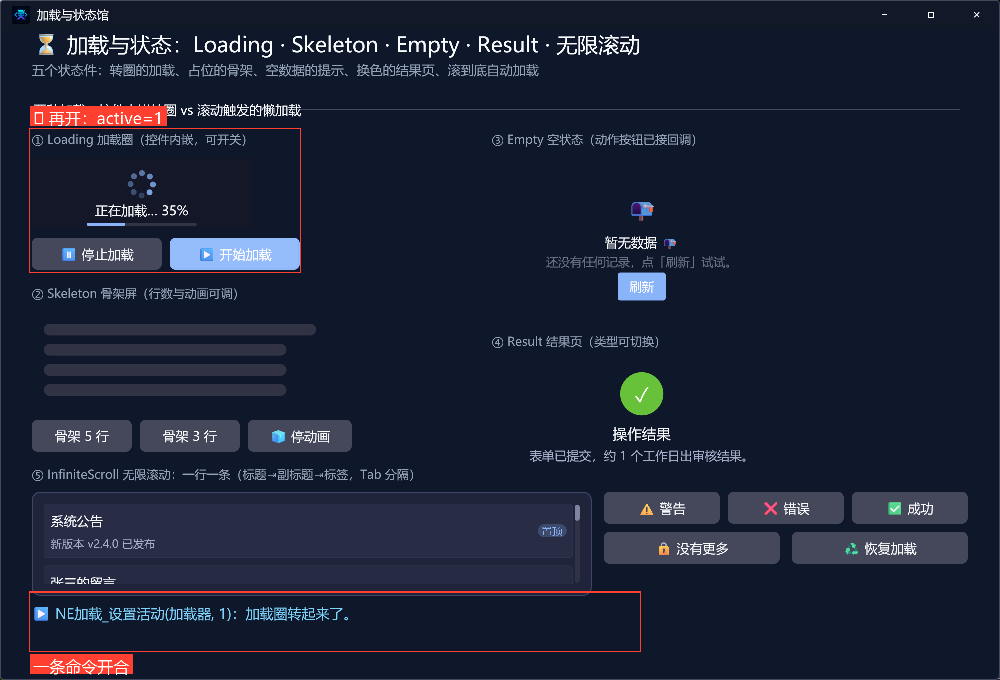

**③ 点「骨架 5 行」**——`设置行列表` 把骨架条从 3 行变 5 行；点「骨架 3 行」变回去：

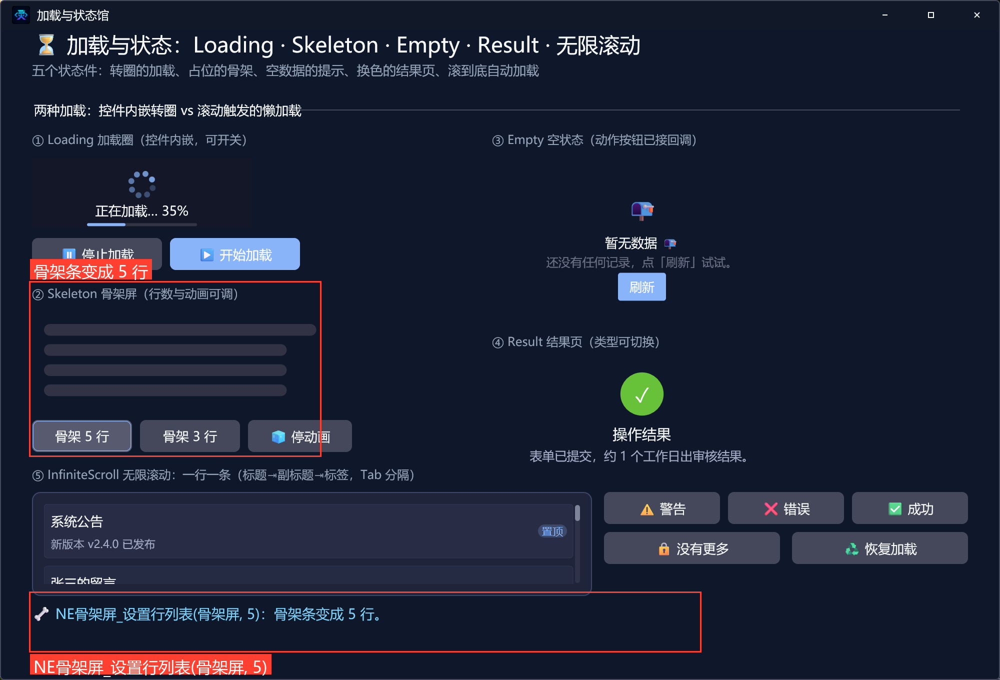

**④ 点「🧊 停动画」**——shimmer 动画停了，骨架条静止（截图看不出来，跑一遍就知道差多少）：

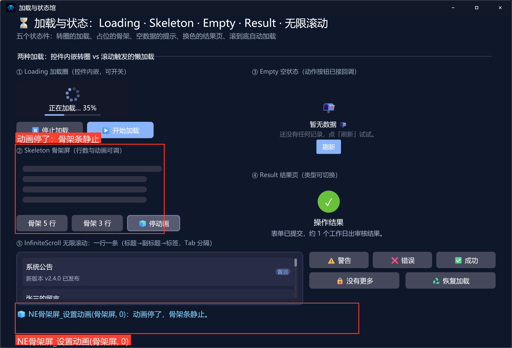

**⑤ 点空状态里的「刷新」**——动作回调触发，状态栏把 `取动作点击` 数出来的次数拼了进去：

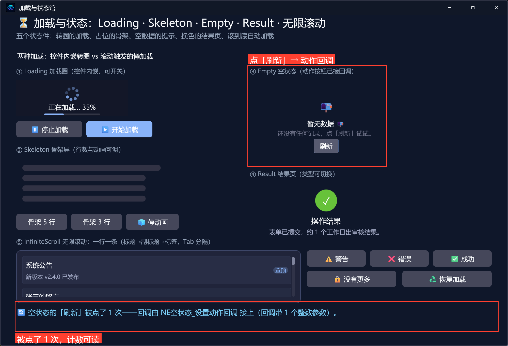

**⑥ 点「⚠️ 警告」**——结果页变黄色感叹号，副标题换成「余额不足」；点「❌ 错误」变红叉；点「✅ 成功」回绿对勾。标题「操作结果」始终不动：

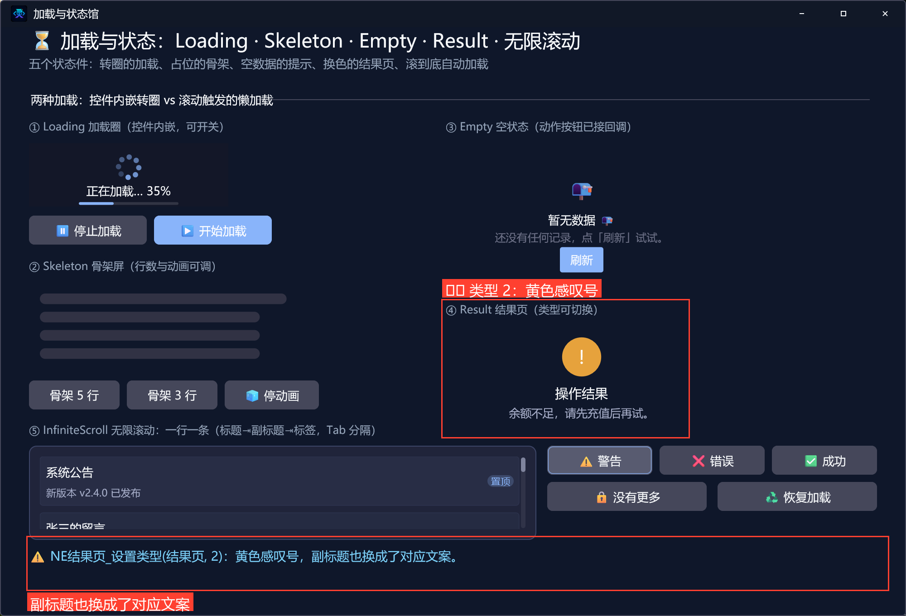

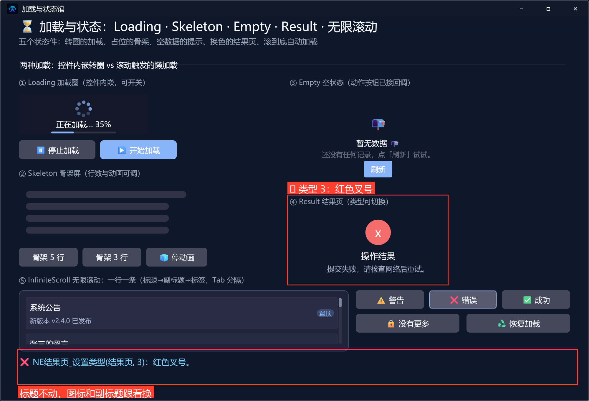

**⑦ 滚轮把无限滚动滚到底**——加载回调触发，第 1 批 3 条「动态消息」追加进列表（滚动位置没跳）；继续滚，第 2 批接着来：

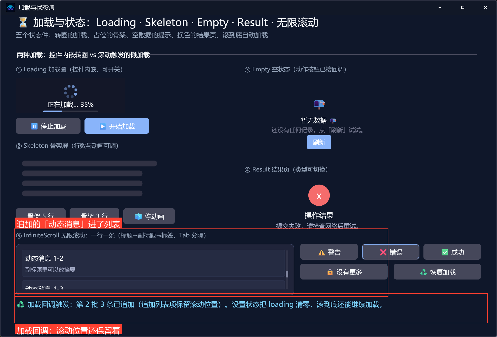

**⑧ 点「🔒 没有更多」**——`no_more=1`，到底了也不再触发；点「♻️ 恢复加载」清掉，又能继续加载：

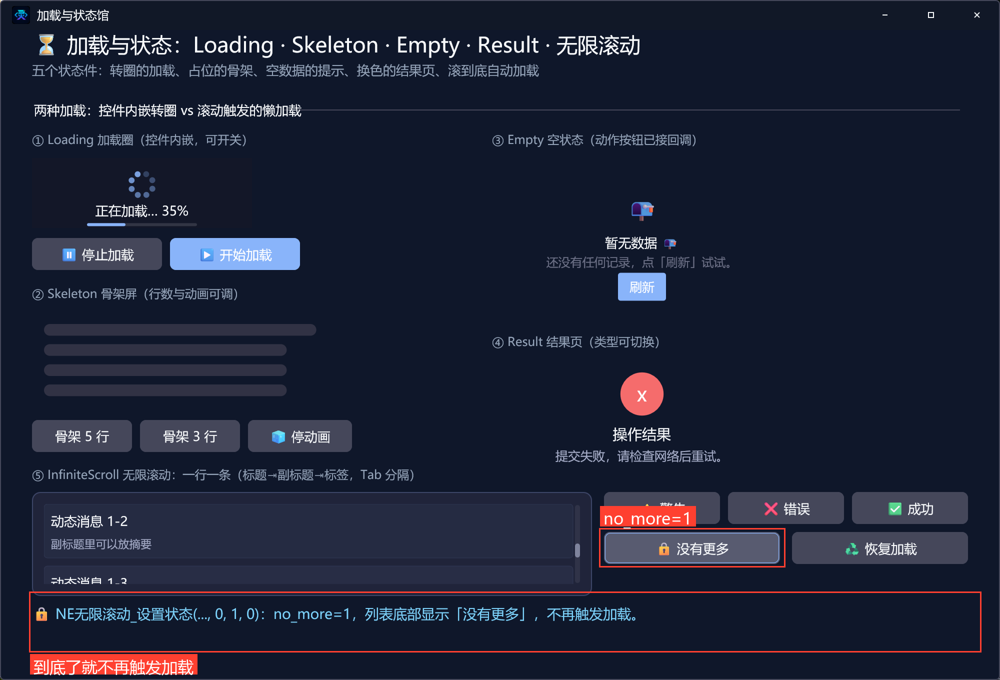

## 7. 导出源码包

命令面板执行「项目：一键导出 LCPP 源码包」即可。

## 本集源码包

- 网页版：[20-加载与状态馆.lcpppkg](https://lingbuilder.com/demos)（示例源码区可下载）

## 下一集预告

展示杂项：Carousel 轮播、Timeline 时间轴、Watermark 水印、Tour 漫游引导、Avatar 头像、Card 卡片——静态展示件如何做出「被设计过」的质感。
