# NE 合集 21 · 展示杂项：轮播 · 时间线 · 水印 · 漫游 · 头像 · 卡片

> 《LingBuilder new_emoji 合集》第 21 集。六个「展示件」一次集齐：**Carousel 轮播**会翻页、**Timeline 时间线**能倒转、**Watermark 水印**打在卡片上、**Tour 漫游**领着用户走、**Avatar 头像**能换图标、**Card 卡片**整张能点。这一集的红线也最密集——水印的透明度和鼠标穿透都有必须显式设置的属性，漏写一个运行期就变样。全程约 40 分钟。
>
> 前置要求：完成[第 20 集](/guide/tutorials/new-emoji-20)；本集延续「展示件」这条线。本集源码包见文末。

## 这一集你将学会

- **Carousel**：`items` 一行一条，`NE轮播_切到下一张(窗口, 轮播, delta)` 翻页——delta 为负就是往回翻；`NE轮播_设置自动播放(窗口, 轮播, 1, 2000)` 每 2 秒自动翻一张
- **Timeline**：`items` 一行一条（时间 + Tab + 标题 + Tab + 状态 + Tab + 图标），`NE时间线_设置高级选项(窗口, 时间线, 0, 1, reverse, 0)` 第 5 个参数就是倒序开关
- **Watermark**：`content` 水印文字、`gapX/gapY` 间距、`rotation` 旋转角、`alpha` 透明度（0~255）——旋转贴片运行期真实渲染
- **Tour**：`steps` 三步引导，`NE漫游引导_设置目标元素(窗口, 漫游, 卡片, 8)` 绑定高亮目标，`设置活动` + `设置打开(…, 1)` 开演
- **Avatar / Card**：`NE头像_设置图标` 换头像；卡片的「被点击」事件整张卡都是热区

开跑之前先看一眼本集成品——轮播、时间线、水印、漫游、头像、卡片六件同框：

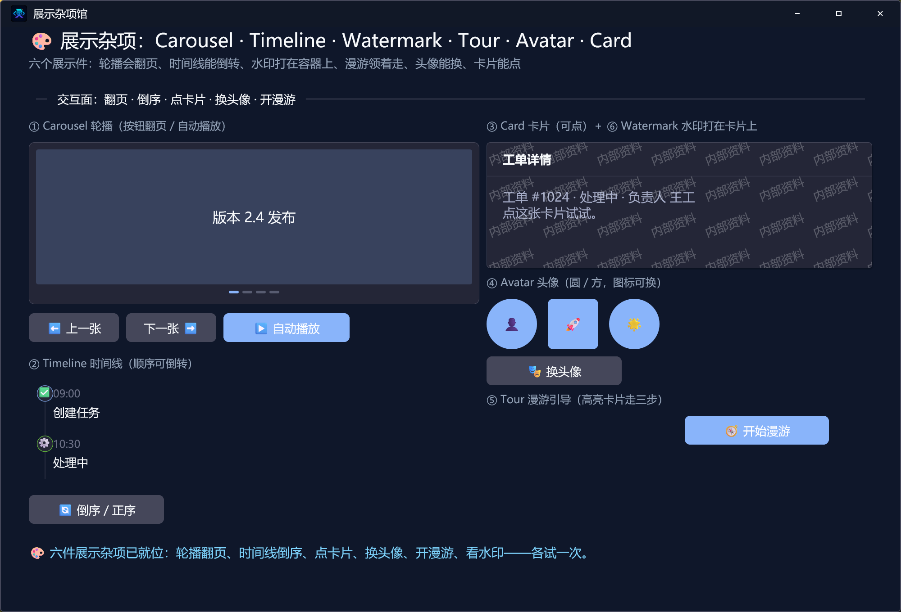

## 1. 命令与事件预告

| 命令 / 事件 | 作用 |
| --- | --- |
| `NE轮播_切到下一张(当前窗口, 轮播, delta)` | 翻页；delta=1 下一张、-1 上一张，`loop` 开着会绕回 |
| `NE轮播_设置自动播放(当前窗口, 轮播, 1, 2000)` | 开自动播放，2000 毫秒一张；轮播右上角亮出「自动播放 2秒」徽标 |
| `NE时间线_设置高级选项(当前窗口, 时间线, 0, 1, reverse, 0)` | 第 5 参 reverse=1 倒序（最新在上面），0 回正序 |
| `NE头像_设置图标(头像甲, "🐱")` | 换头像图标 |
| `NE漫游引导_设置目标元素(当前窗口, 漫游, 卡片, 8)` | 绑定高亮目标（8 = 高亮框外扩像素） |
| `NE漫游引导_设置活动(当前窗口, 漫游, 0)` + `NE漫游引导_设置打开(当前窗口, 漫游, 1)` | 从第 0 步开演 |
| `卡片_被点击()` 事件 | 整张卡片都是热区，不需要再摆透明按钮 |

> 本集只需要 new_emoji 模块。

## 2. 新建项目 + 启用模块 + 切后端

流程和第 1 集一样，项目名称填 **展示杂项馆**：

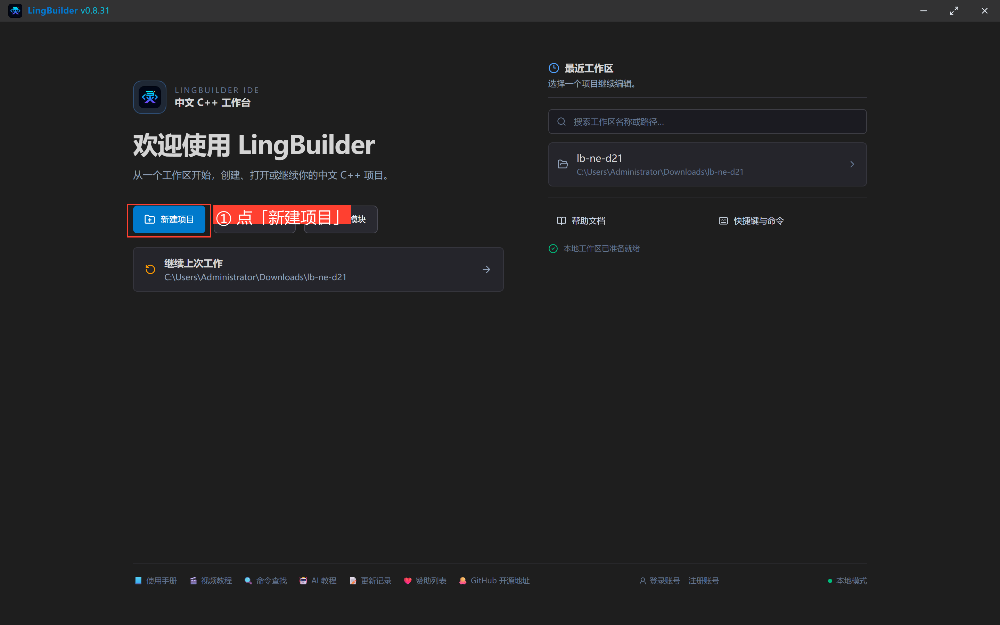

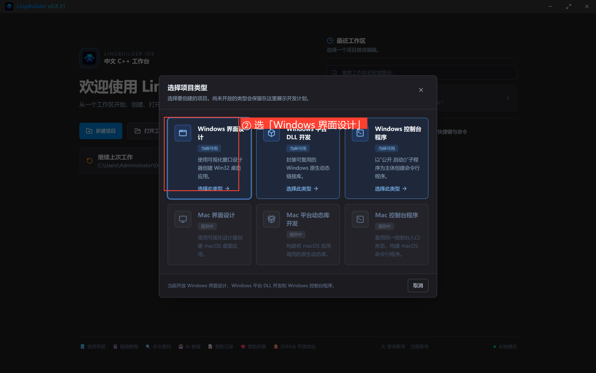

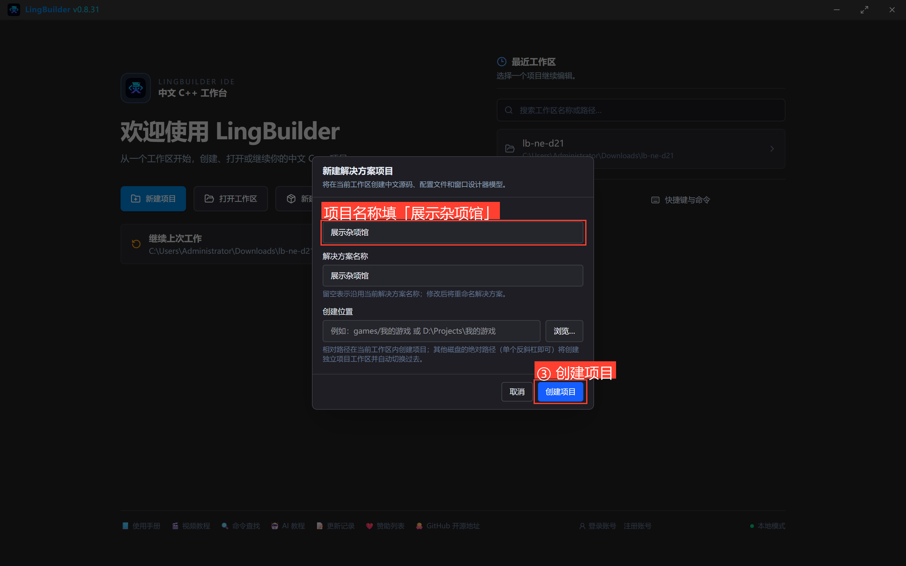

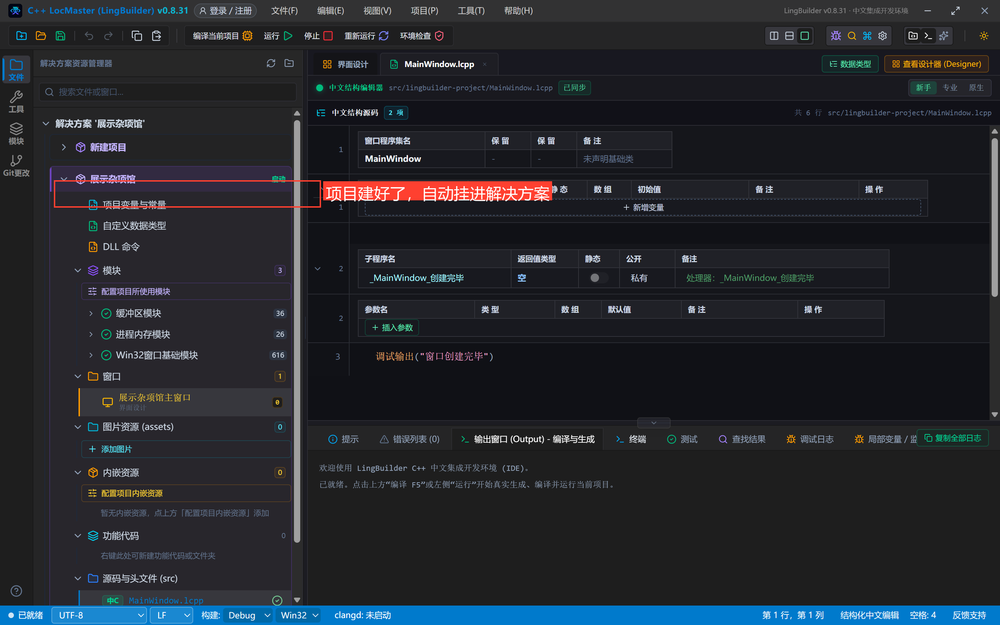

模块面板搜「原生界面」→ 启用「new_emoji 原生界面库」（首次会弹登录框，登录一次即可）：

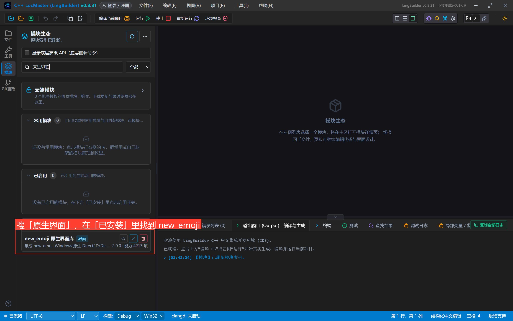

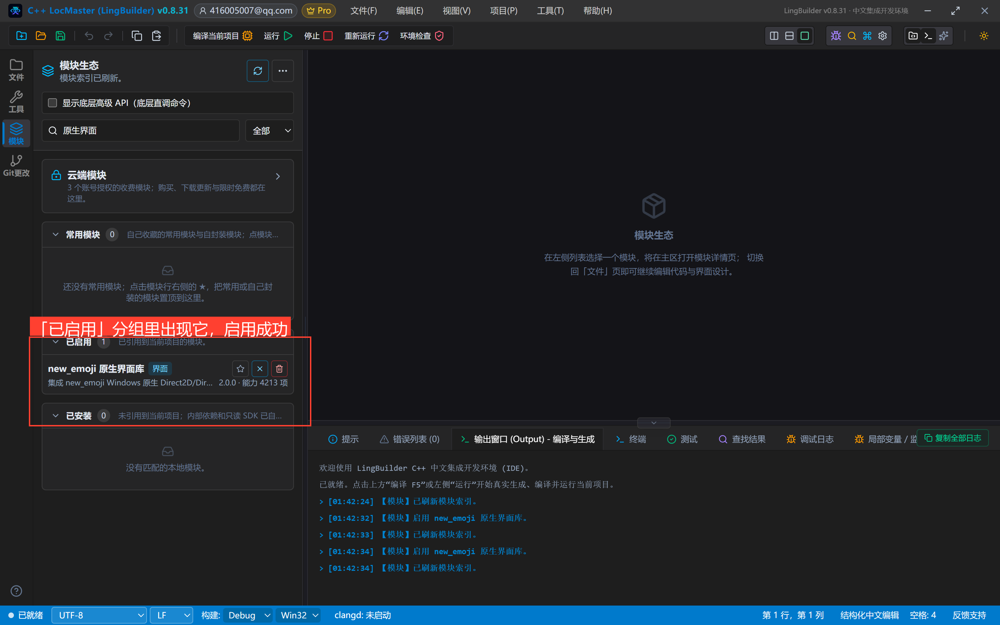

界面设计 → 选中窗口 → 确认「设计后端」是 **new_emoji 模块**：

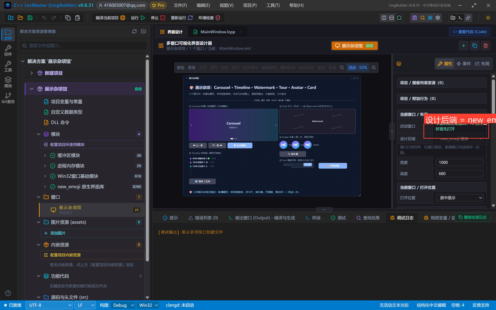

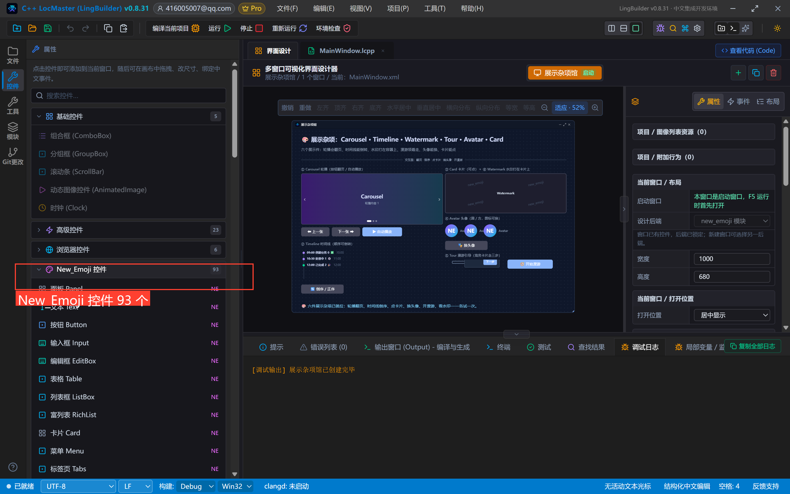

## 3. 设计界面

窗口 1000×680，左列轮播 + 时间线，右列卡片 + 水印 + 头像 + 漫游，底部状态条。

| 控件 | 名称 | 左距 | 顶距 | 宽度 | 高度 | 关键属性 |
| --- | --- | --- | --- | --- | --- | --- |
| 文本 Text | 标题文本 | 32 | 20 | 760 | 36 | 🎨 展示杂项：Carousel · Timeline · Watermark · Tour · Avatar · Card，字号 21 粗体 |
| 文本 Text | 副标题文本 | 32 | 62 | 900 | 24 | 字号 13，#94A3B8 |
| 分割线 Divider | 标题分割线 | 32 | 96 | 936 | 28 | 交互面：翻页 · 倒序 · 点卡片 · 换头像 · 开漫游 |
| 文本 Text | 轮播标签 | 32 | 132 | 500 | 22 | ① Carousel 轮播（按钮翻页 / 自动播放） |
| 轮播 Carousel | 轮播 | 32 | 158 | 500 | 180 | **items 四条；loop=真；showArrows=真；showIndicators=真；autoplay=假** |
| 按钮 Button | 上一张 | 32 | 348 | 100 | 32 | ⬅ 上一张 |
| 按钮 Button | 下一张 | 140 | 348 | 100 | 32 | 下一张 ➡ |
| 按钮 Button | 自动播放 | 248 | 348 | 140 | 32 | ▶ 自动播放，样式=主要(1) |
| 文本 Text | 时间线标签 | 32 | 396 | 500 | 22 | ② Timeline 时间线（顺序可倒转） |
| 时间线 Timeline | 时间线 | 32 | 422 | 500 | 120 | **items 三条：`09:00⇥创建任务⇥0⇥✅` 竖 Tab 分隔；showTime=真** |
| 按钮 Button | 倒序切换 | 32 | 550 | 150 | 32 | 🔄 倒序 / 正序 |
| 文本 Text | 卡片标签 | 540 | 132 | 428 | 22 | ③ Card 卡片（可点）＋ ⑥ Watermark 水印打在卡片上 |
| 卡片 Card | 卡片 | 540 | 158 | 428 | 140 | **title=工单详情；body 两行；shadow=真；绑定「被点击」** |
| 水印 Watermark | 水印 | 540 | 158 | 428 | 140 | **content=内部资料；gapX=120；gapY=80；alpha=64；rotation=-20；鼠标穿透=真** |
| 文本 Text | 头像标签 | 540 | 306 | 300 | 22 | ④ Avatar 头像（圆 / 方，图标可换） |
| 头像 Avatar | 头像甲 | 540 | 332 | 56 | 56 | 形状=圆(0)，图标 👤 |
| 头像 Avatar | 头像乙 | 608 | 332 | 56 | 56 | 形状=方(1)，图标 🚀 |
| 头像 Avatar | 头像丙 | 676 | 332 | 56 | 56 | 形状=圆(0)，图标 🌟 |
| 按钮 Button | 换头像 | 540 | 396 | 150 | 32 | 🎭 换头像 |
| 文本 Text | 漫游标签 | 540 | 436 | 300 | 22 | ⑤ Tour 漫游引导（高亮卡片走三步） |
| 漫游 Tour | 漫游 | 540 | 462 | 200 | 36 | **steps 三步（`第一步⇥这是轮播区，可以翻页` 竖 Tab 分隔）；mask=真；closeOnMask=真** |
| 按钮 Button | 开始漫游 | 760 | 462 | 160 | 32 | 🧭 开始漫游，样式=主要(1) |
| 文本 Text | 状态文本 | 32 | 604 | 936 | 44 | 字号 14，#7DD3FC，自动换行 |

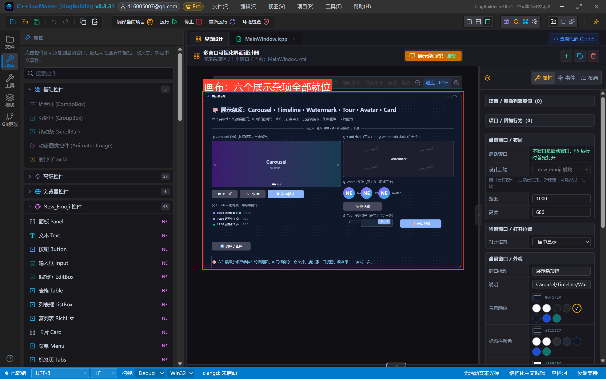

### 3.1 数据格式：还是「一行一条，Tab 分列」

轮播 `items`（一行一条）：

```
版本 2.4 发布
新组件：轮播与漫游
性能：启动快了 40%
社区：突破 10000 星
```

时间线 `items`（时间、标题、状态、图标用 Tab 分列）：

```
09:00	创建任务	0	✅
10:30	处理中	1	⚙️
12:00	已完成	2	🎉
```

漫游 `steps`（标题、正文用 Tab 分列）：

```
第一步	这是轮播区，可以翻页
第二步	这张卡片能点
第三步	看完点「完成」收工
```

### 3.2 水印的三个必须显式设置的属性

- **`alpha`（透明度）是 0~255 的整数**，越大越浓。设计器默认 42 比较淡，本集给 64。实测行为：就算你给水印设置过文字颜色，运行期浓度也只由 alpha 控制，颜色只提供色调——不会突然变成实心大字。
- **`鼠标穿透` 必须显式设为「真」**。属性发射器只发射你显式设置过的属性，没设过的按「假」下发——水印压在卡片上又不穿透，卡片就永远收不到点击。本集拍摄时真实踩到：不设穿透时点卡片毫无反应，显式设真之后立刻恢复。
- **`containerId`（容器ID）留空 = 铺满整个窗口叠加**；要打在某个容器里就填那个控件的 ID（不是显示名）。本集想让水印和卡片完全重合，直接把水印摆成和卡片同样的位置尺寸、留空容器即可。

### 3.3 Tour 控件摆多小都行

设计器里漫游只是个 200×36 的小占位，运行期气泡会按内容自动放大（最小 300×150 逻辑尺寸，200% 缩放屏也按比例放大），标题、正文、页码、上一步/下一步按钮都排得开——不用为了装下文字把设计器里的占位拉很大。

## 4. 写代码

```lcpp
类 MainWindow
    事件 _MainWindow_创建完毕()
        NE漫游引导_设置目标元素(当前窗口, 漫游, 卡片, 8)
        控件_设置文本(状态文本, "🎨 六件展示杂项已就位：轮播翻页、时间线倒序、点卡片、换头像、开漫游、看水印——各试一次。")
        调试输出("展示杂项馆已创建完毕")
    结束

    事件 _上一张_被单击()
        NE轮播_切到下一张(当前窗口, 轮播, -1)
        控件_设置文本(状态文本, "⬅ NE轮播_切到下一张(轮播, -1)：delta 为负就是往回翻。")
    结束

    事件 _下一张_被单击()
        NE轮播_切到下一张(当前窗口, 轮播, 1)
        控件_设置文本(状态文本, "➡ NE轮播_切到下一张(轮播, 1)：翻到下一张，循环开着会绕回第一张。")
    结束

    事件 _自动播放_被单击()
        NE轮播_设置自动播放(当前窗口, 轮播, 1, 2000)
        控件_设置文本(状态文本, "▶ NE轮播_设置自动播放(轮播, 1, 2000)：每 2 秒自动翻一张。")
    结束

    事件 _倒序切换_被单击()
        如果 (时间线倒序 = 假)
            时间线倒序 = 真
            NE时间线_设置高级选项(当前窗口, 时间线, 0, 1, 1, 0)
            控件_设置文本(状态文本, "🔄 NE时间线_设置高级选项(..., reverse=1)：时间线倒过来，最新在上面。")
        否则
            时间线倒序 = 假
            NE时间线_设置高级选项(当前窗口, 时间线, 0, 1, 0, 0)
            控件_设置文本(状态文本, "🔄 reverse=0：时间线回到正序。")
        如果结束
    结束

    事件 _卡片_被点击()
        控件_设置文本(状态文本, "🖱️ 卡片的「被点击」事件触发——整张卡都是热区，不用再摆透明按钮。")
    结束

    事件 _换头像_被单击()
        头像序号 = 头像序号 + 1
        如果 (头像序号 > 3)
            头像序号 = 1
        如果结束
        如果 (头像序号 = 1)
            NE头像_设置图标(头像甲, "🐱")
        如果结束
        如果 (头像序号 = 2)
            NE头像_设置图标(头像甲, "🦊")
        如果结束
        如果 (头像序号 = 3)
            NE头像_设置图标(头像甲, "👤")
        如果结束
        控件_设置文本(状态文本, "🎭 NE头像_设置图标(头像甲, …)：圆形头像的图标换成了第 " + 到文本(头像序号) + " 组。")
    结束

    事件 _开始漫游_被单击()
        NE漫游引导_设置活动(当前窗口, 漫游, 0)
        NE漫游引导_设置打开(当前窗口, 漫游, 1)
        控件_设置文本(状态文本, "🧭 NE漫游引导_设置打开(漫游, 1)：遮罩蒙住全窗，高亮框跟着步骤走，点蒙或按提示前进。")
    结束
结束类
```

四个看点：

1. **`时间线倒序` / `头像序号` 是项目全局变量**（项目全局变量.lcpp 里 `全局 逻辑型 时间线倒序 = 假`），跨事件记状态。
2. **`NE轮播_切到下一张` 的 delta 是「张数偏移」**：-1 上一张、1 下一张，比「上一张/下一张两条命令」好记。
3. **`NE时间线_设置高级选项` 共 6 个参数**，本集只关心第 5 个 reverse；对照第 19 集的时间线命令一起记。
4. **换头像用序号循环**：1→🐱、2→🦊、3→👤，再点回 1，比写一堆「当前图标是什么」的判断省事。

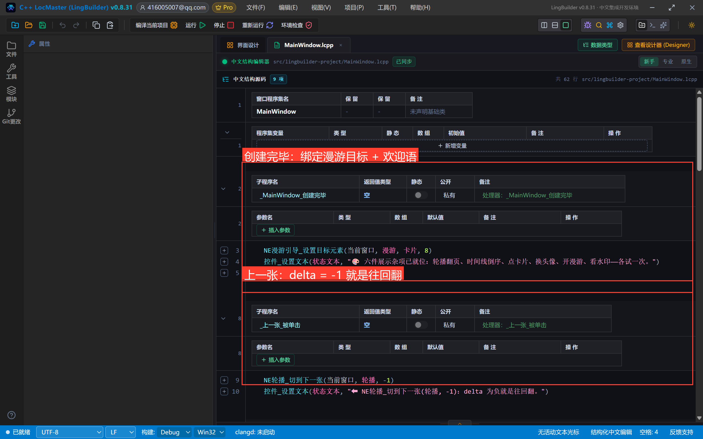

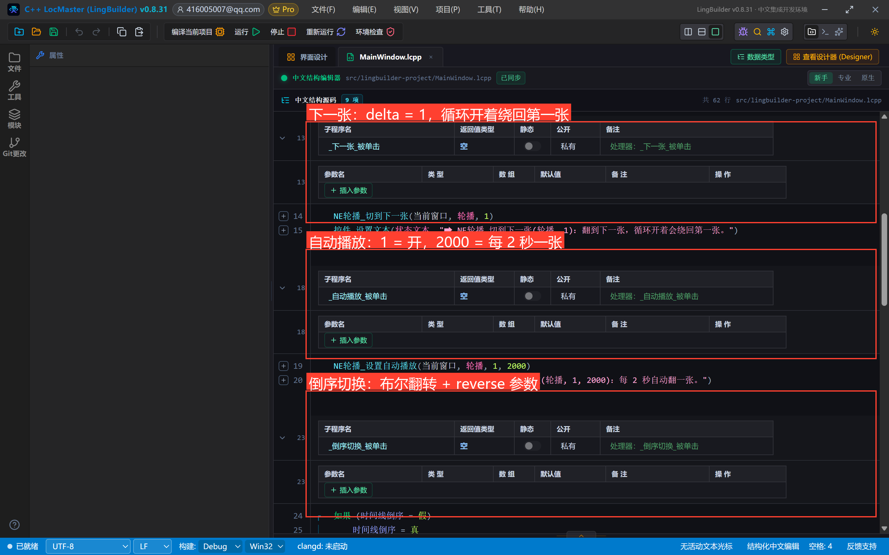

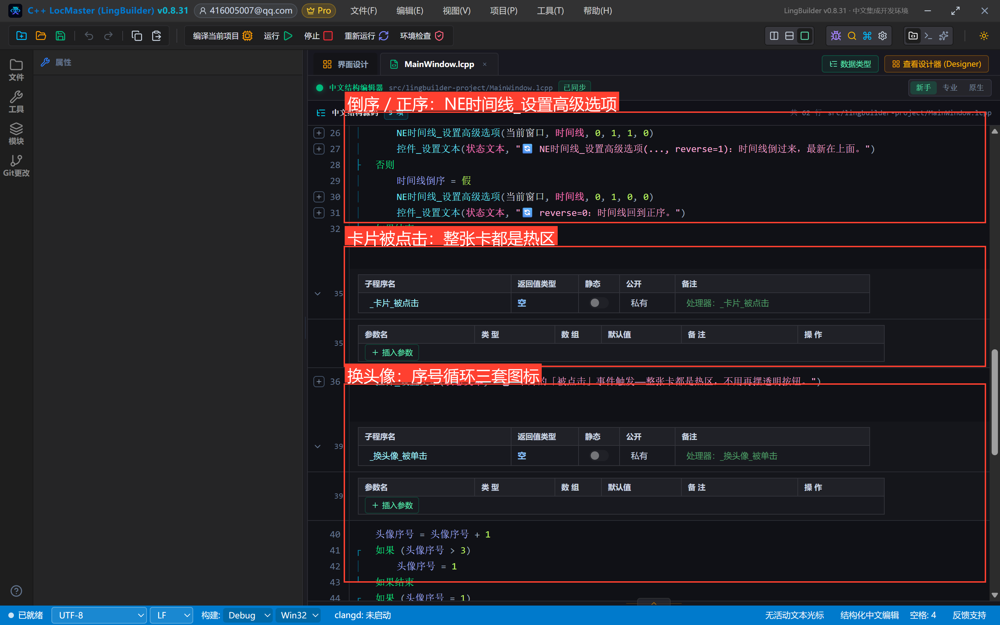

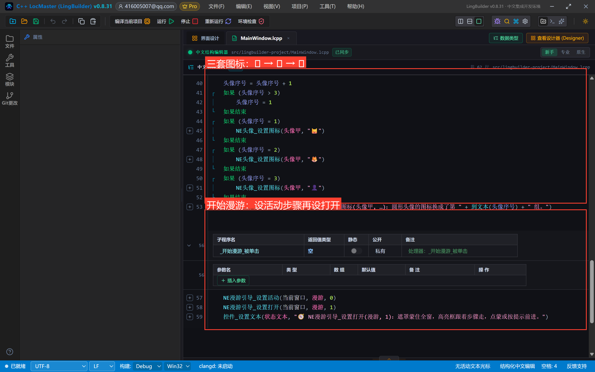

## 5. 编译前先看错误列表

点「编译当前项目」，先看底部错误列表——零报错再继续：

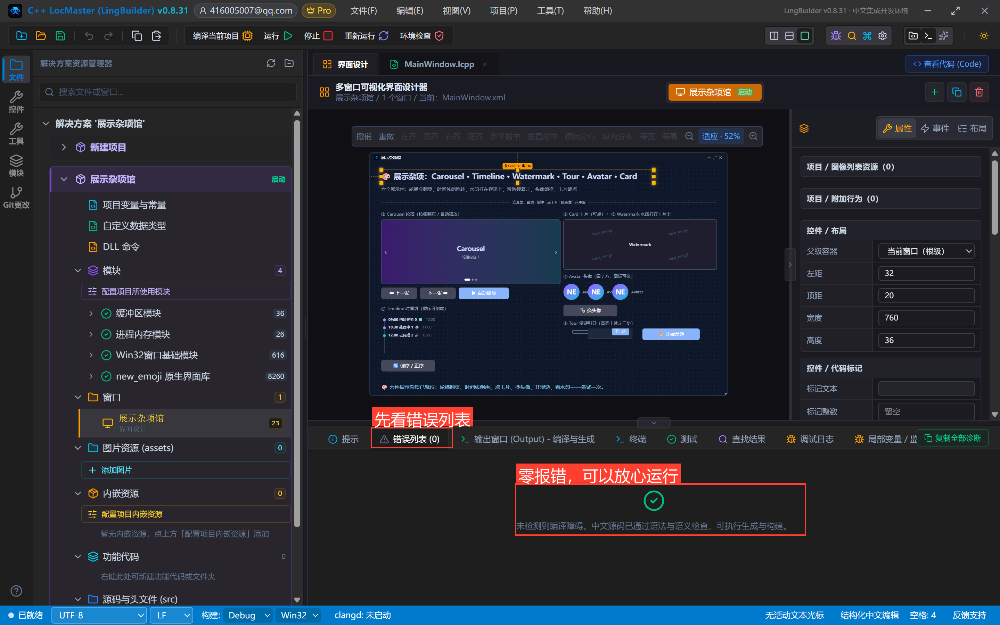

## 6. 运行！六个互动各试一次

点「运行」。左列轮播 + 时间线，右列卡片（带水印）+ 头像 + 漫游：

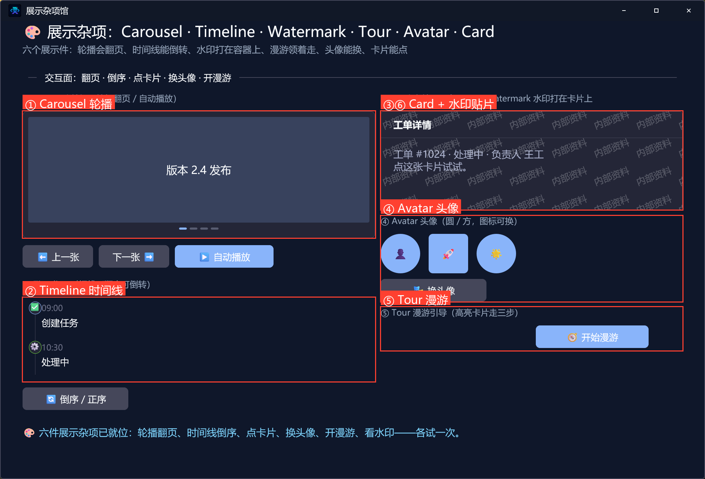

**① 点「下一张 ➡」**——轮播翻到第 2 张「新组件：轮播与漫游」，指示器跟着走：

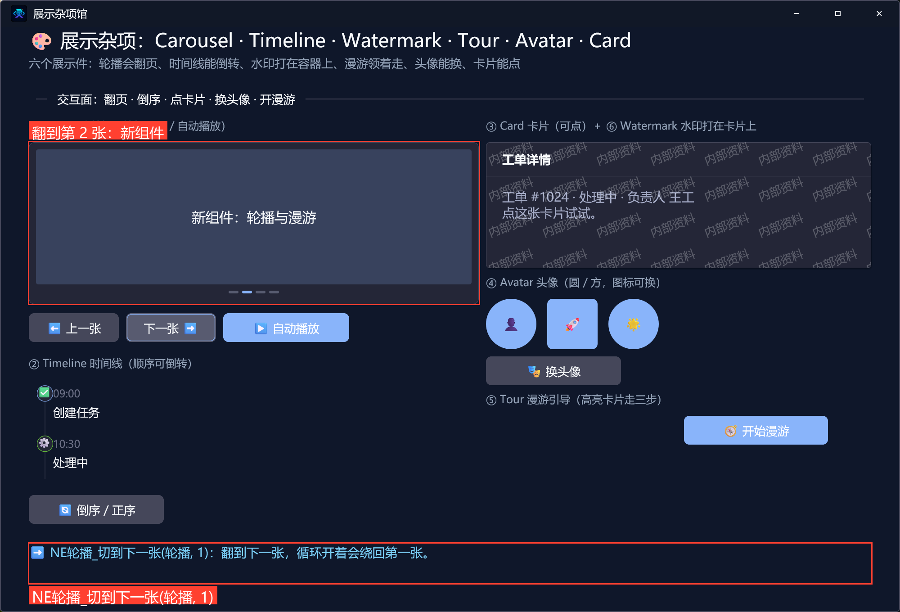

**② 点「▶ 自动播放」**——轮播右上角亮出「自动播放 2秒」徽标，每 2 秒自己翻一张：

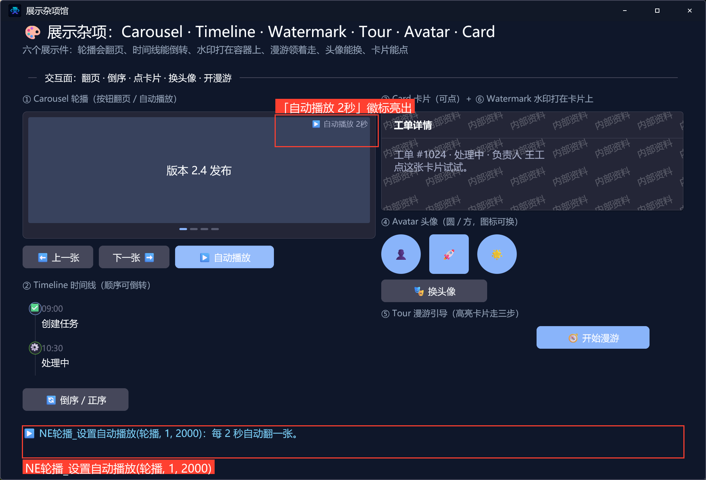

**③ 点「🔄 倒序 / 正序」**——时间线倒过来，「12:00 已完成」排到最上面；再点一次回正序：

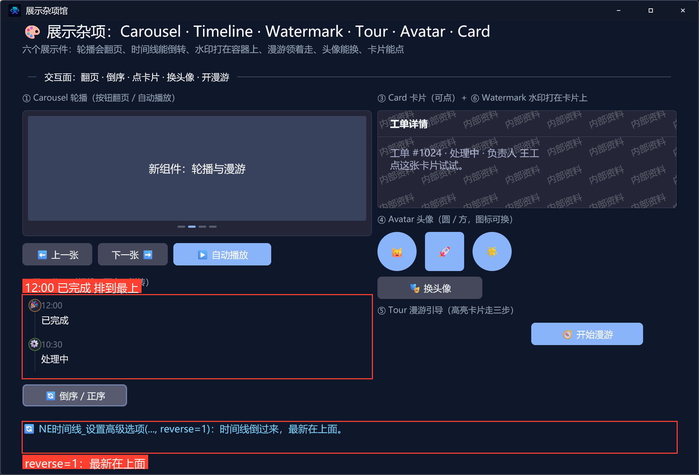

**④ 点卡片**——整张卡都是热区，「被点击」事件触发。注意水印就压在卡片上：因为把水印的「鼠标穿透」显式设了真，点击会穿过水印落到卡片上：

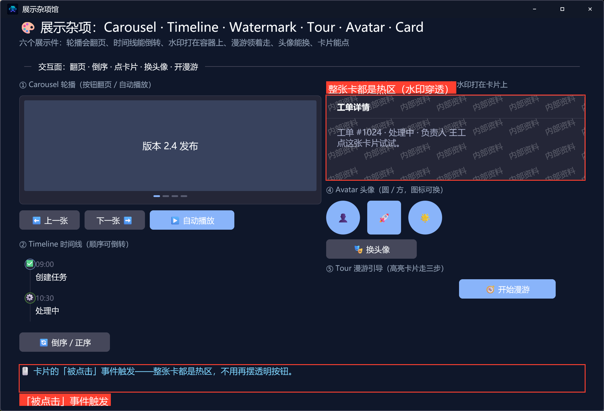

**⑤ 点「🎭 换头像」**——圆形头像甲的图标按 🐱 → 🦊 → 👤 循环换：

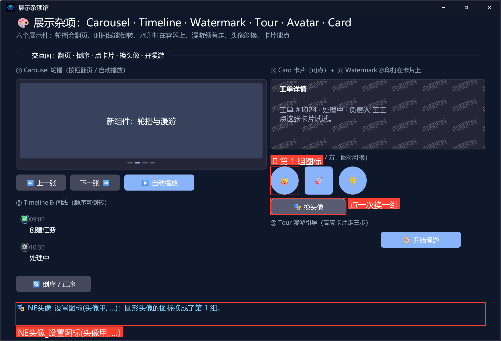

**⑥ 点「🧭 开始漫游」**——遮罩蒙住全窗，蓝色高亮框框住卡片，气泡显示「第一步 · 这是轮播区，可以翻页 · 1/3」，点「下一步」前进、点蒙或 × 关闭：

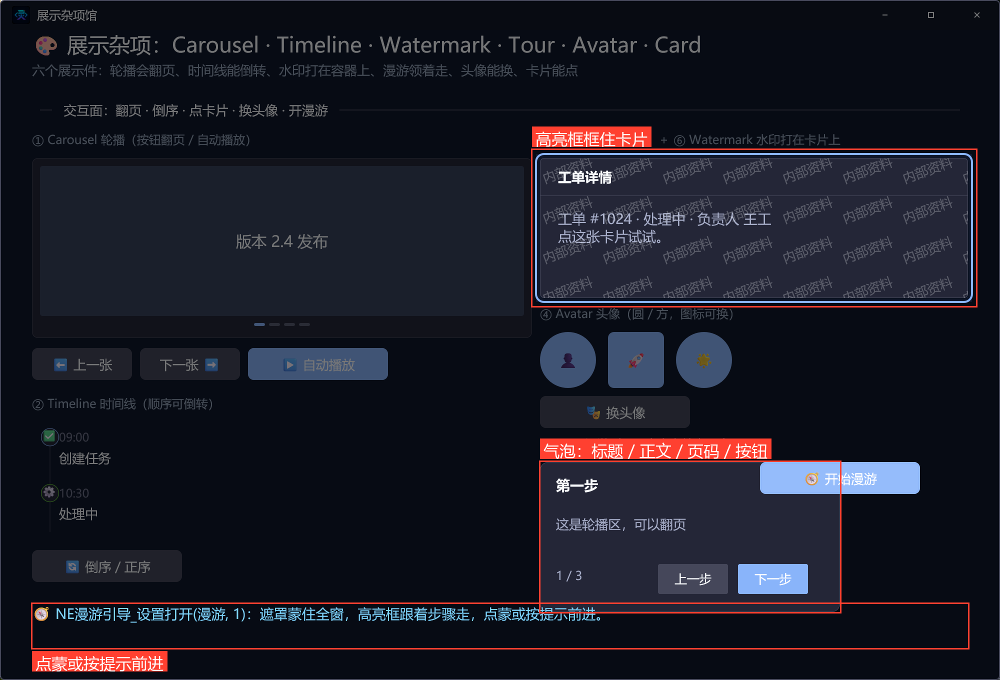

## 7. 导出源码包

命令面板执行「项目：一键导出 LCPP 源码包」即可。

## 本集源码包

- 网页版：[21-展示杂项馆.lcpppkg](https://lingbuilder.com/demos)（示例源码区可下载）

## 下一集预告

窗口结构件：Header 页眉、Footer 页脚、PageHeader 页头、Panel 面板、Omnibox 地址栏、BrowserViewport 浏览器视口——用 NE 拼一个「浏览器窗口」的骨架。
