# NE 合集 23 · 主题定制：一枚令牌，全窗换装

> 《LingBuilder new_emoji 合集》第 23 集。new_emoji 的控件颜色不是散落在各控件里的「死色」，而是集中在一套**主题令牌**上：`accent` 强调色、`panel_bg` 窗口底色、`titlebar_bg` 标题栏、`button_bg` 按钮底色……一条 `NE_设置主题令牌` 命令改令牌，整窗相关控件立刻换装。这一集先做小实验再上全窗换装，把「哪些运行期真能换、哪些只吃设计器初值」逐个验证清楚。全程约 30 分钟。
>
> 前置要求：完成[第 22 集](/guide/tutorials/new-emoji-22)。本集源码包见文末。

## 这一集你将学会

- `NE_设置主题令牌(窗口句柄, 令牌名, 0xAARRGGBB)`：运行期改主题令牌，即时生效
- 常用令牌：`accent` 强调色 · `panel_bg` 窗口底色 · `titlebar_bg` 标题栏 · `button_bg` 按钮底色 · `text_primary` 主文字 · `success / warning / danger` 语义色
- `窗口_取自身句柄()`：拿到当前窗口的句柄喂给令牌命令
- 窗口的 `background` / `titleBarBackground` 属性就是主题令牌的**初值**：设计器里改的是生成时的起点，运行期再改走令牌命令

先看一眼本集成品——深色窗口里摆着一排「吃令牌」的控件，右边六枚换装按钮点一下全窗换色：

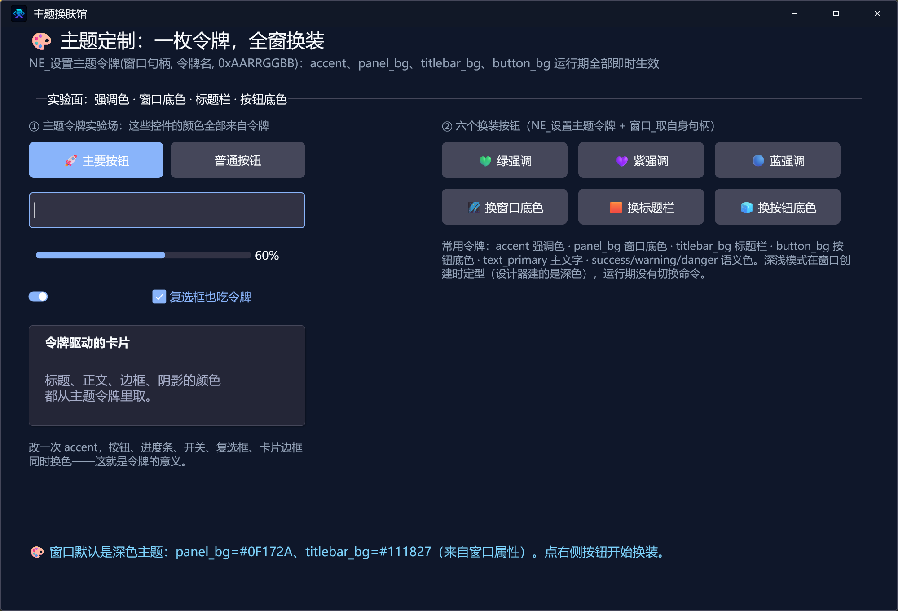

## 1. 命令与事件预告

| 命令 | 作用 |
| --- | --- |
| `NE_设置主题令牌(窗口_取自身句柄(), "accent", 0xFF22C55E)` | 改强调色：主要按钮、进度条、开关、复选框、卡片描边同时变色 |
| `NE_设置主题令牌(窗口_取自身句柄(), "panel_bg", 0xFF101828)` | 改窗口底色，即时刷新不用重开窗口 |
| `NE_设置主题令牌(窗口_取自身句柄(), "titlebar_bg", 0xFF7C2D12)` | 改标题栏底色（连同步快照一起换，立刻变色） |
| `NE_设置主题令牌(窗口_取自身句柄(), "button_bg", 0xFF334155)` | 改普通按钮的底色 |
| `窗口_取自身句柄()` | 返回当前窗口句柄（长整数），喂给令牌命令 |

> 本集只需要 new_emoji 模块（`窗口_取自身句柄` 来自随包启用的 win32 基础命令）。

## 2. 新建项目 + 启用模块 + 切后端

流程和第 1 集一样，项目名称填 **主题换肤馆**：

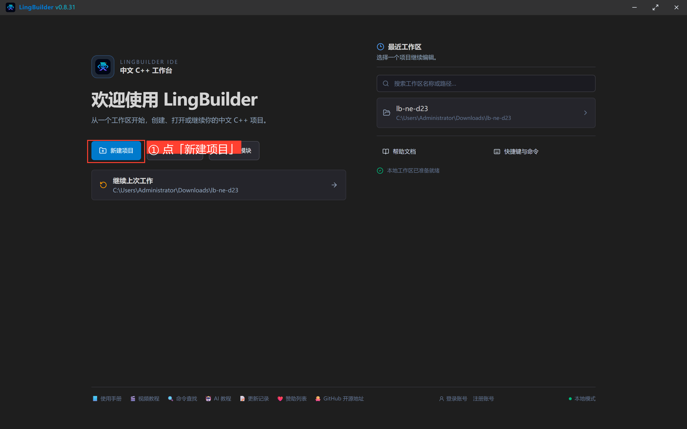

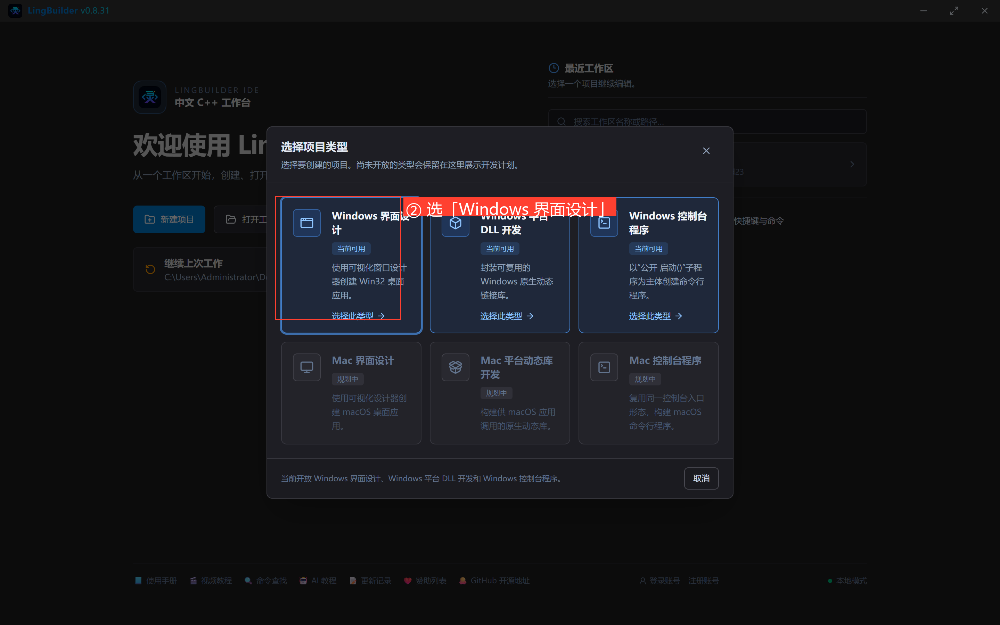

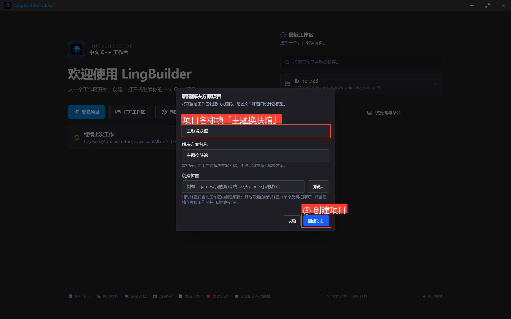

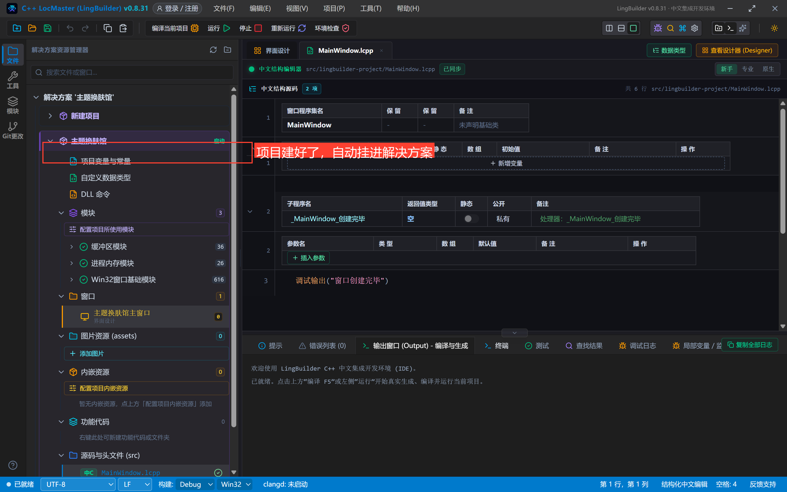

模块面板搜「原生界面」→ 启用「new_emoji 原生界面库」（首次会弹登录框，登录一次即可）：

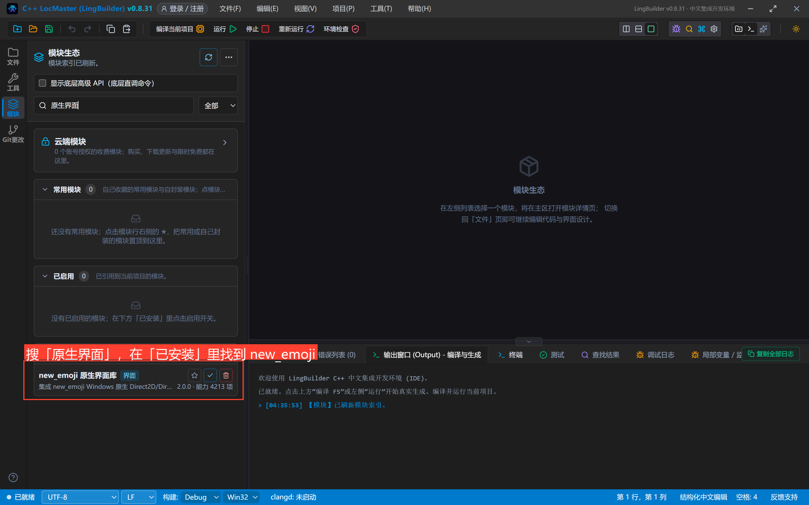

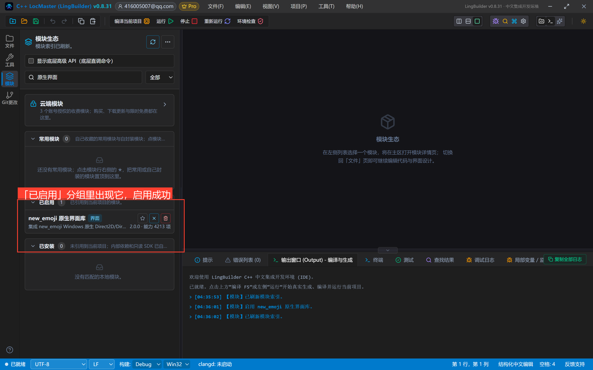

界面设计 → 选中窗口 → 确认「设计后端」是 **new_emoji 模块**：

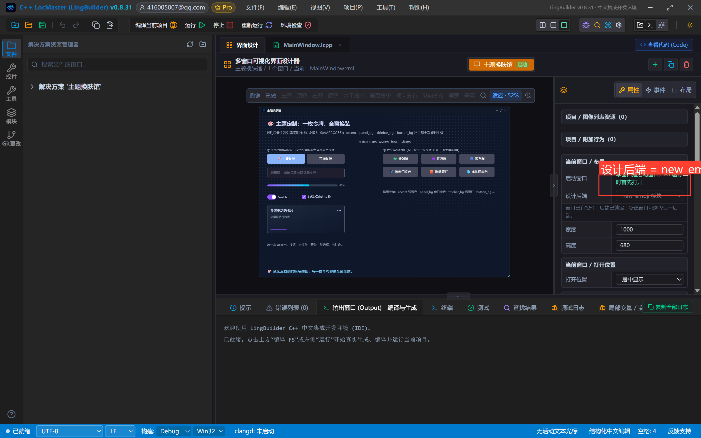

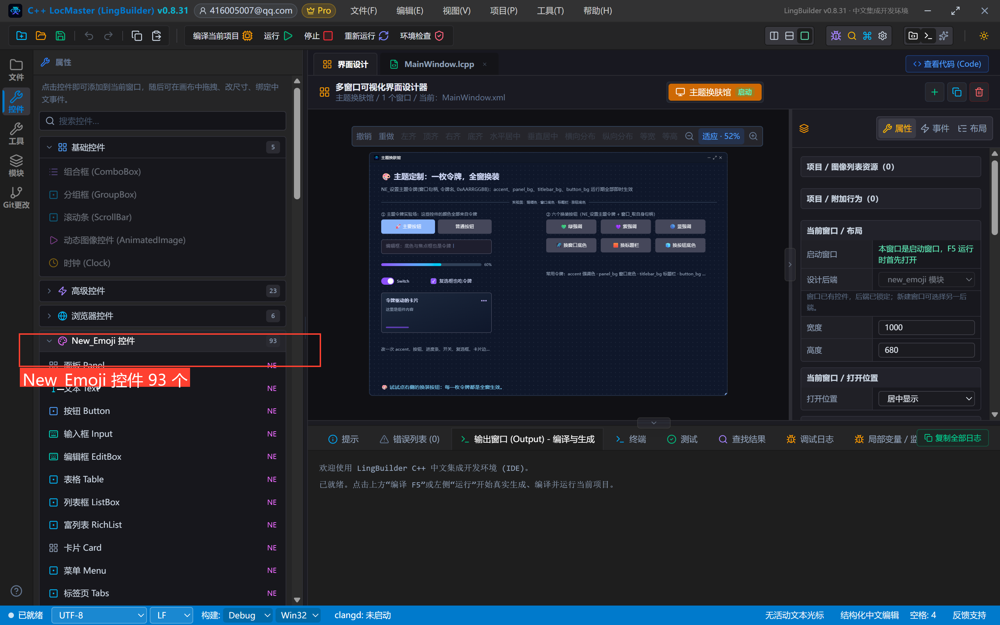

## 3. 设计界面

窗口 1000×680。左列是「实验场」——摆一排颜色全部来自令牌的控件；右列是六个换装按钮和令牌速查。

| 控件 | 名称 | 左距 | 顶距 | 宽度 | 高度 | 关键属性 |
| --- | --- | --- | --- | --- | --- | --- |
| 文本 Text | 标题文本 | 32 | 20 | 700 | 36 | 🎨 主题定制：一枚令牌，全窗换装，字号 21 粗体 |
| 文本 Text | 副标题文本 | 32 | 62 | 920 | 24 | 字号 13，#94A3B8 |
| 分割线 Divider | 标题分割线 | 32 | 96 | 936 | 28 | 实验面：强调色 · 窗口底色 · 标题栏 · 按钮底色 |
| 文本 Text | 展示标签 | 32 | 132 | 440 | 22 | ① 主题令牌实验场：这些控件的颜色全部来自令牌 |
| 按钮 Button | 主要按钮 | 32 | 158 | 150 | 40 | 🚀 主要按钮，样式=主要(1)——底色就是 accent |
| 按钮 Button | 普通按钮 | 190 | 158 | 150 | 40 | 普通按钮——底色是 button_bg |
| 编辑框 EditBox | 输入框 | 32 | 214 | 308 | 40 | 占位：编辑框：底色与焦点框也是令牌 |
| 进度条 Progress | 进度条 | 32 | 270 | 308 | 28 | value=60，showText=真——轨道色是 accent |
| 开关 Switch | 开关 | 32 | 314 | 120 | 32 | 选中=真——开启色是 accent |
| 复选框 Checkbox | 复选框 | 170 | 314 | 170 | 32 | 选中=真，文本「复选框也吃令牌」 |
| 卡片 Card | 样例卡片 | 32 | 362 | 308 | 112 | title=令牌驱动的卡片；body 两行；shadow=真 |
| 文本 Text | 展示说明 | 32 | 490 | 308 | 60 | 字号 12，#94A3B8，自动换行 |
| 文本 Text | 换装标签 | 492 | 132 | 456 | 22 | ② 六个换装按钮（NE_设置主题令牌 + 窗口_取自身句柄） |
| 按钮 Button | 绿强调 | 492 | 158 | 140 | 40 | 💚 绿强调 |
| 按钮 Button | 紫强调 | 644 | 158 | 140 | 40 | 💜 紫强调 |
| 按钮 Button | 蓝强调 | 796 | 158 | 140 | 40 | 🔵 蓝强调 |
| 按钮 Button | 换窗口底色 | 492 | 210 | 140 | 40 | 🌌 换窗口底色 |
| 按钮 Button | 换标题栏 | 644 | 210 | 140 | 40 | 🟧 换标题栏 |
| 按钮 Button | 换按钮底色 | 796 | 210 | 140 | 40 | 🧊 换按钮底色 |
| 文本 Text | 令牌说明 | 492 | 266 | 456 | 88 | 常用令牌速查，字号 12，#94A3B8，自动换行 |
| 文本 Text | 状态文本 | 32 | 604 | 936 | 44 | 字号 14，#7DD3FC，自动换行 |

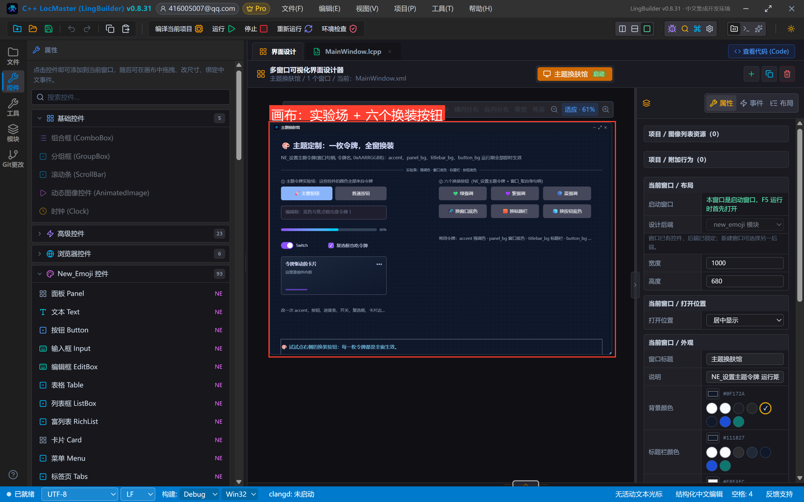

### 3.1 窗口的背景属性就是令牌初值

设计器里窗口的 `background`（#0F172A）和 `titleBarBackground`（#111827）不是普通属性——生成代码时它们被翻译成 `panel_bg` / `titlebar_bg` 两枚令牌的初值写进去。所以「改窗口背景」有两个时机：设计器属性改的是**生成时起点**；运行期想换，走 `NE_设置主题令牌`。本集两个都演示。

### 3.2 深浅模式在窗口创建时定型

设计器新建的 NE 窗口是**深色主题**。主题的深/浅模式没有运行期切换的中文命令（引擎里有，但属于底层直调，.lcpp 调不了）——想换浅色，从窗口属性把 `background` / `titleBarBackground` 配成浅色系即可，令牌照常生效。

### 3.3 颜色值写法

`NE_设置主题令牌` 的第三个参数是 **0xAARRGGBB** 十六进制字面量：`0xFF22C55E` = 不透明绿色（FF 是 alpha，后面是 RRGGBB）。想调透明度就改前两位。

## 4. 写代码

```lcpp
类 MainWindow
    事件 _MainWindow_创建完毕()
        控件_设置文本(状态文本, "🎨 窗口默认是深色主题：panel_bg=#0F172A、titlebar_bg=#111827（来自窗口属性）。点右侧按钮开始换装。")
        调试输出("主题换肤馆已创建完毕")
    结束

    事件 _绿强调_被单击()
        NE_设置主题令牌(窗口_取自身句柄(), "accent", 0xFF22C55E)
        控件_设置文本(状态文本, "💚 accent = #22C55E：主要按钮、进度条、开关、复选框、卡片描边同时变绿。")
    结束

    事件 _紫强调_被单击()
        NE_设置主题令牌(窗口_取自身句柄(), "accent", 0xFFA78BFA)
        控件_设置文本(状态文本, "💜 accent = #A78BFA：一枚令牌，全窗强调色一起换。")
    结束

    事件 _蓝强调_被单击()
        NE_设置主题令牌(窗口_取自身句柄(), "accent", 0xFF60A5FA)
        控件_设置文本(状态文本, "🔵 accent = #60A5FA：回到蓝色系。")
    结束

    事件 _换窗口底色_被单击()
        如果 (底色状态 = 0)
            底色状态 = 1
            NE_设置主题令牌(窗口_取自身句柄(), "panel_bg", 0xFF101828)
            控件_设置文本(状态文本, "🌌 panel_bg = #101828：窗口底色即时刷新，不用重开窗口。")
        否则
            底色状态 = 0
            NE_设置主题令牌(窗口_取自身句柄(), "panel_bg", 0xFF0F172A)
            控件_设置文本(状态文本, "🌌 panel_bg 回到默认的 #0F172A。")
        如果结束
    结束

    事件 _换标题栏_被单击()
        如果 (标题栏状态 = 0)
            标题栏状态 = 1
            NE_设置主题令牌(窗口_取自身句柄(), "titlebar_bg", 0xFF7C2D12)
            NE_设置主题令牌(窗口_取自身句柄(), "titlebar_text", 0xFFFFEDD5)
            控件_设置文本(状态文本, "🟧 titlebar_bg = #7C2D12：标题栏连同步快照一起换，立刻变色。")
        否则
            标题栏状态 = 0
            NE_设置主题令牌(窗口_取自身句柄(), "titlebar_bg", 0xFF111827)
            NE_设置主题令牌(窗口_取自身句柄(), "titlebar_text", 0xFFF8FAFC)
            控件_设置文本(状态文本, "🟧 标题栏回到默认的 #111827。")
        如果结束
    结束

    事件 _换按钮底色_被单击()
        如果 (按钮状态 = 0)
            按钮状态 = 1
            NE_设置主题令牌(窗口_取自身句柄(), "button_bg", 0xFF334155)
            控件_设置文本(状态文本, "🧊 button_bg = #334155：普通按钮的底色整体变冷。")
        否则
            按钮状态 = 0
            NE_设置主题令牌(窗口_取自身句柄(), "button_bg", 0xFF45475A)
            控件_设置文本(状态文本, "🧊 button_bg 回到默认的 #45475A。")
        如果结束
    结束
结束类
```

四个看点：

1. **`底色状态` / `标题栏状态` / `按钮状态` 是项目全局变量**——三个开关按钮都用「翻转 + 双令牌」的套路。
2. **句柄来自 `窗口_取自身句柄()`**：返回长整数，生成器会自动转成命令要的窗口句柄。
3. **改标题栏要连 `titlebar_text` 一起改**——底色变浅了文字还是浅色会看不清。
4. **令牌名就是那几个英文小写单词**：`accent` / `panel_bg` / `titlebar_bg` / `titlebar_text` / `button_bg` / `edit_bg` / `edit_focus` / `text_primary` / `text_secondary` / `border_default` / `success` / `warning` / `danger`……全部见文末速查。

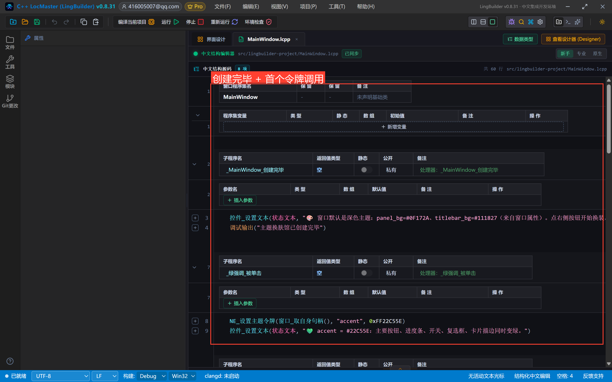

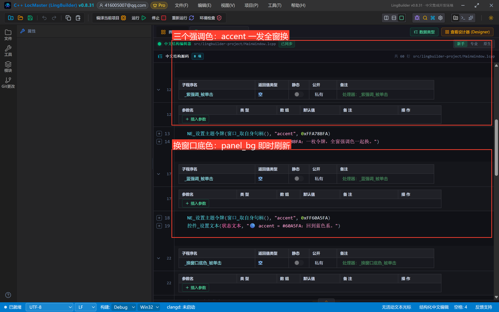

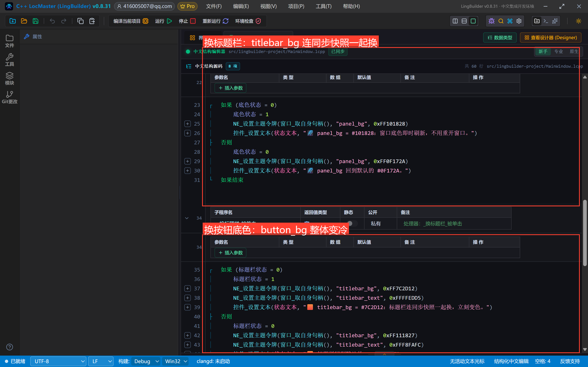

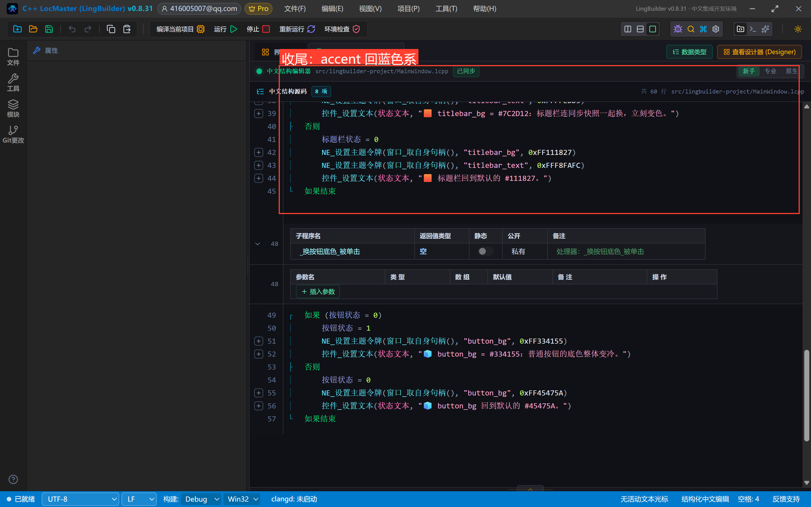

## 5. 编译前先看错误列表

点「编译当前项目」，先看底部错误列表——零报错再继续：

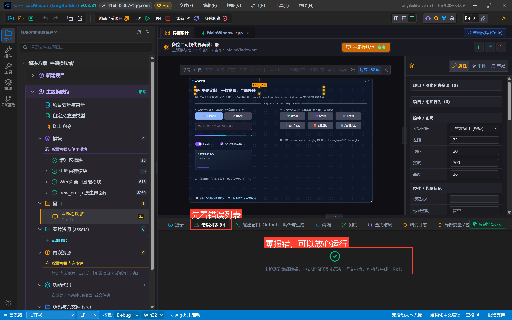

## 6. 运行！六次换装各来一次

点「运行」。左列实验场（主要按钮、编辑框、进度条、开关、复选框、卡片），右列六个换装按钮：

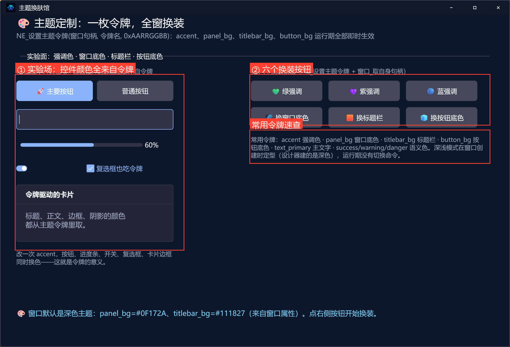

**① 点「💚 绿强调」**——一枚 `accent` 令牌，主要按钮、进度条、开关、复选框、卡片描边同时变绿：

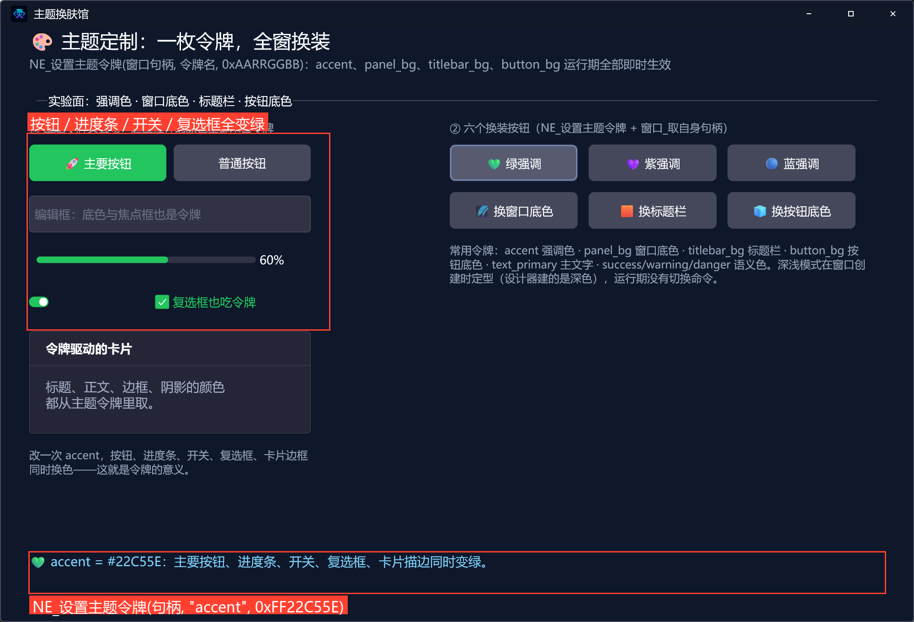

**② 点「🌌 换窗口底色」**——`panel_bg` 换成 #101828，整窗底色即时刷新：

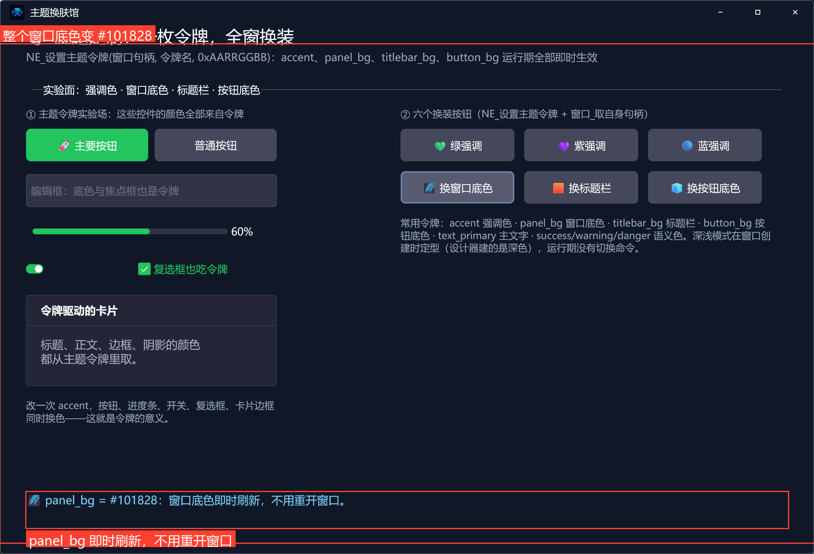

**③ 点「🟧 换标题栏」**——`titlebar_bg` 连 `titlebar_text` 一起换成橙棕系，标题栏立刻变色：

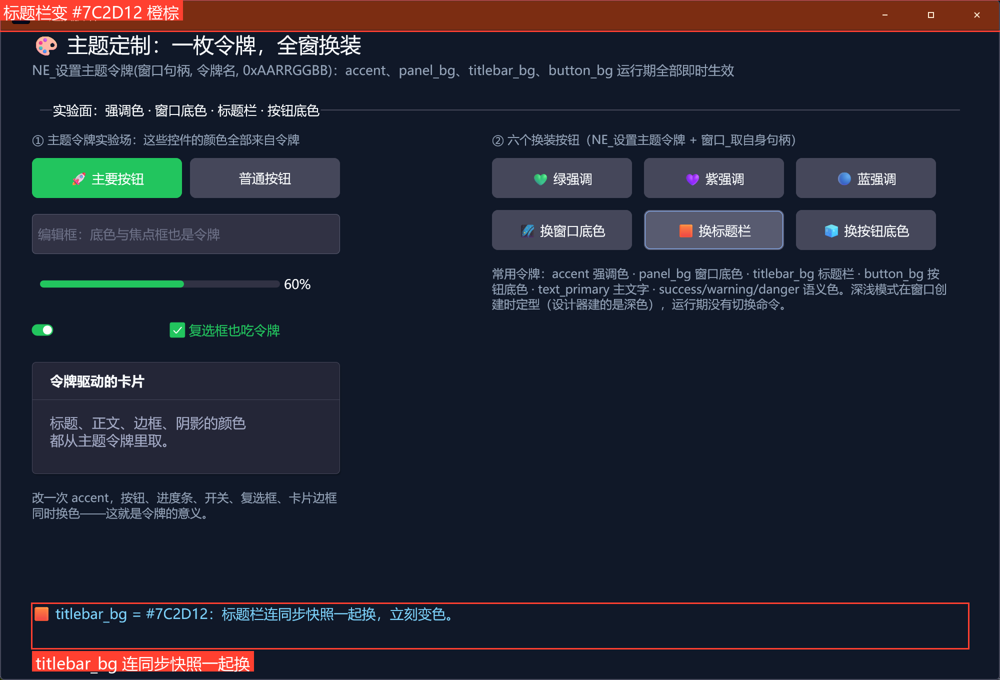

**④ 点「🧊 换按钮底色」**——`button_bg` 变冷，普通按钮的底色整体变化：

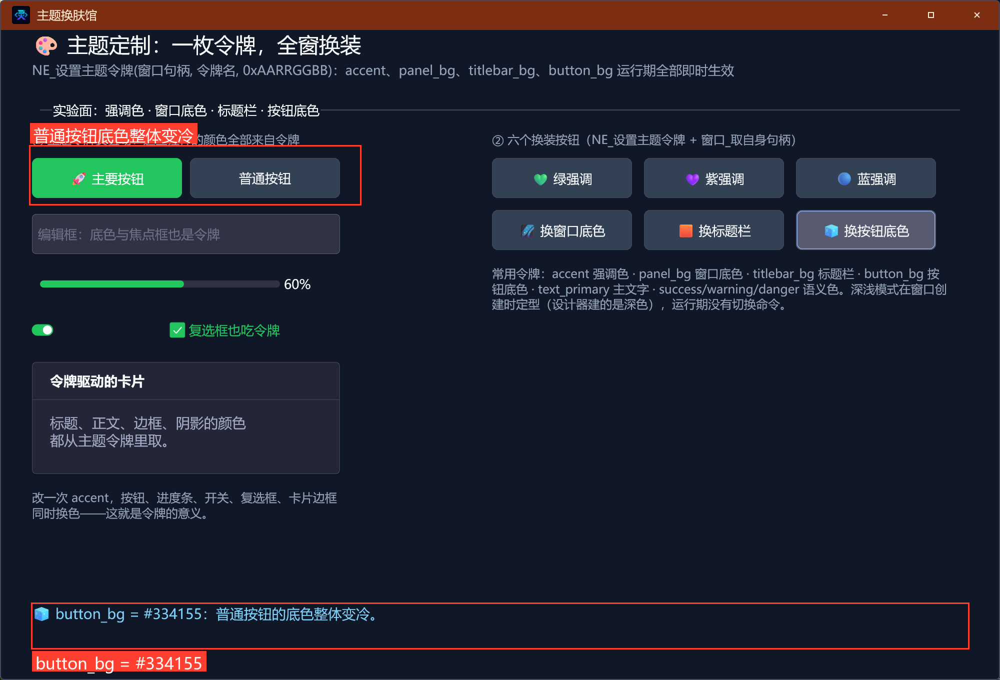

**⑤ 点「💜 紫强调」**——强调色整体换紫：

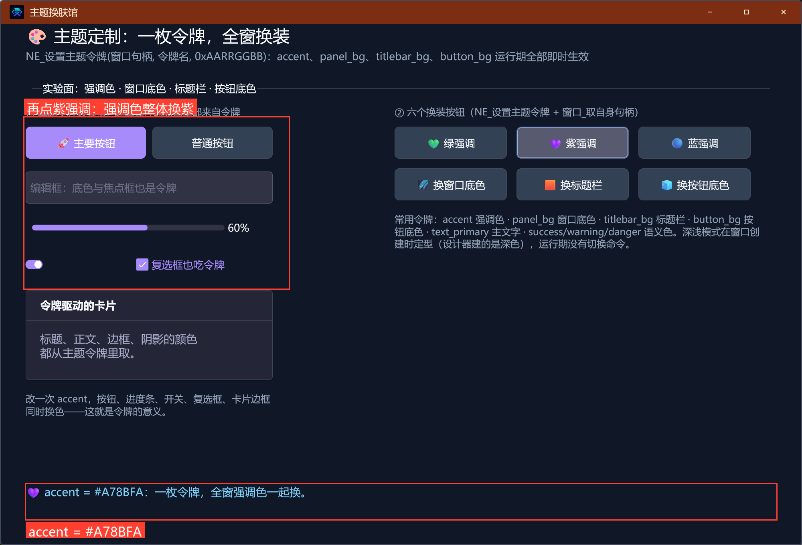

**⑥ 点「🔵 蓝强调」收尾**——回到蓝色系：

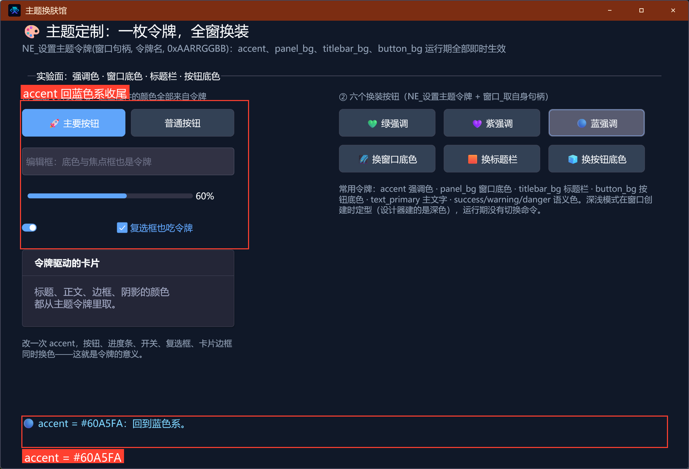

## 7. 导出源码包

命令面板执行「项目：一键导出 LCPP 源码包」即可。

## 本集源码包

- 网页版：[23-主题换肤馆.lcpppkg](https://lingbuilder.com/demos)（示例源码区可下载）

## 附：常用主题令牌速查

| 令牌名 | 管什么 |
| --- | --- |
| `accent` | 强调色：主要按钮、进度条、开关、复选框选中态、输入框焦点框 |
| `panel_bg` | 窗口/面板底色 |
| `titlebar_bg` / `titlebar_text` | 标题栏底色 / 标题文字色 |
| `button_bg` / `button_hover` / `button_press` | 普通按钮 底 / 悬停 / 按下 |
| `edit_bg` / `edit_border` / `edit_focus` | 编辑框 底色 / 边框 / 焦点框 |
| `text_primary` / `text_secondary` / `text_muted` | 主文字 / 次要文字 / 弱文字 |
| `border_default` | 默认边框 |
| `primary` / `secondary` / `muted` | 语义：主 / 次 / 弱 |
| `info` / `success` / `warning` / `danger` | 语义：信息 / 成功 / 警告 / 危险 |

## 下一集预告

综合实战（一）现代数据看板：KpiCard、趋势图、统计数字、折线/柱状/环形/仪表盘、数据表格——把前 22 集的展示件拼成一间「驾驶舱」。
