# NE 合集 24 · 综合实战（一）：现代数据看板

> 《LingBuilder new_emoji 合集》第 24 集。综合实战第一弹：把前 22 集认识的八件套——**Statistic 统计数值、Trend 趋势、KpiCard 指标卡、LineChart 折线图、BarChart 柱状图、DonutChart 环形图、Gauge 仪表盘、Table 数据表格**——拼成一间真正会「动」的驾驶舱：六枚刷新按钮，每一块屏都真的会换数据。全程约 40 分钟。
>
> 前置要求：完成[第 23 集](/guide/tutorials/new-emoji-23)；图表单件详解见[第 15~17 集](/guide/tutorials/new-emoji-15)。本集源码包见文末。

## 这一集你将学会

- 看板三层结构：**指标行**（Statistic + Trend + KpiCard）→ **图表行**（折线 + 柱状 + 环形）→ **健康行**（仪表盘 + 按钮 + 表格）
- 运行期刷新命令：`NE折线图_设置数据点`、`NE环形图_设置分片数据`、`NE表格_设置行数据`、`NE统计数值_设置数值`、`NE趋势_设置数值`、`控件_设置数值`
- 表格的列行协议：`title=列名\tkey=键\twidth=宽` 一列一行、**换行分隔**；行数据 `键=值` 配 Tab 分字段
- KpiCard 的边界：它**没有**运行期刷新命令，数值是设计器初值

先看一眼本集成品——指标行、图表行、健康行三层铺满，六枚刷新按钮全部真实生效：

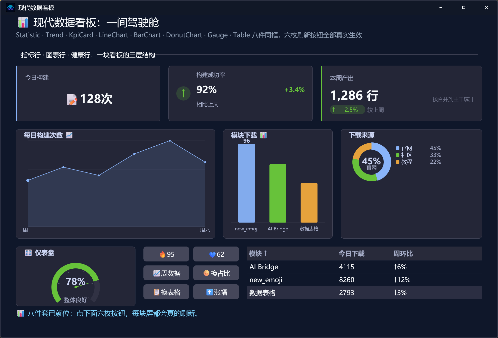

## 1. 命令与事件预告

| 命令 | 作用 |
| --- | --- |
| `控件_设置数值(服务健康, 95)` / `控件_取数值(服务健康)` | 仪表盘改数 / 读数（越过 90 危险线自动变红） |
| `NE折线图_设置数据点(访问趋势, "周一\t34\|周二\t41…")` | 折线图整组换点，`\|` 分隔、Tab 分「名称,数值」 |
| `NE环形图_设置分片数据(流量构成, "移动端\t52\|…", 0)` | 环形图整组换片，末参是激活片下标 |
| `NE表格_设置行数据(模块表, "key=r1\tc0=…\tc1=…\nkey=r2…")` | 整表换行：**行与行用换行**（源码写 `\n`），字段 Tab 分、`键=值` 按列键寻址 |
| `NE统计数值_设置数值(今日构建, "156")` | 统计数值换数——**第 2 参是文本型**，数字要加引号 |
| `NE趋势_设置数值(构建成功率, "96%", "+7.2%", "较上周", 1)` | 趋势卡五件套一次换 |

> 本集只需要 new_emoji 模块。

## 2. 新建项目 + 启用模块 + 切后端

流程和第 1 集一样，项目名称填 **现代数据看板**：

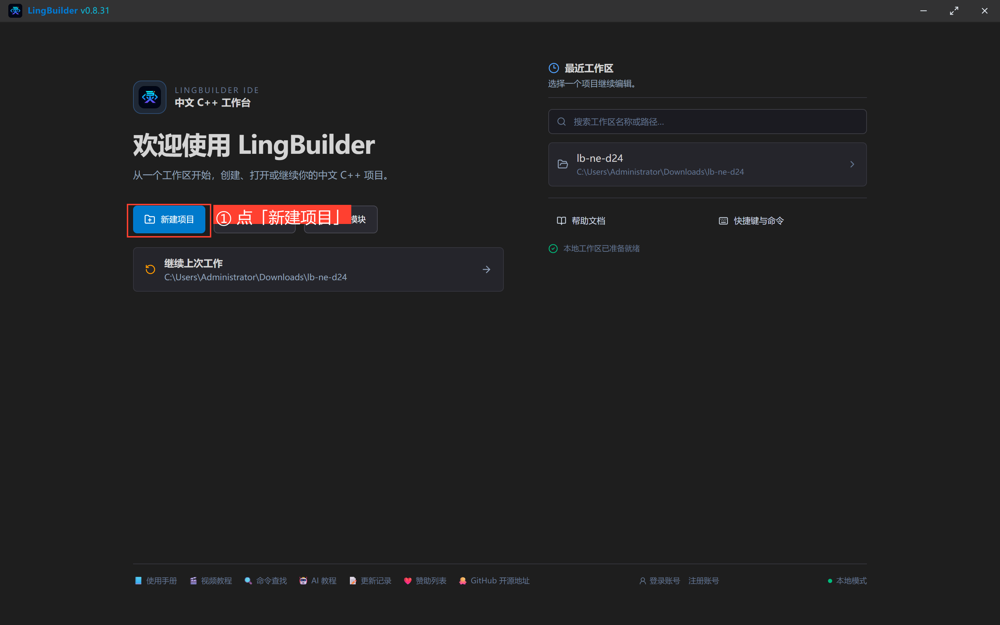

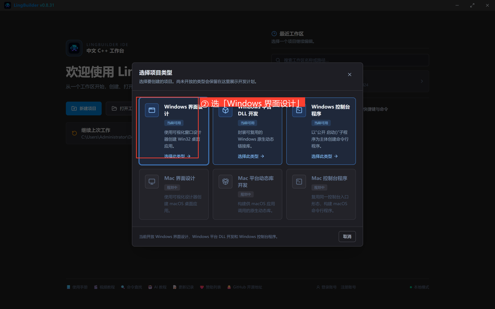

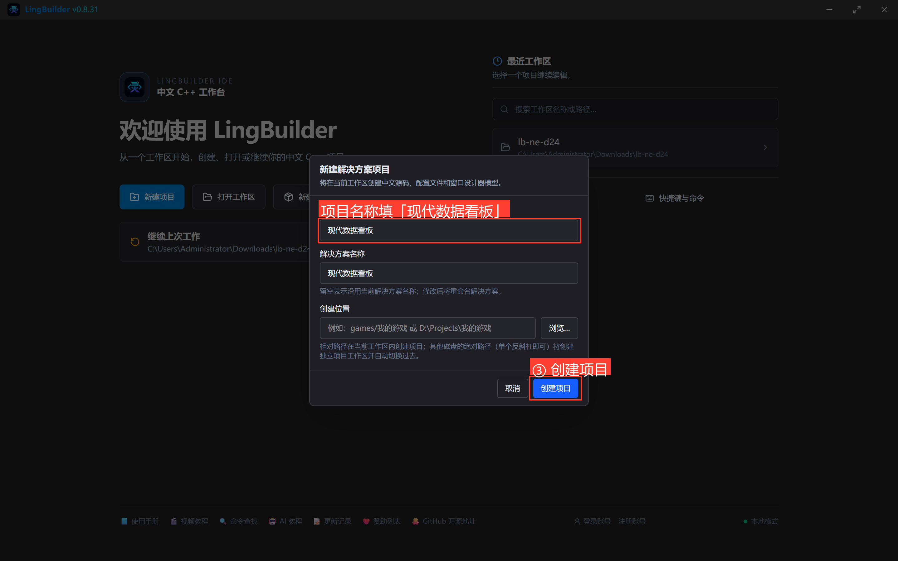

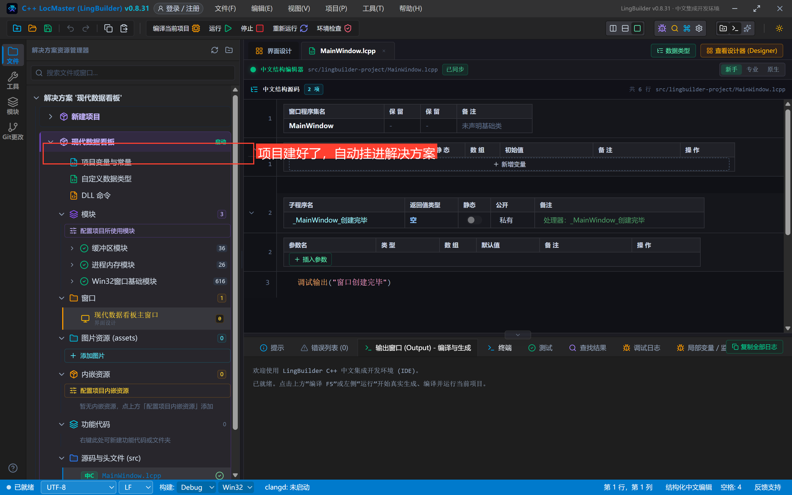

模块面板搜「原生界面」→ 启用「new_emoji 原生界面库」（首次会弹登录框，登录一次即可）：

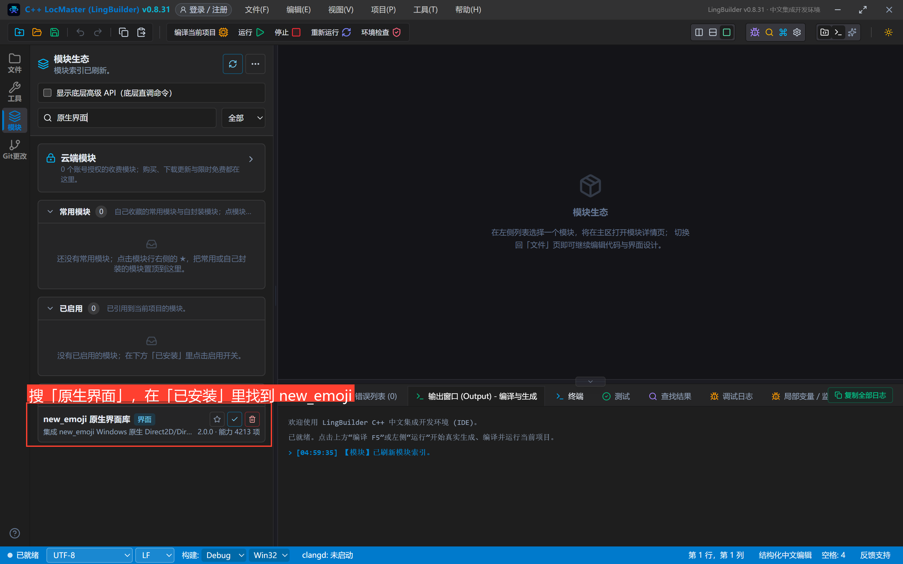

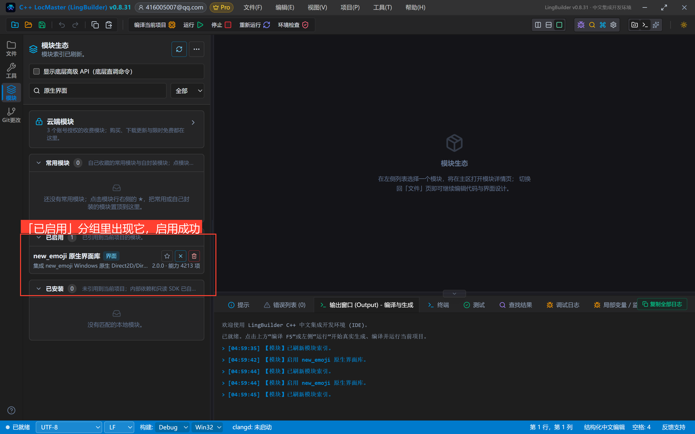

界面设计 → 选中窗口 → 确认「设计后端」是 **new_emoji 模块**：

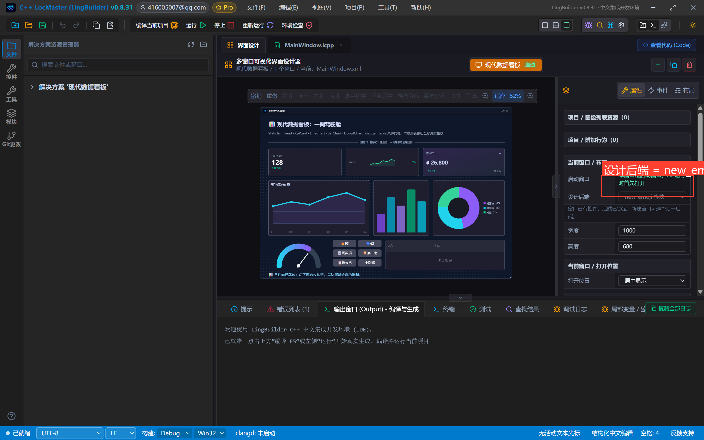

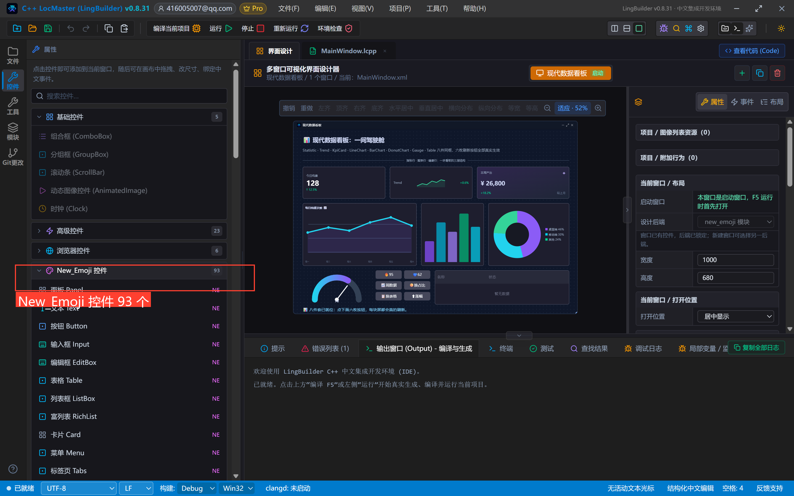

## 3. 设计界面

窗口 1000×680，三层结构：指标行、图表行、健康行。

| 控件 | 名称 | 左距 | 顶距 | 宽度 | 高度 | 关键属性 |
| --- | --- | --- | --- | --- | --- | --- |
| 文本 Text | 标题文本 | 32 | 20 | 700 | 36 | 📊 现代数据看板：一间驾驶舱，字号 21 粗体 |
| 文本 Text | 副标题文本 | 32 | 62 | 920 | 24 | 字号 13，#94A3B8 |
| 分割线 Divider | 标题分割线 | 32 | 96 | 936 | 28 | 指标行 · 图表行 · 健康行：一块看板的三层结构 |
| 统计数值 Statistic | 今日构建 | 32 | 132 | 290 | 112 | **title=今日构建；value=128；prefix=📝；suffix=次；animated=真** |
| 趋势 Trend | 构建成功率 | 338 | 132 | 290 | 112 | **value=92%；percent=+3.4%；detail=相比上周；direction=1（上涨）** |
| 指标卡 KpiCard | 本周产出 | 644 | 132 | 324 | 112 | **value=1,286 行；trend=+12.5%；trendType=1；helper=按合并到主干统计** |
| 折线图 LineChart | 访问趋势 | 32 | 260 | 400 | 220 | **points 六行（`周一⇥28`）；showArea=真；showAxis=真** |
| 柱状图 BarChart | 模块下载 | 448 | 260 | 220 | 220 | **bars 三行；orientation=1（竖向）；showValues=真** |
| 环形图 DonutChart | 流量构成 | 684 | 260 | 284 | 220 | **slices 三行；showLegend=真；ringWidth=26；showLabels=假** |
| 仪表盘 Gauge | 服务健康 | 32 | 496 | 240 | 120 | **value=78；caption=整体良好；status=1；warningValue=70；dangerValue=90** |
| 按钮 Button | 峰值按钮 | 288 | 496 | 92 | 30 | 🔥95 |
| 按钮 Button | 回暖按钮 | 388 | 496 | 92 | 30 | 💙62 |
| 按钮 Button | 换周数据 | 288 | 534 | 92 | 30 | 📈周数据 |
| 按钮 Button | 换占比 | 388 | 534 | 92 | 30 | 🥧换占比 |
| 按钮 Button | 换表格 | 288 | 572 | 92 | 30 | 📋换表格 |
| 按钮 Button | 涨涨幅 | 388 | 572 | 92 | 30 | ⬆涨幅 |
| 表格 Table | 模块表 | 496 | 496 | 472 | 120 | 列与行在「创建完毕」里用命令下发（见 3.1） |
| 文本 Text | 状态文本 | 32 | 620 | 936 | 28 | 字号 14，#7DD3FC |

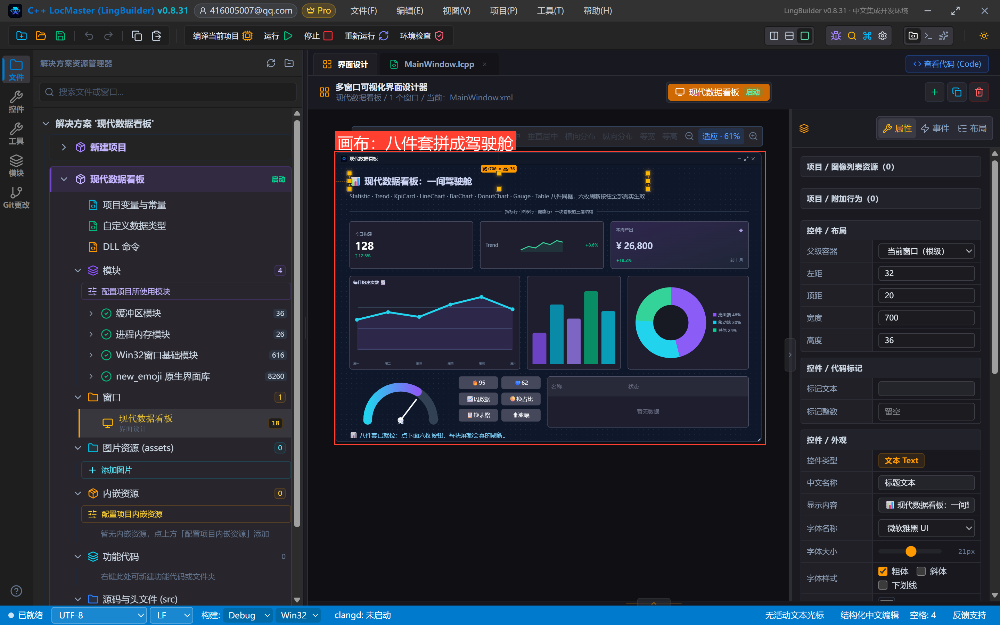

### 3.1 表格的列和行：设计器留空，创建完毕下发

表格的列定义协议是 `title=列名\tkey=键\twidth=宽`，**一列一行，行与行用换行分隔**——在 .lcpp 字符串里写反斜杠 `n`（源码里的 `\n` 会被确定性解释成真实换行符）。行数据按列键寻址：`key=r1\tc0=new_emoji\tc1=8260\tc2=↑12%`，同样换行分行。列一旦定好，换行数据时列不动、只换行，按 `c0/c1/c2` 对号入座，不会串列。

### 3.2 KpiCard 没有运行期刷新命令

八个件里只有 KpiCard 是「静态展示件」：它的数值、趋势角标都是设计器初值，运行期没有中文命令可改（底层的 `EU_SetKpiCardData` 属于直调形态，.lcpp 不能调）。所以本集的六枚刷新按钮不包含 KpiCard——指标行的「涨涨幅」按钮改的是 Statistic 和 Trend 这对搭档。

## 4. 写代码

```lcpp
类 MainWindow
    事件 _MainWindow_创建完毕()
        NE表格_设置列(模块表, "title=模块\tkey=c0\twidth=180\ntitle=今日下载\tkey=c1\twidth=110\ntitle=周环比\tkey=c2\twidth=90")
        NE表格_设置行数据(模块表, "key=r1\tc0=new_emoji\tc1=8260\tc2=↑12%\nkey=r2\tc0=AI Bridge\tc1=4115\tc2=↑6%\nkey=r3\tc0=数据表格\tc1=2793\tc2=↓3%")
        控件_设置文本(状态文本, "📊 八件套已就位：点下面六枚按钮，每块屏都会真的刷新。")
        调试输出("现代数据看板已创建完毕")
    结束

    事件 _峰值按钮_被单击()
        控件_设置数值(服务健康, 95)
        控件_设置文本(状态文本, "🔥 控件_设置数值(服务健康, 95)：越过危险线 90，仪表盘自动变红（说明文字被引擎换成默认「📍 当前状态」）。")
    结束

    事件 _回暖按钮_被单击()
        控件_设置数值(服务健康, 62)
        控件_设置文本(状态文本, "💙 控件_设置数值(服务健康, 62)：回到 70 以下，状态「信息」，弧线变蓝。读回：" + 到文本(控件_取数值(服务健康)) + "。")
    结束

    事件 _换周数据_被单击()
        NE折线图_设置数据点(访问趋势, "周一\t34|周二\t41|周三\t38|周四\t52|周五\t61|周六\t47")
        控件_设置文本(状态文本, "📈 NE折线图_设置数据点(访问趋势, …)：六个新点，折线和面积一次重画。")
    结束

    事件 _换占比_被单击()
        NE环形图_设置分片数据(流量构成, "移动端\t52|桌面端\t32|API\t16", 0)
        控件_设置文本(状态文本, "🥧 NE环形图_设置分片数据(流量构成, …)：三片新占比，图例跟着重排。")
    结束

    事件 _换表格_被单击()
        NE表格_设置行数据(模块表, "key=n1\tc0=主题令牌\tc1=5120\tc2=↑21%\nkey=n2\tc0=地址栏\tc1=3846\tc2=↑9%\nkey=n3\tc0=漫游引导\tc1=2210\tc2=↑4%")
        控件_设置文本(状态文本, "📋 NE表格_设置行数据(模块表, …)：整表换新行，列不动。")
    结束

    事件 _涨涨幅_被单击()
        NE统计数值_设置数值(今日构建, "156")
        NE趋势_设置数值(构建成功率, "96%", "+7.2%", "较上周", 1)
        控件_设置文本(状态文本, "⬆ NE统计数值_设置数值(今日构建, 「156」) + NE趋势_设置数值(…, 96%, +7.2%, 较上周, 1)：指标行一起涨。")
    结束
结束类
```

> 注意：折线与环形的数据串里，行与行这里用的是 `|` 分隔（图表族的行分隔符），而**表格**的行分隔是换行（`\n`）——两族协议就差在这里，别混用。

四个看点：

1. **`健康状态` 是项目全局变量**，本集其实没用到翻转——仪表盘的 95/62 直接由控件_设置数值驱动，状态由引擎按阈值自动变色。
2. **`NE统计数值_设置数值` 第 2 参是文本型**：传 `156` 会被「实参类型门禁」拦下（要求 文本型、实参 整数型），加引号即可。
3. **`NE趋势_设置数值` 五个参数**：数值、百分比、详情、方向（1 上涨 / 0 下跌）——一次换齐，不用逐个属性设。
4. **仪表盘的「读回」**：`控件_取数值` 写在拼接里要包一层 `到文本(...)`。

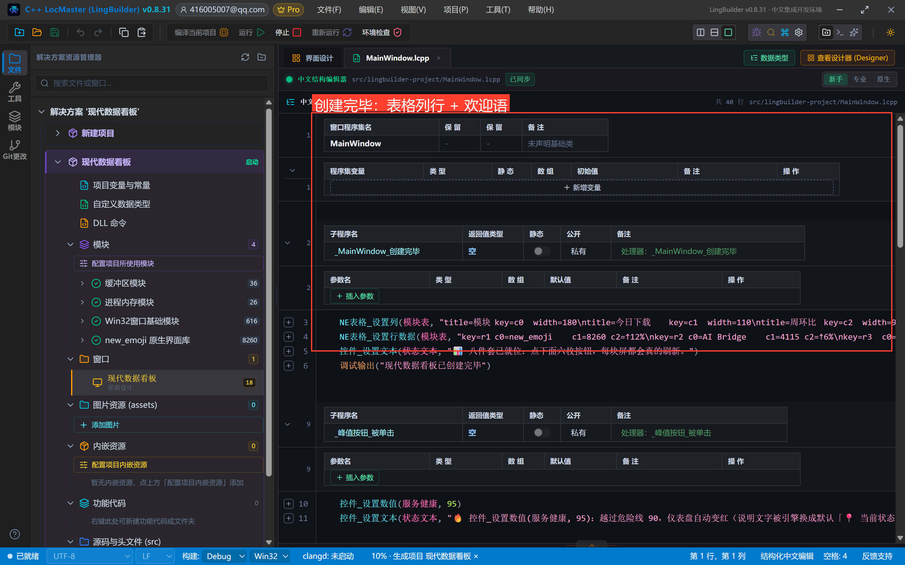

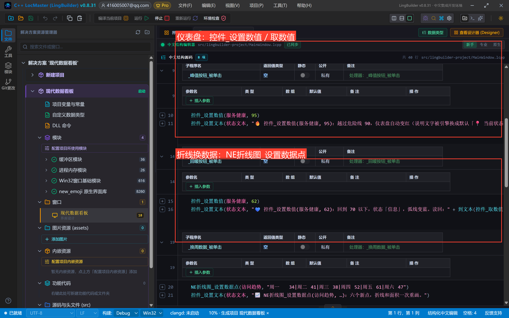

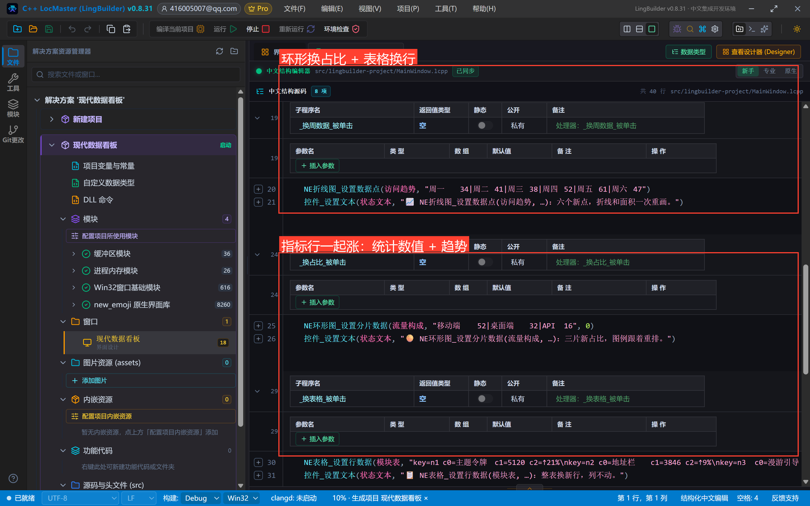

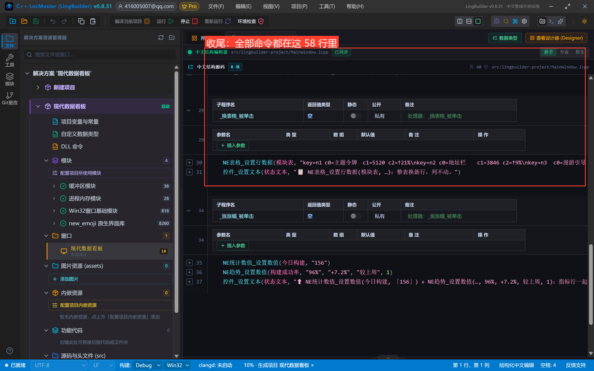

## 5. 编译前先看错误列表

点「编译当前项目」，先看底部错误列表——零报错再继续：

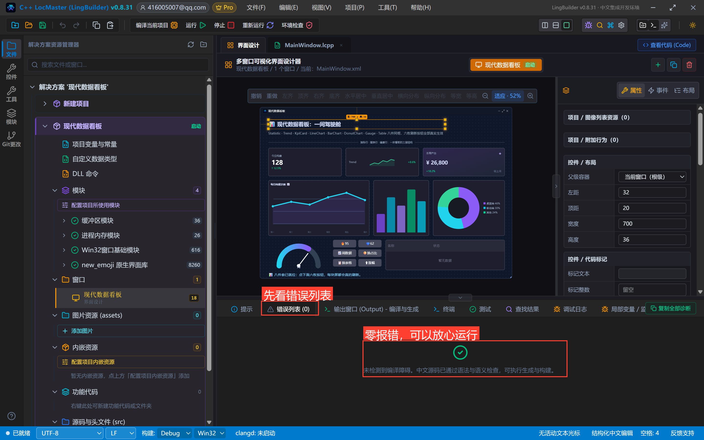

## 6. 运行！六枚刷新按钮各来一次

点「运行」。指标行、图表行、健康行一次铺满：

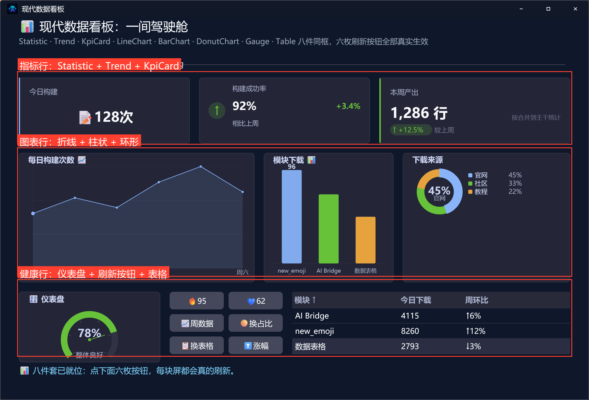

**① 点「🔥95」**——仪表盘 78→95，越过危险线 90 自动变红：

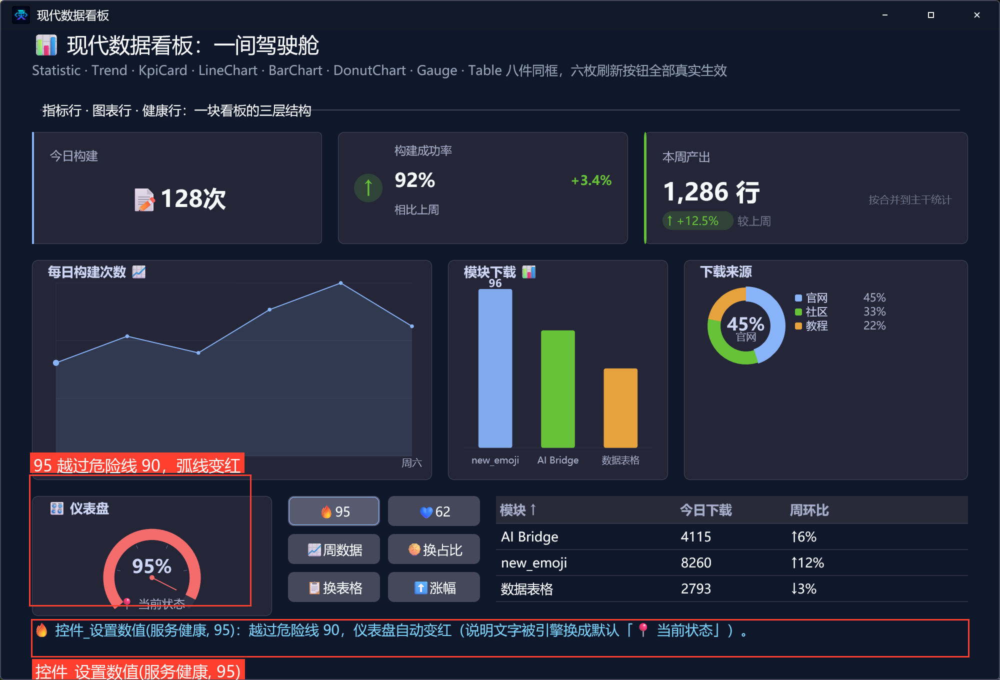

**② 点「💙62」**——回到 62，状态「信息」弧线变蓝，状态栏把 `控件_取数值` 读回的 62 拼进提示：

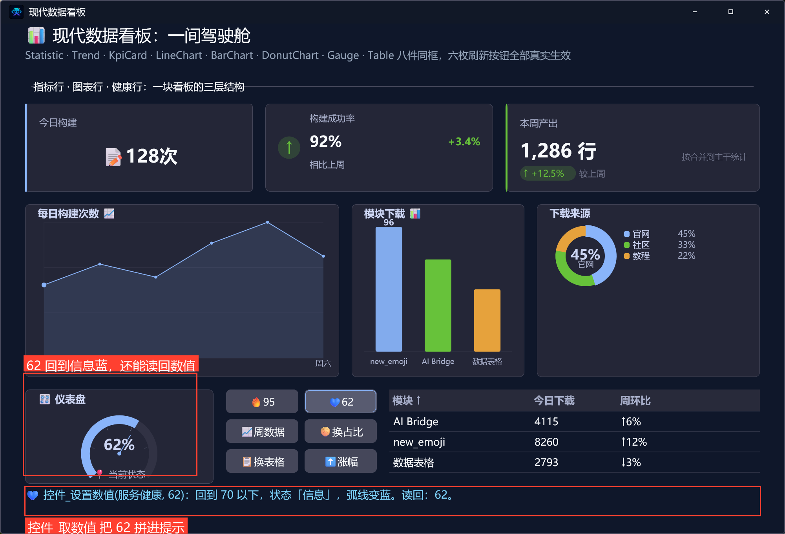

**③ 点「📈周数据」**——折线图换成六个新点，走势一次重画：

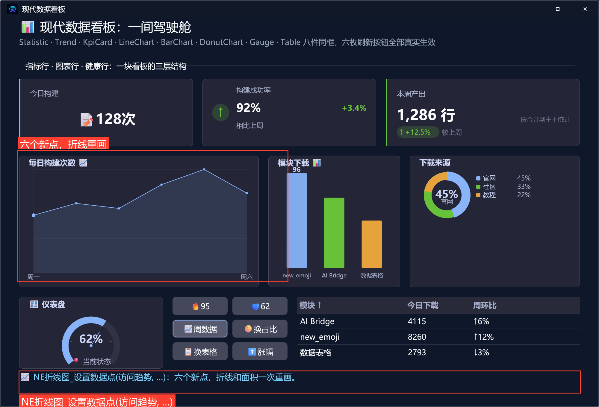

**④ 点「🥧换占比」**——环形图换成移动端 52 / 桌面端 32 / API 16，图例重排：

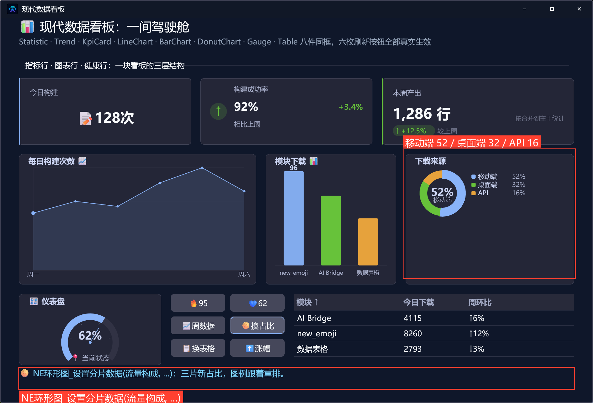

**⑤ 点「📋换表格」**——整表换新行，列头不动：

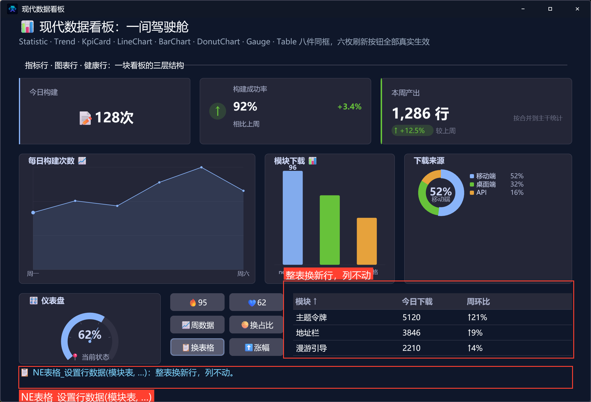

**⑥ 点「⬆涨幅」**——今日构建 128→156 次、构建成功率 92%→96%（+7.2%），指标行一起涨：

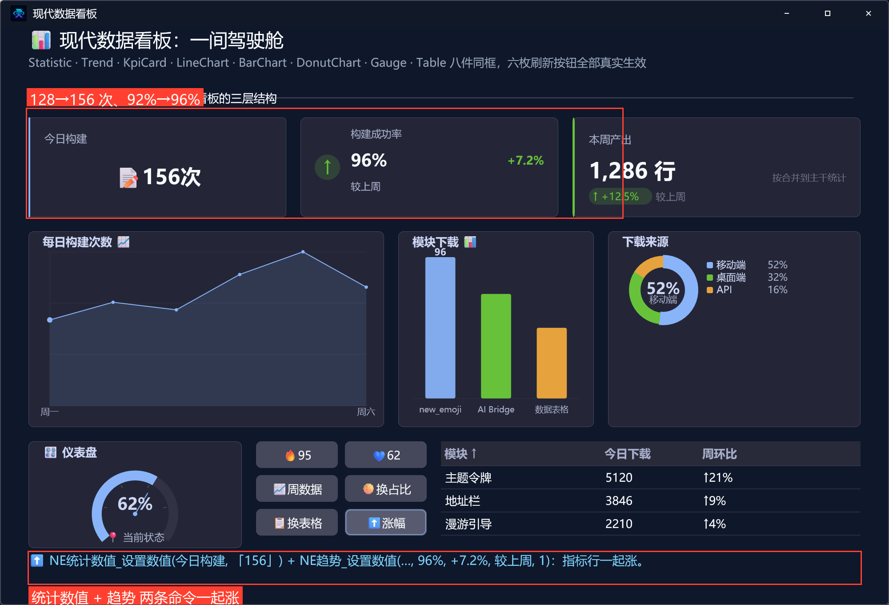

## 7. 导出源码包

命令面板执行「项目：一键导出 LCPP 源码包」即可。

## 本集源码包

- 网页版：[24-现代数据看板.lcpppkg](https://lingbuilder.com/demos)（示例源码区可下载）

## 下一集预告

综合实战（二）个人信息管家：把进阶实战第 11 集的「个人信息管理系统」换装成 new_emoji 界面——SQLite 数据 + 全 NE 控件的收官之作。
