# NE 合集 25 · 综合实战（二）：个人信息管家（SQLite + 全 NE 界面）

> 《LingBuilder new_emoji 合集》第 25 集，合集收官。把进阶实战第 11 集的「个人信息管理系统」整体换装成 new_emoji 界面：数据还是那份 SQLite（`联系人.db`），界面从 Win32 控件全部换成 **NE 编辑框 + NE 按钮 + NE 表格**，删除交互升级成「点表格一行选中 → 一键删除」。全程约 40 分钟。
>
> 前置要求：完成[第 24 集](/guide/tutorials/new-emoji-24)；原版工程见进阶实战系列第 11 集。本集需要**两个模块**：new_emoji 界面库 + SQLite 数据库模块。本集源码包见文末。

## 这一集你将学会

- SQLite 五步闭环：`SQLite_打开连接` → `SQLite_执行于` 建表 → `SQLite_准备` + `SQLite_绑定文本` + `SQLite_语句步进` → `SQLite_语句释放`
- NE 表格当名册：`NE表格_设置列` / `NE表格_设置行数据` 下发数据，「单元格点击」事件把行号记进全局变量
- `NE表格_取单元格值(表, 行号, 列号)`：按行列坐标取单元格文本，删除时拿姓名用
- 界面换装的取舍：托盘、时钟这类平台件在换装版里由「🔄 刷新」手动替代

先看一眼本集成品——左边录入、右边名册，数据落在 SQLite 里，重开不丢：

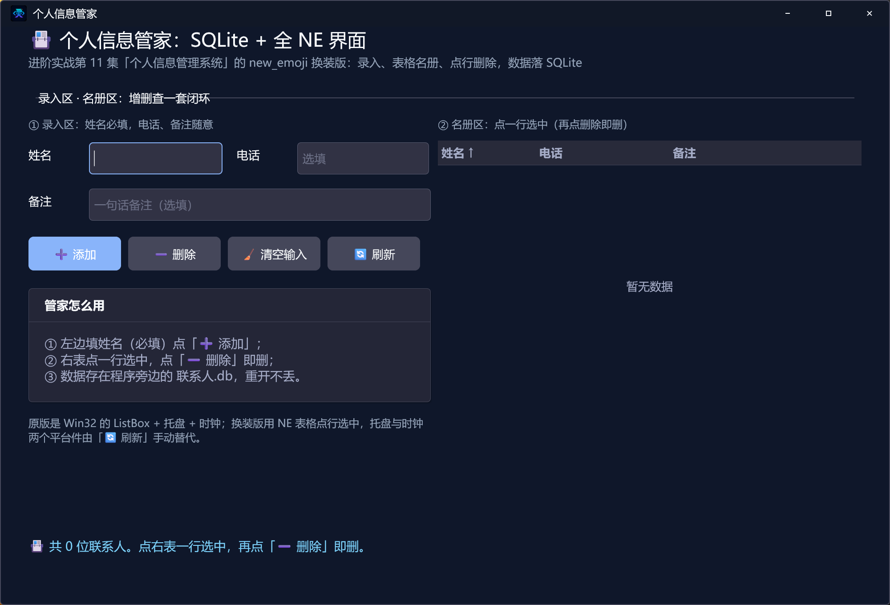

## 1. 命令与事件预告

| 命令 / 事件 | 作用 |
| --- | --- |
| `SQLite_打开连接("联系人.db", 0, 5000)` | 打开（不存在则创建）数据库文件，返回连接句柄 |
| `SQLite_执行于(数据库, "CREATE TABLE …")` | 执行建表等无结果 SQL |
| `SQLite_准备(数据库, "INSERT … VALUES (?, ?)")` | 预编译带 `?` 占位的 SQL |
| `SQLite_绑定文本(语句, 序号, 值)` | 按占位序号（从 1 起）绑定文本 |
| `SQLite_语句步进` / `SQLite_语句释放` | 执行一步 / 释放语句 |
| `NE表格_设置列(表, "title=姓名\tkey=c0\twidth=110\n…")` | 下发列（换行分隔、Tab 分字段） |
| `NE表格_设置行数据(表, "key=r1\tc0=…\n…")` | 整表换行，`键=值` 按列键寻址 |
| `NE表格_取单元格值(表, 行号, 列号)` | 取单元格文本（删除时取姓名） |
| `联系人表_单元格点击(整数型 行号, 整数型 列号)` 事件 | 点表格任意格触发，行号从 0 起 |
| `控件_取文本(框)` / `控件_设置文本(框, "")` | 通用命令：读输入框 / 清空输入框 |

## 2. 新建项目 + 启用模块 + 切后端

流程和第 1 集一样，项目名称填 **个人信息管家**。本集要启用**两个模块**：先搜「原生界面」启用 new_emoji，再搜「SQLite」启用 SQLite 数据库模块：

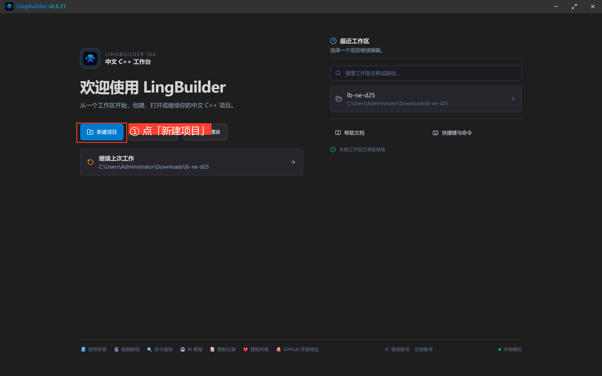

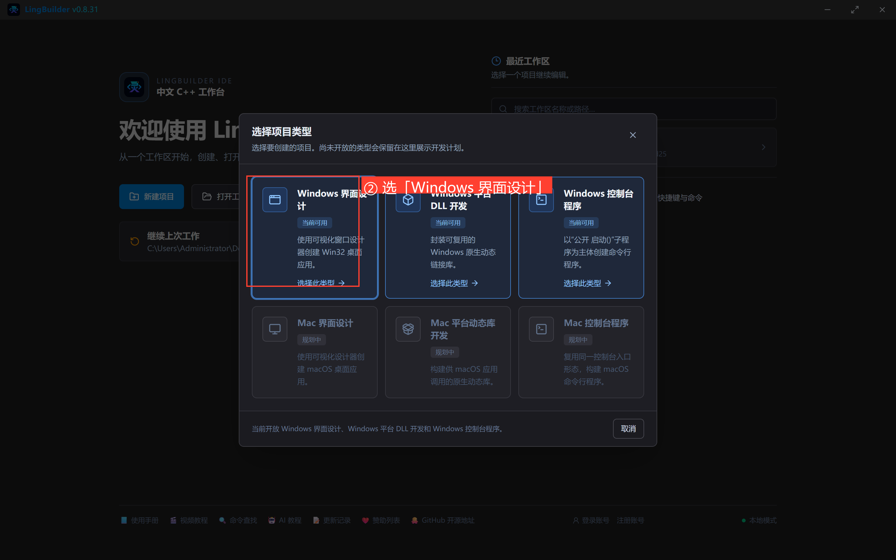

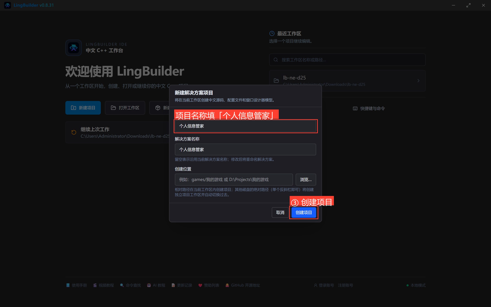

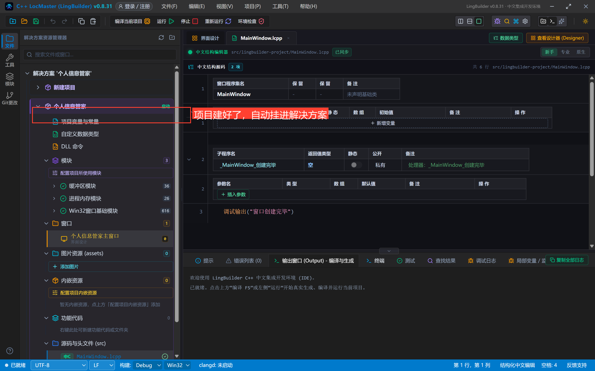

模块面板搜「原生界面」→ 启用「new_emoji 原生界面库」（首次会弹登录框，登录一次即可）：

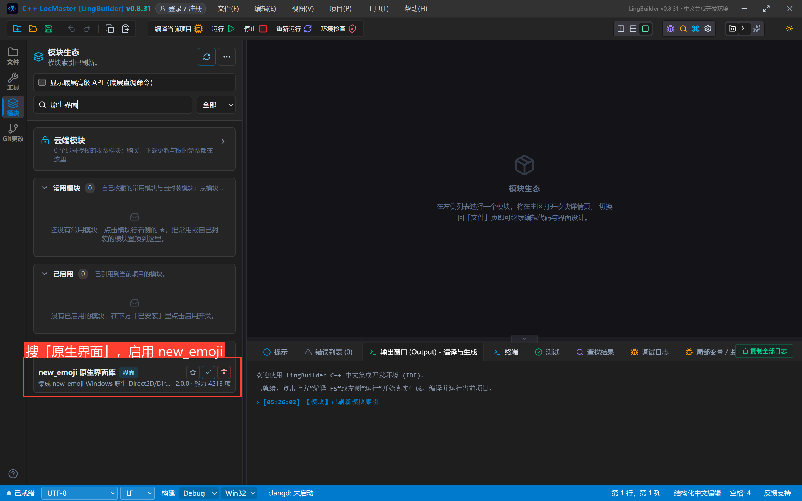

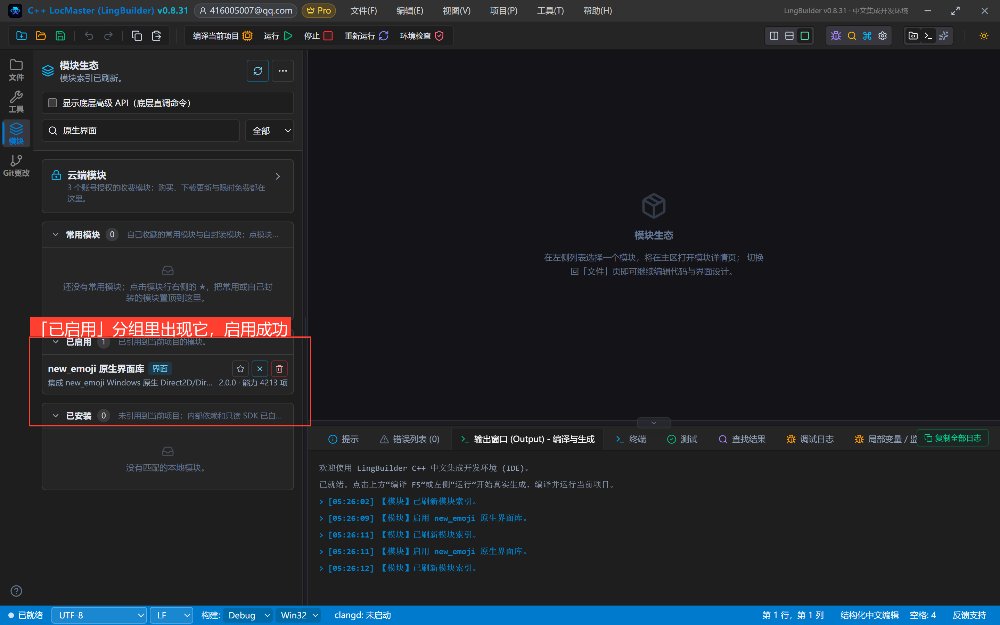

界面设计 → 选中窗口 → 确认「设计后端」是 **new_emoji 模块**：

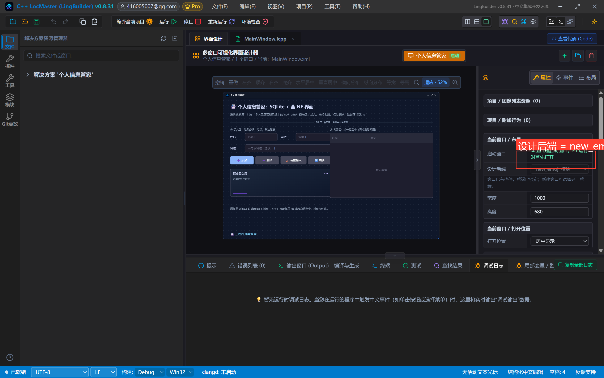

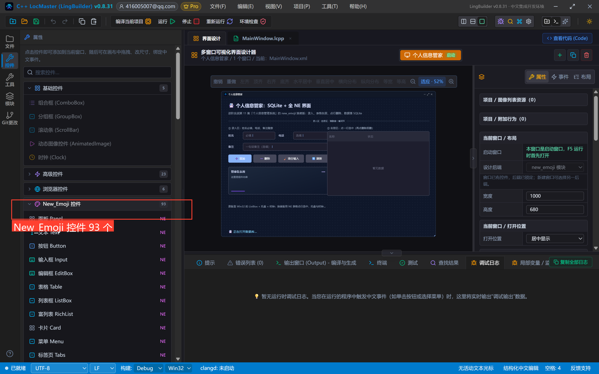

## 3. 设计界面

窗口 1000×680。左列录入区 + 用法卡片，右列联系人表格。

| 控件 | 名称 | 左距 | 顶距 | 宽度 | 高度 | 关键属性 |
| --- | --- | --- | --- | --- | --- | --- |
| 文本 Text | 标题文本 | 32 | 20 | 760 | 36 | 📇 个人信息管家：SQLite + 全 NE 界面，字号 21 粗体 |
| 文本 Text | 副标题文本 | 32 | 62 | 920 | 24 | 字号 13，#94A3B8 |
| 分割线 Divider | 标题分割线 | 32 | 96 | 936 | 28 | 录入区 · 名册区：增删查一套闭环 |
| 文本 Text | 录入标签 | 32 | 132 | 440 | 22 | ① 录入区：姓名必填，电话、备注随意 |
| 文本 Text | 姓名标签 | 32 | 166 | 60 | 24 | 姓名 |
| 编辑框 EditBox | 姓名框 | 100 | 160 | 150 | 36 | 占位：必填 |
| 文本 Text | 电话标签 | 266 | 166 | 60 | 24 | 电话 |
| 编辑框 EditBox | 电话框 | 334 | 160 | 148 | 36 | 占位：选填 |
| 文本 Text | 备注标签 | 32 | 218 | 60 | 24 | 备注 |
| 编辑框 EditBox | 备注框 | 100 | 212 | 384 | 36 | 占位：一句话备注（选填） |
| 按钮 Button | 添加按钮 | 32 | 266 | 104 | 38 | ➕ 添加，样式=主要(1) |
| 按钮 Button | 删除按钮 | 144 | 266 | 104 | 38 | ➖ 删除 |
| 按钮 Button | 清空按钮 | 256 | 266 | 104 | 38 | 🧹 清空输入 |
| 按钮 Button | 刷新按钮 | 368 | 266 | 104 | 38 | 🔄 刷新 |
| 卡片 Card | 说明卡片 | 32 | 324 | 452 | 128 | title=管家怎么用；body 三行用法 |
| 文本 Text | 换装说明 | 32 | 468 | 452 | 80 | 字号 12，#94A3B8，自动换行 |
| 文本 Text | 名册标签 | 492 | 132 | 476 | 22 | ② 名册区：点一行选中（再点删除即删） |
| 表格 Table | 联系人表 | 492 | 158 | 476 | 300 | **selectionMode=单选；striped=真；绑定「单元格点击」** |
| 文本 Text | 状态文本 | 32 | 604 | 936 | 44 | 字号 14，#7DD3FC，自动换行 |

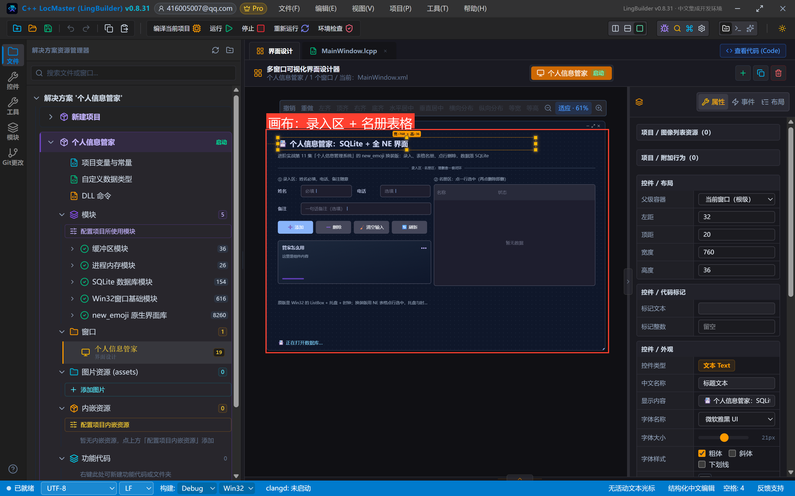

### 3.1 两个全局变量撑起整个状态

`全局 SQLite连接 数据库`（连接句柄跨事件共用）和 `全局 整数型 选中行号 = -1`（表格「单元格点击」事件写入、删除按钮读取）。-1 表示没选中——所有「先选中再操作」的校验都靠它。

### 3.2 换装的取舍：托盘与时钟没有跟着换

原版有托盘图标和 30 秒自动刷新时钟，两个都是 Win32 平台件。换装版**主动砍掉**：托盘与时钟属于平台行为而非界面构件，NE 换装版用「🔄 刷新」按钮手动触发同一段 `刷新表格()`。想自动刷新，配上第 22 集的定时思路即可。

## 4. 写代码

```lcpp
类 MainWindow
    事件 _MainWindow_创建完毕()
        数据库 = SQLite_打开连接("联系人.db", 0, 5000)
        如果 (数据库 = 0)
            控件_设置文本(状态文本, "数据库打开失败：" + SQLite_取错误())
            返回()
        如果结束
        SQLite_执行于(数据库, "CREATE TABLE IF NOT EXISTS 联系人 (姓名 文本, 电话 文本, 备注 文本)")
        NE表格_设置列(联系人表, "title=姓名\tkey=c0\twidth=110\ntitle=电话\tkey=c1\twidth=150\ntitle=备注\tkey=c2\twidth=170")
        刷新表格()
    结束

    空 刷新表格()
        局部 文本型 行们
        行们 = ""
        局部 整数型 序号
        序号 = 0
        局部 SQLite语句 查询
        查询 = SQLite_准备(数据库, "SELECT 姓名, 电话, 备注 FROM 联系人 ORDER BY 姓名")
        如果 (查询 = 0)
            控件_设置文本(状态文本, "读取失败：" + SQLite_取错误())
            返回()
        如果结束
        局部 整数型 状态
        状态 = SQLite_语句步进(查询)
        判断循环首 (状态 = 1)
            行们 = 行们 + "key=r" + 到文本(序号) + "\tc0=" + SQLite_取列文本(查询, 0) + "\tc1=" + SQLite_取列文本(查询, 1) + "\tc2=" + SQLite_取列文本(查询, 2) + "\n"
            序号 = 序号 + 1
            状态 = SQLite_语句步进(查询)
        判断循环尾
        SQLite_语句释放(查询)
        NE表格_设置行数据(联系人表, 行们)
        控件_设置文本(状态文本, "📇 共 " + 到文本(序号) + " 位联系人。点右表一行选中，再点「➖ 删除」即删。")
    结束

    事件 _联系人表_单元格点击(整数型 行号, 整数型 列号)
        选中行号 = 行号
        控件_设置文本(状态文本, "🎯 已选中第 " + 到文本(行号 + 1) + " 行：" + NE表格_取单元格值(联系人表, 行号, 0) + "——点「➖ 删除」即删。")
    结束

    事件 _添加按钮_被单击()
        局部 文本型 新姓名
        新姓名 = 控件_取文本(姓名框)
        如果 (新姓名 = "")
            控件_设置文本(状态文本, "⚠️ 先填写姓名再添加哦。")
            返回()
        如果结束
        局部 SQLite语句 语句
        语句 = SQLite_准备(数据库, "INSERT INTO 联系人 (姓名, 电话, 备注) VALUES (?, ?, ?)")
        如果 (语句 = 0)
            控件_设置文本(状态文本, "添加失败：" + SQLite_取错误())
            返回()
        如果结束
        SQLite_绑定文本(语句, 1, 新姓名)
        SQLite_绑定文本(语句, 2, 控件_取文本(电话框))
        SQLite_绑定文本(语句, 3, 控件_取文本(备注框))
        SQLite_语句步进(语句)
        SQLite_语句释放(语句)
        控件_设置文本(姓名框, "")
        控件_设置文本(电话框, "")
        控件_设置文本(备注框, "")
        刷新表格()
    结束

    事件 _删除按钮_被单击()
        如果 (选中行号 < 0)
            控件_设置文本(状态文本, "⚠️ 先在右表点一行选中，再点删除。")
            返回()
        如果结束
        局部 文本型 目标姓名
        目标姓名 = NE表格_取单元格值(联系人表, 选中行号, 0)
        局部 SQLite语句 语句
        语句 = SQLite_准备(数据库, "DELETE FROM 联系人 WHERE 姓名 = ?")
        如果 (语句 = 0)
            控件_设置文本(状态文本, "删除失败：" + SQLite_取错误())
            返回()
        如果结束
        SQLite_绑定文本(语句, 1, 目标姓名)
        SQLite_语句步进(语句)
        SQLite_语句释放(语句)
        选中行号 = -1
        刷新表格()
    结束

    事件 _清空按钮_被单击()
        控件_设置文本(姓名框, "")
        控件_设置文本(电话框, "")
        控件_设置文本(备注框, "")
        控件_设置文本(状态文本, "🧹 三个输入框已清空。")
    结束

    事件 _刷新按钮_被单击()
        刷新表格()
    结束
结束类
```

四个看点：

1. **「创建完毕」里的 `返回()` 是早退**：数据库打不开就直接结束启动流程，后面的建表、刷新全部跳过。
2. **`刷新表格()` 是全项目唯一读数据的地方**：添加、删除、刷新按钮全部汇到它——名册永远和数据库一致。
3. **行拼接里 `\t` 和 `\n` 都是源码字面量**：写一次，表格协议自动展开。
4. **删除按「姓名」定位**：`NE表格_取单元格值` 拿到选中行第一列，`DELETE WHERE 姓名 = ?` 精确删人。

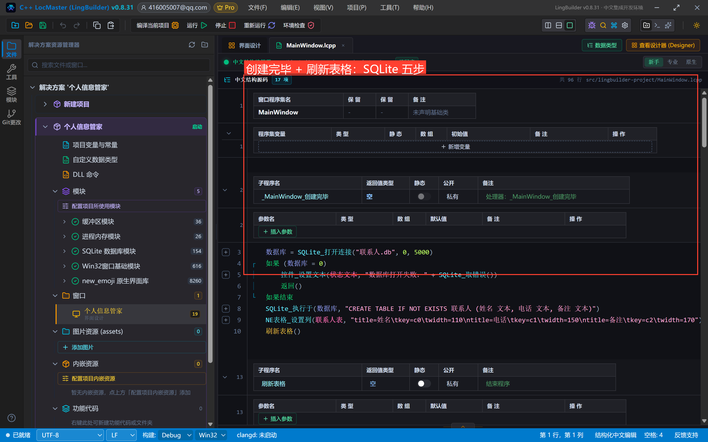

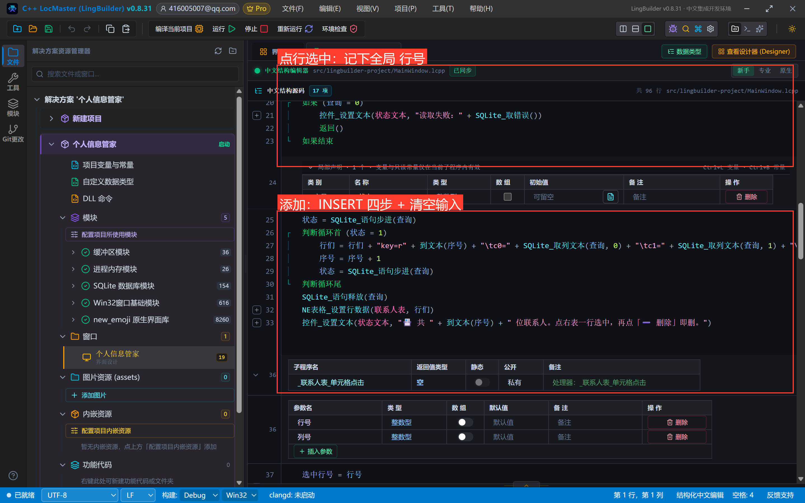

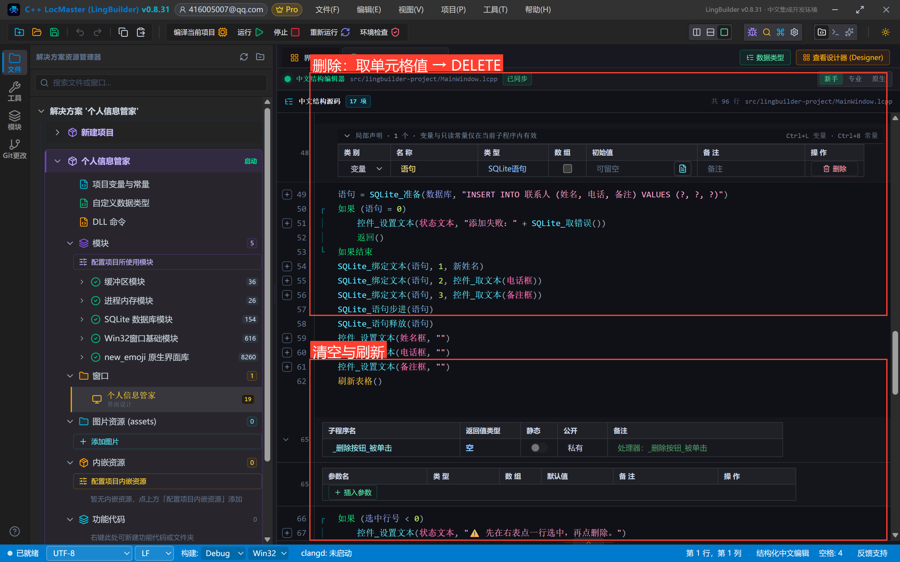

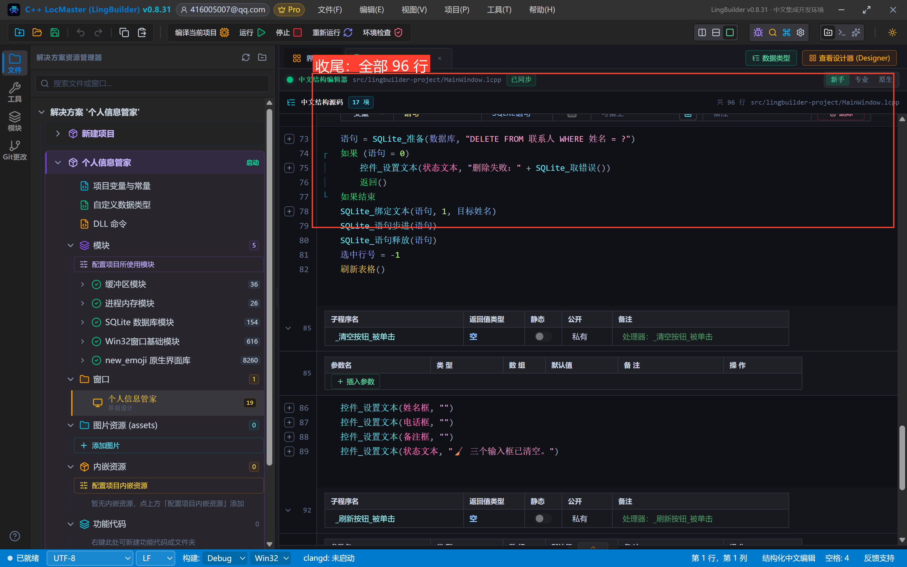

## 5. 编译前先看错误列表

点「编译当前项目」，先看底部错误列表——零报错再继续：

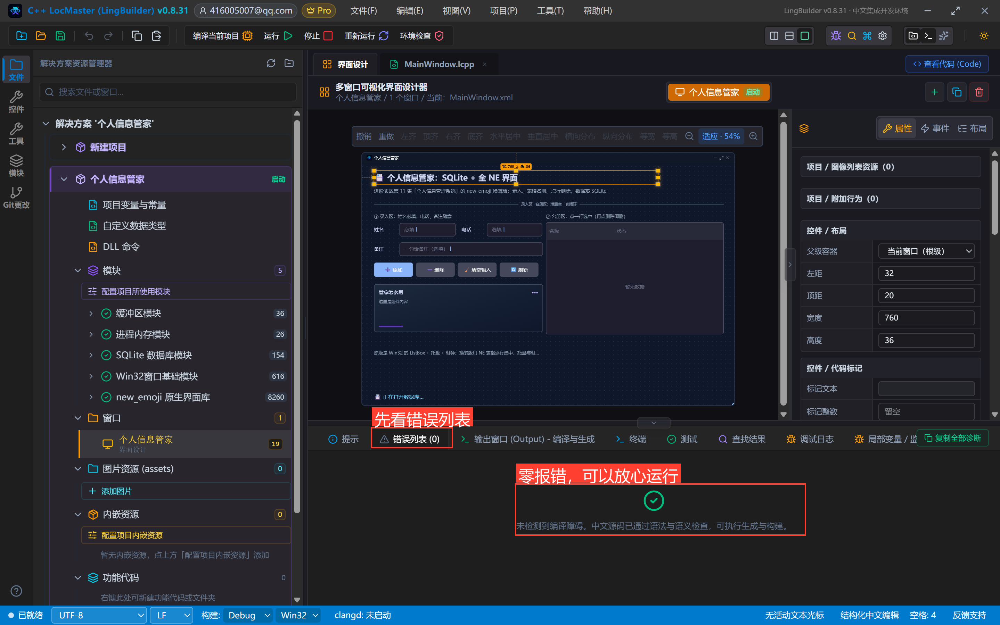

## 6. 运行！增删查一套走完

点「运行」。表格自动建好三列，空态显示「暂无数据」，状态栏报「共 0 位联系人」：

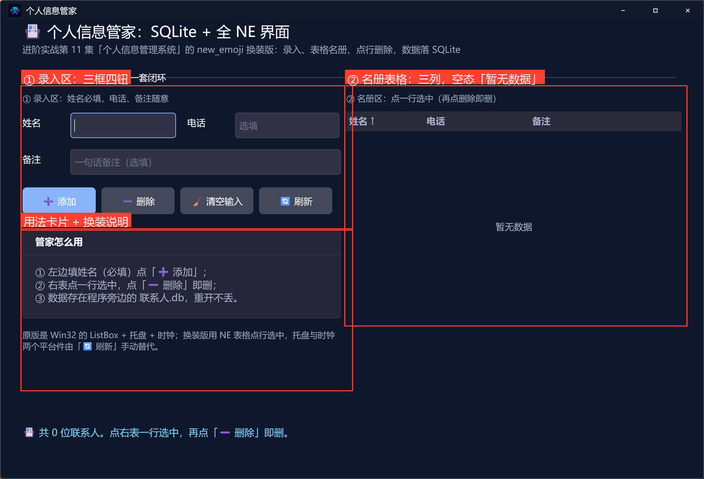

**① 填「王小明 / 13800000001」点「➕ 添加」**——名册出现第一行并高亮，输入框自动清空：

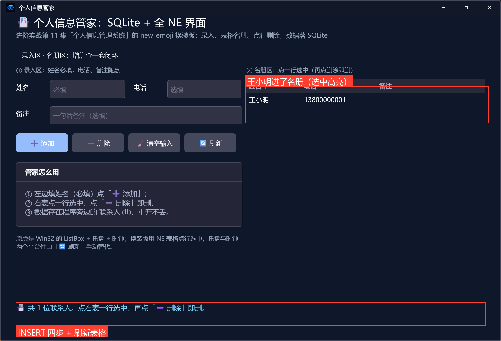

**② 点「王小明」那一行**——整行选中，状态栏报「已选中第 1 行：王小明」：

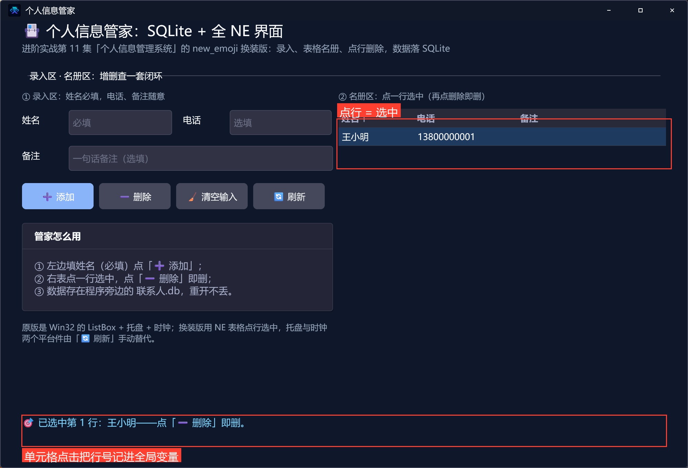

**③ 点「➖ 删除」**——整行消失，表格回到空态（数据也从 `联系人.db` 里真删了）：

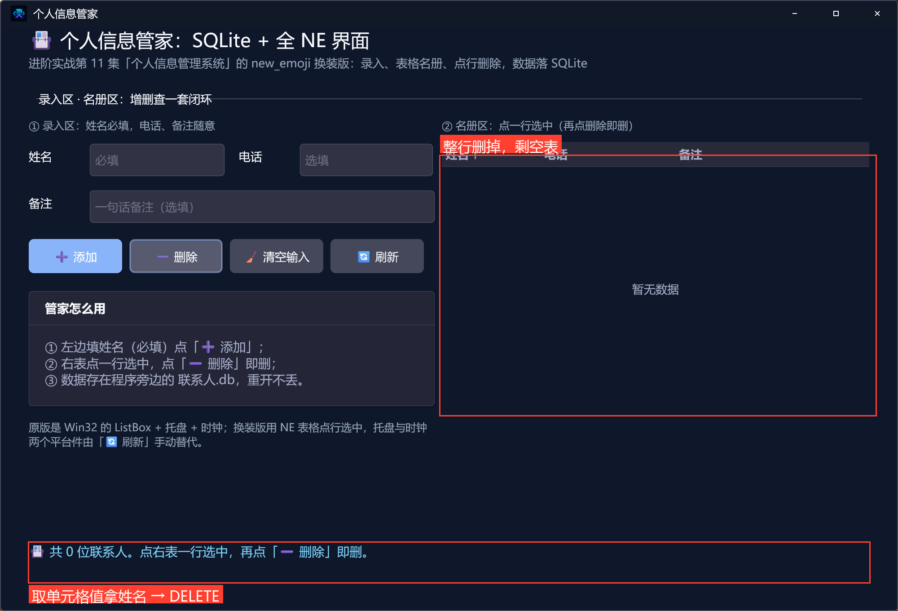

**④ 随便填点字点「🧹 清空输入」**——三个输入框一键清空：

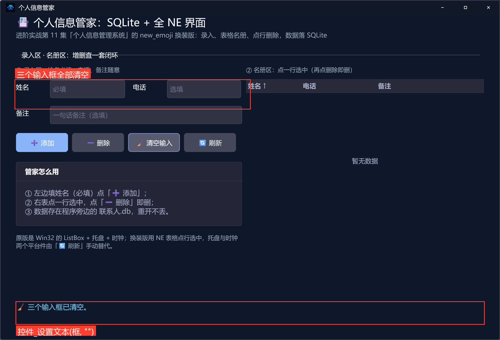

**⑤ 点「🔄 刷新」**——重新读一遍数据库，名册与库内数据对齐：

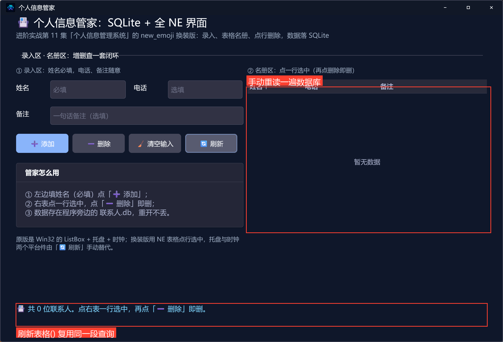

**⑥ 再加「李小花」「赵大壮」两位**——名册按姓名排序，两位都稳稳落座：

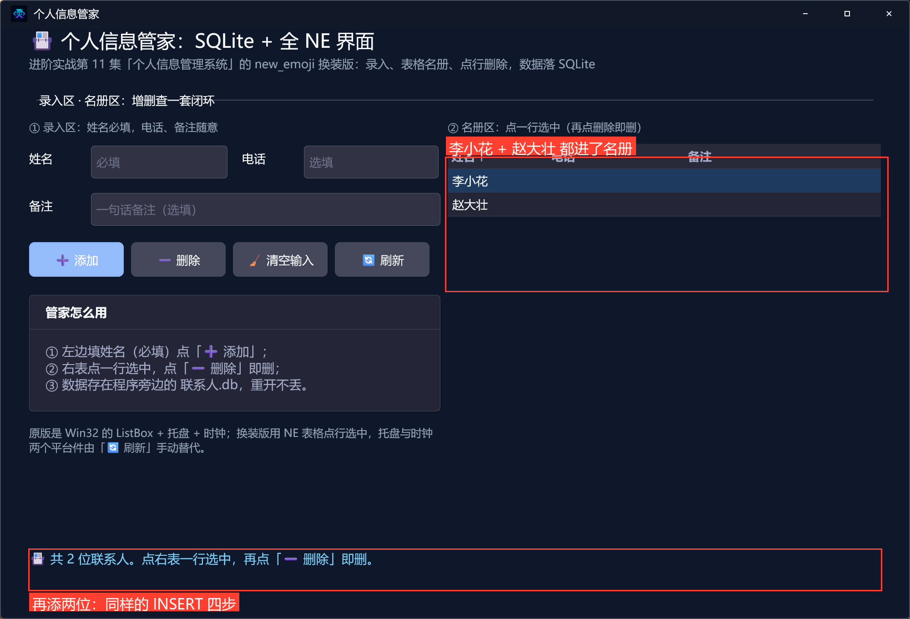

## 7. 导出源码包

命令面板执行「项目：一键导出 LCPP 源码包」即可。

## 本集源码包

- 网页版：[25-个人信息管家.lcpppkg](https://lingbuilder.com/demos)（示例源码区可下载）

## 合集收官

25 集全部完成：从第 1 集点下「新建项目」开始，到这一集用 SQLite + 全 NE 界面写完一个能日常用的管家。下一步可以去进阶实战系列，把这套界面接到更复杂的业务上。
