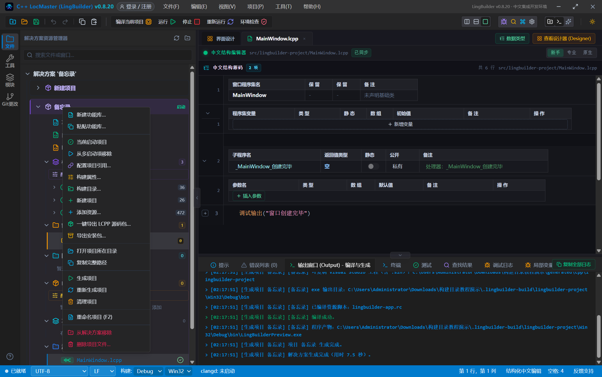
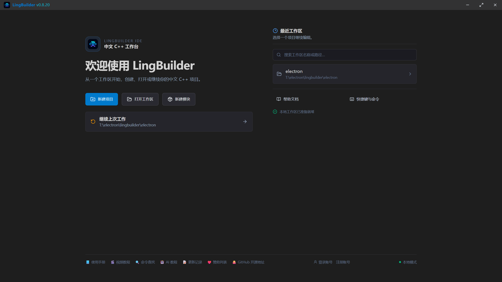
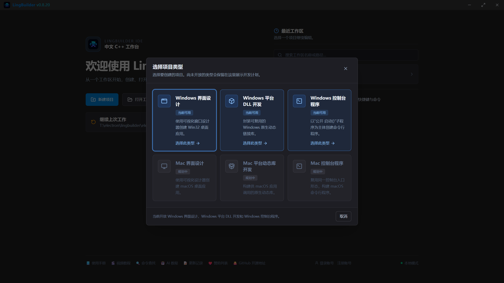
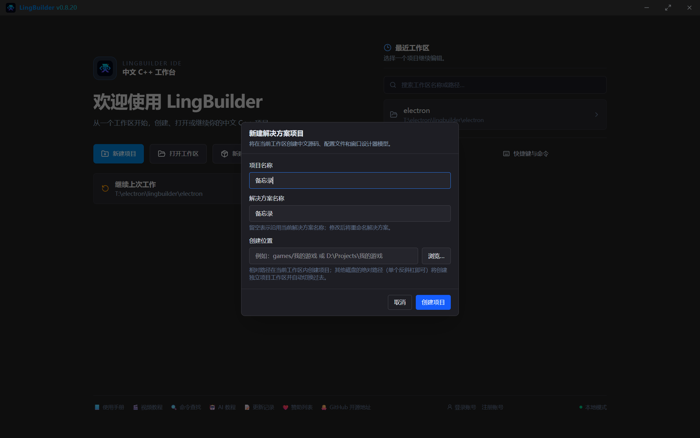
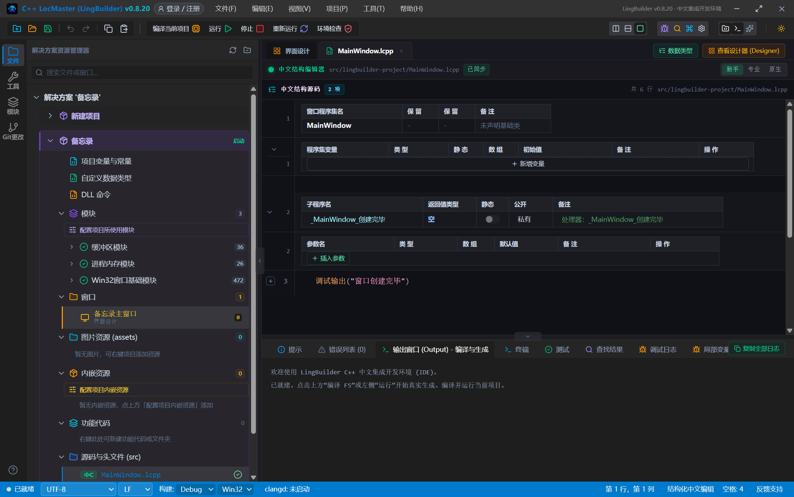
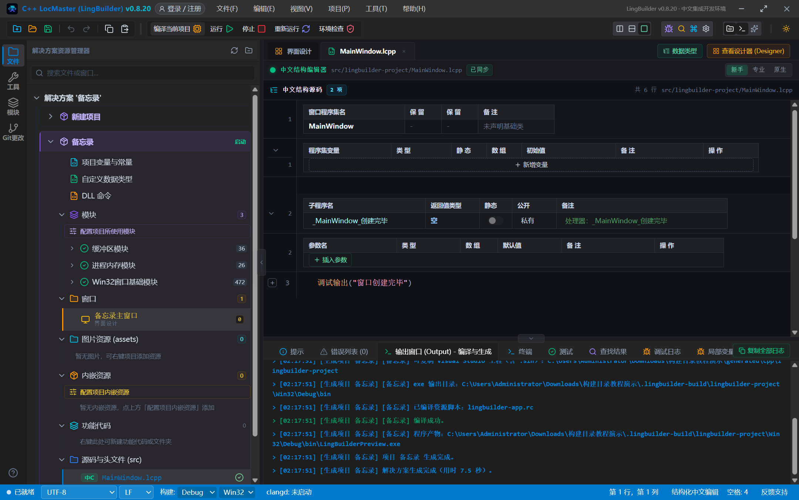
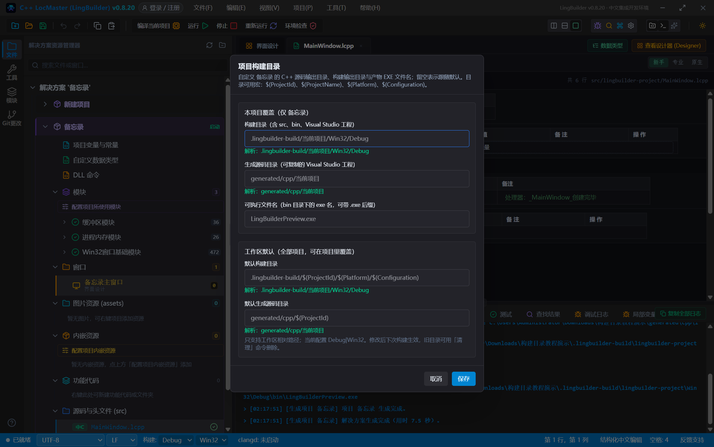
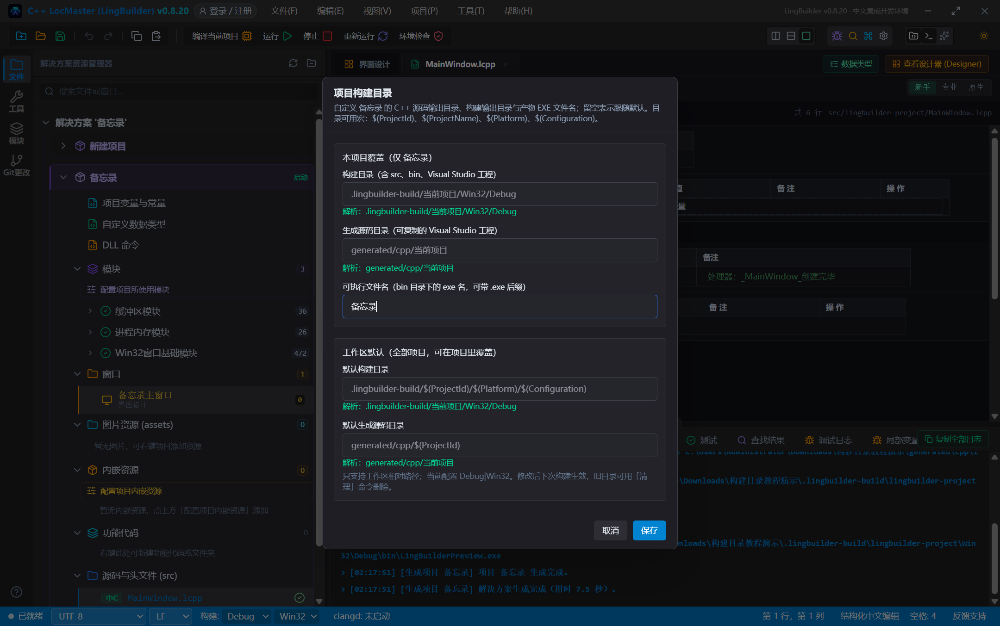
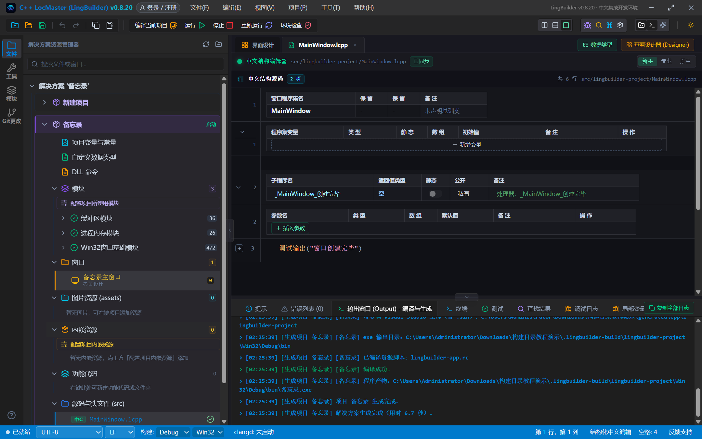
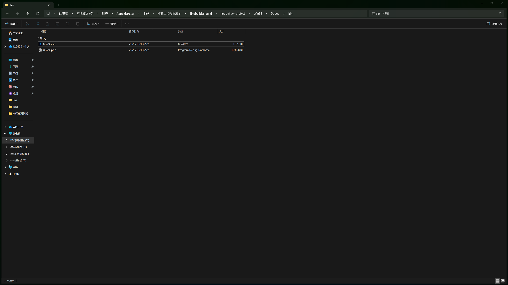

# 构建目录图文教程：自定义构建输出目录与可执行文件名

> 适用对象：想把编译出来的 exe 改成自己程序名字的新手
> 演示环境：LingBuilder v0.8.20 · Windows · 真机全程可复现
> 学完你能：把构建产物 `LingBuilderPreview.exe` 改成「备忘录.exe」这样的自定义名字；把构建输出目录、生成源码目录搬到自定义位置；弄懂「本项目覆盖」和「工作区默认」的关系

新建项目的编译产物默认叫 `LingBuilderPreview.exe`，构建输出固定在 `.lingbuilder-build` 下。如果你想让别人拿到的是 `备忘录.exe`、`库存管家.exe`，或者想把构建输出集中到自己的目录里，用项目右键菜单的「**构建目录…**」就能搞定——不用改代码、不用配工程文件。

本教程全部截图来自开发环境真机操作，从新建项目到产物改名全程走通。

---

## 第 1 章 入口在哪：项目右键菜单「构建目录…」

在解决方案资源管理器里**右键你的项目**，菜单里点「**构建目录…**」：



> 这个菜单里还有「生成项目」「重新生成项目」「清理项目」，后面第 5 章会用到。「构建属性…」是另一个对话框（改 Debug/Release、架构、附加参数），产物文件名和输出目录都归「构建目录…」管。

---

## 第 2 章 从新建项目开始（可跳过）

如果你还没有项目：启动 LingBuilder，在欢迎页点「**新建项目**」。



在类型选择里选「**Windows 界面设计**」（当前可用），点「选择此类型」：



填写项目名称（本教程用「**备忘录**」），点「**创建项目**」：



创建完成后进入工作台，解决方案树里就是你的项目，模板代码已经可以直接编译：



---

## 第 3 章 先构建一次，看看默认产物

点工具栏「**编译当前项目**」（或 F5、或右键项目「生成项目」，三个入口行为一致）。构建完成后，输出面板会播报产物路径：



重点看这一行：

```
[生成项目 备忘录] [备忘录] 程序产物：C:\...\构建目录教程演示\.lingbuilder-build\lingbuilder-project\Win32\Debug\bin\LingBuilderPreview.exe
```

三个信息：

- **产物名**：`LingBuilderPreview.exe` —— 所有项目的缺省名，这就是我们要改的；
- **bin 目录**：exe 永远落在构建目录的 `bin` 子目录里；
- **构建目录**：缺省是 `.lingbuilder-build/<项目ID>/<平台>/<配置>`（如 `Win32\Debug`）。

---

## 第 4 章 改可执行文件名

再次右键项目 →「构建目录…」，打开「**项目构建目录**」对话框：



对话框分上下两半：

| 区域 | 作用 | 生效范围 |
|---|---|---|
| **本项目覆盖** | 构建目录 / 生成源码目录 / 可执行文件名 | 只对当前项目生效，留空=跟随工作区默认 |
| **工作区默认** | 默认构建目录 / 默认生成源码目录 | 工作区里全部项目的缺省值，可被项目覆盖 |

每个目录输入框下方都有绿色「**解析：**」实时预览，告诉你这个写法最终会落在哪个目录。目录支持宏，见第 7 章速查表。

在「**可执行文件名（bin 目录下的 exe 名，可带 .exe 后缀）**」里填你想要的名字，本教程填「**备忘录**」（带不带 `.exe` 后缀都可以），点「**保存**」：



> 名字规则：不得包含 `\ / : * ? " < > |` 等 Windows 文件名非法字符，长度不超过 64。填了不合法的名字，保存时会得到明确的中文提示。

---

## 第 5 章 再构建一次，产物就是新名字

右键项目 →「**生成项目**」：



输出面板里，产物已经变成新名字：

```
[生成项目 备忘录] [备忘录] 程序产物：C:\...\构建目录教程演示\.lingbuilder-build\lingbuilder-project\Win32\Debug\bin\备忘录.exe
```

改完名字后的第一次「生成项目」会自动重新编译，不需要你先「清理」或「重新生成」。当然，用 F5「生成并运行」或「重新生成项目」也完全可以——产物同样跟着新名字走。

---

## 第 6 章 打开 bin 目录验证

右键项目 →「打开项目所在目录」，进到构建目录的 `bin` 子目录；或者直接看输出面板里播报的路径。`bin` 里现在是：



- `备忘录.exe` —— 你的程序，可以随意拷给别人；
- `备忘录.pdb` —— 调试符号文件，只在 IDE 里调试时有用，发布给别人可以不带。

旧名字的 `LingBuilderPreview.exe` 已经被自动清掉了，不会残留占空间。

---

## 第 7 章 目录宏速查表

构建目录和生成源码目录支持以下宏（大小写不敏感）：

| 宏 | 含义 | 示例值 |
|---|---|---|
| `$(ProjectId)` | 项目 ID（构建目录名里用的那个） | `lingbuilder-project` |
| `$(ProjectName)` | 项目显示名 | `备忘录` |
| `$(Platform)` | 平台架构 | `Win32` / `x64` |
| `$(Configuration)` | 构建配置 | `Debug` / `Release` |

缺省值：

- 构建目录：`.lingbuilder-build/$(ProjectId)/$(Platform)/$(Configuration)`
- 生成源码目录：`generated/cpp/$(ProjectId)`（这里生成的 Visual Studio 工程可以复制走、用 VS 打开编译）

注意：

- 只支持**工作区相对路径**，不接受绝对路径和 `..`；
- 不同项目的构建目录、生成源码目录、源码目录互相**不能重合或嵌套**，保存时 IDE 会中文提示冲突；
- 修改目录后**下次构建生效**，旧目录里的产物不会自动搬家，可用「清理项目」删除旧目录。

---

## 第 8 章 常见问题

**Q：改了可执行文件名，点「生成项目」没反应，bin 里还是旧 exe？**
旧版本 IDE 的增量构建可能误判「输出没变化」而跳过编译，此时用「**重新生成项目**」（会先清理再编译）必然生效。新版已修复：改产物名后「生成项目」也会自动重新编译。

**Q：bin 里残留了旧名字的 exe / pdb？**
旧**默认名**（LingBuilderPreview）的 exe 会在下次构建时被自动清理。如果你是从自定义名 A 改成自定义名 B，旧 A 的 `.exe/.pdb` 需要手动删，或右键「清理项目」后重新生成。

**Q：DLL 项目能用这个对话框吗？**
能。「可执行文件名」对动态库项目同样生效，产物是 `<名字>.dll` 和导入库 `<名字>.lib`，同样落在 `bin` 目录。

**Q：构建目录能指到工作区外面吗？**
不能。目录必须是工作区相对路径（可以用宏），这是为了保证项目可复制、可迁移，也为了工作区搜索和 AI 索引能正确排除构建产物。

**Q：「生成源码目录」和「构建目录」什么区别？**
构建目录（`.lingbuilder-build`）是 IDE 的临时工作区，每次构建都可能重新物化；生成源码目录（`generated/cpp`）里是一份**可复制**的 Visual Studio 工程（含 .sln），想用 VS 打开、想留给别人编译都从这里拿。

**Q：工作区默认和本项目覆盖同时改了，听谁的？**
本项目覆盖优先。本项目对应项留空时，才使用工作区默认值。

---

## 教程环境

| 项 | 值 |
|---|---|
| LingBuilder | v0.8.20（含 2026-10-13 构建目录增量构建修复） |
| 演示项目 | 备忘录（Windows 界面设计模板，Win32 · Debug） |
| 演示工作区 | `C:\Users\Administrator\Downloads\构建目录教程演示` |
