# 进阶实战 01 · SQLite 数据库入门：做一个能「记住数据」的通讯录

> 《LingBuilder 进阶实战系列》第 1 集。从这一集开始，我们告别「程序一关数据就没了」的小例子——你要做一个**真正的通讯录软件**：添加联系人、修改电话、删除联系人，而且**关掉程序再打开，数据还稳稳地在**。做完这一集，你就掌握了写「正经软件」的第一块基石：数据库。全程约 40 分钟。
>
> 前置要求：学完[零基础入门系列](/guide/tutorials/beginner)（至少 01~12 集），会新建项目、拖控件、写事件。本系列每集的完整源码都提供一键导入的 `.lcpppkg` 源码包，见文末。

## 这一集你将学会

- 什么是数据库、为什么需要它（30 秒版）
- 怎么给项目**启用模块**——LingBuilder 的能力都藏在模块里
- SQLite 最常用的 8 条中文命令：打开连接、建表、增、删、改、查
- 参数绑定 `?` 写法——从第一行代码就养成防坑习惯
- 编译前**先看错误列表**的黄金习惯（本集还原了一个真实报错）
- 用 `.lcpppkg` 源码包把作品一键分享给别人

---

## 1. 三十秒搞懂：为什么需要数据库？

回忆零基础第 10 集的好友名单：好友名字存在**数组变量**里。程序运行时一切正常，但你一关程序——数组变量随着进程一起消失了，下次打开又是空空如也。

> **变量是「记在脑子里」的，数据库是「写在笔记本上」的。** 程序退出，脑子清空，笔记本还在。

数据库（Database）就是一个高度可靠的「笔记本」：数据以**表**的形式存在硬盘上的一个文件里，增删改查都快，还不怕程序重启。我们这一集用的 **SQLite** 是全世界用得最多的数据库——你手机里的微信、聊天记录背后都有它。它不需要安装任何服务器软件，**整个数据库就是你 exe 旁边的一个文件**，最适合我们做桌面小软件。

我们的通讯录数据就存在一张叫「联系人」的表里，长这样：

| 姓名（文本） | 电话（文本） |
| --- | --- |
| 李明 | 13800000001 |
| 王芳 | 13900000002 |

## 2. 新建项目

新建一个窗口项目：项目名称填 **SQLite通讯录**，模板选「Windows 界面设计」，创建位置**留空**（在当前工作区内创建）。新建项目的详细步骤在[零基础第 02 集](/guide/tutorials/beginner-02-first-window)讲过，这里不再重复截图。

创建完成后，左侧解决方案树里会出现「SQLite通讯录」项目和它自带的主窗口。

> 本集用到的控件只有标签、编辑框、按钮、列表框四种，都是零基础阶段的老朋友；新面孔只有「模块」这个概念，下一节讲。

## 3. 启用 SQLite 数据库模块

LingBuilder 的能力都装在「模块」里：文件操作、网络访问、数据库……各是一个模块。**用之前要先启用**。

点解决方案树里的「**配置项目所使用模块**」，进入模块生态页。在搜索框输入「**SQLite 数据库**」，找到「SQLite 数据库模块」（内置、数据库分类），点它行上的**启用**开关：

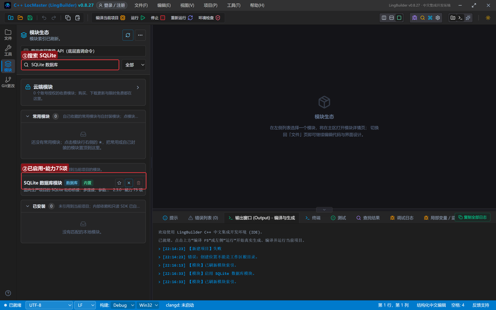

启用成功的标志有两个：①这一行跑到了「**已启用**」分组里，显示「2.3.0 · 能力 75 项」；②底部输出窗口打印「【模块】启用 SQLite 数据库模块」。启用即时生效，不用重启 IDE。

> **什么时候用它**：凡是要「把数据留下来」的场景——通讯录、记录、配置、历史记录——都用数据库模块。

## 4. 设计界面

回到主窗口设计器，照下表摆 9 个控件（拖控件、改属性的方法见零基础第 02 集；「名称」在属性面板最上方改，改名是为了让代码一眼看懂）：

| 控件 | 名称 | 显示内容 | 左距 | 顶距 | 宽度 | 高度 |
| --- | --- | --- | --- | --- | --- | --- |
| 标签 | 姓名 | 姓名 | 30 | 32 | 50 | 24 |
| 编辑框 | 姓名框 | （占位提示：请输入姓名） | 85 | 28 | 180 | 28 |
| 标签 | 电话 | 电话 | 285 | 32 | 50 | 24 |
| 编辑框 | 电话框 | （占位提示：请输入电话号码） | 340 | 28 | 180 | 28 |
| 按钮 | 添加按钮 | 添加联系人 | 30 | 72 | 100 | 32 |
| 按钮 | 修改按钮 | 修改选中 | 140 | 72 | 100 | 32 |
| 按钮 | 删除按钮 | 删除选中 | 250 | 72 | 100 | 32 |
| 列表框 | 联系人列表 | — | 30 | 120 | 560 | 300 |
| 标签 | 状态标签 | 就绪。 | 30 | 436 | 560 | 24 |

顺手把窗口宽度改成 **620**（点画布空白处选中窗口，在属性面板改「宽度」）。摆完长这样：

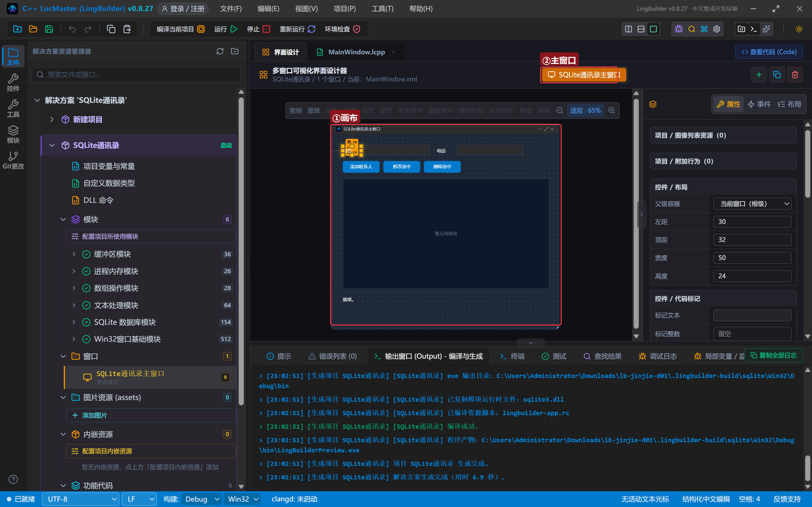

然后给 5 个控件绑定事件（方法见零基础第 03 集：选中控件 → 右侧「事件」页 → 点对应事件行）：

| 控件 | 事件 | 自动生成的处理器名 |
| --- | --- | --- |
| 窗口（空白处） | 创建完毕 | `_MainWindow_创建完毕` |
| 添加按钮 | 被单击 | `_添加按钮_被单击` |
| 修改按钮 | 被单击 | `_修改按钮_被单击` |
| 删除按钮 | 被单击 | `_删除按钮_被单击` |
| 联系人列表 | 选择项被改变 | `_联系人列表_选择项被改变` |

## 5. 认识本集的 8 条 SQLite 命令

写代码前，先跟这 8 条命令混个脸熟（都是「SQLite 数据库模块」提供的中文命令）：

| 命令 | 作用 | 什么时候用它 |
| --- | --- | --- |
| `SQLite_打开连接(路径, 模式, 忙等待)` | 打开数据库文件，返回一个「连接」编号 | 程序启动时，调一次 |
| `SQLite_执行于(连接, SQL)` | 执行没有返回结果的 SQL（建表等） | 建表、不常走的维护语句 |
| `SQLite_准备(连接, SQL)` | 把带 `?` 占位符的 SQL 预编译成「语句」 | 所有带用户输入的增删改查 |
| `SQLite_绑定文本(语句, 序号, 文本)` | 把文本填进第 N 个 `?` | 和「准备」配套 |
| `SQLite_语句步进(语句)` | 执行一步：得到一行返回 1，做完返回 0，出错返回 -1 | 插入执行一次；查询放进循环 |
| `SQLite_取列文本(语句, 列号)` | 读当前行第 N 列（从 0 起） | 查询循环里取数据 |
| `SQLite_语句释放(语句)` | 用完释放语句 | 每次用完「准备」的语句后 |
| `SQLite_取错误()` | 返回最近一次错误的中文说明 | 每个失败分支里，给用户看原因 |

> **为什么插入要用「准备 + 绑定」，而不是把用户输入直接拼进 SQL？** 如果用户姓名里输入了一个英文单引号 `'`，拼出来的 SQL 语法就碎了；更危险的是恶意输入可能「借道」执行别的 SQL（SQL 注入）。`?` 占位符让 SQLite 把输入**当纯数据**处理，从根上杜绝这两类问题。

## 6. 写代码 ①：两个程序集变量 + 打开数据库

双击 MainWindow.lcpp 打开新手编辑器。先在「程序集变量」表里加两个变量（点「新增变量」，一行一个）：

| 名称 | 类型 | 初始值 |
| --- | --- | --- |
| 数据库 | SQLite连接 | 0 |
| 选中姓名 | 文本型 | （空） |

「数据库」存打开的连接编号（0 表示还没打开），全程序的增删改查都靠它；「选中姓名」记住列表里当前点选的是谁，修改和删除要靠它定位。

然后在 `_MainWindow_创建完毕` 事件里写打开数据库的代码：

```lcpp
事件 _MainWindow_创建完毕()
    数据库 = SQLite_打开连接("通讯录.db", 0, 5000)
    如果 (数据库 = 0)
        控件_设置文本(状态标签, "数据库打开失败：" + SQLite_取错误())
        返回()
    如果结束
    SQLite_执行于(数据库, "CREATE TABLE IF NOT EXISTS 联系人 (姓名 文本, 电话 文本)")
    刷新列表()
结束
```

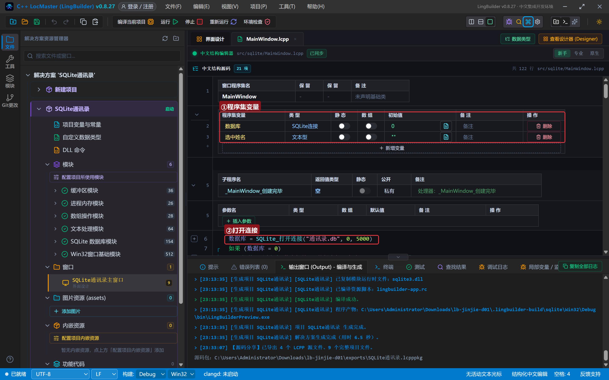

逐行拆解：

- `SQLite_打开连接("通讯录.db", 0, 5000)`：打开（不存在就自动创建）exe 旁边的「通讯录.db」文件；`0` 表示读写模式，`5000` 表示遇到占用最多等 5 秒。返回非 0 的连接编号，失败返回 0。
- `如果 (数据库 = 0)`：打不开就别往下走了，把原因写到状态标签上，`返回()` 直接结束本事件。**每个可能失败的地方都给用户一句人话**，这是本系列一直强调的习惯。
- `CREATE TABLE IF NOT EXISTS 联系人 (...)`：建一张「联系人」表，有两列——姓名、电话，都是文本。`IF NOT EXISTS` 保证第二次运行不会因为表已存在而报错。
- `刷新列表()`：调用我们马上要写的子程序，把表里的数据显示到列表框。

## 7. 写代码 ②：添加联系人

`_添加按钮_被单击` 事件的完整代码：

```lcpp
事件 _添加按钮_被单击()
    局部 文本型 新姓名 = 控件_取文本(姓名框)
    局部 文本型 新电话 = 控件_取文本(电话框)
    如果 (新姓名 = "")
        信息框("先填写姓名再添加哦", 48, "提示")
        返回()
    如果结束
    如果 (新电话 = "")
        信息框("电话也不能空哦", 48, "提示")
        返回()
    如果结束
    局部 SQLite语句 语句
    语句 = SQLite_准备(数据库, "INSERT INTO 联系人 (姓名, 电话) VALUES (?, ?)")
    如果 (语句 = 0)
        控件_设置文本(状态标签, "添加失败：" + SQLite_取错误())
        返回()
    如果结束
    SQLite_绑定文本(语句, 1, 新姓名)
    SQLite_绑定文本(语句, 2, 新电话)
    SQLite_语句步进(语句)
    SQLite_语句释放(语句)
    控件_设置文本(姓名框, "")
    控件_设置文本(电话框, "")
    控件_设置文本(状态标签, "已添加：" + 新姓名)
    刷新列表()
结束
```

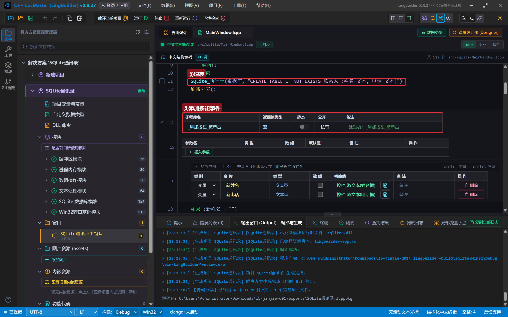

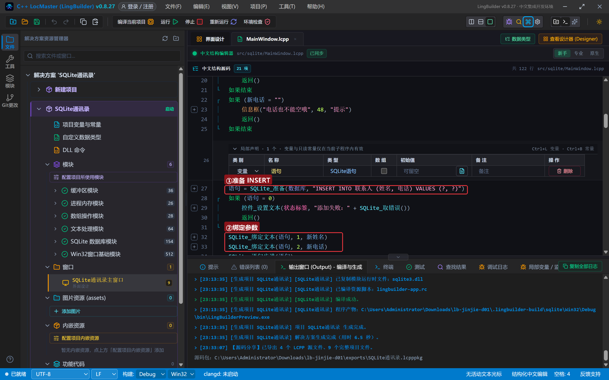

套路就是「五步曲」：**准备 → 绑定 → 步进 → 释放 → 刷新**。

- `SQLite_准备` 里的 SQL 有两个 `?`，分别代表姓名和电话。
- `SQLite_绑定文本(语句, 1, 新姓名)`：把新姓名填进第 **1** 个 `?`（序号从 1 开始），电话填第 2 个。
- `SQLite_语句步进(语句)`：对 INSERT 来说，步进一次就是「执行完毕」。
- 用完**必须** `SQLite_语句释放`，不释放虽然程序退出时也会兜底回收，但好习惯要从第一行代码养成。
- 最后清空两个输入框、更新状态文字、调 `刷新列表()` 让列表框立刻显示新数据。

> ⚠️ 新手最常踩的坑：声明 `局部 SQLite语句 语句` 时**不要写 `= 0`**。`SQLite连接` 句柄可以用 `= 0` 开局，但 `SQLite语句` 类型不接受整数初始化，写了会直接报编译错（第 10 节我们真机复现了这个错）。

## 8. 写代码 ③：修改与删除

修改和删除都遵循同一个思路：**先在列表里点选一个人 → 程序记住TA的姓名 → 按姓名定位数据库里的行**。

先写「点选带出」——`_联系人列表_选择项被改变` 事件：

```lcpp
事件 _联系人列表_选择项被改变()
    局部 整数型 序号
    序号 = 控件_取选择项(联系人列表)
    如果 (序号 < 0)
        返回()
    如果结束
    局部 文本型 行文本
    行文本 = 控件_取项目文本(联系人列表, 序号)
    局部 文本型 两段[]
    文本_分割(行文本, "：", 两段, 真)
    选中姓名 = 数组_取成员(两段, 0)
    控件_设置文本(姓名框, 选中姓名)
    控件_设置文本(电话框, 数组_取成员(两段, 1))
结束
```

列表框里每行是「姓名：电话」的拼串，这里用 `文本_分割` 按中文冒号拆开：前半段存进程序集变量「选中姓名」，两段分别填回姓名框和电话框——**点一下列表，编辑框自动带出**，这就是体验。

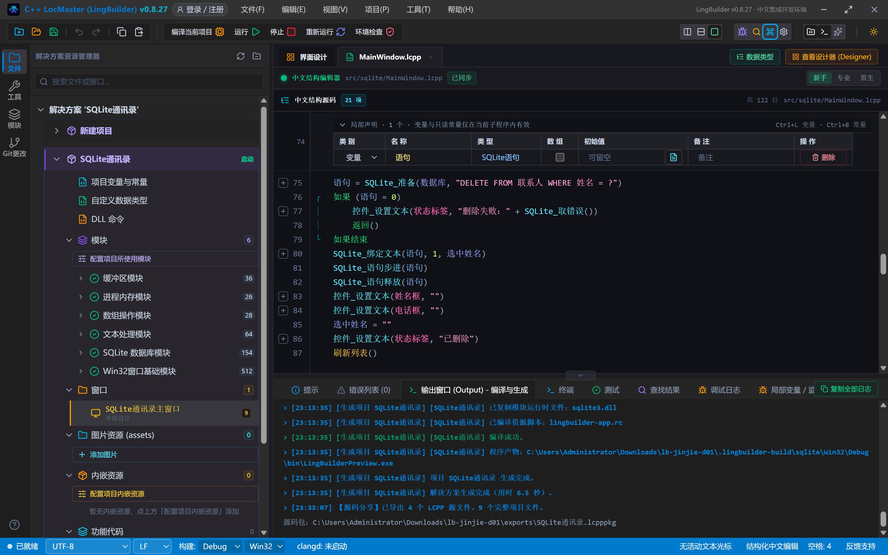

> ⚠️ 又是那个坑：`局部 文本型 行文本 = 控件_取项目文本(联系人列表, 序号)` 这种「声明带初始值」的写法，初始值会被**提升到子程序最开头**执行——那时 `序号` 还没赋值！所以带依赖关系的值必须**先声明、再单独赋值**（上面就是这么写的）。零基础第 30 集的随机数 bug 也是它。

`_修改按钮_被单击` 事件：

```lcpp
事件 _修改按钮_被单击()
    如果 (选中姓名 = "")
        信息框("请先在列表里点选一位联系人", 48, "提示")
        返回()
    如果结束
    局部 文本型 新姓名 = 控件_取文本(姓名框)
    局部 文本型 新电话 = 控件_取文本(电话框)
    如果 (新姓名 = "")
        信息框("姓名不能为空", 48, "提示")
        返回()
    如果结束
    局部 SQLite语句 语句
    语句 = SQLite_准备(数据库, "UPDATE 联系人 SET 姓名 = ?, 电话 = ? WHERE 姓名 = ?")
    如果 (语句 = 0)
        控件_设置文本(状态标签, "修改失败：" + SQLite_取错误())
        返回()
    如果结束
    SQLite_绑定文本(语句, 1, 新姓名)
    SQLite_绑定文本(语句, 2, 新电话)
    SQLite_绑定文本(语句, 3, 选中姓名)
    SQLite_语句步进(语句)
    SQLite_语句释放(语句)
    选中姓名 = ""
    控件_设置文本(状态标签, "已修改：" + 新姓名)
    刷新列表()
结束
```

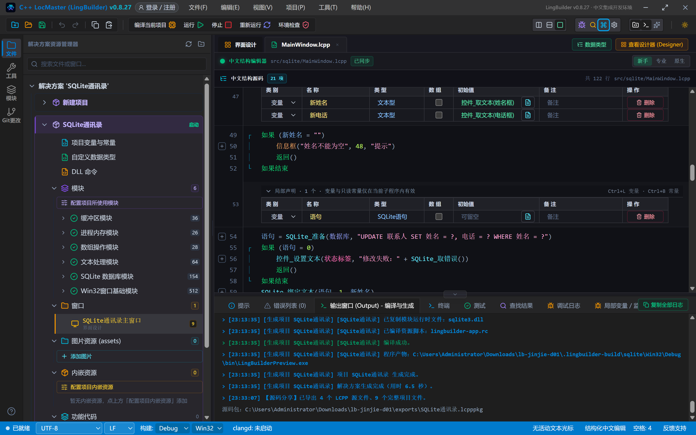

`UPDATE ... SET 姓名 = ?, 电话 = ? WHERE 姓名 = ?` 有**三个** `?`：前两个是新值，第三个（`WHERE` 后面的）是定位条件——用「选中姓名」找到要改的那一行。改完把「选中姓名」清空，逼着用户下次重新点选，避免旧选中值捣乱。

`_删除按钮_被单击` 事件（套路完全一样，只是 SQL 换成 DELETE）：

```lcpp
事件 _删除按钮_被单击()
    如果 (选中姓名 = "")
        信息框("请先在列表里点选一位联系人", 48, "提示")
        返回()
    如果结束
    局部 SQLite语句 语句
    语句 = SQLite_准备(数据库, "DELETE FROM 联系人 WHERE 姓名 = ?")
    如果 (语句 = 0)
        控件_设置文本(状态标签, "删除失败：" + SQLite_取错误())
        返回()
    如果结束
    SQLite_绑定文本(语句, 1, 选中姓名)
    SQLite_语句步进(语句)
    SQLite_语句释放(语句)
    控件_设置文本(姓名框, "")
    控件_设置文本(电话框, "")
    选中姓名 = ""
    控件_设置文本(状态标签, "已删除")
    刷新列表()
结束
```

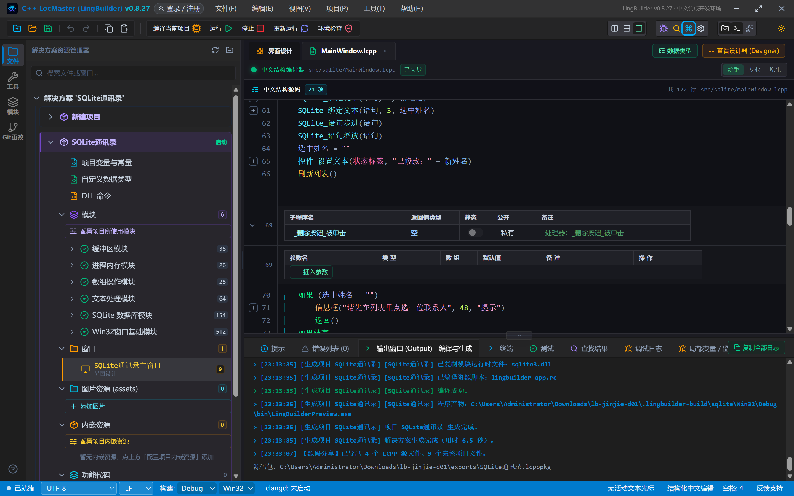

## 9. 写代码 ④：刷新列表（查询）

最后是贯穿全场的 `刷新列表` 子程序（类里直接写 `空 刷新列表()` 声明，和事件平级）：

```lcpp
空 刷新列表()
    控件_清空项目(联系人列表)
    局部 SQLite语句 查询
    查询 = SQLite_准备(数据库, "SELECT 姓名, 电话 FROM 联系人 ORDER BY 姓名")
    如果 (查询 = 0)
        控件_设置文本(状态标签, "读取失败：" + SQLite_取错误())
        返回()
    如果结束
    局部 整数型 状态
    状态 = SQLite_语句步进(查询)
    判断循环首 (状态 = 1)
        控件_添加项目(联系人列表, SQLite_取列文本(查询, 0) + "：" + SQLite_取列文本(查询, 1))
        状态 = SQLite_语句步进(查询)
    判断循环尾
    SQLite_语句释放(查询)
    控件_设置文本(状态标签, "共 " + 到文本(控件_取项目数量(联系人列表)) + " 位联系人")
结束
```

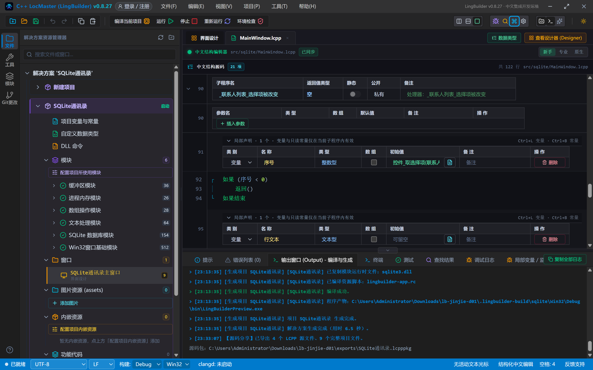

查询的读法是「步进一次 = 得到一行」：

- `SQLite_语句步进` 返回 **1** 表示拿到一行，返回 **0** 表示读完了，**-1** 表示出错。
- `判断循环首 (状态 = 1)`：只要还有行就继续循环，这是读多行数据的标准姿势。
- `SQLite_取列文本(查询, 0)` 读第 0 列（姓名，列号**从 0 开始**！），第 1 列是电话，用中文冒号拼成一行塞进列表框。
- `ORDER BY 姓名` 让结果按姓名排序，每次刷新顺序都一致。

## 10. 编译！先看错误列表，再看输出

代码写完，点工具栏「**编译当前项目**」。**编译前后都要先瞄一眼 IDE 底部的「错误列表」**——这是从第一集就要养成的黄金习惯：

如果代码有问题，错误列表会亮红，比如把 `局部 SQLite语句 语句` 误写成 `局部 SQLite语句 语句 = 0`，会看到：

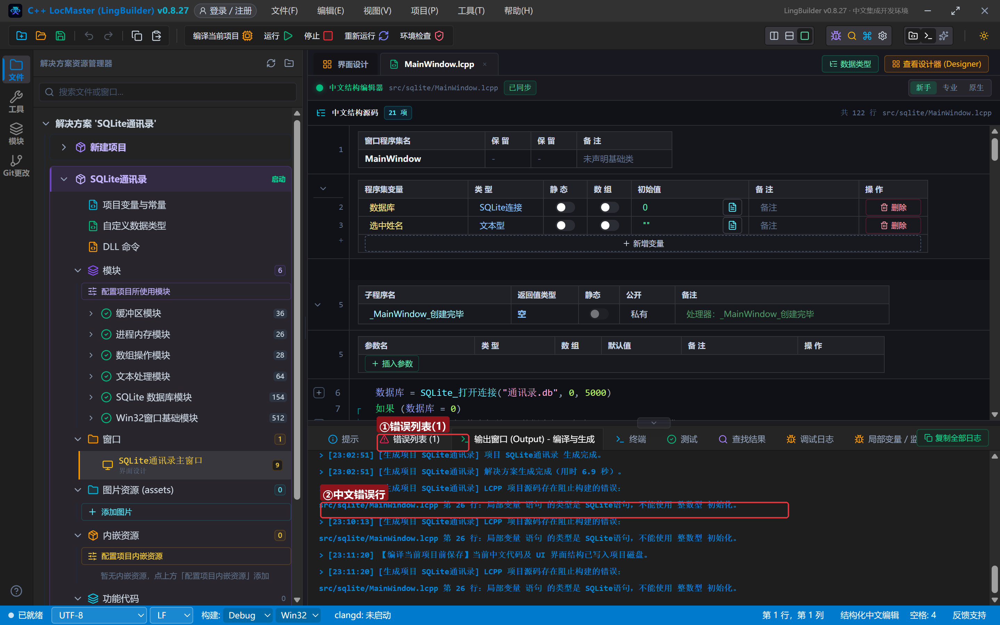

错误是中文的：**第 26 行：局部变量 语句 的类型是 SQLite语句，不能使用 整数型 初始化**。双击错误行能直接跳到出事的代码行，删掉 `= 0` 再编译即可。

修复后错误列表归零，显示「未检测到编译障碍」：

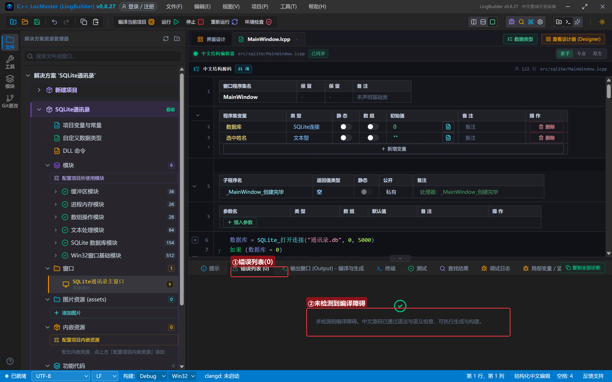

然后切到「输出窗口」页，看到绿色的「**编译成功。**」和「程序产物」路径就稳了：

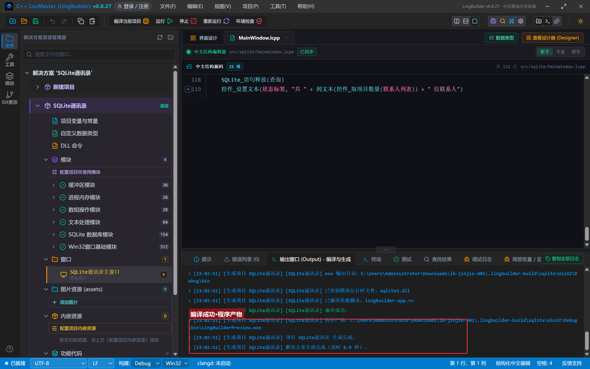

## 11. 运行！把通讯录用起来

点工具栏「**运行**」，通讯录就跑起来了。首次启动列表是空的（数据库文件 `通讯录.db` 会自动出现在程序旁边）：

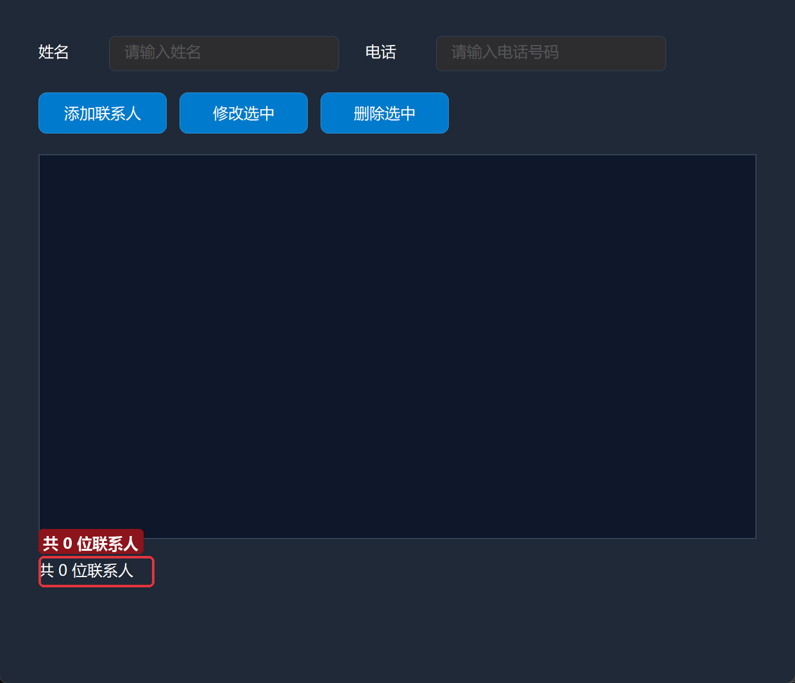

**添加**：姓名框输入「李明」，电话框输入「13800000001」，点「添加联系人」——列表立刻出现一行，状态栏显示「共 1 位联系人」：

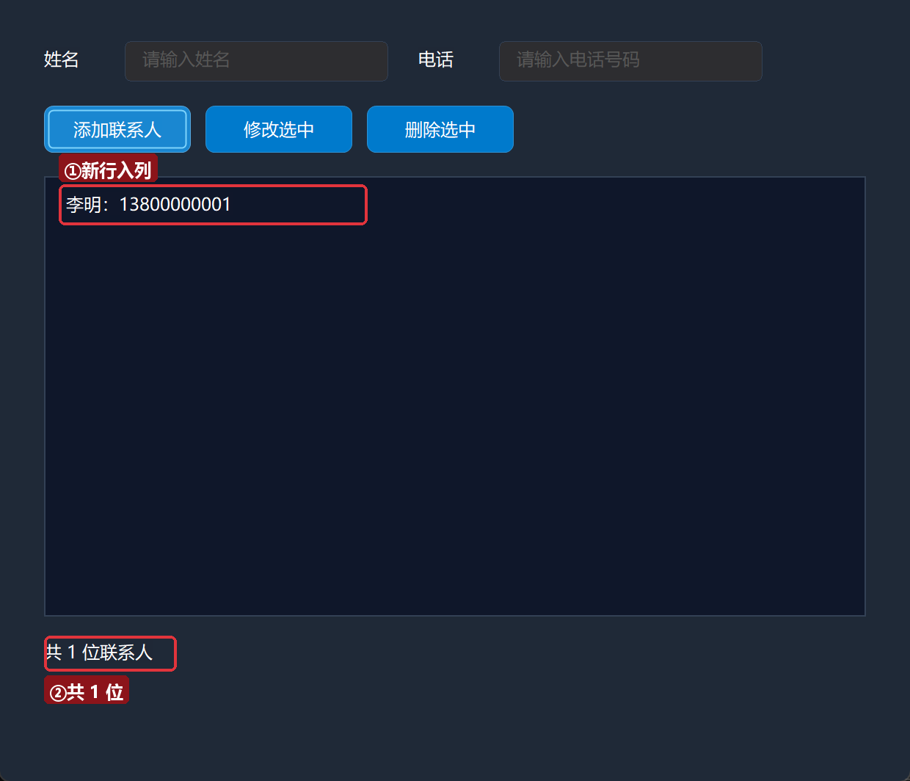

再把「王芳 / 13900000002」也加进去：

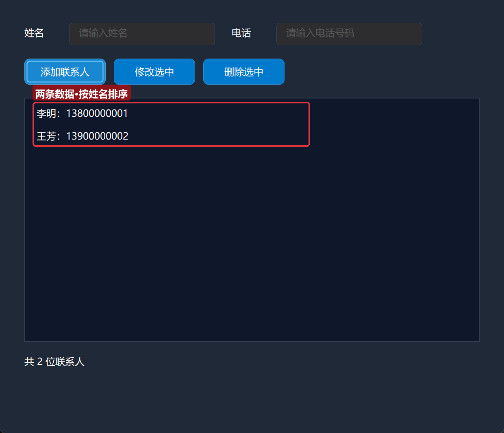

**点选带出**：在列表里点「李明」那一行——整行高亮，姓名和电话自动填回输入框：

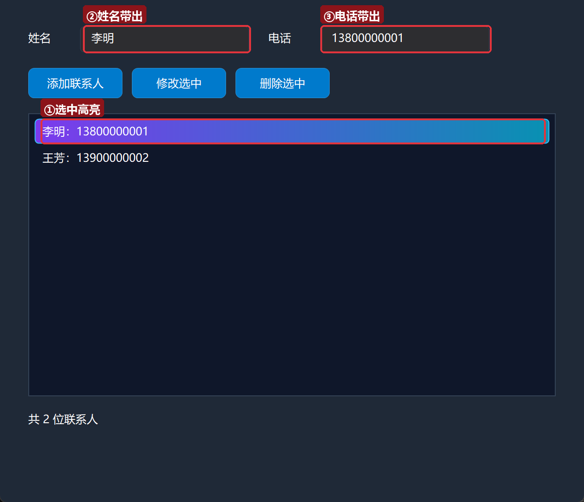

**修改**：把电话改成「13811112222」，点「修改选中」——列表里李明的电话立刻变了：

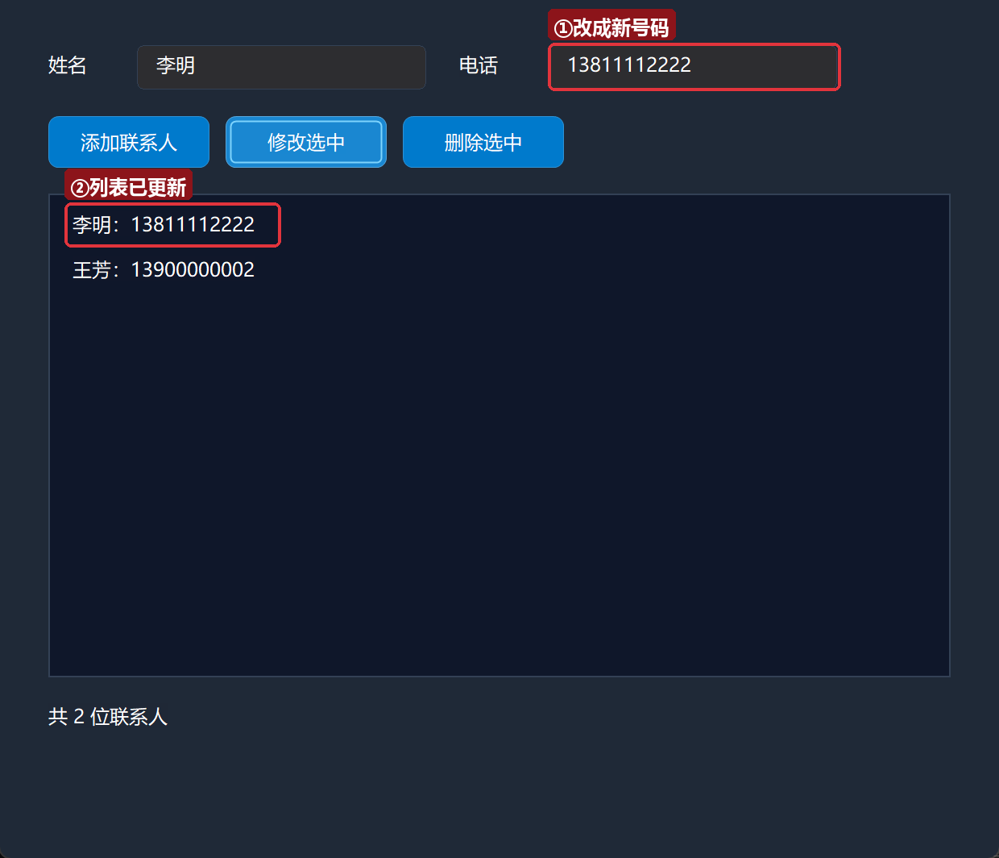

**删除**：再次点选李明（修改后选中状态会清空，这是有意设计），点「删除选中」——列表只剩王芳：

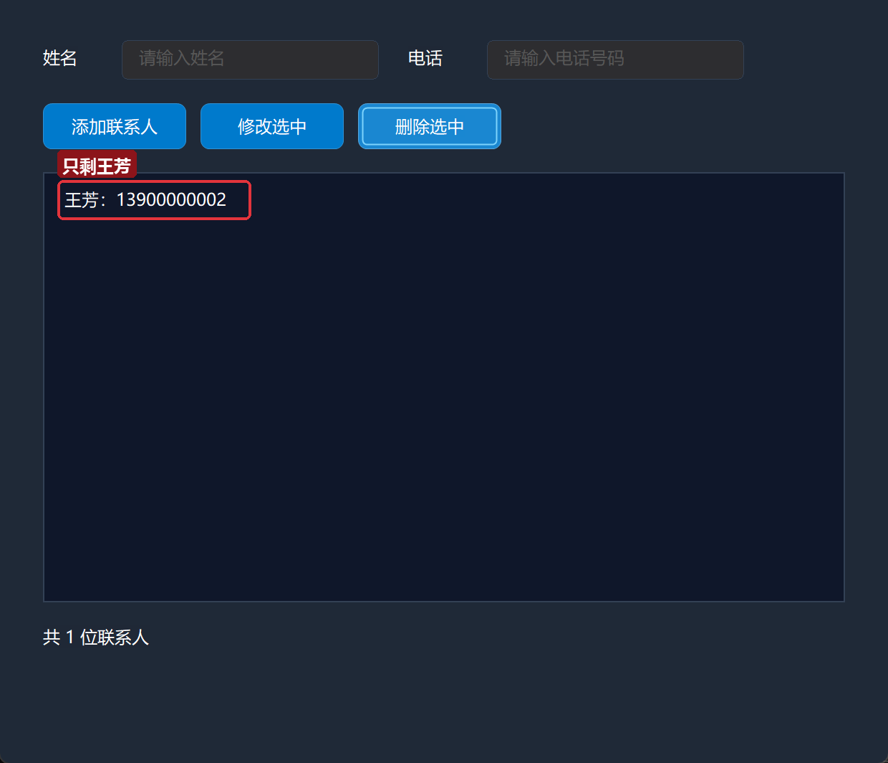

**见证数据库的时刻**：关掉程序，再从构建输出目录里重新打开一次（零基础系列里你已经很熟的 `bin` 目录）——

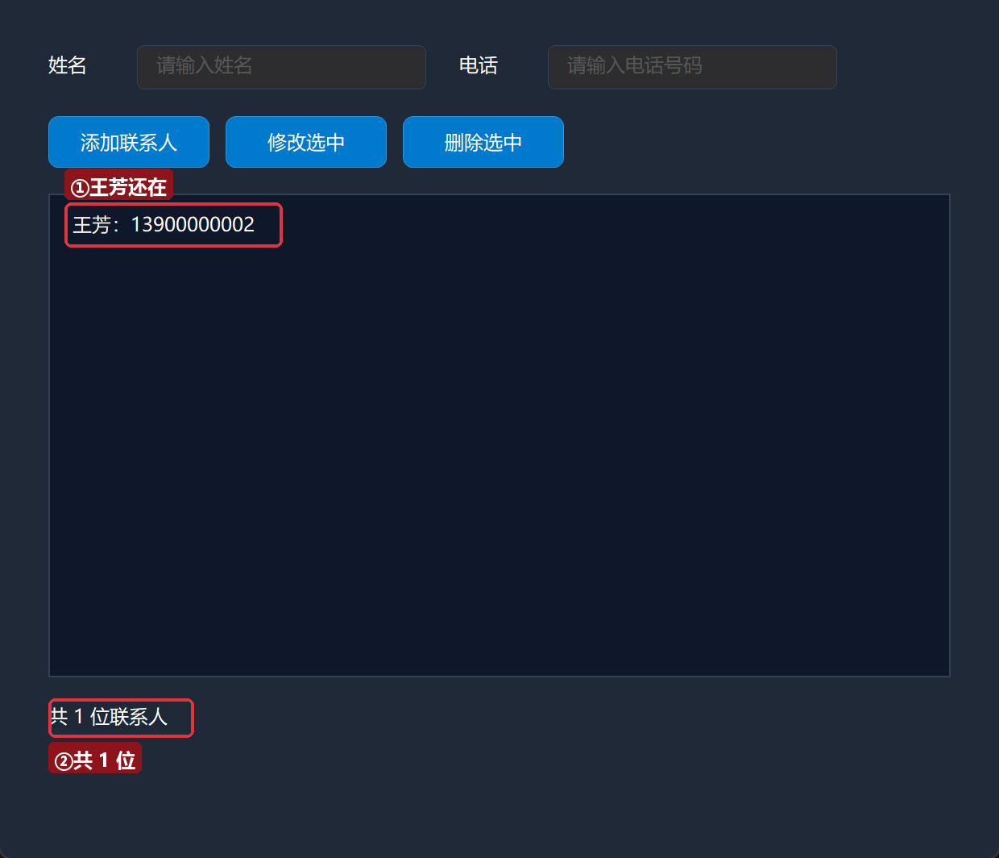

王芳还在！这就是数据库和变量的本质区别：**数据写在硬盘上，程序只是它的管理员**。

## 12. 一键分享：导出 LCPP 源码包

做好一个软件，怎么发给朋友？点工具栏「打开命令面板」（或按 `Ctrl+Shift+P`），输入「源码包」，选择「**项目：一键导出 LCPP 源码包**」：

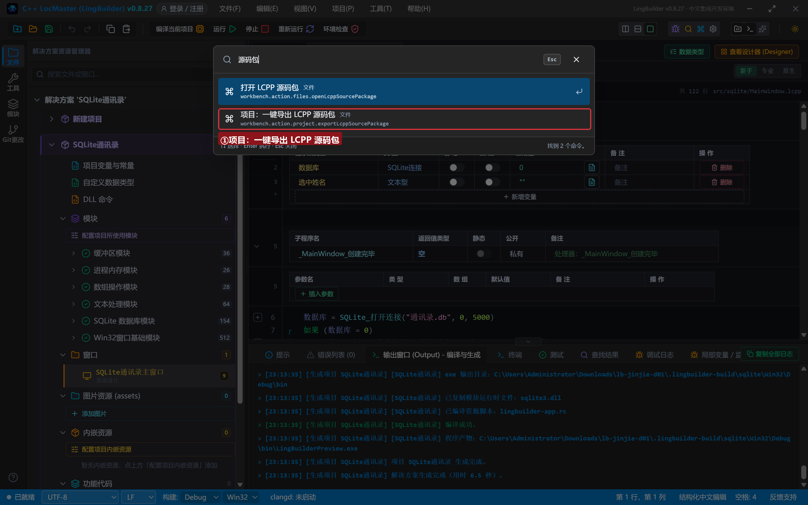

在保存对话框里直接点保存（默认落到工作区 `exports` 目录），输出窗口会报告「已导出 4 个 LCPP 源文件、9 个完整项目文件」，得到一个 `SQLite通讯录.lcpppkg`。你的朋友双击这个文件（或用「文件 → 打开 LCPP 源码包」）就能一键导入完整项目——源码、界面设计、模块清单全都在，详见《LCPP 源码包分享图文教程》。本集的源码包也放在官网示例源码区，搜「SQLite通讯录」即可下载。

## 13. 常见问题急救表

| 症状 | 原因 | 解法 |
| --- | --- | --- |
| 编译报「SQLite语句，不能使用 整数型 初始化」 | `局部 SQLite语句 语句 = 0` 多写了 `= 0` | 删掉 `= 0`，先声明再赋值 |
| 添加成功但列表一直是「共 0 位」 | `局部 整数型 状态 = SQLite_语句步进(查询)` 初始值被提升，查询还没准备就执行了 | 拆成两行：先 `局部 整数型 状态`，再单独赋值 |
| 命令报红/构建报「未知命令」 | SQLite 模块没启用 | 回到第 3 节启用模块 |
| 打开连接返回 0 | 磁盘写保护或路径非法 | 用 `SQLite_取错误()` 看中文原因 |
| 重启后数据没了 | exe 换了目录运行，读的是另一处的 `通讯录.db` | 数据库文件在 exe 旁边，认准同一个目录 |

## 本集小结

- **数据库 = 写在硬盘上的表**：程序退出数据不丢，SQLite 整个数据库就是一个文件。
- **启用模块**是使用一切高级能力的第一步。
- 增删改查五步曲：**准备 → 绑定 → 步进 → 释放 → 刷新**，`?` 占位符防注入。
- 编译先看**错误列表**，中文错误双击直达出错行。
- `.lcpppkg` 一键分享完整项目。

**下一集预告**：《@ 行内嵌 C++：当模块不够用时》——教你在中文代码里直接嵌入 C++ 语句，调一把模块没有的 Win32 API，做一个系统信息小工具。

[回系列总览](/guide/tutorials/jinjie)
