# 进阶实战 02 · @ 行内嵌 C++：当模块不够用时

> 《LingBuilder 进阶实战系列》第 2 集。101 个内置模块几乎覆盖了日常开发，但总有一天你会遇到「模块没有的能力」——这时就该请出 LingBuilder 的逃生舱：**@ 行内嵌 C++**。行首写一个 `@`，后面直接写 C++ 语句，它会被原样放进生成的 C++ 程序里执行。本集我们做一个模块真心做不了的软件：**电脑空闲监视器**——它能知道你已经多久没碰鼠标键盘了（这个能力 101 个模块都没有）。全程约 30 分钟。
>
> 前置要求：学完[零基础入门系列](/guide/tutorials/beginner)与[进阶第 1 集](/guide/tutorials/jinjie-01-sqlite)，会新建项目、绑事件、写子程序。

## 这一集你将学会

- `@` 行怎么写：行首一个 `@`，后面就是真正的 C++
- **中文变量互通**：C++ 语句里可以直接读写中文变量（不需要任何转换）
- 从 `@` 行里调用中文命令 `调试输出`，把 C++ 侧的数据打进调试日志
- 三条红线：`@` 行**禁止 #include**、**禁止内联 if/for**、**模块有的优先用模块**
- 时钟（Clock）非可视组件的周期用法

## 1. 三十秒理解 @ 行

先记住一句话：**中文源码最终会被翻译成 C++，而 `@` 行跳过翻译、原样保留**。生成器在处理 `@ 开机毫秒 = (long long)GetTickCount64();` 这一行时，只是去掉行首的 `@` 和空格，剩下的 `(long long)GetTickCount64();` 一字不改地进 C++。

那中文变量怎么和 C++ 打交道？秘密是：**中文变量在生成的 C++ 里就叫中文名**（MSVC 支持）。所以你在 `@` 行里直接写 `开机毫秒`，操作的正是你在中文代码里声明的那个变量——赋值进来的数据，下一行就能用 `到文本(开机毫秒)` 拼接显示。

> **什么时候用 @ 行**：模块没有覆盖的系统能力（本集的空闲检测）、一两句算法胶水。**什么时候不用**：模块已经有对应命令时——写 `@` 行调用已被中文命令覆盖的 Win32 API，编辑器会给黄色「可替代」警告（不阻断，但听劝）。

## 2. 新建项目

新建窗口项目：项目名称 **空闲监视器**，模板「Windows 界面设计」，创建位置留空（方法见零基础第 02 集）：

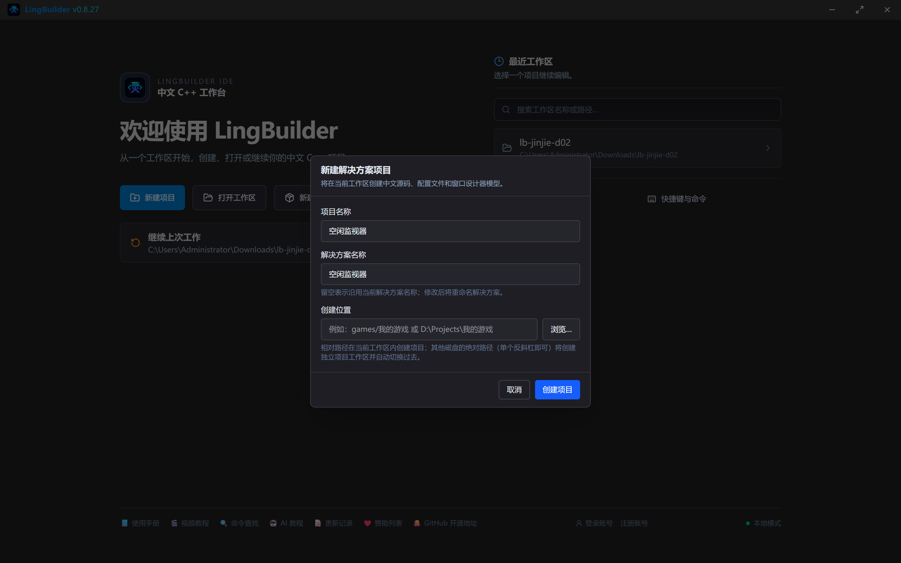

## 3. 设计界面

本集界面非常简单：3 个标签 + 1 个按钮，外加一个**看不见的控件——时钟**。

| 控件 | 名称 | 显示内容 | 左距 | 顶距 | 宽度 | 高度 |
| --- | --- | --- | --- | --- | --- | --- |
| 标签 | 说明标签 | 本程序用 @ 行内嵌 C++，调用模块没有的系统能力 | 30 | 30 | 560 | 24 |
| 标签 | 开机标签 | 开机时长：检测中… | 30 | 86 | 560 | 28 |
| 标签 | 空闲标签 | 空闲检测中…（字体大小改 15） | 30 | 156 | 560 | 48 |
| 按钮 | 刷新按钮 | 手动刷新 | 30 | 240 | 120 | 32 |

窗口宽度改 **620**、高度改 **360**（点画布空白处选中窗口后改）。

时钟从工具箱「基础控件」组的底部添加——它**不占界面位置**，添加后画布上只有一个黄色占位框。点选时钟，在属性里把「周期（毫秒）」设为 **1000**，并勾选「**启动时启用**」（这样程序一启动时钟就开始跳，不用代码启动）。

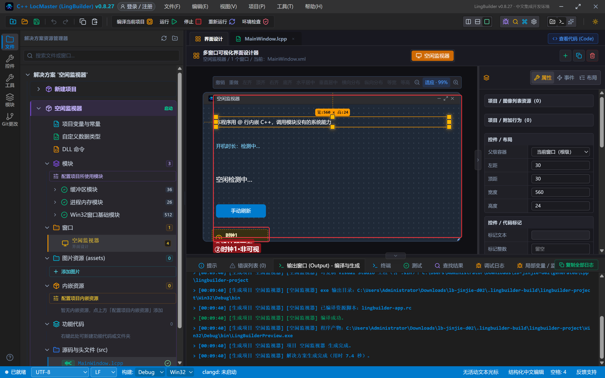

然后绑定 3 个事件（方法见零基础第 03 集）：

| 控件 | 事件 | 处理器名 |
| --- | --- | --- |
| 窗口（空白处） | 创建完毕 | `_MainWindow_创建完毕` |
| 时钟1 | 周期到期 | `_时钟1_周期到期` |
| 刷新按钮 | 被单击 | `_刷新按钮_被单击` |

## 4. 写代码 ①：用 @ 行取系统开机时长

完整代码本节分三段讲。先写 `_MainWindow_创建完毕`：

```lcpp
事件 _MainWindow_创建完毕()
    局部 长整数型 开机毫秒
    @ 开机毫秒 = (long long)GetTickCount64();
    控件_设置文本(开机标签, "系统已连续运行 " + 到文本(开机毫秒 / 1000 / 60) + " 分钟")
    调试输出("开机毫秒：", 开机毫秒)
结束
```

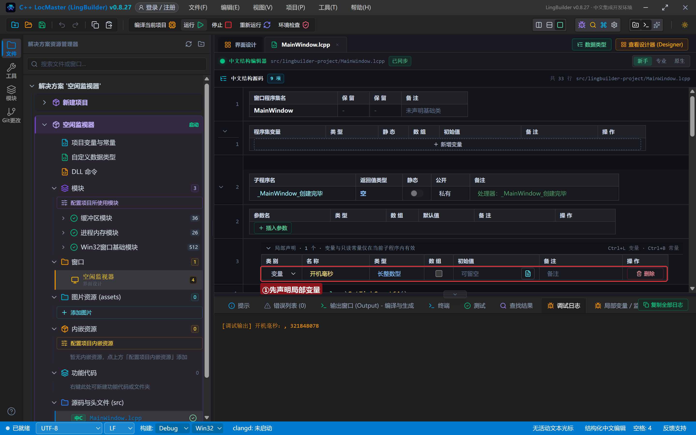

逐行拆解：

- `局部 长整数型 开机毫秒`：先声明一个 64 位整数变量。**为什么要先声明**：声明带初始化会被提升到子程序最前（进阶第 1 集的老坑），而我们要的值必须由下一行 `@` 语句现场计算，所以「先声明、再由 @ 行赋值」。
- `@ 开机毫秒 = (long long)GetTickCount64();`——本集主角。`GetTickCount64()` 是 Windows 系统 API，返回系统开机以来的毫秒数（101 个模块都没有它）；`(long long)` 是 C++ 强制类型转换，把返回值对齐我们变量的类型；**行尾要有分号**，因为这就是 C++ 语句。
- 下一行立刻用中文命令 `到文本` 把它拼接显示——C++ 侧赋的值，中文侧直接用，这就是「互通」。
- `调试输出` 是基础命令，调试日志会显示这行的内容（第 8 节看效果）。

## 5. 写代码 ②：空闲检测核心

系统怎么知道你「多久没操作」了？Windows 在内部记录着**最后一次输入的时刻**，API `GetLastInputInfo` 能读到它。用「当前时刻 − 最后输入时刻」就是空闲时长。这个计算每秒做一次最合适——时钟的「周期到期」事件每 1000 毫秒自动触发一次。

先写两个「入口」事件（它们都只是调用同一个子程序）：

```lcpp
事件 _刷新按钮_被单击()
    刷新空闲()
结束

事件 _时钟1_周期到期()
    刷新空闲()
结束
```

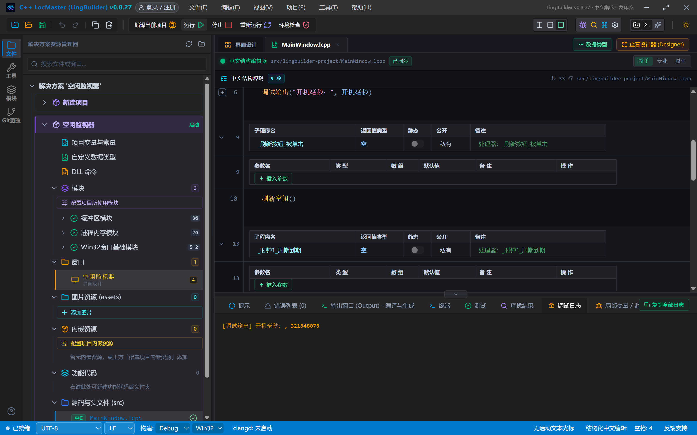

再写核心子程序 `刷新空闲`（在类里和事件平级，`空 刷新空闲()` 声明）：

```lcpp
空 刷新空闲()
    局部 长整数型 现在毫秒
    局部 长整数型 上次输入毫秒
    @ LASTINPUTINFO 输入信息 = { sizeof(LASTINPUTINFO), 0 };
    @ GetLastInputInfo(&输入信息);
    @ 现在毫秒 = (long long)GetTickCount64();
    @ 上次输入毫秒 = (long long)输入信息.dwTime;
    局部 长整数型 空闲秒
    空闲秒 = (现在毫秒 - 上次输入毫秒) / 1000
    如果 (空闲秒 < 5)
        控件_设置文本(空闲标签, "状态：刚刚还有操作（不到 5 秒）")
    否则
        控件_设置文本(空闲标签, "状态：已经 " + 到文本(空闲秒) + " 秒没动鼠标键盘了")
    如果结束
结束
```

这四条 `@` 行是全集的精华，一条条看：

- `@ LASTINPUTINFO 输入信息 = { sizeof(LASTINPUTINFO), 0 };`：声明一个 Windows 系统结构体（用来接收「最后输入时刻」），变量名就是中文「输入信息」——`{ ... }` 是 C++ 的结构体初始化写法，第一个成员必须是结构体自己的大小（`sizeof`），这是 Windows API 的规矩。
- `@ GetLastInputInfo(&输入信息);`：调用系统 API，把数据填进结构体。**注意 `&`**——在 `@` 行里它是 C++ 的「取地址」运算符（把结构体的位置递给 API），和中文代码里 `&处理器名` 完全是两回事；`@` 行里的内容一律按原生 C++ 处理，不会被误判。
- `@ 现在毫秒 = (long long)GetTickCount64();`：取当前毫秒，写回**中文变量**「现在毫秒」。
- `@ 上次输入毫秒 = (long long)输入信息.dwTime;`：从结构体里取出最后输入时刻，写回中文变量「上次输入毫秒」。`输入信息.dwTime` 是 C++ 的成员访问写法（结构体名.成员名）。

四条 `@` 行跑完，数据已经躺在两个中文变量里，剩下的就是纯中文代码：相减、除以 1000 变秒，再按「小于 5 秒」分两种文案显示。

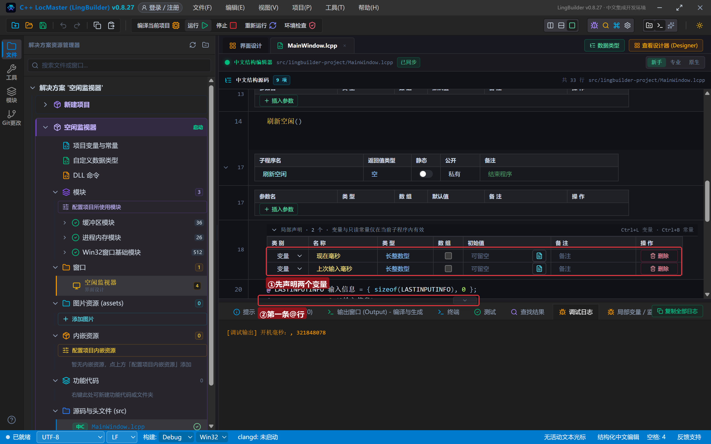

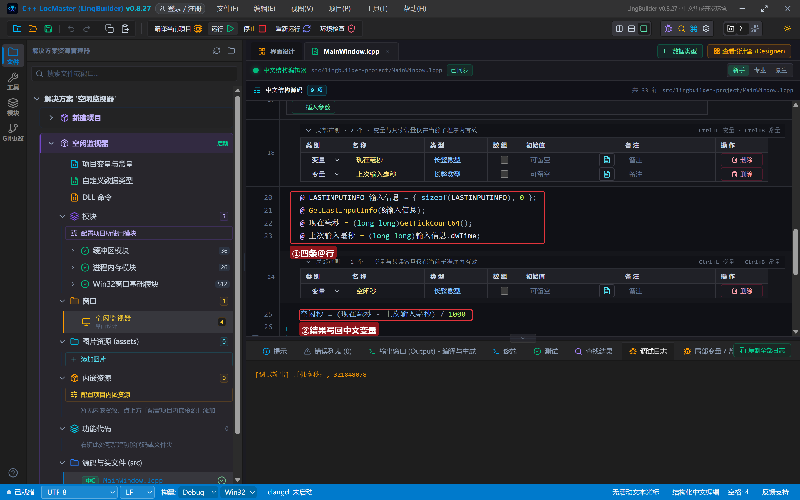

> ⚠️ 又见「先声明、再赋值」：`空闲秒` 的值依赖上面 `@` 行算出的两个变量，所以绝不能写成 `局部 长整数型 空闲秒 = (现在毫秒 - 上次输入毫秒) / 1000`——带初始化的声明会被提升到子程序最前，算出来的就是一堆 0。进阶第 1 集的通讯录列表就是这么「共 0 位」的，这个坑每集都要提。

## 6. 编译：先看错误列表

点「**编译当前项目**」，习惯性先瞄底部「**错误列表**」。本集代码一次通过，错误列表 (0)；如果 `@` 行写了非法 C++（少分号、拼错 API 名），MSVC 的报错也会被翻译成中文行号定位到这里。看到输出窗口的「**编译成功。**」再进行下一步：

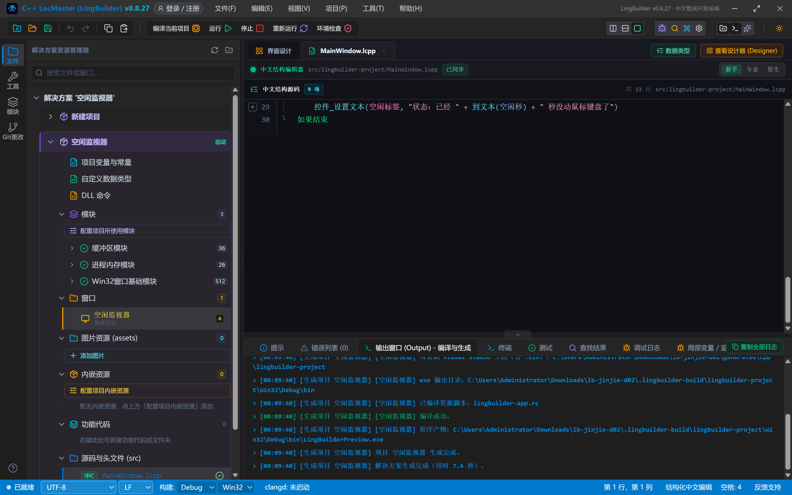

## 7. 运行：看着空闲秒数跳

点「运行」。程序启动时「创建完毕」事件先报出开机时长（截图时这台电脑已连续运行 5361 分钟），时钟每秒刷新一次空闲状态：

刚点过鼠标时——状态显示「不到 5 秒」：

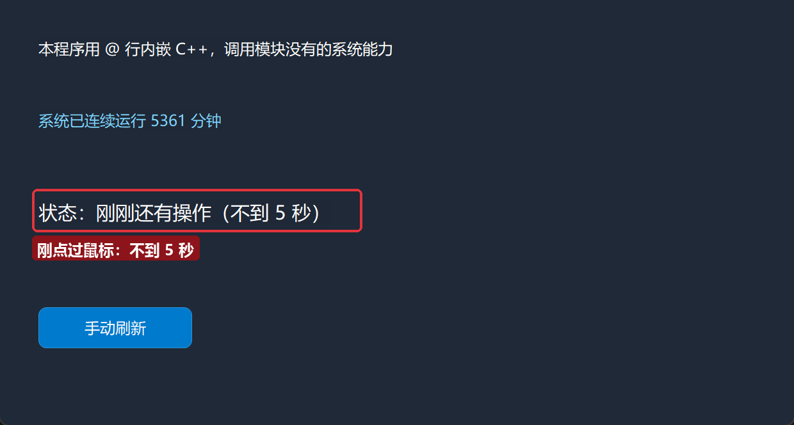

静置十几秒不动——秒数自己往上跳（时钟在每秒刷新）：

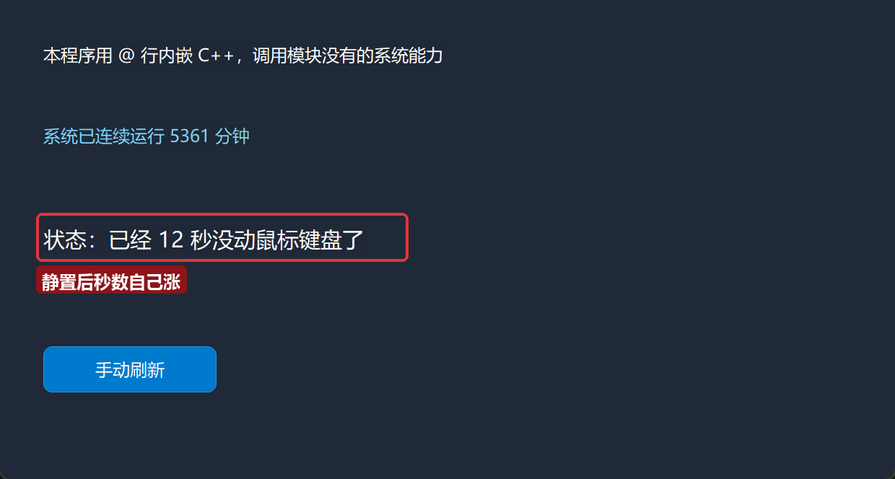

再点一下鼠标——立刻回弹：

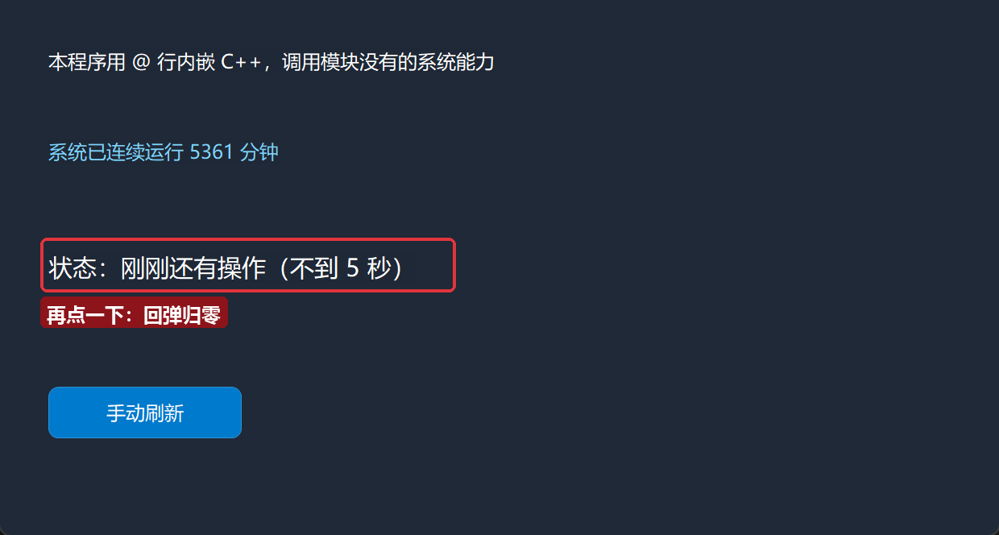

切换回 IDE，点底部「**调试日志**」页，`创建完毕` 里那句 `调试输出` 的结果就在这里——`@` 行赋的值，从 `@` 行里也能直接打印：

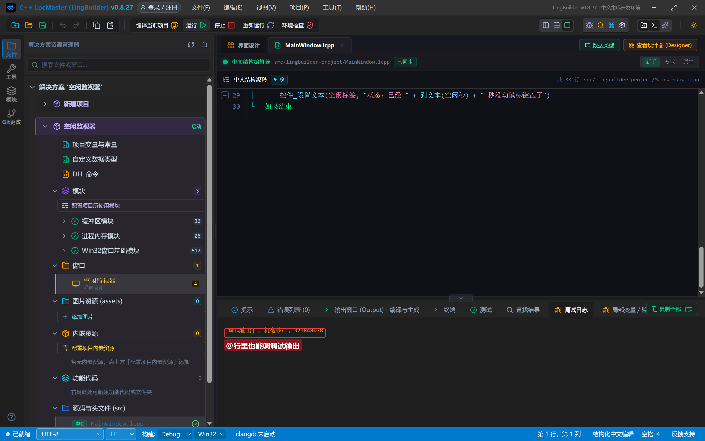

## 8. 三条红线（记牢少踩坑）

1. **`@` 行禁止 `#include`**。`@` 行展开在函数体内部，`#include` 只能出现在文件顶层，写了必报 C2598。需要第三方 SDK 头文件时，在项目的「**DLL 命令**」声明文件里写一行 `头文件 = 头文件名.h`，生成器会把它放到文件顶层，然后 `@` 行就能直接用那个头文件里的函数。
2. **`@` 行禁止内联 `if` / `for` / `while` / `try`**。流程控制必须用中文语句（如果/计次循环首/判断循环首/尝试），`@` 行只写单条 C++ 语句（可以一条里带分号的多句赋值，但不写控制流）。
3. **模块有的优先用模块**。写 `@` 行前先查替代警告——编辑器对「可用中文命令替代」的 `@` 行给黄色警告并列出替代命令；确实无替代的，在行尾加 `// 允许: 原因` 显式豁免。本集的 `GetTickCount64` 和 `GetLastInputInfo` 就是查过对照表确认「无替代」才动手的。

## 9. 一键分享源码包

老规矩：命令面板（`Ctrl+Shift+P` 或工具栏按钮）→ 输入「一键导出」→ 回车 → 保存。得到 `空闲监视器.lcpppkg`，朋友双击即可导入完整项目（源码 + 界面 + 时钟配置）。本集源码包同样放在官网示例源码区，搜「空闲监视器」。

## 10. 常见问题急救表

| 症状 | 原因 | 解法 |
| --- | --- | --- |
| 编译报 C2598 或「命名空间作用域」错误 | 在 `@` 行里写了 `#include` | 删掉，改在「DLL 命令」声明文件写 `头文件 = xxx.h` |
| `@` 行的变量中文代码里读不到值 | 把值赋给了 `@` 行里临时声明的 C++ 变量（如 `输入信息`），而不是中文变量 | 加一条 `@ 中文变量 = C++变量;` 把结果回写到中文变量 |
| 计算结果一直是 0 或旧值 | 声明带初始化被提升到子程序最前 | 拆成「先声明、再赋值」两行 |
| `@` 行写了 if/for 报错 | 流程控制必须用中文语句 | 改用 如果/计次循环首/判断循环首 |
| 编辑器出现黄色「可替代」警告 | 该 API 已有中文命令覆盖 | 听劝改用模块命令，或行尾 `// 允许: 原因` |
| 以为要写 `&处理器` 但报错 | `@` 行里的 `&` 是 C++ 取地址 | 正常现象，`@` 行按原生 C++ 处理 |

## 本集小结

- `@` 行 = 行首一个 `@` + 原样进 C++ 的语句；**中文变量在 C++ 里就叫中文名**，双向互通零成本。
- 空闲检测 = `GetTickCount64()`（当前）− `GetLastInputInfo`（最后输入），时钟每秒刷一次。
- 三条红线：禁 `#include`、禁内联流程控制、模块优先。
- 「先声明、再赋值」防提升坑，本集两处代码都是这么写的。

**下一集预告**：《网络请求 web.http》——让程序连上互联网，做一个 IP/天气查询小工具，学会同步与异步两种访问方式和 `&完成处理器`。

[回系列总览](/guide/tutorials/jinjie)
