# 进阶实战 07 · 定时任务 cron：定时提醒器

> 《LingBuilder 进阶实战系列》第 7 集。「每天早上 9 点提醒我交日报」「每小时备份一次」——这类**按日历时间**干活的需求，靠秒表式的循环数不靠谱，正解是 **cron 表达式**。本集用**定时任务模块（lingbuilder.cron）**做一个**定时提醒器**：填一句表达式，到点自动写日志、弹窗提醒；还能暂停、恢复、立即试触发。你还会搞清「时钟组件」和「cron」到底各管什么。全程约 30 分钟。
>
> 前置要求：学完[零基础入门系列](/guide/tutorials/beginner)与进阶前 6 集（特别是第 2 集的时钟组件和第 6 集的「失败就问取错误」）。本集源码包见文末。

## 这一集你将学会

- `cron_定时_启动(表达式, &处理器)`：按 cron 表达式注册周期任务
- cron 表达式入门：五段「分 时 日 月 周」，`*`、`*/n`、`a-b`、逗号列表
- 三件辅助命令：`cron_定时_校验表达式`、`cron_定时_取表达式错误`、`cron_定时_表达式说明`（把表达式翻译成人话）
- 生命周期管理：`cron_定时_暂停` / `cron_定时_恢复` / `cron_定时_停止` / `cron_定时_下次触发时间`
- 演示利器 `cron_定时_立即触发`：不用干等整分，立刻触发一次
- 状态守卫：用 `cron_定时_取状态` 判断「等待中 / 已暂停 / 已停止 / 不存在」

## 1. 三十秒理解：时钟管间隔，cron 管日历

第 2 集用过**时钟组件**：每隔固定毫秒触发一次，适合「每秒刷新界面」这种**间隔型**任务。但它回答不了「每天 9 点」——一天 86400 秒，从哪个时刻数起？重启了怎么办？跨过午夜怎么办？

**cron 表达式**按**日历时间**匹配：五段分别是「分 时 日 月 周」，每一到点命中就触发，不依赖程序什么时候启动：

| 表达式 | 含义 |
| --- | --- |
| `*/1 * * * *` | 每 1 分钟 |
| `0 9 * * *` | 每天 09:00 |
| `30 8 * * 1-5` | 工作日（周一到周五）08:30 |
| `0 */2 * * *` | 每 2 小时（整点） |
| `0 0 1 * *` | 每月 1 号零点 |

记不住写法也没关系——本集会教模块自带的人话翻译，写完先「检查表达式」看看它理解得对不对。

> 到点后处理器在**注册窗口的 UI 线程**执行，可以直接更新控件；窗口关闭时任务自动停止，不会留下后台僵尸。

## 2. 新建项目与启用模块

新建窗口项目：名称 **定时提醒器**，模板「Windows 界面设计」，创建位置留空：

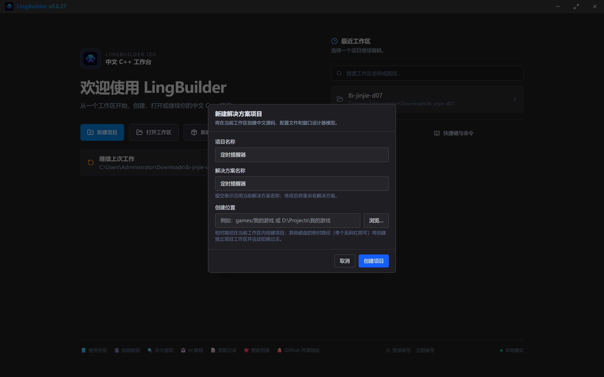

启用「**定时任务模块**」（29 条命令，本集用其中 10 条）。

## 3. 设计界面

| 控件 | 名称 | 显示内容 | 左距 | 顶距 | 宽度 | 高度 |
| --- | --- | --- | --- | --- | --- | --- |
| 标签 | 说明标签 | 用 cron 表达式约定时间，到点自动弹窗提醒 | 30 | 22 | 560 | 24 |
| 标签 | 表达式标签 | cron 表达式（分 时 日 月 周） | 30 | 56 | 320 | 22 |
| 编辑框 | 表达式框 | （空） | 30 | 82 | 560 | 28 |
| 标签 | 内容标签 | 提醒内容 | 30 | 120 | 320 | 22 |
| 编辑框 | 提醒内容框 | （空，勾选**多行**） | 30 | 146 | 560 | 64 |
| 按钮 | 校验按钮 | 检查表达式 | 30 | 222 | 176 | 32 |
| 按钮 | 启动按钮 | 启动定时提醒 | 222 | 222 | 176 | 32 |
| 按钮 | 触发按钮 | 立刻试一次 | 414 | 222 | 176 | 32 |
| 按钮 | 暂停按钮 | 暂停 | 30 | 262 | 176 | 32 |
| 按钮 | 恢复按钮 | 恢复 | 222 | 262 | 176 | 32 |
| 按钮 | 停止按钮 | 停止提醒 | 414 | 262 | 176 | 32 |
| 列表框 | 结果列表 | — | 30 | 306 | 560 | 120 |
| 标签 | 状态标签 | 就绪 | 30 | 434 | 560 | 22 |

窗口宽 620、高 500。绑 6 个按钮事件 + 窗口「创建完毕」。

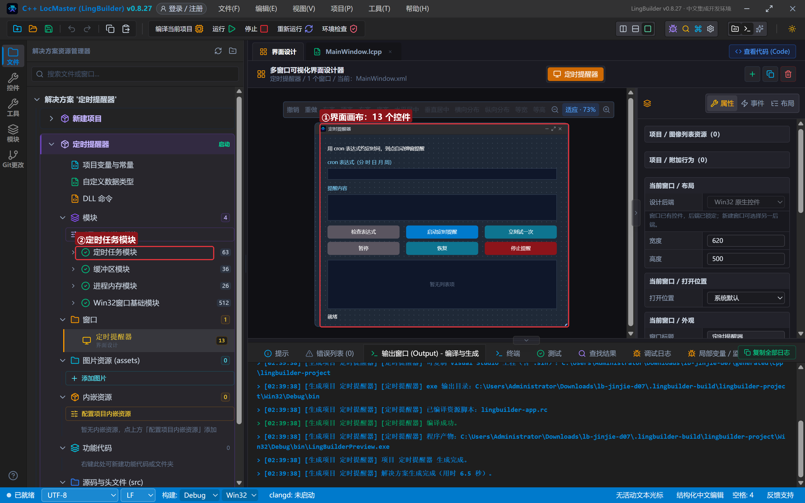

## 4. 写代码 ①：创建完毕与启动

创建完毕预填一个每分钟的表达式和提醒内容；启动按钮先校验、再注册：

```lcpp
事件 _MainWindow_创建完毕()
    控件_设置文本(表达式框, "*/1 * * * *")
    控件_设置文本(提醒内容框, "该站起来活动一下啦！")
    控件_设置文本(状态标签, "就绪。先「检查表达式」，再「启动定时提醒」")
结束

事件 _启动按钮_被单击()
    局部 文本型 表达式
    表达式 = 控件_取文本(表达式框)
    如果 (cron_定时_校验表达式(表达式) = 假)
        控件_设置文本(状态标签, "表达式非法，先点「检查表达式」看原因")
        返回()
    如果结束
    当前任务 = cron_定时_启动(表达式, &到点提醒)
    控件_清空项目(结果列表)
    如果 (当前任务 > 0)
        控件_添加项目(结果列表, "已启动：任务编号 " + 到文本(当前任务))
        控件_添加项目(结果列表, cron_定时_表达式说明(表达式) + "，下次触发：" + cron_定时_下次触发时间(当前任务))
        控件_设置文本(状态标签, "定时提醒运行中，到点会写进列表并弹窗")
    否则
        控件_添加项目(结果列表, "启动失败：" + cron_定时_取错误())
        控件_设置文本(状态标签, "启动失败，原因见结果列表")
    如果结束
结束
```

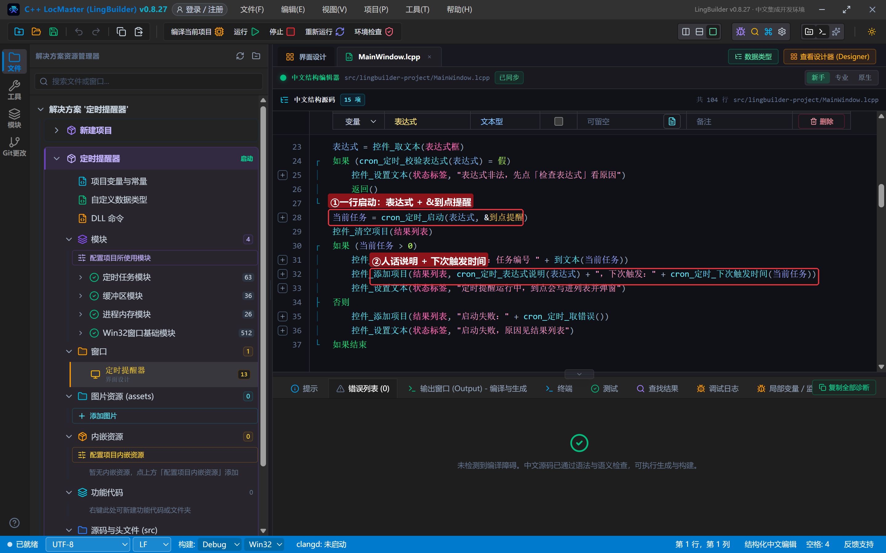

拆解：

- `cron_定时_启动(表达式, &到点提醒)` 返回**任务编号**（`定时任务` 类型，64 位、进程内不复用）；编号大于 0 = 启动成功。处理器引用照旧写 `&到点提醒`。
- `cron_定时_表达式说明` 把表达式翻成人话（「每分钟」），`cron_定时_下次触发时间` 给出精确到秒的下次触发时刻——两行结果一贴，用户立刻知道任务什么时候干活。
- `当前任务`、`到点次数` 是两个项目全局变量（`全局 定时任务 当前任务`、`全局 整数型 到点次数`）——任务编号要跨按钮保存。

> **本集真实编译错误**：最初版本我在停止按钮里写了 `当前任务 = 0` 想清空编号，编译直接被拦——「不能把 整数型 赋值给 定时任务 变量 当前任务」。`定时任务` 是模块专属类型，不接受整数赋值，也别用 0 当哨兵：
>
> 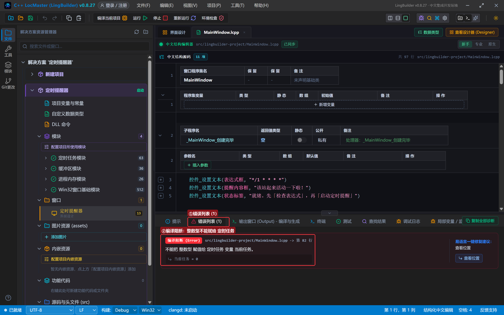
>
> 正确姿势是用 `cron_定时_取状态(任务)` 查状态（返回「等待中 / 已暂停 / 已停止 / 不存在」），本集所有按钮的守卫都改成按状态判断。

## 5. 写代码 ②：到点提醒与状态守卫

到点处理器：签名必须是 `空 处理器(定时任务 任务)`：

```lcpp
空 到点提醒(定时任务 任务)
    到点次数 = 到点次数 + 1
    控件_添加项目(结果列表, "【第 " + 到文本(到点次数) + " 次到点】" + 控件_取文本(提醒内容框))
    控件_设置文本(状态标签, "到点啦！第 " + 到文本(到点次数) + " 次提醒已触发")
    调试输出("到点提醒：任务 " + 到文本(任务))
    信息框(控件_取文本(提醒内容框), 64, "定时提醒")
结束
```

到点时先把记录写进列表、再弹一个信息框（64 = 信息图标）。手动点「检查表达式」和「立刻试一次」负责触发与状态切换：

```lcpp
事件 _触发按钮_被单击()
    局部 文本型 状态
    状态 = cron_定时_取状态(当前任务)
    如果 (状态 <> "等待中")
        控件_设置文本(状态标签, "任务当前是「" + 状态 + "」，等运行中才能试")
        返回()
    如果结束
    cron_定时_立即触发(当前任务)
结束

事件 _暂停按钮_被单击()
    局部 文本型 状态
    状态 = cron_定时_取状态(当前任务)
    如果 (状态 <> "等待中")
        控件_设置文本(状态标签, "任务当前是「" + 状态 + "」，等运行中才能暂停")
        返回()
    如果结束
    如果 (cron_定时_暂停(当前任务))
        控件_添加项目(结果列表, "已暂停：到点不触发也不补发")
        控件_设置文本(状态标签, "已暂停，点「恢复」继续")
    否则
        控件_添加项目(结果列表, "暂停失败：" + cron_定时_取错误())
    如果结束
结束
```

`cron_定时_立即触发` 是演示神器：不用等下一个整分，立刻按注册方式触发一次，且不影响原有周期。恢复、停止两个按钮同一套路：先 `cron_定时_取状态` 守卫，再调 `cron_定时_恢复` / `cron_定时_停止`，成功失败都写进列表。

## 6. 编译与运行

点「编译当前项目」，错误列表 (0)、输出窗口「编译成功」「生成完成」：

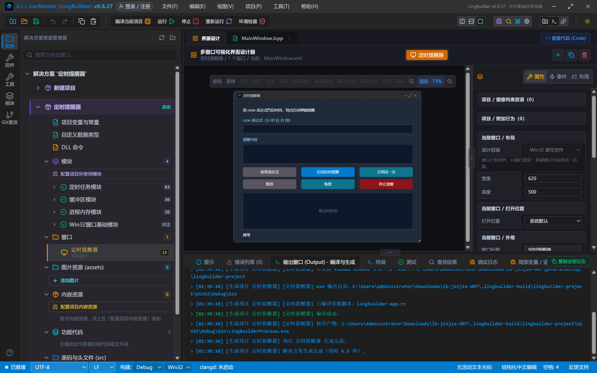

### 6.1 先故意写错：非法表达式

把表达式改成一句中文「每晚八点」，点「检查表达式」：

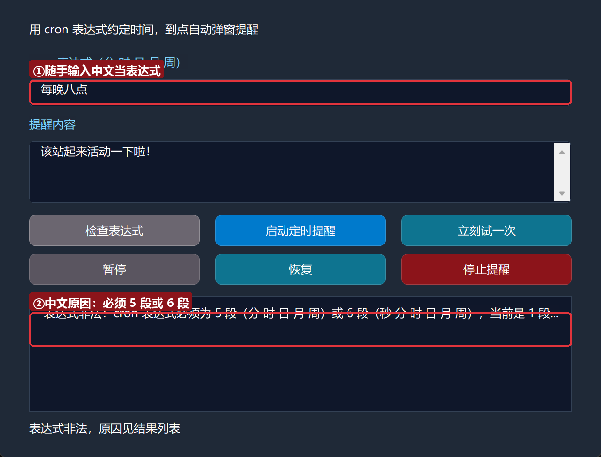

模块不跟你客气：**「cron 表达式必须为 5 段（分 时 日 月 周）或 6 段（秒 分 时 日 月 周），当前是 1 段」**——中文原因直接说清。改回 `*/1 * * * *` 再检查：

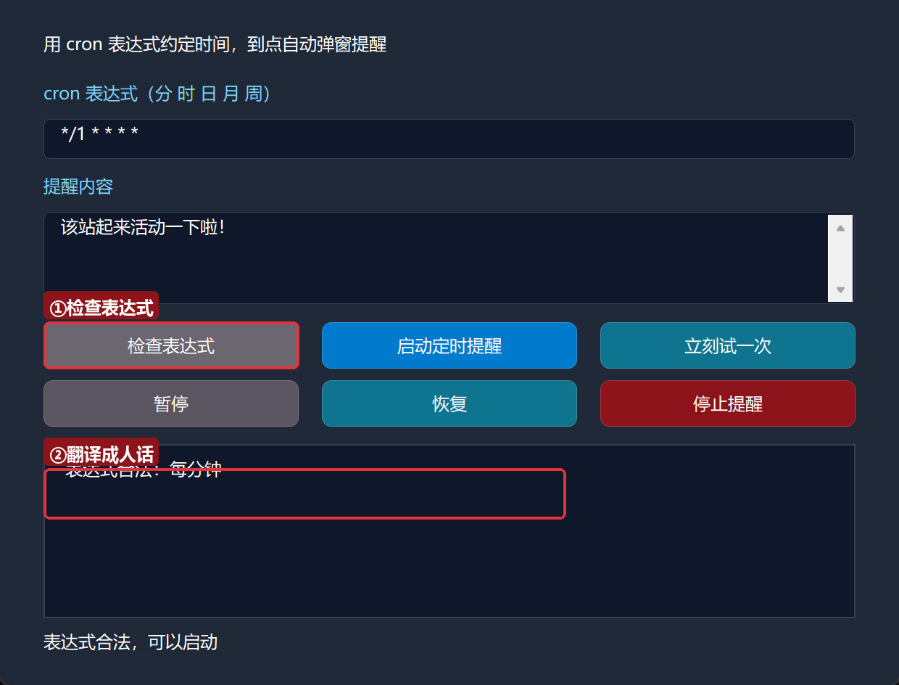

翻译成人话：**每分钟**。

### 6.2 启动并立刻试一次

点「启动定时提醒」：

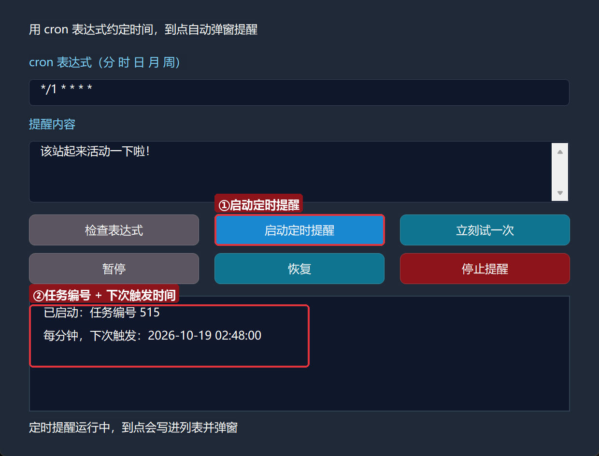

结果列表报出任务编号、「每分钟，下次触发：2026-10-19 02:43:00」——下次触发的时刻精确到秒。到点了（或点「立刻试一次」）会发生什么：

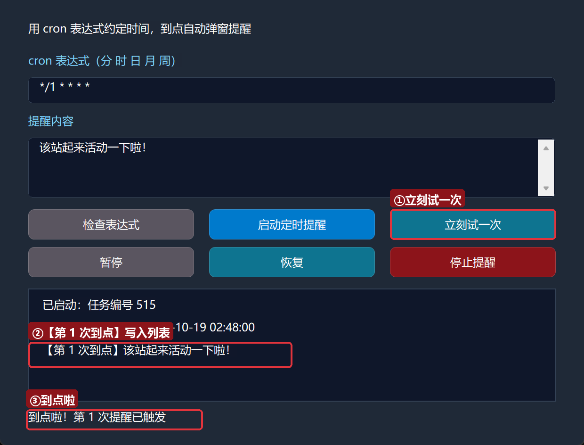

结果列表写入「【第 1 次到点】该站起来活动一下啦！」，状态栏同步报「到点啦」，同时弹出「定时提醒」信息框（截图采集时信息框被置顶的采集窗口挡住，你自己运行会正常看到弹窗）。

### 6.3 暂停与停止

点「暂停」：

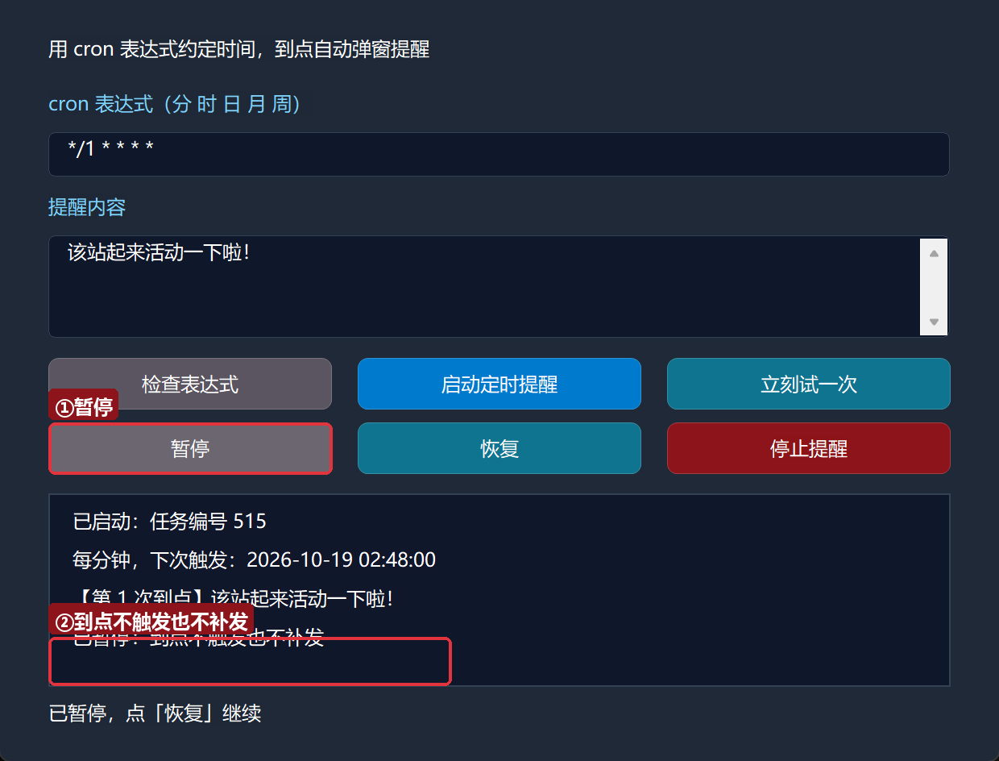

「已暂停：到点不触发也不补发」——暂停期间的到点**不会被补发**，恢复后从当前时间重新计算下次触发。点「停止提醒」：

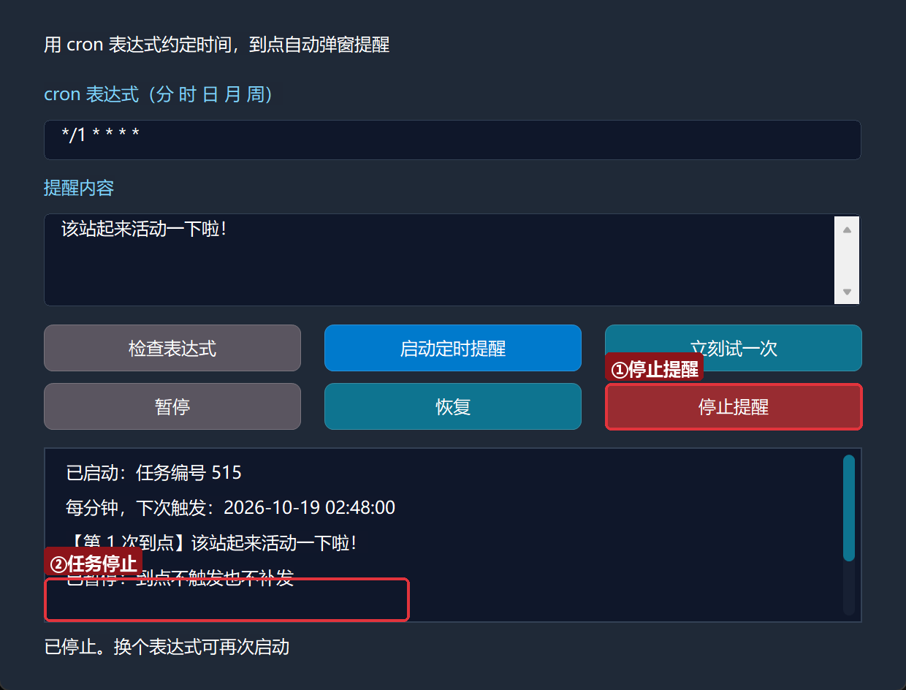

任务彻底停止；想再来一轮，换个表达式重新启动即可。

## 7. cron 还能做什么（进阶速览）

本集用了 10 条命令，模块一共 29 条，还有三块进阶能力先混个脸熟：

- **crontab 表文件**：`cron_定时_表添加` / `cron_定时_表保存` / `cron_定时_表载入运行` 把任务持久化成表文件（默认在 `%APPDATA%\LingBuilder\cron\crontab.txt`），下次启动一键载入。
- **后台线程型任务**：`cron_定时_提交线程(表达式, &工作处理器, &完成处理器)` 到点先在后台线程干活、干完回 UI 线程汇报——和第 4 集的线程纪律一样：工作处理器禁碰控件。
- **开机自启 + MAILTO**：`cron_定时_开机自启(真)` 把本程序注册为开机自启的 cron 守护；命令型任务失败时还能经 `cron_定时_邮件配置` 发通知邮件（第 8 集的邮件模块正好接上）。

## 8. 常见问题急救表

| 症状 | 原因 | 解法 |
| --- | --- | --- |
| 编译报「不能把 整数型 赋值给 定时任务 变量」 | 给 `定时任务` 类型赋了 0 或其他整数 | 用 `cron_定时_取状态` 判状态，别用整数哨兵 |
| 「表达式非法：…当前是 1 段」 | cron 必须五段/六段，空格分开 | `分 时 日 月 周` 五段，如 `0 9 * * *` |
| 到点没反应 | 表达式写得太远（如 `0 9 * * *` 要等到早上 9 点） | 先 `cron_定时_立即触发` 验证，再等真实到点 |
| 暂停期间错过的到点没补 | cron 暂停语义就是「不补发」 | 需要必达的任务改用表文件 + 守护模式 |
| 处理器没触发 | `&处理器名` 与子程序名不一致 | 名字必须一字不差（第 3 集老坑） |
| 想要「每天 9 点」却写成 `9 * * * *` | 第二段才是小时，第一段是分钟 | `0 9 * * *`；写完用 表达式说明 校对 |

## 本集小结

- 时钟管**间隔**，cron 管**日历时间点**；「每天/每小时/工作日」类需求用 cron。
- 一行启动：`当前任务 = cron_定时_启动(表达式, &到点提醒)`；任务编号是 `定时任务` 类型，别拿整数赋值。
- 校验三件套：`校验表达式` → `取表达式错误`（中文原因）→ `表达式说明`（人话翻译）。
- 状态守卫用 `cron_定时_取状态`；演示用 `cron_定时_立即触发`，不用干等。
- 到点处理器在 UI 线程执行，可直接碰控件；窗口关闭任务自动停。

**下一集预告**：《邮件发送 mail》——给你的程序装上「发信能力」，学会 SMTP 配置与授权码，做一个一键发通知邮件的小工具，顺便把上一集 cron 的 MAILTO 通知补全。

[回系列总览](/guide/tutorials/jinjie)
