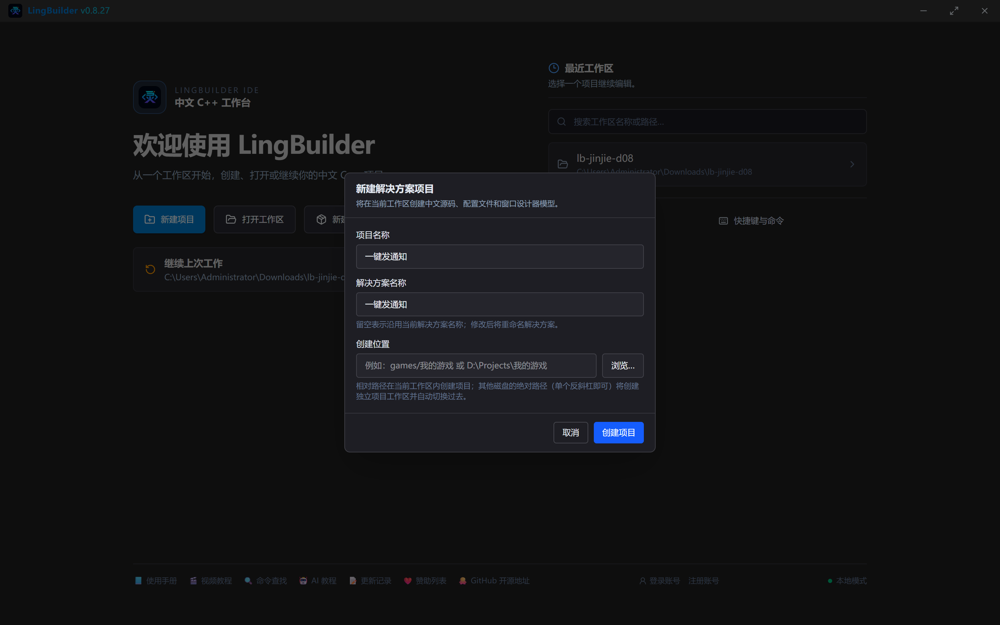
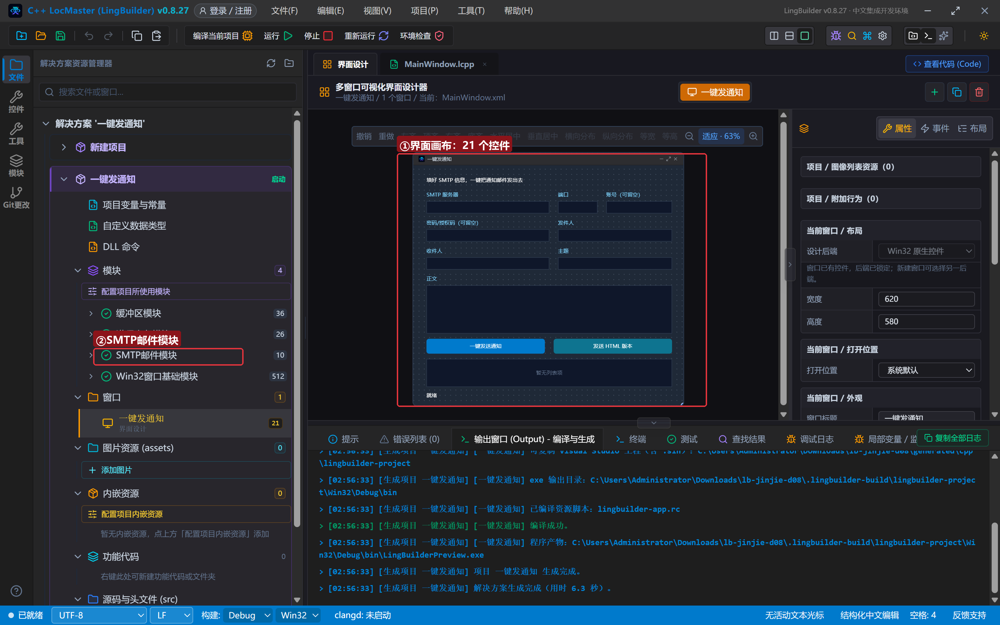
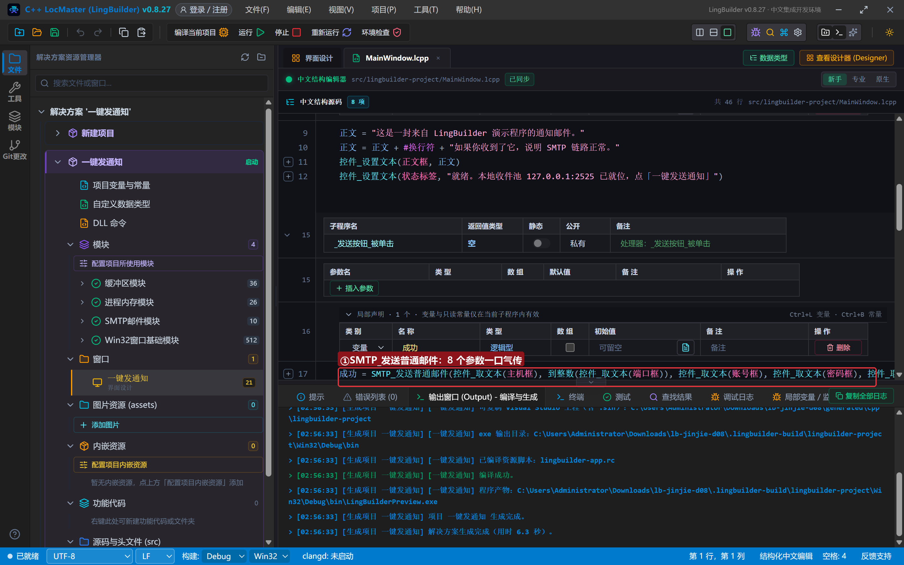
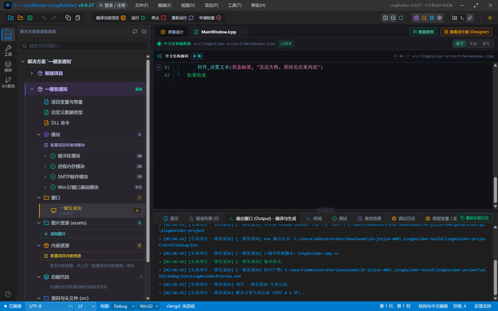
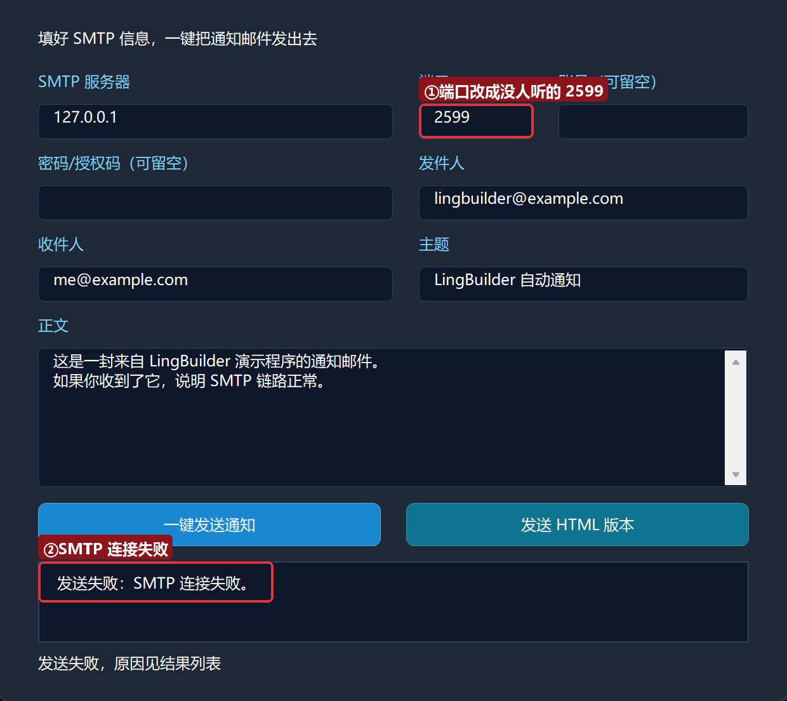
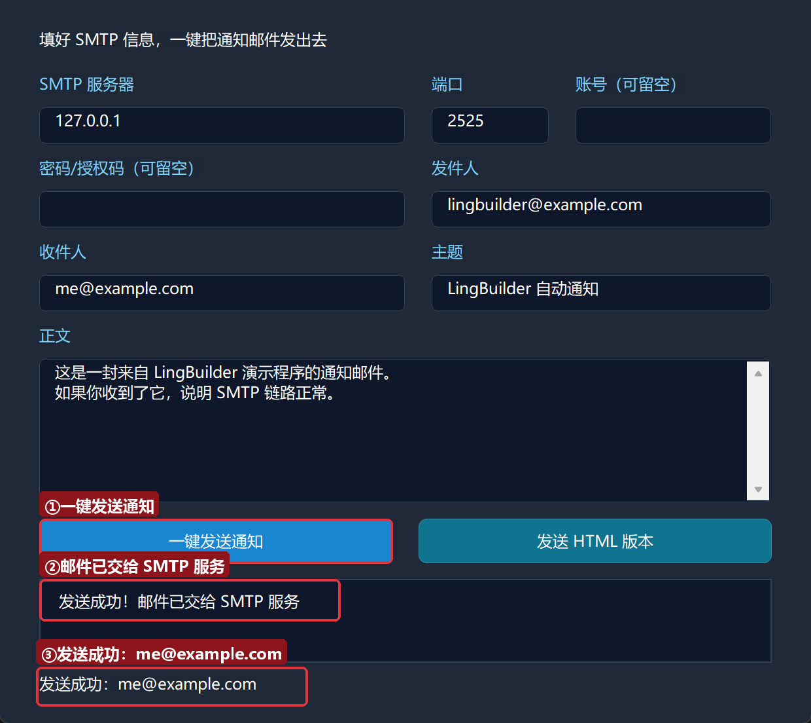
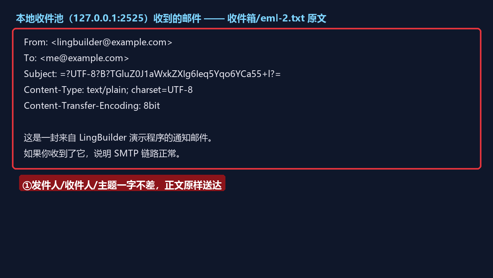
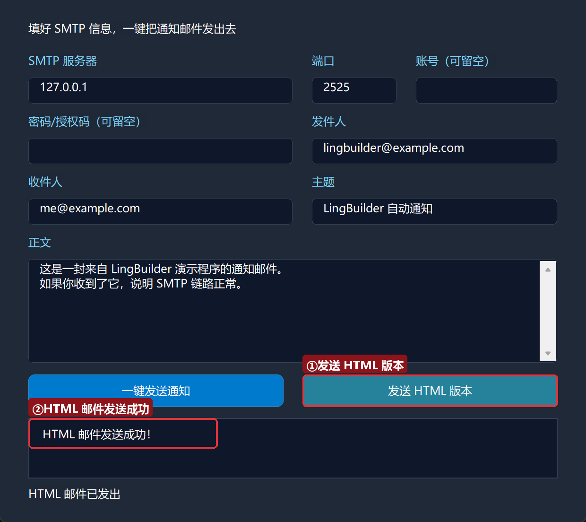

# 进阶实战 08 · 邮件发送 mail：一键发通知

> 《LingBuilder 进阶实战系列》第 8 集。程序跑完一批任务、服务器半夜出了状况——「发封邮件告诉我」是最通用的通知方式。本集用**SMTP邮件模块（lingbuilder.net.mail）**做一个**一键发通知**小工具：填好 SMTP 信息点一下，邮件发出去；我们还会搭一个**本地收件池**，不依赖任何真实邮箱就能完整演练收发闭环，并看清一封邮件在网络上到底长什么样。全程约 30 分钟。
>
> 前置要求：学完[零基础入门系列](/guide/tutorials/beginner)与进阶前 7 集（特别是第 7 集的 cron——它的 MAILTO 邮件通知正是靠本集的 SMTP 能力）。本集源码包见文末。

## 这一集你将学会

- `SMTP_发送普通邮件(主机, 端口, 用户名, 密码, 发件人, 收件人, 主题, 正文)`：8 个参数一口气发送
- `SMTP_发送HTML邮件`：正文换成富文本网页
- `SMTP_取错误()`：失败时拿到服务端原话或中文原因
- 一封邮件的网络真身：头部（From/To/Subject）+ 正文，主题的「编码字」写法
- 红线：授权码安全、本模块的 TLS 边界

## 1. 三十秒理解：程序怎么发邮件

邮件通过 **SMTP 协议**投递：程序连上服务器的 SMTP 端口，按顺序说「你好（EHLO）→ 谁发的（MAIL FROM）→ 发给谁（RCPT TO）→ 内容如下（DATA）」，服务器逐条应答 250 表示同意。LingBuilder 的 SMTP模块把这套对话封装成**一条命令**：

```lcpp
SMTP_发送普通邮件("smtp.example.com", 25, "账号", "密码", "发件人@x.com", "收件人@y.com", "主题", "正文")
```

返回逻辑型：真 = 已把邮件交给服务器，假 = 中途被拒（用 `SMTP_取错误()` 看原因）。本模块当前**只支持不加密 SMTP**（详见第 5 节红线）——公有邮箱（QQ/163 等）强制 TLS，本模块会明确失败；公司内网 SMTP、路由器/NAS 的邮件通知、本地调试服务才是它的主场。

**本集的演示方案**：自己起一个「本地收件池」——一个监听 127.0.0.1:2525 的小 SMTP 服务，收到的邮件存成文件。不用注册任何邮箱，就能完整走一遍真实 SMTP 对话，还能亲眼看到邮件的原文。

## 2. 新建项目与启用模块

新建窗口项目：名称 **一键发通知**，模板「Windows 界面设计」，创建位置留空：



启用「**SMTP邮件模块**」（4 条命令）。

## 3. 设计界面

| 控件 | 名称 | 显示内容 | 左距 | 顶距 | 宽度 | 高度 |
| --- | --- | --- | --- | --- | --- | --- |
| 标签 | 说明标签 | 填好 SMTP 信息，一键把通知邮件发出去 | 30 | 22 | 560 | 24 |
| 标签 | 主机标签 | SMTP 服务器 | 30 | 56 | 200 | 22 |
| 编辑框 | 主机框 | （空） | 30 | 82 | 280 | 28 |
| 标签 | 端口标签 | 端口 | 330 | 56 | 80 | 22 |
| 编辑框 | 端口框 | （空） | 330 | 82 | 90 | 28 |
| 标签 | 账号标签 | 账号（可留空） | 440 | 56 | 160 | 22 |
| 编辑框 | 账号框 | （空） | 440 | 82 | 150 | 28 |
| 标签 | 密码标签 | 密码/授权码（可留空） | 30 | 120 | 260 | 22 |
| 编辑框 | 密码框 | （空） | 30 | 146 | 280 | 28 |
| 标签 | 发件人标签 | 发件人 | 330 | 120 | 200 | 22 |
| 编辑框 | 发件人框 | （空） | 330 | 146 | 260 | 28 |
| 标签 | 收件人标签 | 收件人 | 30 | 184 | 200 | 22 |
| 编辑框 | 收件人框 | （空） | 30 | 210 | 280 | 28 |
| 标签 | 主题标签 | 主题 | 330 | 184 | 200 | 22 |
| 编辑框 | 主题框 | （空） | 330 | 210 | 260 | 28 |
| 标签 | 正文标签 | 正文 | 30 | 248 | 200 | 22 |
| 编辑框 | 正文框 | （空，勾选**多行**） | 30 | 274 | 560 | 110 |
| 按钮 | 发送按钮 | 一键发送通知 | 30 | 396 | 270 | 34 |
| 按钮 | HTML按钮 | 发送 HTML 版本 | 320 | 396 | 270 | 34 |
| 列表框 | 结果列表 | — | 30 | 442 | 560 | 64 |
| 标签 | 状态标签 | 就绪 | 30 | 514 | 560 | 22 |

窗口宽 620、高 580。绑 2 个按钮事件 + 窗口「创建完毕」。



## 4. 写代码

创建完毕把本地收件池的地址和一封示例邮件预填好；发送按钮一条命令完成投递：

```lcpp
事件 _MainWindow_创建完毕()
    控件_设置文本(主机框, "127.0.0.1")
    控件_设置文本(端口框, "2525")
    控件_设置文本(发件人框, "lingbuilder@example.com")
    控件_设置文本(收件人框, "me@example.com")
    控件_设置文本(主题框, "LingBuilder 自动通知")
    局部 文本型 正文
    正文 = "这是一封来自 LingBuilder 演示程序的通知邮件。"
    正文 = 正文 + #换行符 + "如果你收到了它，说明 SMTP 链路正常。"
    控件_设置文本(正文框, 正文)
    控件_设置文本(状态标签, "就绪。本地收件池 127.0.0.1:2525 已就位，点「一键发送通知」")
结束

事件 _发送按钮_被单击()
    局部 逻辑型 成功
    成功 = SMTP_发送普通邮件(控件_取文本(主机框), 到整数(控件_取文本(端口框)), 控件_取文本(账号框), 控件_取文本(密码框), 控件_取文本(发件人框), 控件_取文本(收件人框), 控件_取文本(主题框), 控件_取文本(正文框))
    控件_清空项目(结果列表)
    如果 (成功)
        控件_添加项目(结果列表, "发送成功！邮件已交给 SMTP 服务")
        控件_设置文本(状态标签, "发送成功：" + 控件_取文本(收件人框))
    否则
        控件_添加项目(结果列表, "发送失败：" + SMTP_取错误())
        控件_设置文本(状态标签, "发送失败，原因见结果列表")
    如果结束
结束
```



拆解：

- 8 个参数按顺序就是 SMTP 对话的剧本：连谁（主机+端口）、以谁登录（账号+密码，**都留空 = 匿名发送**，本地收件池就是这样）、谁发的、发给谁、说什么。
- 端口是整数型，编辑框读出来是文本，用内建 `到整数()` 转换（零基础 16 集的老朋友）。
- 「先声明、再赋值」依旧成立：`成功` 依赖整条发送命令的结果，必须先 `局部 逻辑型 成功` 再赋值。
- HTML 按钮同一套路，换成 `SMTP_发送HTML邮件`，正文参数传一段 HTML：

```lcpp
局部 文本型 页面
页面 = "<h3>LingBuilder 通知</h3>"
页面 = 页面 + "<p>这是 <b>HTML 版本</b> 的通知邮件。</p>"
页面 = 页面 + "<p style='color:#007ACC'>富文本样式也可以。</p>"
成功 = SMTP_发送HTML邮件(主机, 端口, 账号, 密码, 发件人, 收件人, 主题, 页面)
```

> 还有第 4 条命令 `SMTP_发送附件邮件`：多出「是否HTML」和「附件列表（路径数组）」两个参数，附件逐个按 Base64 打包，全部上传成功才返回真。需要发报表/日志文件时用它。

## 5. 编译与运行

点「编译当前项目」，错误列表 (0)、输出窗口「编译成功」：



### 5.1 先来一次真实失败：端口没人听

把端口改成 **2599**（没有服务在听），点「一键发送通知」：



「发送失败：SMTP 连接失败。」——连接阶段就被拒绝，中文原因直接可读。失败不可怕，`SMTP_取错误()` 把「哪一步、为什么」交代清楚，这才是可靠的通知代码。

### 5.2 改回 2525：真发真收

端口改回 **2525**，再点「一键发送通知」：



「发送成功！邮件已交给 SMTP 服务」。邮件去哪了？看本地收件池的收件箱：



这是收件池存下的邮件原文：From、To 一字不差；Subject 是一串 `=?UTF-8?B?...?=`——这叫**编码字**，中文主题按 UTF-8 + Base64 打包后的标准形态，收件软件会自动解回中文；正文两行原样送达。一封邮件在网上的真身就这么朴素。

### 5.3 HTML 版本

点「发送 HTML 版本」：



「HTML 邮件发送成功！」收件池里的 eml-3.txt 里 `Content-Type` 变成了 `text/html`，正文就是那段 HTML——用真正的邮箱客户端收这封信，就会看到加粗和颜色的富文本。

## 6. 红线：授权码与 TLS

- **授权码别硬编码**：公开的示例、教程、源码包里，密码/授权码一律留空或用占位符（本集演示全程空凭据连本地收件池，零秘密）。真实代码从配置文件或加密存储里读。
- **本模块不支持 TLS**：账号密码按 AUTH LOGIN 明文 Base64 传输，只适合**内网或本机回环**。QQ/163 等公有邮箱的 465/587 端口强制 TLS，本模块会明确失败（不会假装成功）——需要公有邮箱时，请在内网架一个中继（如收件池 + 转发脚本），或等待后续版本的 TLS 支持。
- **失败要可见**：永远把 `SMTP_取错误()` 的结果回显给用户，静默吞掉失败是通知系统的大忌。

## 7. 常见问题急救表

| 症状 | 原因 | 解法 |
| --- | --- | --- |
| 「SMTP 连接失败。」 | 主机/端口不通 | 先确认服务在听（本集收件池 2525）；内网 SMTP 找管理员要地址 |
| 收到「535 认证失败」类应答 | 账号或授权码错误 | 核对；QQ 邮箱要用「授权码」不是登录密码 |
| 需要 TLS 的服务器连不上 | 本模块不支持 STARTTLS/TLS | 换内网不加密服务或自建中继 |
| 发送成功但对方没收到 | 服务器只表示「收下了」，投递是异步的 | 查收件方垃圾箱；确认发件地址没被拦 |
| 端口填了却总连本机 | 端口参数忘了 `到整数()` | 端口参数是整数型，文本框读出后要转换 |
| 中文主题收下来是乱码 | 自拼邮件头没做编码 | 用模块命令发送（自动打成 `=?UTF-8?B?...?=` 编码字） |

## 本集小结

- 一条命令发邮件：`SMTP_发送普通邮件` 8 参数；HTML 用 `SMTP_发送HTML邮件`；附件用 `SMTP_发送附件邮件`；失败问 `SMTP_取错误()`。
- 本地收件池（127.0.0.1:2525）让「发邮件」不再依赖真实邮箱，还能看到邮件原文。
- 邮件主题走 `=?UTF-8?B?...?=` 编码字，中文安全。
- 红线：授权码不进代码库；本模块明文 SMTP 只用于内网/回环；失败必须回显。

**下一集预告**：《HTTP 服务器 http.server》——反过来，让你的程序**当服务器**：局域网里用浏览器访问你的文件分享小站，学会静态路由与 SSE 实时推送。

[回系列总览](/guide/tutorials/jinjie)
